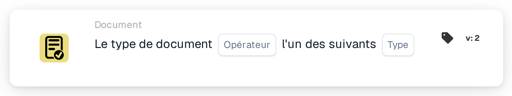

# Type de document Un de

<figure><figcaption>
Version 2
</figcaption></figure>

## **Objectif:**

Cette carte DocBits garantit la classification correcte d'un document en vérifiant s'il correspond à l'un des types de document spécifiés. Cela est utile dans les situations où un document pourrait appartenir à plus d'une catégorie, permettant une validation plus large et une gestion automatisée.

## **Fonctionnalité:**

* **Validation de plusieurs types de documents:** Cette carte permet aux utilisateurs de vérifier si un document correspond à l'un des types de document spécifiés, garantissant une catégorisation flexible pour des flux de travail documentaires plus complexes.
* **Opérateur:** Les utilisateurs peuvent définir des conditions pour valider le document par rapport à plusieurs types. Les opérateurs disponibles incluent:
  * **Est:** Confirme que le document correspond à l'un des types de document spécifiés.
  * **N'est pas:** Assure que le document ne correspond à aucun des types de document sélectionnés.
* **Types de documents:** Les utilisateurs peuvent choisir parmi plusieurs types de documents pris en charge, notamment:
  * **Facture :** Enregistrements financiers soumis pour paiement.
  * **Avoir:** Documents indiquant un ajustement augmentant le montant dû.
  * **Avoir:** Documents indiquant une réduction du montant dû.
  * **Bon de commande:** Documents détaillant la commande d'un acheteur.
  * **Confirmation de commande:** Documents confirmant qu'une commande a été acceptée.
  * **Avis d'expédition anticipée:** Documents informant d'une expédition imminente.

## **Utilisation:**

Cette carte est idéale pour les gestionnaires de documents et les administrateurs qui doivent s'assurer que les documents sont classés dans l'un des plusieurs types. Elle est particulièrement utile pour les flux de travail documentaires où un document peut être classé dans plusieurs catégories, améliorant l'automatisation et la précision de la classification.

## **Scénario d'exemple:**

* Un utilisateur télécharge un document qui pourrait être soit une "Facture" soit un "Avoir." En utilisant l'opérateur "Est", la carte confirme que le document correspond à l'un des types sélectionnés, permettant au système d'appliquer les règles et la catégorisation appropriées.

En utilisant la carte "Validation de plusieurs types de documents", les organisations peuvent améliorer la flexibilité du flux de travail, automatiser la catégorisation et garantir que les documents sont correctement traités même lorsque plusieurs types sont applicables.
