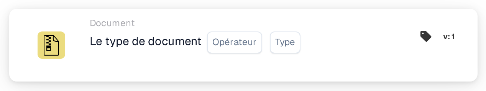
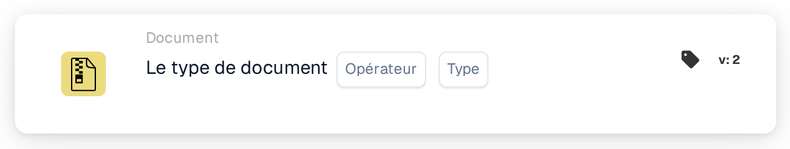

# Opération de Type de Document

<figure><figcaption>
Version 1
</figcaption></figure>

<figure><figcaption>
Version 2
</figcaption></figure>

## **Objectif:**

Cette carte de flux de travail est spécifiquement conçue pour effectuer des opérations prédéfinies sur des documents catégorisés par type. Elle rationalise la gestion de diverses formes de documents au sein d'un système ERP, garantissant que chaque type est traité selon ses exigences uniques et les politiques organisationnelles.

## **Fonctionnalités:**

* **Validation du Type de Document**: Cette carte vérifie si un document correspond à un type particulier, permettant aux utilisateurs de confirmer sa catégorisation.
* **Opérateur**: Les utilisateurs peuvent définir des conditions pour déterminer le type de document. Les opérateurs disponibles incluent:
  * **Est**: Confirme que le document correspond au type de document spécifié.
  * **N'est pas**: Veille à ce que le document ne corresponde pas au type de document spécifié.
* **Types de Document**: Les types de documents pris en charge comprennent:
  * **Facture**
  * **Note de Débit**
  * **Note de Crédit**
  * **Bon de Commande**
  * **Confirmation de Commande**
  * **Avis d'Expédition Avancée**

## **Utilisation**:

Cette carte est utile pour les gestionnaires de documents et les administrateurs qui doivent s'assurer que les documents sont correctement classés pour un traitement rationalisé. La validation des types de documents améliore l'automatisation des flux de travail, permet des actions spécifiques aux documents et maintient les enregistrements organisés.

## **Scénario Exemple**:

* Un utilisateur télécharge un document étiqueté comme "Note de Débit." En utilisant l'opérateur "Est", la carte confirme que le type de document est effectivement "Note de Débit", permettant au système d'appliquer des règles de traitement pertinentes et de le catégoriser de manière appropriée.

En déployant la carte "Type de Document", les organisations peuvent automatiser la classification des documents, garantir la cohérence dans la gestion des documents et améliorer l'efficacité des flux de travail de gestion des documents.
