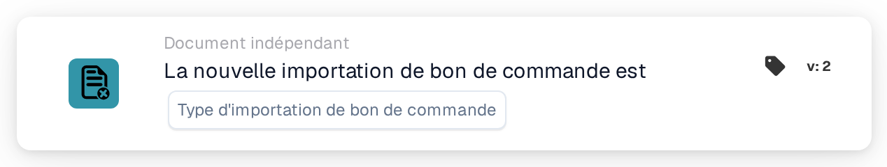

# Importation de bon de commande

<figure><figcaption>
Version 2
</figcaption></figure>

## Objectif :

Cette carte de workflow démarre un workflow (déclencheur) lorsqu'un bon de commande est importé dans DocBits. Elle peut réagir aux bons de commande nouvellement créés, aux mises à jour de bons de commande existants, ou aux deux. Le workflow s'exécute sans document ; il peut donc servir à informer des personnes ou à appeler d'autres systèmes chaque fois que des données de bon de commande arrivent.

## Composants de la carte :

1. **Type d'importation de bon de commande**
   * **Description :** définit quel type d'importation démarre le workflow.
   * **Options :**
     * **un nouveau bon de commande.** Le bon de commande n'existait pas auparavant et a été créé par l'importation.
     * **une mise à jour d'un bon de commande existant.** Un bon de commande existant a été mis à jour par l'importation.

     Les deux options peuvent être sélectionnées.

## Fonctionnalité :

* **Démarrage du workflow :** lorsqu'un bon de commande provenant du système ERP est traité par l'importation des bons de commande, le système enregistre s'il s'agissait d'un nouveau bon de commande ou d'une mise à jour. Il démarre ensuite tous les workflows indépendants des documents activés de l'organisation (à l'exception des workflows webhook et planifiés) et leur transmet cette information, avec l'ID et le numéro du bon de commande. Cela ne se produit que si le module workflow est actif pour l'organisation et qu'il existe des workflows actifs. Un bon de commande ignoré parce que la version reçue n'est pas plus récente que la version enregistrée ne démarre aucun workflow.
* **Évaluation de la condition :** la carte vérifie si le type d'importation transmis au workflow fait partie des types sélectionnés sur la carte.
* **Exécution de l'action :**
  * **Condition vraie :**\
    Si le type d'importation correspond à une option sélectionnée, le workflow se poursuit avec les cartes suivantes.
  * **Condition fausse :**\
    Si le type d'importation ne correspond pas, ou si le workflow a été démarré par un autre événement indépendant des documents (par exemple un changement de statut d'un fournisseur), la condition de la carte n'est pas remplie et les étapes suivantes ne sont pas exécutées.
* **Données manquantes :** si aucun type d'importation n'est sélectionné sur la carte, la carte n'évalue pas la condition. Elle signale la saisie manquante (ou une erreur) dans le journal du workflow, et les étapes suivantes ne sont pas exécutées.

## Mise en place et configuration :

* La carte peut être ajoutée depuis le groupe **WHEN**, catégorie **Document indépendant**. Ensuite, un ou les deux types d'importation sont sélectionnés, les autres conditions et actions sont ajoutées, puis le workflow est enregistré et activé.

## Conclusion :

La carte « Purchase order import » permet aux workflows de réagir dès que des données de bon de commande sont créées ou mises à jour, sans attendre de document. Les processus de suivi restent ainsi synchronisés avec les bons de commande provenant du système ERP.
