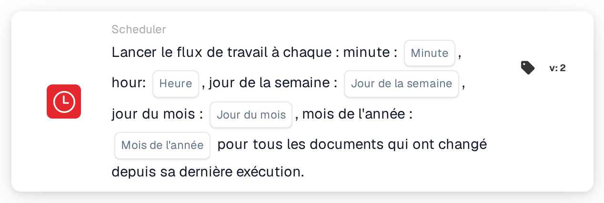

# Démarrage planifié du workflow

<figure><figcaption>
Version 2
</figcaption></figure>

## Objectif :

Cette carte de workflow démarre un workflow (déclencheur) selon une planification horaire, à la manière d'une tâche cron. À chaque horaire planifié, le workflow est exécuté pour tous les documents modifiés depuis l'exécution précédente. Elle est utile pour des traitements réguliers tels que des contrôles nocturnes, des rappels périodiques ou des relances qui ne devraient pas s'exécuter immédiatement à chaque modification d'un document.

## Composants de la carte :

1. **Minute**
   * **Description :** la ou les minutes de l'heure auxquelles le workflow démarre.
   * **Détail :** valeur au format cron, par exemple `0`, `30`, `0,30` ou `*/15`. Un champ vide signifie chaque minute (`*`).
2. **Heure**
   * **Description :** la ou les heures de la journée auxquelles le workflow démarre.
   * **Détail :** valeur au format cron, par exemple `6` ou `8-18`. Un champ vide signifie chaque heure (`*`).
3. **Jour de la semaine**
   * **Description :** le ou les jours de la semaine auxquels le workflow démarre.
   * **Détail :** valeur au format cron, par exemple `1-5`. Un champ vide signifie chaque jour de la semaine (`*`).
4. **Jour du mois**
   * **Description :** le ou les jours du mois auxquels le workflow démarre.
   * **Détail :** valeur au format cron, par exemple `1` ou `1,15`. Un champ vide signifie chaque jour (`*`).
5. **Mois de l'année**
   * **Description :** le ou les mois au cours desquels le workflow démarre.
   * **Détail :** valeur au format cron, par exemple `1` ou `1-6`. Un champ vide signifie chaque mois (`*`).

## Fonctionnalité :

* **Fuseau horaire :** toutes les heures sont exprimées en UTC, le fuseau horaire des serveurs DocBits. Par exemple, 6:00 UTC correspond à 8:00 à l'heure d'été d'Europe centrale.
* **Démarrage du workflow :** lorsque le workflow est enregistré et activé, une entrée de planification est créée à partir des cinq champs. Si le workflow est désactivé ou supprimé, l'entrée de planification est supprimée. À chaque horaire planifié, le système :
  * recherche les documents de l'organisation qui ont été modifiés, enregistrés ou qui ont changé de statut depuis la dernière exécution du workflow,
  * démarre le workflow séparément pour chacun de ces documents en arrière-plan, et
  * mémorise l'heure de cette exécution comme point de départ de la suivante.

  Les documents qui ont atteint la limite d'exécutions du workflow sont ignorés. Si le workflow est désactivé pendant le traitement des documents, les documents restants ne sont pas traités.
* **Évaluation de la condition :** la carte vérifie si le workflow a été démarré par la planification.
* **Exécution de l'action :**
  * **Condition vraie :**\
    Lorsque le workflow est démarré par la planification, la condition de la carte est remplie et le workflow se poursuit avec les cartes suivantes.
  * **Condition fausse :**\
    Lorsque le workflow est démarré d'une autre manière, par exemple par un déclencheur de document, un webhook ou une modification de variable, la condition de la carte n'est pas remplie et les étapes suivantes ne sont pas exécutées.
* **Une seule planification par workflow :** dans l'Advanced Workflow Builder, si un workflow contient plusieurs cartes de planification, seule la première est utilisée pour la planification.
* **Enregistrement :** si l'entrée de planification ne peut pas être mise à jour lors de l'enregistrement, le workflow est tout de même enregistré et un avertissement s'affiche. Un nouvel enregistrement du workflow relance la mise à jour.

## Mise en place et configuration :

* La carte peut être ajoutée depuis le groupe **WHEN**, catégorie **Scheduler**. Les champs horaires sont ensuite renseignés ; les champs laissés vides signifient « chaque ». Par exemple, la minute `0`, l'heure `6`, le jour de la semaine `1-5` et les autres champs vides démarrent le workflow à 6:00 UTC les jours de semaine. Ensuite, les autres conditions et actions sont ajoutées, puis le workflow est enregistré et activé.

## Conclusion :

La carte « Scheduled workflow start » exécute les workflows à heures fixes plutôt qu'à chaque événement. Comme chaque exécution ne prend en compte que les documents modifiés depuis l'exécution précédente, les traitements réguliers restent concentrés sur le nouveau travail.
