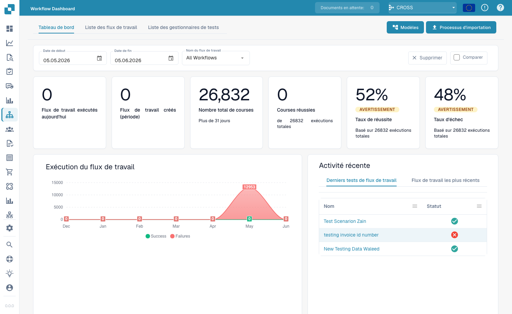
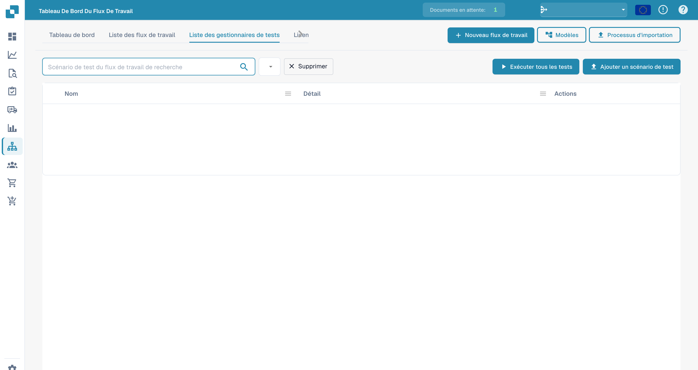

# Dashboard

Le **Tableau de bord du flux de travail** est la page d'accueil de la zone des workflows. Il montre les performances de vos workflows — totaux d'exécutions, taux de réussite et d'échec, graphique des exécutions dans le temps et activité récente — et vous donne accès à la liste des workflows, au Test Manager et au Card SDK.

<figure><figcaption>
Le Workflow Dashboard — totaux d'exécutions, taux de réussite/échec et activité récente pour chaque workflow.
</figcaption></figure>

## Onglets

- **Tableau de bord** — indicateurs d'exécution et activité récente (affichés ci-dessus).
- **Liste des flux de travail** — chaque workflow avec son type, son ordre d'exécution et son déclencheur. Créez-en un nouveau avec **Nouveau flux de travail**.
- **Liste des gestionnaires de tests** — scénarios de test qui valident vos workflows ; exécutez-les avec **Exécuter tous les tests**.
- **Licence** — informations sur la licence des workflows.
- **Kit de développement logiciel pour cartes** — créez et téléversez des cartes de workflow personnalisées (voir [Card SDK](card-sdk.md)).

La barre d'outils propose également **Modèles**, qui ouvre la bibliothèque [Workflow Templates](standard-workflow-builder.md#workflow-templates), et **Processus d'importation**, qui importe un workflow à partir d'un fichier JSON.

Le **Test Manager** vous permet d'enregistrer des scénarios de test par workflow et de les exécuter ensemble, afin de confirmer que vos workflows se comportent toujours correctement après des modifications :

<figure><figcaption>
Liste des scénarios de test de workflows.
</figcaption></figure>

## Étapes suivantes

- Créez une automatisation linéaire avec le builder **Standard Workflow**.
- Créez un flux avec branches grâce au builder **Flux de travail avancé**.
