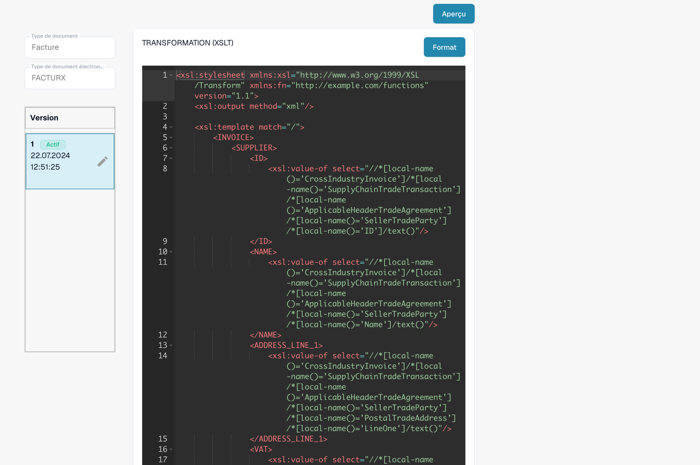

# Configurer DocBits avec Claude ou Codex

Décrivez le résultat souhaité, laissez l’assistant lire la configuration, examinez sa proposition, puis appliquez la modification convenue. DocBits MCP fournit ces outils dans Claude et Codex avec les autorisations du compte DocBits connecté. Les modifications de configuration nécessitent les droits d’administration correspondants.

Ce guide décrit une procédure. Il ne constitue pas la preuve d’une correction déjà réalisée chez un client ni d’un test d’export réussi.

## 1. Se connecter à la bonne organisation

Choisissez région et environnement dans le [guide des points d’accès et de connexion](setup-and-configuration.md). Les commandes utilisent le **sandbox UE** ; remplacez l’URL si votre organisation de test utilise un autre point d’accès. Exécutez-les sur la machine de l’assistant, connectez-vous et autorisez l’accès à DocBits dans le navigateur.



```bash
claude mcp add --transport http docbits https://eu.sandbox.api.docbits.com/v3/mcp
claude mcp login docbits
```


```bash
codex mcp add docbits --url https://eu.sandbox.api.docbits.com/v3/mcp
codex mcp login docbits
```



Dans l’application Codex, utilisez les paramètres MCP ou la configuration partagée avec la CLI sur la même machine. Dans Claude Desktop, utilisez un connecteur distant personnalisé si votre offre le permet, avec le même point d’accès HTTP. Ouvrez une nouvelle conversation si les outils n’apparaissent pas. Instructions actuelles : [Codex MCP](https://developers.openai.com/codex/mcp) et [Claude MCP](https://code.claude.com/docs/en/mcp).

```text
Lecture seule. Vérifie l’environnement et l’organisation DocBits connectés
avec get_api_info et get_current_user. Liste les outils de configuration.
Montre l’ID d’organisation et l’hôte API, sans jetons ni extraits de clés.
Ne modifie aucun paramètre et ne traite aucun document.
```

Si l’organisation n’est pas encore résolue, lisez la configuration concernée et vérifiez le `org_id` renvoyé. Arrêtez-vous si ce n’est pas l’organisation prévue. Les noms peuvent porter un préfixe client/serveur ; utilisez les outils et schémas d’arguments annoncés par votre connexion.

## 2. Modifier un paramètre simple

```text
Trouve avec find_setting le paramètre d’extraction des codes QR de cette
organisation de test. Affiche son setting_key exact et sa valeur actuelle.
S’il y a plusieurs résultats, demande lequel je souhaite. Si apply_setting
prend ce paramètre en charge, prépare un aperçu de son activation.
Affiche current_value et proposed_value ; attends ma confirmation avant
d’appeler confirm_setting_change.
```

`apply_setting` crée uniquement un aperçu. Après confirmation de cette proposition précise, `confirm_setting_change(preview_id)` enregistre la modification. Relisez la valeur et conservez le `undo_id` : `undo_setting_change` permet de l’annuler dans le délai renvoyé. L’aperçu expire normalement après 5 minutes et l’annulation après 15 minutes. Si la valeur a changé ou si l’aperçu a expiré, créez et examinez un nouvel aperçu.

Pour les modifications structurées prises en charge : `preview_settings_action` → `confirm_settings_action` → `undo_settings_action`. Lisez d’abord les types d’actions proposés. Si aucune action d’écriture n’est disponible, demandez le `app_path` et effectuez le changement dans DocBits. N’inventez pas une clé de préférence et ne la remplacez pas par un appel général à `set_preference`.

## 3. Examiner un avoir enregistré comme Invoice

Une transformation Custom peut toujours produire `<INVOICE_TYPE>Invoice</INVOICE_TYPE>`, même si le XML d’origine contient un code d’avoir. C’est le scénario du [guide de diagnostic avec vidéo de la véritable interface DocBits](../../administration-and-setup/settings/global-settings/document-types/edi/credit-note-recognized-as-invoice.md).

```text
Lecture seule. Pour le XML d’origine et l’ID de document fournis, identifie
la famille eDoc, la syntaxe, la version/le profil et le code de type d’origine.
Liste les attributs Custom et Default. Lis les TRANSFORMATION et
EXTRACTION_PATHS effectifs et par défaut avec get_edoc_attribute_source.
Note attribute_id, active_version et active_value_id, puis lis l’historique.
Suis TypeCode -> XML transformé -> invoice_type -> champ enregistré,
aperçu d’export et scripts ultérieurs. Présente les preuves et incertitudes.
N’active, ne supprime, ne redémarre, n’approuve et n’exporte rien.
```

Utilisez le **libellé exact du format détecté**, sans deviner la version ZUGFeRD ou Factur-X. Le `doc_type_key` technique peut rester `INVOICE` ; la valeur métier étudiée est `invoice_type`.

| Lecture | Outil MCP |
| --- | --- |
| Attributs Custom et Default | `list_edoc_custom_attributes` |
| Source effective ou par défaut et IDs actifs | `get_edoc_attribute_source`, avec `source: "effective"` ou `"default"` |
| Historique et brouillons | `list_edoc_attribute_versions`, avec `include_values: true` si nécessaire |
| Champs enregistrés, journaux, aperçu d’export | `get_extracted_fields`, `get_document_logs`, `get_export_preview` |

La version active aujourd’hui ne prouve pas celle qui a traité un ancien document. Si les journaux ne le déterminent pas, conservez cette incertitude. Un aperçu PDF ne prouve ni le type enregistré ni les montants exportés.

<figure><figcaption><p>Exemple de développement en lecture seule : éditeur de source et de versions DocBits. Lisez votre propre source effective et valeur active via MCP ; cette image ne montre pas de modification enregistrée.</p></figcaption></figure>

## 4. Prévisualiser la correction minimale

```text
Propose la modification minimale de notre transformation Custom existante
pour que 381 produise Credit Note. Préserve les autres correspondances et
les codes d’avoir déjà pris en charge. Ne classe pas 383 ou 384 en Credit Note.
Montre le diff. Prévisualise le candidat sur nos documents de test sans
l’enregistrer. Montre INVOICE_TYPE transformé et les montants concernés,
et précise les vérifications encore manquantes.
```

Pour un **attribut existant appartenant à l’organisation**, appelez `preview_edoc_custom_xslt` avec le candidat complet :

```json
{
  "attribute_id": "<custom_attribute_id_from_response>",
  "candidate_value": "<complete_candidate_xslt>",
  "doc_id": "<test_document_id_in_this_org>"
}
```

Remplacez tous les paramètres fictifs par les valeurs de vos réponses ; le XSLT/JSON doit être complet et correctement échappé dans une chaîne JSON. L’outil utilise un document existant de la même organisation. Il renvoie du **XML** pour `TRANSFORMATION`, des champs/tableaux pour `EXTRACTION_PATHS` et un **PDF** pour `PREVIEW`, sans enregistrer le candidat. Pour comparer la transformation par défaut, prévisualisez sa source comme autre candidat avec le même attribut Custom et le même document.

`compare_edoc_extraction` compare les **EXTRACTION_PATHS** et nécessite un attribut personnalisé de chemins d’extraction. Il ne compare pas deux transformations. Ne créez pas une personnalisation inutile pour utiliser cet outil.

Sans attribut Custom, arrêtez-vous avant d’en créer un en production : `create_edoc_custom_attribute` crée une première version **immédiatement active**, sans option de brouillon seul. Préparez cette personnalisation dans une organisation de test ou utilisez le parcours de création/aperçu pris en charge par l’éditeur DocBits. Ne tentez pas de modifier globalement les règles partagées par défaut.

## 5. Enregistrer un brouillon, puis l’activer explicitement

Après examen du diff et de la sortie, relisez la source active. Si elle a changé, comparez à nouveau. Pour un attribut Custom existant, utilisez `update_edoc_custom_attribute` :

```json
{
  "attribute_id": "<custom_attribute_id_from_response>",
  "new_value": "<complete_reviewed_xslt>",
  "activate": false
}
```

Passez toujours `activate: false` à cette étape : la valeur par défaut de l’outil est `true`. Notez l’ID de valeur de version renvoyé et vérifiez avec `list_edoc_attribute_versions` que l’ancienne version reste active. Un brouillon enregistré n’affecte pas le traitement normal.

Après les tests, l’administrateur confirme l’organisation, l’attribut, le diff et la version précis. Activez avec `activate_edoc_attribute_version` :

```json
{
  "attribute_id": "<custom_attribute_id_from_response>",
  "draft_id": "<value_id_of_reviewed_version>"
}
```

`draft_id` est l’**ID de valeur de la version**, pas son numéro ni l’ID d’attribut. Relisez source effective et historique pour confirmer que cette valeur est active. eDocs utilise ces outils directement, sans le parcours générique de paramètres avec `preview_id`. Lisez les IDs dans l’environnement cible ; ceux du sandbox ne sont pas réutilisables en production.

## 6. Vérifier classification, montants et export

`test_electronic_document` teste à blanc la configuration **actuellement active**, sans enregistrer de document. Il ne permet pas de sélectionner un candidat ou brouillon. Avec MCP HTTP distant, envoyez le XML d’origine dans `file_content_base64` avec `file_name` ; le serveur ne peut pas lire un `file_path` local de votre machine. Pour tester tout le traitement du candidat, activez-le d’abord explicitement dans l’organisation de test. L’aperçu XSLT seul ne teste ni les scripts ultérieurs ni l’export.

| Code d’origine | Vérification attendue |
| --- | --- |
| 380 | Invoice reste Invoice |
| 381 | L’avoir devient Credit Note |
| 261 | Préserver le comportement d’avoir si le format/mapping le prend en charge |
| 383 | Une note de débit ne devient pas Credit Note parce qu’elle ajuste une facture |
| 384 | Une facture corrigée ne devient pas Credit Note parce qu’elle corrige une facture |

Vérifiez aussi les champs personnalisés, lignes, totaux et le paramètre de signe négatif. Traitez un **nouveau document de test** dans une organisation isolée où les exports automatiques sont maîtrisés. Comparez `invoice_type` enregistré, tableau de bord et `get_export_preview`. Un export réel vers le système cible nécessite un test convenu séparément ; ni le test à blanc ni l’aperçu ne prouvent la livraison à l’ERP.

`validate_all_edocs` teste à blanc les fichiers de test disponibles sur le serveur ; `verify_electronic_documents` **téléverse et traite** les fichiers de test. Ils ne remplacent pas vos documents représentatifs et contrôles en aval. Si les outils/fichiers manquent, testez des exemples fournis.

## 7. Revenir à une version et traiter séparément les anciens documents

Pour revenir en arrière, appelez `activate_edoc_attribute_version` avec l’ancien `active_value_id` comme `draft_id`, puis vérifiez la source effective. Ne supprimez pas toute la personnalisation pour corriger un champ : les autres correspondances seraient perdues et les règles par défaut s’appliqueraient.

Ne redémarrez pas en masse les anciens documents. Un redémarrage peut supprimer les données extraites et journaux d’export, puis répéter approbations ou exports. Examinez pour chaque document le statut d’export, les approbations et corrections manuelles avant de décider.

Pour les autres paramètres, commencez par `find_setting` ou `run_config_checks` et demandez l’action prise en charge ou le chemin dans l’interface. Conservez proposition avant/après, résultats de test, IDs de valeurs actives et référence de retour arrière dans le dossier de modification.
