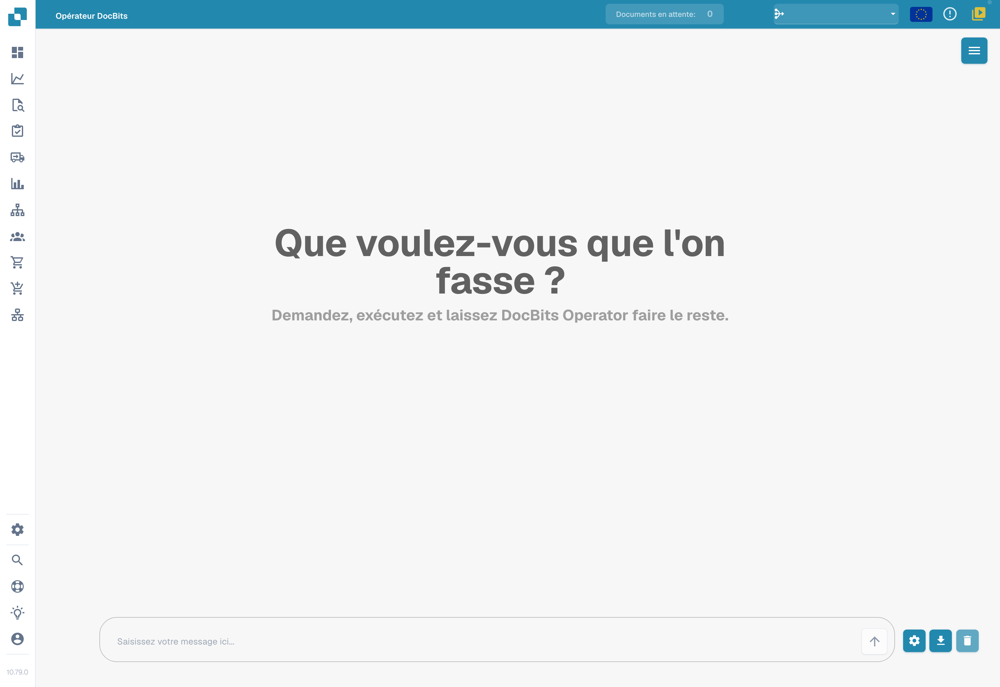
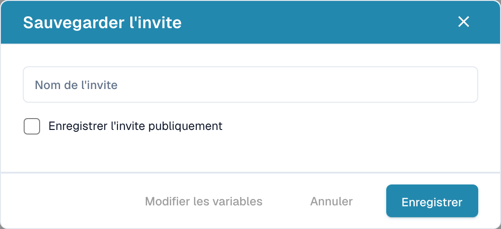

# Opérateur DocBits

Opérateur DocBits permet de préparer des instructions pour des actions dans le navigateur. Le résultat dépend de l’instruction, de l’application cible, des données et des autorisations disponibles. Une instruction enregistrée n’est pas une preuve de son exécution réussie.

## Accès et contexte

Vérifiez le module correspondant dans **Paramètres → Module → Intégration de documents** lorsque votre organisation utilise cette fonction. La vue montre les réglages existants, sans modification.

<figure><figcaption>
Contexte des modules d’intégration de documents dans leur état existant. Aucun interrupteur n’a été modifié.
</figcaption></figure>

Ouvrez **Opérateur DocBits** depuis la navigation disponible dans votre environnement.

<figure><figcaption>
Écran initial réel d’Opérateur DocBits avec son champ d’instruction vide. Aucune instruction n’a été envoyée ni exécutée.
</figcaption></figure>

## Préparer une instruction

Décrivez l’objectif et les étapes attendues de manière précise. Identifiez l’application et les données nécessaires. Des variables telles que `{invoice_number}` ou `{url}` peuvent servir de paramètres lorsque votre configuration les prend en charge ; ce sont des exemples de noms, pas des valeurs universelles.

Commencez avec un cas de test autorisé et vérifiez les valeurs des variables avant de lancer une action. N’intégrez pas de mots de passe ou de données privées dans un exemple partagé.

## Enregistrer une invite

L’action de sauvegarde ouvre **Sauvegarder l’invite**. Renseignez **Nom de l’invite** et examinez l’option **Enregistrer l’invite publiquement** avant de confirmer **Enregistrer**. Le périmètre de partage et les droits doivent correspondre à votre organisation ; cette page ne garantit pas un partage entre tous les comptes ou environnements.

<figure><figcaption>
Formulaire initial Sauvegarder l’invite, sans contenu enregistré. Invite désigne ici une instruction ou prompt. Aucune instruction ni préférence de partage n’a été sauvegardée.
</figcaption></figure>

Annuler ou la croix ferme le formulaire sans enregistrer. Ici, invite désigne une instruction (prompt), pas un courriel d’invitation. Aucun nom, aucune variable ni option de partage n’a été enregistré pendant cette prise de vue.

**Modifier les variables** donne accès à leur configuration lorsque cette action est disponible. Vérifiez les valeurs stockées et leur portée ; leur durée de vie ne doit pas être déduite de ce formulaire vide.

## Exécuter et contrôler

Avant de lancer une instruction, vérifiez ses paramètres et ses effets attendus. Suivez l’exécution et contrôlez le résultat dans l’application cible. Ne confondez pas une instruction envoyée, une étape commencée et une opération achevée.

Les commandes de reprise et d’arrêt servent au contrôle d’une exécution lorsque ces commandes sont proposées. Les icônes suivantes sont des repères visuels ; elles ne montrent aucune exécution réalisée pendant cette documentation.

<figure><figcaption>
Exemple des icônes de reprise et d’arrêt.
</figcaption></figure>

La commande d’agrandissement ouvre une vue détaillée lorsqu’elle est disponible.

<figure><figcaption>
Icône d’agrandissement de la vue détaillée.
</figcaption></figure>

Cette page montre uniquement l’écran initial, le formulaire de sauvegarde vide et des icônes sans texte. Aucune instruction n’a été envoyée, aucun modèle d’invite n’a été sauvegardé et aucune opération externe n’a été exécutée pendant la prise de vue.
