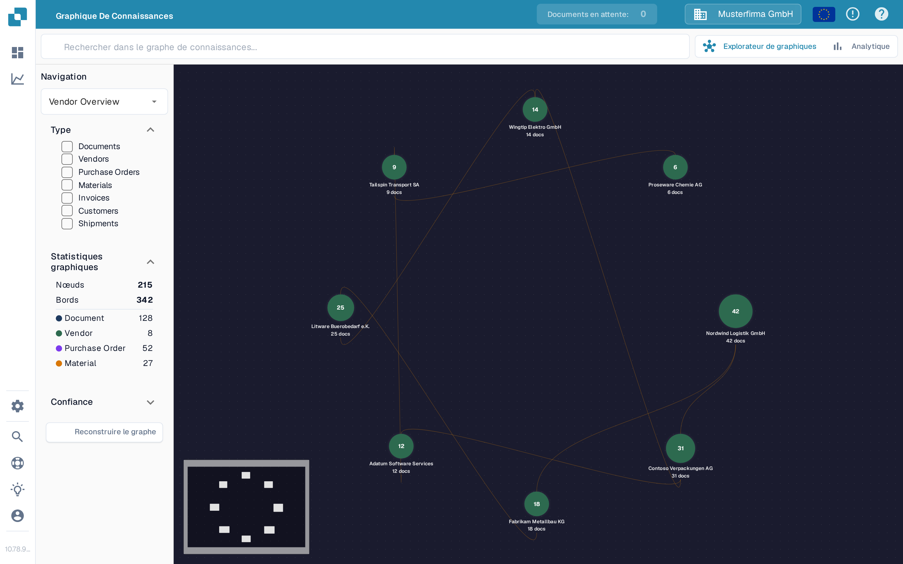

# Knowledge Graph Explorer (Graphe de connaissances)

L'Explorateur de graphe de connaissances vous aide à visualiser les connexions entre les fournisseurs, les documents, les commandes d'achat et d'autres enregistrements. Utilisez-le lorsque vous souhaitez suivre une relation ou vérifier combien d'éléments connectés sont disponibles. L'illustration ci-dessous présente un graphe peuplé avec des données de démonstration.

<figure><figcaption>
Illustration avec des données de démonstration : le graphe présenté contient 215 nœuds et 342 liens.
</figcaption></figure>

## Démarrer

1. Ouvrez **l'Explorateur de graphe de connaissances** dans DocBits. Vérifiez que l'organisation affichée en haut est celle que vous souhaitez inspecter.
2. Si le centre affiche **Search for a node or compute the graph to get started**, choisissez **Reconstruire le graphe** et attendez la fin du message de progression. Cela prépare les données du graphe ; cela peut prendre du temps. Si l'organisation n'a pas encore de relations correspondantes, **Nœuds** et **Bords** peuvent rester à zéro.
3. Saisissez un nom ou un autre terme de recherche dans **Search knowledge graph** et appuyez sur Entrée ou sélectionnez l'icône de recherche. Lorsque plusieurs résultats apparaissent, choisissez celui dont vous avez besoin. Un résultat unique ouvre directement son graphe.
4. Sélectionnez un nœud pour voir ses détails. Fermez le panneau de détails avec **X** lorsque vous souhaitez revenir au graphe.

## Choisir ce que vous voyez

| Contrôle | Ce qu'il fait |
| --- | --- |
| **Navigation** | Basculez entre **Vendor Overview** (fournisseurs connectés), **Vendor Intelligence** (un tableau de fournisseurs), **Document Journey** (étapes et variantes du traitement des documents) et **Anomalies** (relations inhabituelles). |
| **Type** | Sélectionnez les types d'éléments sur lesquels vous concentrer, tels que Documents, Vendors, Purchase Orders ou Invoices. Les types sélectionnés limitent également les résultats de recherche. |
| **Statistiques graphiques** | Affiche le nombre de nœuds (éléments) et de bords (connexions) actuellement disponibles. Dépliez ou repliez cette section selon vos besoins. |
| **Confiance** | Ouvrez cette section pour définir la confiance minimale des relations lors du développement d'un nœud. Une valeur plus élevée restreint les connexions affichées. |
| **Reconstruire le graphe** | Lance un nouveau calcul du graphe. Attendez la fin de sa progression avant de rechercher à nouveau. |
| **Explorateur de graphiques / Analytique** | Basculez entre le graphe interactif et les graphiques de synthèse. Analytique affiche des comptages et des graphiques lorsque des données de graphe existent ; un graphe vide laisse également Analytique vide. |

Si vous devez résoudre une différence entre une facture et sa commande, continuez avec l'[Écran de correspondance des bons de commande](../end-user-and-partner-section/end-user-section/purchase-order-matching/README.md). Pour des indicateurs plus larges en dehors du graphe, consultez le [Tableau de bord analytique](../administration-and-setup/analytics-dashboard.md).
