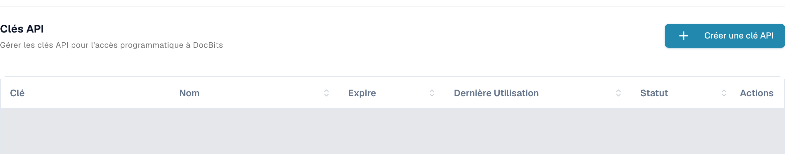
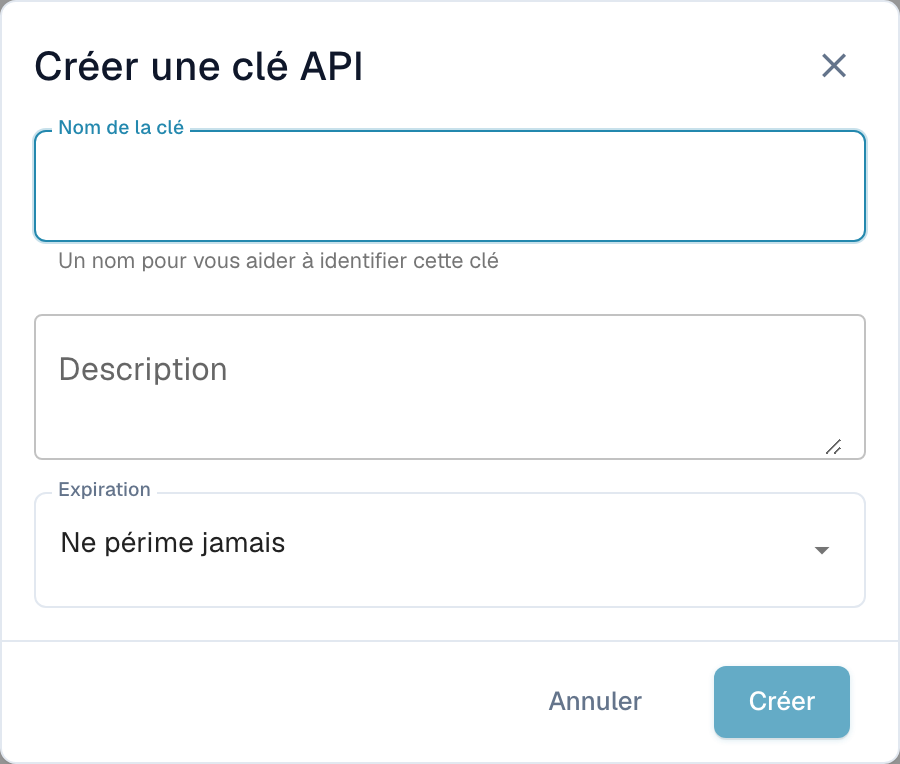

# Postman pour DocBits

Postman permet d’envoyer des requêtes HTTP à l’API DocBits. Commencez par une requête en lecture seule dans un environnement que vous êtes autorisé à utiliser. Séparez les environnements de test et de production et conservez les identifiants dans des variables privées ou un coffre de secrets.

## Configuration

### API DocBits

Ouvrez la documentation de l’API de votre environnement, par exemple l’[API Sandbox](https://sandbox.api.docbits.com/docs) ou l’[API de production](https://api.docbits.com/docs). Reprenez les chemins actuels des opérations et la valeur **Servers** qui y figure. Un chemin de serveur relatif s’ajoute à l’origine de l’API.

Dans la [documentation Dev vérifiée ici](https://eu.dev.api.docbits.com/docs), ce chemin est `/dev-api`. L’URL de base complète est donc `https://eu.dev.api.docbits.com/dev-api`. D’autres environnements peuvent utiliser un chemin de serveur différent.

La spécification de l’API décrit plusieurs schémas d’en-têtes distincts :

| En-tête | Rôle |
| --- | --- |
| `X-ORG-ID` | Identifie l’organisation cible lorsque l’opération le demande. |
| `Authorization` | Contient la valeur d’autorisation attendue par le mécanisme d’authentification concerné. |
| `X-API-KEY` | Contient une clé API pour les opérations qui utilisent ce schéma. |

Ces en-têtes ne sont pas interchangeables. La boîte de dialogue globale **Authorize** affiche les schémas disponibles ; chaque opération n’a pas nécessairement besoin de tous ces en-têtes. Consultez les paramètres et les informations d’autorisation de l’opération concernée.

Demandez les identifiants appropriés à votre administrateur. Dans les paramètres de DocBits, les utilisateurs autorisés accèdent à la gestion des clés sous **Intégration et SSO → Clés API**. La liste présente le préfixe de clé, le nom, l’expiration, la dernière utilisation et l’état. Les lignes existantes sont masquées dans la capture.

<figure><figcaption><p>Vue réelle de Dev en français : Clés API, bouton Créer une clé API et colonnes Clé, Nom, Expire, Dernière Utilisation, Statut et Actions ; les lignes existantes sont masquées.</p></figcaption></figure>

**Créer une clé API**, au-dessus de la liste, ouvre d’abord un formulaire vide avec **Nom de la clé**, **Description** et **Expiration**. Seul l’envoi de ce formulaire crée une clé. Le formulaire illustré a été fermé avec **Annuler**, sans être envoyé. Aucune clé n’a été créée, affichée, copiée ni révoquée. Créez des clés uniquement dans le cadre de vos autorisations et des règles de votre organisation.

<figure><figcaption><p>Formulaire vide Créer une clé API en français avec Nom de la clé, Description, Expiration, Annuler et Créer ; Créer est désactivé tant que le nom est vide.</p></figcaption></figure>

### Créer un espace de travail dans Postman

Ouvrez Postman et utilisez un espace de travail dont la visibilité convient à votre organisation. Créez un environnement avec la variable `base_url`. Sa valeur doit être l’URL de base complète, chemin de serveur compris. Sélectionnez cet environnement avant d’envoyer une requête. Le [guide des environnements de Postman](https://learning.postman.com/docs/use/send-requests/variables/managing-environments/) explique la sélection et l’utilisation des variables.

Créez une requête ou ajoutez-la à votre collection. Les noms des commandes Postman ci-dessous correspondent aux libellés techniques de l’application ; les images précédentes montrent la gestion des clés de DocBits en français.

## Exemple de méthode "GET"

Sélectionnez **GET** et l’URL `{{base_url}}/version`. Dans **Authorization**, choisissez **No Auth**, puis **Send**. La requête Dev en lecture seule vérifiée était :

```http
GET https://eu.dev.api.docbits.com/dev-api/version
```

Cet endpoint a renvoyé HTTP 200 sans clé API. Il vérifie la disponibilité de l’API et renvoie des informations de version. Il ne prouve pas l’accès aux documents ou aux utilisateurs d’une organisation. Vérifiez l’état et le contenu de la réponse ; en cas d’échec, contrôlez d’abord l’environnement sélectionné, l’origine de l’API et le chemin du serveur.

Pour une opération utilisant une clé API, choisissez **Authorization → API Key** dans Postman. Saisissez `X-API-KEY` dans **Key**, utilisez un secret privé pour **Value** et sélectionnez **Header** dans **Add to**. Ajoutez `X-ORG-ID` dans **Headers** si l’opération le demande. Consultez les guides officiels sur l’[autorisation par clé API](https://learning.postman.com/docs/use/send-requests/authorization/authorization-types/#api-key) et les [secrets Vault](https://learning.postman.com/docs/use/postman-vault/use-vault-secrets/).

## Exemple de méthode "POST"

**POST** peut créer des données ou déclencher un traitement. Reprenez la méthode, le chemin, les paramètres obligatoires et le schéma du corps dans la spécification actuelle de l’API. N’exécutez ces requêtes que pour une tâche précise et autorisée. Une requête de version réussie ne démontre pas qu’une requête d’écriture fonctionnera.

### Importer un document

Avant un téléversement, consultez l’opération actuellement documentée. Si elle exige des données de formulaire multipart, sélectionnez ce type de corps et utilisez les noms de champs et les types de fichiers indiqués. Ne les déduisez pas d’une capture d’une ancienne version de l’API. Aucun document n’a été téléversé pour ce guide.

## Exemple de méthode "DELETE"

**DELETE** peut supprimer définitivement des données. Vérifiez l’opération précise, l’identifiant de la cible et les autorisations nécessaires. Aucune suppression n’a été exécutée ou présentée comme testée avec succès ici.

## Exemple de méthode "PUT"

**PUT** peut modifier des données existantes. Utilisez uniquement les paramètres et le schéma du corps de l’opération actuelle et confirmez la portée du changement demandé. Aucune modification n’a été exécutée ici.

## Modifier l’adresse e-mail d’un utilisateur

Déterminez le chemin et les champs obligatoires à partir de la spécification actuelle de l’API et faites vérifier le changement concernant l’utilisateur avant de l’exécuter. Ce guide n’utilise pas de données réelles d’utilisateurs ou d’organisations et ne démontre pas une modification réussie d’adresse e-mail.

La spécification actuelle de l’API Dev, la requête de version sans authentification et les vues réelles de DocBits en français de la gestion des clés et du formulaire vide ont été vérifiées. Le compte de test autorisé et des lectures de métadonnées de l’interface ont été utilisés pour vérifier les vues. Aucune création de clé, aucun téléversement, aucune création d’utilisateur, aucune modification ni suppression n’ont été exécutés. Les opérations métier de l’API sur des documents ou des fiches utilisateur n’ont pas été testées. Aucune requête n’a été testée dans l’application Postman.
