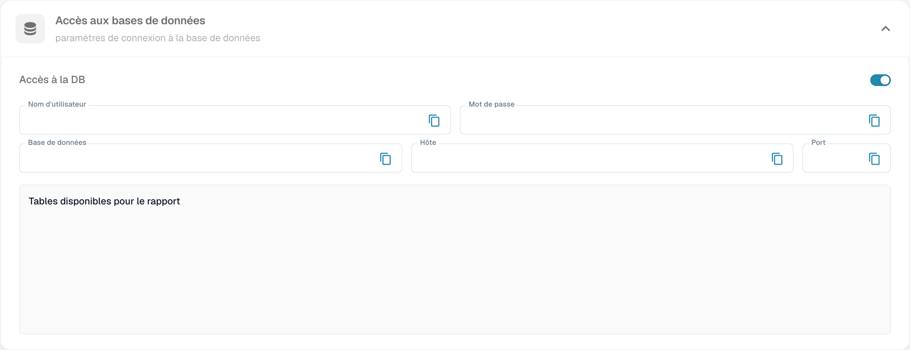
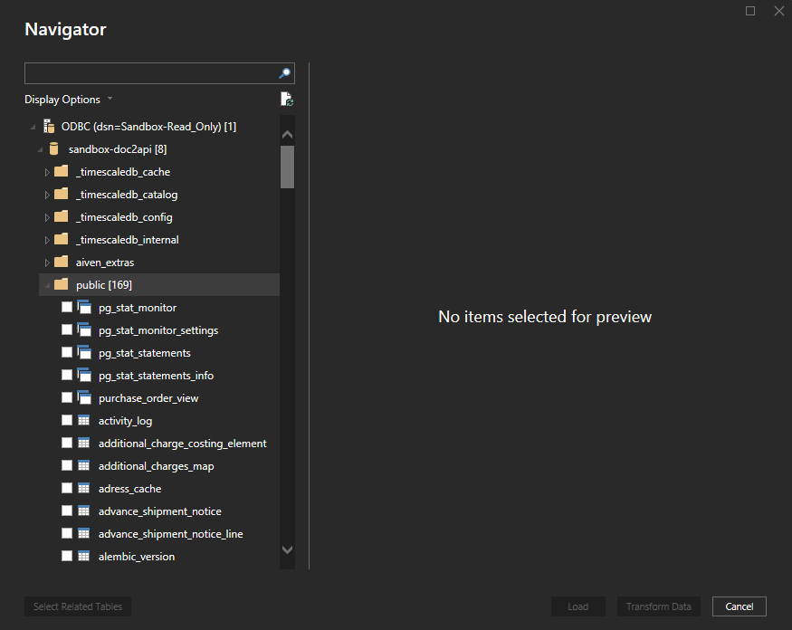

# Se connecter via la base de données en lecture seule

Ce guide décrit la connexion de Power BI Desktop à la base de données en lecture seule de DocBits avec le pilote PostgreSQL ODBC. L’accès doit être disponible pour votre organisation et autorisé pour votre compte. Les captures illustrent les réglages et des écrans externes historiques ; elles ne prouvent pas qu’une connexion ou une actualisation a été exécutée.




## 1. Préparer les identifiants DocBits

Dans **Paramètres → Module → Tableaux de bord et analyses**, ouvrez **Accès aux bases de données**. Si cet accès n’est pas disponible, contactez votre administrateur avant de configurer la connexion. Utilisez les valeurs de votre environnement ; ne publiez pas les identifiants dans un rapport ou une capture.

<figure><figcaption>
Accès aux bases de données dans la version française illustrée. L’accès était déjà activé ; les identifiants et les noms des tables sont masqués. Aucun réglage n’a été modifié et aucune connexion Power BI n’a été exécutée.
</figcaption></figure>

## 2. Installer et configurer le pilote ODBC

Installez [psqlODBC depuis le site PostgreSQL](https://www.postgresql.org/ftp/odbc/releases/), avec une architecture compatible avec votre installation de Power BI et, le cas échéant, votre passerelle. Sous Windows 64 bits, ouvrez l’administrateur des sources de données ODBC 64 bits, puis **DSN système → Ajouter** et sélectionnez le pilote PostgreSQL approprié.

Renseignez un nom de DSN, l’hôte, le port, la base de données, le nom d’utilisateur et le mot de passe fournis pour votre accès DocBits. Configurez le mode SSL selon les exigences de votre environnement. Le mode `require` impose le chiffrement ; il ne remplace pas à lui seul une configuration de vérification du certificat. Consultez les [options officielles psqlODBC](https://odbc.postgresql.org/docs/config-opt.html).

## 3. Ouvrir la connexion dans Power BI Desktop

Choisissez **Obtenir des données → ODBC**, puis votre DSN. Si Power BI demande une authentification de base de données, utilisez les identifiants correspondants. Les libellés peuvent varier selon la version et la langue de Power BI.

<figure><figcaption>
Exemple historique externe de la boîte Get Data de Power BI en anglais, avec le connecteur ODBC. Il ne s’agit pas de l’interface française de DocBits.
</figcaption></figure>

<figure><figcaption>
Exemple historique externe du choix d’un DSN dans Power BI en anglais. Le nom Sandbox-Read_Only est illustratif ; sélectionnez votre propre source autorisée.
</figcaption></figure>

Si `password authentication failed for user` apparaît, vérifiez l’hôte, la base de données et les identifiants. L’échappement par accolades dans une chaîne de connexion relève de la syntaxe du pilote ; ce n’est pas une solution générale aux erreurs d’authentification.

## 4. Sélectionner et transformer les tables

Dans le **Navigateur**, ouvrez les schémas disponibles et sélectionnez les tables autorisées pour votre rapport. Le schéma `public` est un exemple, pas une liste de tables garantie pour toutes les organisations. Choisissez **Charger** pour importer les données ou **Transformer les données** pour les préparer dans Power Query.

<figure><figcaption>
Exemple historique externe du Navigateur Power BI en anglais, avec une liste de tables. Les tables disponibles dépendent de vos droits et de votre environnement ; aucune donnée de rapport n’est affichée ici.
</figcaption></figure>

Le [guide Microsoft du connecteur ODBC](https://learn.microsoft.com/fr-fr/power-query/connectors/odbc) décrit la sélection du DSN, l’authentification et les options du Navigateur.

## 5. Construire votre rapport

Créez les visuels à partir des tables autorisées, vérifiez les relations et les filtres, puis contrôlez les agrégations et les unités. Comparez un échantillon avec les données sources avant de diffuser le rapport. Utilisez des données de test autorisées pour les démonstrations et masquez les informations sensibles dans les captures.

## 6. Configurer l’actualisation planifiée, si nécessaire

Après publication du fichier `.pbix` dans le service Power BI, vérifiez les paramètres du modèle sémantique, les identifiants et la connexion à la passerelle. Pour un accès ODBC via une passerelle, celle-ci doit disposer du pilote, du DSN et d’un accès réseau appropriés. La fréquence et la disponibilité de l’actualisation dépendent notamment de la licence, de la capacité et du mode de connexion.

Suivez la [documentation Microsoft de l’actualisation planifiée](https://learn.microsoft.com/fr-fr/power-bi/connect-data/refresh-scheduled-refresh) et vérifiez l’historique après un premier essai autorisé. L’enregistrement d’un horaire ne prouve pas la réussite d’une actualisation.
