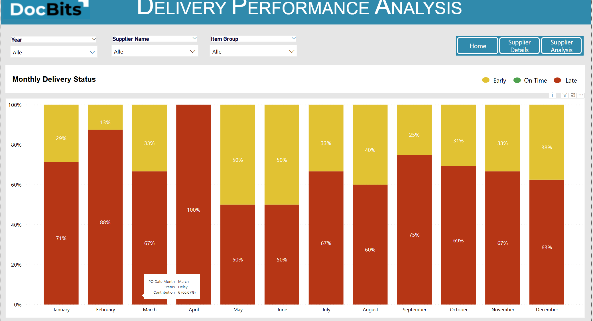

# Se connecter via la base de données en lecture seule

Ce guide vous explique comment connecter la **base de données en lecture seule de DocBits à Power BI Desktop** à l'aide du **pilote ODBC PostgreSQL**. Il couvre l'installation du pilote, la configuration ODBC, l'intégration à Power BI et l'actualisation planifiée.




#### 1. Installer le pilote ODBC PostgreSQL

* Téléchargez le dernier pilote ODBC PostgreSQL (**psqlODBC**) depuis le site officiel :
  * [https://www.postgresql.org/ftp/odbc/releases/](https://www.postgresql.org/ftp/odbc/releases/)
* Exécutez le programme d'installation et suivez l'assistant.

#### 2. Configurer la source de données ODBC

* Ouvrez l'**Administrateur de source de données ODBC (64 bits)** via le Panneau de configuration ou la recherche Windows.
* Accédez à l'onglet **DSN système** et cliquez sur **Ajouter**.
* Sélectionnez le pilote **PostgreSQL Unicode(x64)** dans la liste et cliquez sur **Terminer**.
* Renseignez les champs requis avec les identifiants disponibles ici :\n  **DocBits → Settings → Document Processing → Module → AI Dashboard → Read-Only DB Access**

<figure><figcaption></figcaption></figure>

**Champs requis :**

* **Nom :** un nom pour la connexion (par ex. `Sandbox-Read_Only`)
* **Serveur :** copiez la valeur de l'hôte depuis DocBits
* **Port :** copiez la valeur du port depuis DocBits
* **Base de données :** copiez le nom de la base de données depuis DocBits
* **Nom d'utilisateur :** copiez le nom d'utilisateur depuis DocBits
* **Mot de passe :** copiez le mot de passe depuis DocBits
* **Mode SSL :** définissez sur **Require** (garantit une communication chiffrée)

#### 3. Connecter la base de données en lecture seule à Power BI

* Ouvrez **Power BI Desktop**.
*   Sélectionnez **Obtenir des données** → **ODBC** → **Se connecter**.

    <figure><figcaption></figcaption></figure>
* Dans la liste des DSN, sélectionnez votre source configurée (par ex. `Sandbox-Read_Only`).

<figure><figcaption></figcaption></figure>

* Cliquez sur **OK**. Saisissez à nouveau les identifiants si vous y êtes invité.
  * Si `password authentication failed for user` apparaît, vérifiez l’hôte, la base de données, le nom d’utilisateur et le mot de passe. Saisissez le véritable mot de passe dans la boîte de dialogue d’authentification. L’échappement par accolades dans une chaîne de connexion ODBC relève de la syntaxe du pilote ; ce n’est pas une solution générale aux échecs d’authentification.

#### 4. Charger et transformer les données

* Dans le volet **Navigateur**, développez la liste des schémas.
* Ouvrez le schéma **`public`**.
* Sélectionnez les tables que vous souhaitez importer.

        

* Choisissez :
  * **Charger** → importe directement dans Power BI
  * **Transformer les données** → ouvre Power Query pour mettre en forme et filtrer les données avant le chargement

#### 5. Visualiser vos données

* Utilisez le canevas de rapport de Power BI pour créer des tableaux de bord.
* Faites glisser des champs, ajoutez des segments, choisissez des types de graphiques et appliquez des calculs DAX.
* Utilisez l'**Éditeur Power Query** pour nettoyer ou joindre les données avant de créer des visuels.
* Référence : [Documentation Power BI](https://learn.microsoft.com/en-us/power-bi/)

#### 6. Activer l'actualisation planifiée (facultatif)

L’actualisation planifiée dépend de la licence ou de la capacité de l’espace de travail, du connecteur et du mode de connexion. Pour cette connexion ODBC, configurez une passerelle accessible avec le pilote, le DSN et les identifiants appropriés. Vérifiez les conditions actuelles dans la documentation officielle.

* Pour maintenir vos rapports synchronisés avec PostgreSQL :
* Publiez votre fichier `.pbix` sur le **service Power BI**.
* Installez la **passerelle Power BI** (mode Standard) sur une machine disposant d'un accès réseau à PostgreSQL.
* Dans le service Power BI :
  * Accédez à votre jeu de données → **Paramètres** → **Actualisation planifiée**
  * Associez votre DSN et fournissez les identifiants
* Plus d'informations [ici](https://learn.microsoft.com/en-us/power-bi/connect-data/service-gateway-deployment-guidance).&#x20;

#### 7. Exemples de tableaux de bord et de vues de données&#x20;

<figure><figcaption></figcaption></figure> <figure><figcaption></figcaption></figure> <figure><figcaption></figcaption></figure> <figure><figcaption></figcaption></figure>

[Documentation officielle — ODBC](https://learn.microsoft.com/en-us/power-query/connectors/odbc)

[Documentation officielle — psqlODBC](https://odbc.postgresql.org/docs/config-opt.html)

[Documentation officielle — Power BI](https://learn.microsoft.com/en-us/power-bi/connect-data/refresh-scheduled-refresh)
