# Tableau AI

Le **Tableau extrait IA** est le tableau des lignes d'articles que DocBits lit avec l'IA lorsqu'un fournisseur n'a pas de règles de tableau entraînées. Il apparaît sur l'écran de validation, sous les champs d'en-tête. Cette page explique toutes les commandes autour de ce tableau : comment corriger une colonne erronée, comment donner des instructions à l'IA, comment tester une modification avant de la conserver, comment voir ce que l'IA a fait, ce que l'Assistant peut faire et ne peut pas faire pour vous, et qui a le droit d'enregistrer quoi.

## Quand obtenez-vous le tableau AI

* Un administrateur a activé **Extraction de table AI** (Paramètres → Traitement des documents → Classification et extraction, voir [Paramètres pour les administrateurs](./#parametres-pour-les-administrateurs)). Si l'option est désactivée, la zone du tableau affiche _La table AI s'affichera ici. Activer dans …_.
* Le fournisseur n'a **aucune règle enregistrée**. Dès que quelqu'un entraîne le tableau du fournisseur et enregistre les règles, les règles enregistrées remplacent le tableau AI pour ce fournisseur. Les lignes apparaissent alors dans l'onglet **Tableau extrait**, et l'onglet **Tableau extrait IA** est grisé avec l'info-bulle _IA de Table Désactivée : Une table personnalisée est en cours d'utilisation._
* Exception : les colonnes marquées **Utiliser l'IA** dans les paramètres des colonnes de tableau sont remplies par l'IA même pour les fournisseurs disposant de règles enregistrées, voir [Utiliser l'IA par colonne](./#utiliser-lia-par-colonne).

Le niveau d'IA qui lit le tableau (Fast, Full, Nexus) est défini par organisation et peut être remplacé par fournisseur, voir Modèle d'IA Spécifique au Fournisseur pour l'Extraction de Champs et de Tableaux.

## Le tableau AI en un coup d'œil

<figure>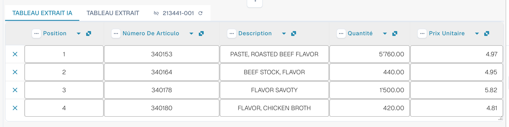<figcaption>
Les deux onglets, le Tableau extrait IA et ses en-têtes de colonnes.
</figcaption></figure>

* **Onglets.** _Tableau extrait IA_ est ce que l'IA a lu. _Tableau extrait_ est le tableau classique issu des règles entraînées. L'onglet IA s'ouvre par défaut lorsque le document possède un tableau AI.
* **En-tête de colonne.** Chaque colonne affiche son nom, un petit symbole d'**origine** (survolez-le : _IA · cartographie_, _IA · synonyme_, etc. indiquent comment l'IA a associé la colonne), un menu **trois points** et, pour une colonne mappée, un **bouton de nom** sur lequel vous pouvez cliquer pour changer de quelle colonne il s'agit.
* **Boutons de ligne.** Le **x** au début d'une ligne supprime cette ligne. Un clic droit sur une ligne propose _Sélectionner comme coût supplémentaire_ / _Remove as additional cost_.
* **Barre d'outils du pied de page.** Les icônes en bas de l'écran ajoutent ou masquent des colonnes et des lignes, voir [Barre d'outils du pied de page](./#barre-doutils-du-pied-de-page).
* **Carte Instructions pour l'IA** sous le tableau : prompt, colonnes supplémentaires, **Test de changement**, **Appliquer**, **Enregistrer comme formation**, **Supprimer**, **Exporter**, voir [Donner des instructions à l'IA](./#donner-des-instructions-a-lia).


Les commandes de colonne ne fonctionnent que si vous pouvez modifier le document. Si elles sont grisées, le document est en lecture seule ou verrouillé dans une autre session. Lorsque le bandeau rouge indique que le document est verrouillé par votre propre utilisateur dans une autre session, **Déverrouiller** reprend le verrou.


## Modifier une colonne

### Choisir la bonne colonne (remappage)

Utilisez cette option lorsqu'une valeur se trouve dans la mauvaise colonne, par exemple lorsque le montant net est dans _Montant total_ ou que _Quantité_ est vide alors que la facture l'indique.

1. Cliquez sur le **nom de la colonne** dans l'en-tête.
2. Choisissez la colonne de tableau configurée à laquelle les valeurs appartiennent réellement.

<figure>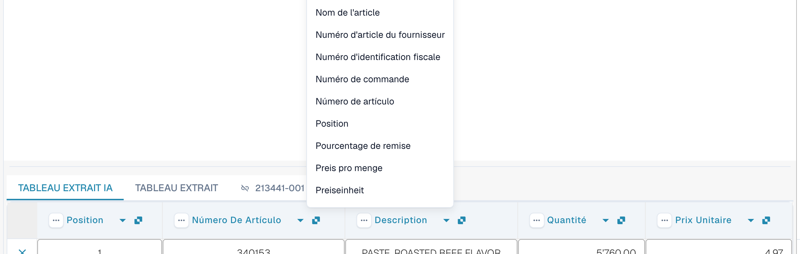<figcaption>
Cliquez sur le nom de la colonne et choisissez la colonne qu'elle doit être. La liste affiche toutes les colonnes de tableau configurées.
</figcaption></figure>

DocBits reformate aussitôt le tableau, pour ce document uniquement. Si la colonne choisie est déjà utilisée par une autre colonne, une boîte de dialogue _Remapper "…" ?_ avertit que l'autre colonne ne sera plus mappée. Confirmez pour continuer ; l'autre colonne affiche alors l'icône d'erreur _Sélectionnez une colonne à mapper dans la liste déroulante._ afin que vous puissiez aussi lui choisir une colonne.

### Le menu trois points

<figure>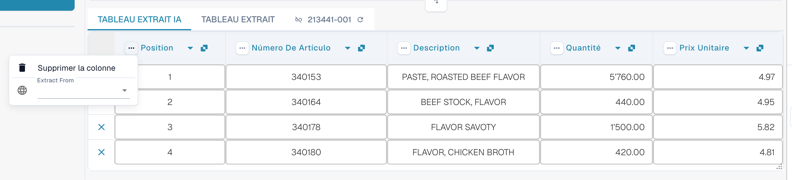<figcaption>
Le menu trois points d'une colonne.
</figcaption></figure>

| Entrée                    | Ce qu'elle fait                                                                                                                                                                                                                                                                             |
| ------------------------- | ------------------------------------------------------------------------------------------------------------------------------------------------------------------------------------------------------------------------------------------------------------------------------------------- |
| **Supprimer la colonne**  | Masque la colonne. Une confirmation indique _Les modifications ne seront pas prises en compte_ ; choisissez **Terminé**. Le tableau est reconstruit sans la colonne. Utilisez **Restaurer colonne du tableau** dans la barre d'outils du pied de page pour récupérer les colonnes masquées. |
| **Désactiver la colonne** | Pour une colonne que vous avez ajoutée vous-même : la masque sans relancer l'IA.                                                                                                                                                                                                            |
| **Formatage du montant**  | Uniquement pour les colonnes de montant. Choisissez comment les nombres sont lus (séparateurs décimaux et de milliers). **Auto** laisse DocBits décider.                                                                                                                                    |
| **Extract From**          | Indique à l'IA de prendre la valeur sur la ligne située au-dessus (**Above**) ou en dessous (**Below**) du libellé de la colonne. Laissez le champ vide si la valeur se trouve à l'endroit habituel.                                                                                        |

### Barre d'outils du pied de page

<figure><figcaption>
Les icônes du tableau dans le pied de page de l'écran de validation, de gauche à droite.
</figcaption></figure>

| Icône (info-bulle)                                                           | Ce qu'elle fait                                                                                                                                                                                                                             |
| ---------------------------------------------------------------------------- | ------------------------------------------------------------------------------------------------------------------------------------------------------------------------------------------------------------------------------------------- |
| **Aller à la vue d'extraction de tableau**                                   | Ouvre l'entraînement classique du tableau. Si le document a un tableau AI, DocBits avertit : _Le tableau est déjà extrait par l'IA. Voulez-vous l'entraîner manuellement ? A l'avenir, l'IA n'extraira pas de tableau pour ce fournisseur._ |
| **Ajouter des colonnes mappées vides**                                       | Ouvre **Paramètres de colonnes** pour ajouter les colonnes configurées que l'IA n'a pas remplies, afin que vous puissiez saisir les valeurs à la main.                                                                                      |
| **Afficher les colonnes non mappées** / **Masquer les colonnes non mappées** | Affiche ou masque les colonnes renvoyées par l'IA qui ne sont pas mappées à une colonne configurée. Par défaut, elles sont masquées. Cela ne modifie que l'affichage de ce document.                                                        |
| **Blocage de l'extraction de table pour ce fournisseur**                     | Désactive l'extraction de table pour le fournisseur.                                                                                                                                                                                        |
| **Supprimer le tableau**                                                     | Vide le tableau dans l'éditeur.                                                                                                                                                                                                             |
| **Ajouter une nouvelle colonne de tableau**                                  | Ajoute une colonne personnalisée. Réservé aux administrateurs.                                                                                                                                                                              |
| **Ajouter une nouvelle ligne de tableau**                                    | Ajoute une ligne vide.                                                                                                                                                                                                                      |
| **Ignorer la validation du tableau**                                         | Ignore la validation du tableau pour ce document.                                                                                                                                                                                           |
| **Restaurer colonne du tableau**                                             | Récupère toutes les colonnes que vous avez supprimées.                                                                                                                                                                                      |

<figure>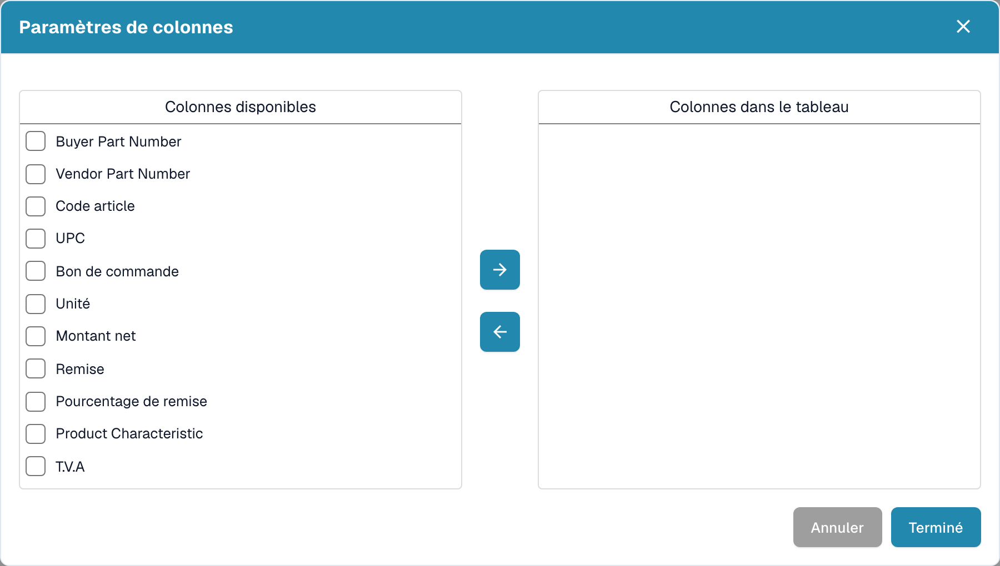<figcaption>
Paramètres de colonnes : déplacez les colonnes de <em>Colonnes disponibles</em> vers <em>Colonnes dans le tableau</em> avec les boutons fléchés, puis choisissez <strong>Terminé</strong>.
</figcaption></figure>

## Donner des instructions à l'IA

Sous le tableau, la carte **Instructions pour l'IA** indique à l'IA ce qu'elle doit faire autrement. Elle comporte deux champs de saisie et quatre boutons que vous utiliserez en permanence.

<figure>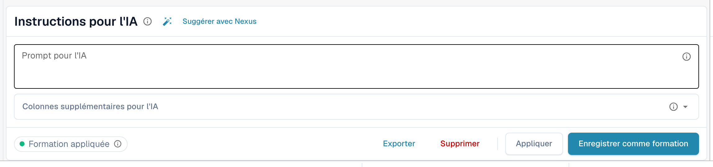<figcaption>
La carte Instructions pour l'IA.
</figcaption></figure>

* **Prompt pour l'IA.** Écrivez une instruction par ligne, en langage courant. Tapez **@** pour insérer un nom de colonne, afin que l'IA sache exactement de quelle colonne vous parlez.
* **Colonnes supplémentaires pour l'IA.** Choisissez les colonnes que l'IA doit renvoyer en plus des colonnes habituelles.
* **État de la formation.** La pastille affiche **Formation appliquée** lorsqu'une formation enregistrée a été utilisée lors de la dernière exécution, ou **No training applied** dans le cas contraire.

<figure>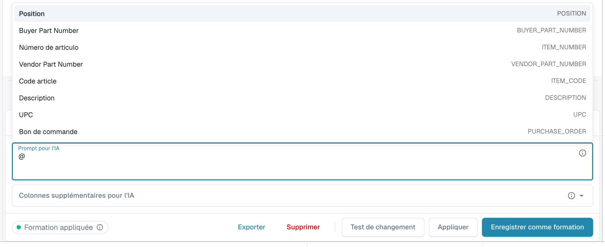<figcaption>
Tapez <strong>@</strong> dans le prompt pour choisir une colonne. Dès que quelque chose a changé, <strong>Test de changement</strong> apparaît à côté de <strong>Appliquer</strong>.
</figcaption></figure>


Un prompt modifié oblige l'IA à relire le tableau, et elle peut modifier toutes les colonnes, pas seulement celle à laquelle vous pensiez. Vérifiez ensuite l'ensemble du tableau.


### Suggérer avec Nexus

Vous ne savez pas quoi écrire ? Cliquez sur **Suggérer avec Nexus**. DocBits examine l'extraction de ce document et propose des instructions ou des colonnes supplémentaires. Rien n'est appliqué tant que vous ne cliquez pas sur **Insérer** (ajoute la ligne à votre prompt) ou sur **Add column**.

<figure>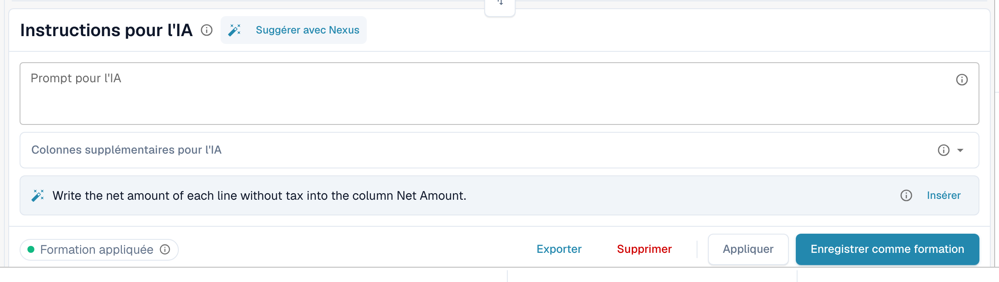<figcaption>
Une suggestion de Nexus. <strong>Insérer</strong> la copie dans le prompt.
</figcaption></figure>

Si votre organisation a désactivé le conseiller IA, DocBits vous l'indique au lieu de faire une suggestion.

### Tester, appliquer, enregistrer : ce que fait chaque bouton

| Bouton                                                                | Ce qui se passe                                                                                                                                                                                                                                                               | Conservé pour les documents suivants ? |
| --------------------------------------------------------------------- | ----------------------------------------------------------------------------------------------------------------------------------------------------------------------------------------------------------------------------------------------------------------------------- | -------------------------------------- |
| **Test de changement**                                                | Exécute votre modification et affiche une comparaison. **Rien n'est écrit**, ni dans le document ni sous forme de règle.                                                                                                                                                      | Non                                    |
| **Appliquer**                                                         | Relit le tableau avec vos modifications et place le résultat dans ce document dans l'éditeur. Il ne devient définitif que lorsque vous enregistrez le document.                                                                                                               | Non                                    |
| **Enregistrer comme formation** (info-bulle _Enregistrer les règles_) | Enregistre le prompt, les colonnes supplémentaires, le mappage des colonnes, les colonnes masquées, les formats de montant et les réglages **Extract From** pour cette mise en page de fournisseur. Les documents suivants de cette mise en page sont lus de la même manière. | Oui                                    |
| **Supprimer** (info-bulle _Supprimer les règles_)                     | Supprime les règles de tableau enregistrées pour cette mise en page de fournisseur, sans confirmation supplémentaire, et relance l'IA sans elles. Cela supprime aussi l'entraînement de tableau classique enregistré pour la même mise en page.                               | Les supprime                           |
| **Exporter**                                                          | Télécharge le tableau sous forme de fichier CSV.                                                                                                                                                                                                                              | Non                                    |


Les remappages d'en-tête, **Supprimer la colonne**, **Formatage du montant**, **Extract From** et **Restaurer colonne du tableau** se comportent comme **Appliquer** : ils reconstruisent aussitôt le tableau pour ce document et sont enregistrés avec le document, pas comme règle. Seul **Enregistrer comme formation** apprend quelque chose à DocBits pour les documents suivants.


Si le document contient déjà des lignes rapprochées d'un bon de commande, Appliquer et Enregistrer avertissent que **vous risquez de perdre les connexions au bon de commande**. Choisissez **Terminé** pour continuer et refaites ensuite le rapprochement.

<figure>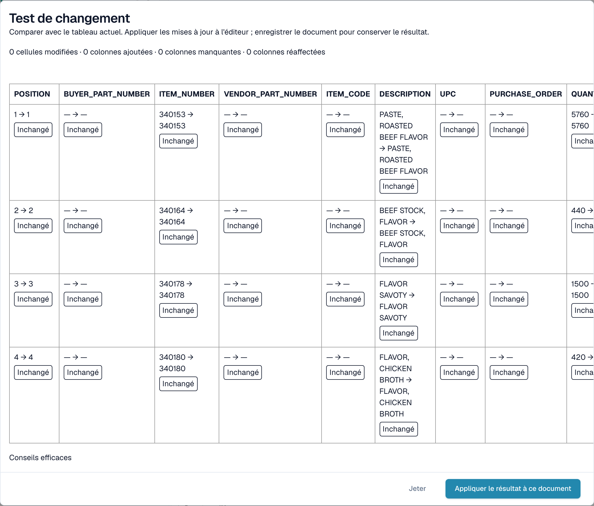<figcaption>
La boîte de dialogue <strong>Test de changement</strong> compare le nouveau résultat au tableau que vous voyez actuellement.
</figcaption></figure>

La boîte de dialogue **Test de changement** compte ce qui changerait : cellules modifiées, colonnes ajoutées, colonnes manquantes et colonnes réaffectées. Chaque cellule est marquée **Ajouté**, **Modifié**, **Manquant**, **Réaffecté** ou **Inchangé**. En bas, la boîte de dialogue liste les éléments de preuve de l'exécution : _Conseils efficaces_, _Formation sélectionnée_, _Politique de la colonne_ et _Les substitutions de requêtes utilisées_. Choisissez **Appliquer le résultat à ce document** pour le reprendre (puis enregistrez le document), ou **Jeter** pour l'abandonner. Si vous modifiez le prompt après le test, le résultat est marqué comme périmé et vous devez tester à nouveau.

Après **Enregistrer comme formation**, DocBits indique que la formation sera utilisée lors du prochain retraitement ; l'exécution en cours ne l'a pas encore utilisée. Vérifiez sur le prochain document du fournisseur que la pastille indique **Formation appliquée**.

## Voir ce que l'IA a fait

Quatre boutons sous le tableau expliquent l'extraction.

<figure>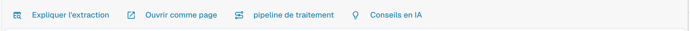<figcaption>
Les boutons d'explication.
</figcaption></figure>

* **Expliquer l'extraction** ouvre _Comment le tableau de l'IA est parvenu à ses valeurs_ : le document, l'extraction par l'IA (niveau, nombre de colonnes et de lignes brutes), la correspondance avec votre structure et le résultat par colonne avec l'origine de chaque colonne.
* **Ouvrir comme page** affiche la même explication dans sa propre fenêtre.
* **pipeline de traitement** liste les étapes de traitement du document et l'endroit où il s'est arrêté.
* **Conseils en IA** demande à Nexus comment l'extraction peut s'améliorer et liste des recommandations concrètes, par exemple _Enable structured output_ ou _Add an instruction tag_. Ce ne sont que des conseils ; c'est vous qui décidez.

<figure>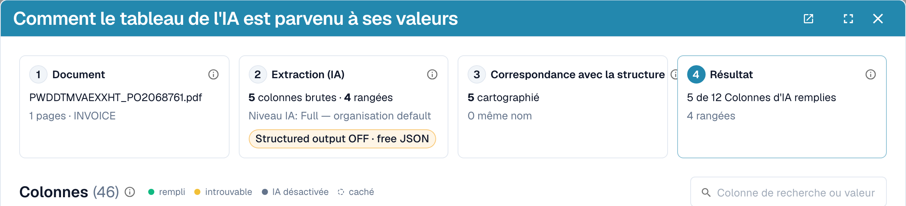<figcaption>
Expliquer l'extraction : quatre étapes, du document au résultat.
</figcaption></figure>

<figure>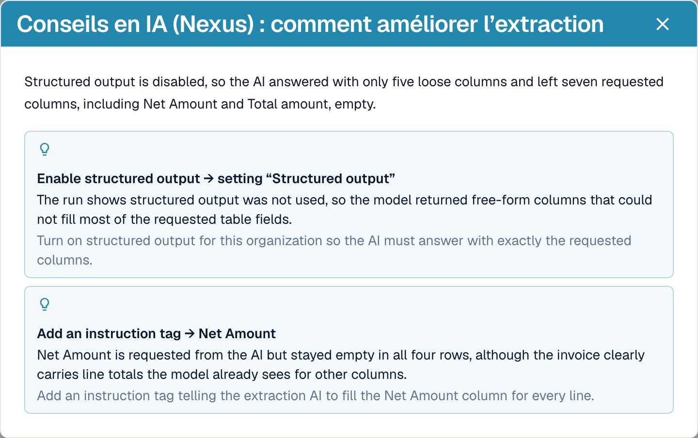<figcaption>
Conseils en IA propose les prochaines étapes.
</figcaption></figure>

<figure>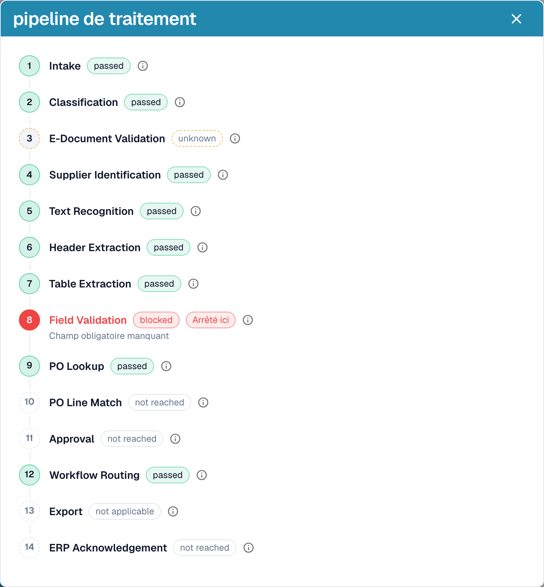<figcaption>
Le pipeline de traitement montre où un document s'est arrêté, ici à la validation des champs.
</figcaption></figure>

Ces explications relèvent du module **Tableau de bord analytique**. Sans licence pour le module, ou lorsque votre rôle n'a pas accès à l'onglet Analytics, DocBits vous indique ce que vous devez demander à votre administrateur (activer le module sous Paramètres → Modules, ou accorder l'onglet à votre rôle sous Paramètres → Rôles).

## Exemples pratiques

| Situation                                                                                               | Que faire                                                                                                                                                                                                                                                                              |
| ------------------------------------------------------------------------------------------------------- | -------------------------------------------------------------------------------------------------------------------------------------------------------------------------------------------------------------------------------------------------------------------------------------- |
| Une valeur se trouve dans la mauvaise colonne, par exemple _Prix Unitaire_ se trouve dans _Montant net_ | Cliquez sur le nom de la colonne et mappez-la sur la bonne colonne. Puis **Enregistrer comme formation** si le fournisseur l'imprime toujours ainsi.                                                                                                                                   |
| Une colonne reste vide sur chaque ligne, par exemple _Remise_                                           | Ajoutez la colonne sous **Colonnes supplémentaires pour l'IA**, ou écrivez une instruction avec le libellé utilisé par la facture, par exemple _Remplis la colonne Remise avec la colonne nommée « Rabatt » sur la facture._ Vérifiez avec **Test de changement**, puis **Appliquer**. |
| L'IA ne sait pas quoi faire (rien dans le prompt)                                                       | Cliquez sur **Suggérer avec Nexus** et insérez ce qui convient.                                                                                                                                                                                                                        |
| Un prix doit être divisé ou arrondi                                                                     | Écrivez la règle dans le prompt, par exemple _Le prix unitaire est le montant net divisé par la quantité._                                                                                                                                                                             |
| Les montants sont lus avec de mauvais séparateurs (1.234,50 au lieu de 1,234.50)                        | Ouvrez le menu trois points de la colonne, choisissez **Formatage du montant** et sélectionnez le bon format.                                                                                                                                                                          |
| Le libellé se trouve sous la valeur                                                                     | Menu trois points → **Extract From** → **Below**.                                                                                                                                                                                                                                      |
| Une colonne n'est pas nécessaire pour ce fournisseur                                                    | Menu trois points → **Supprimer la colonne**. **Enregistrer comme formation** la garde masquée pour le fournisseur.                                                                                                                                                                    |
| Une ligne est erronée ou manquante                                                                      | Supprimez-la avec le **x**, ou ajoutez-en une avec **Ajouter une nouvelle ligne de tableau** et saisissez les valeurs.                                                                                                                                                                 |
| Les mêmes corrections sont nécessaires encore et encore                                                 | Utilisez **Enregistrer comme formation** pour que les documents suivants de ce fournisseur soient corrects. Pour les mises en page complexes, [entraînez plutôt le tableau](../../../administration-and-setup/setup/document-training/training-line-fields-table-training/).           |


Toutes les lignes de description réparties sur plusieurs lignes ne peuvent pas être corrigées par une instruction. Si les lignes d'un même article sont réparties sur plusieurs lignes du tableau, modifiez les lignes ou utilisez l'entraînement de tableau classique.


## L'Assistant et le tableau AI

Cliquez sur l'**Assistant** (icône d'ampoule à côté de Enregistrer sur l'écran de validation) pour poser des questions sur le document.

<figure>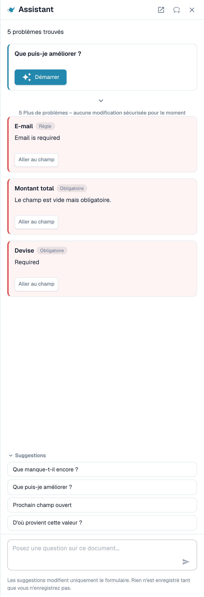<figcaption>
L'Assistant liste les problèmes ouverts et propose des questions à poser.
</figcaption></figure>

**Ce que l'Assistant fait pour les tableaux.** Il peut vous amener à une cellule du tableau et, si vous avez le droit de modifier le document, définir la valeur d'une cellule ou ajouter une ligne de tableau. Cela fonctionne aussi bien dans le Tableau extrait IA que dans le Tableau extrait. Il répond également à des questions comme _Que manque-t-il encore ?_ et _Que puis-je améliorer ?_.

<figure>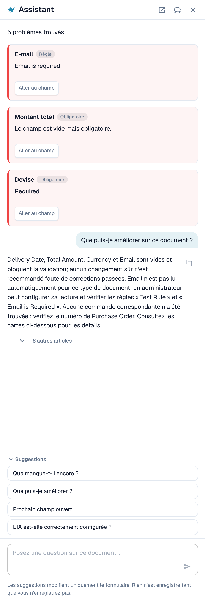<figcaption>
Demandez <em>Que puis-je améliorer ?</em> pour obtenir une courte liste de ce qu'il faut corriger ensuite.
</figcaption></figure>

**Ce qu'il ne fait pas.** L'Assistant ne modifie **pas** les instructions pour l'IA, les colonnes supplémentaires, le mappage des colonnes ni la formation. Pour cela, utilisez la carte **Instructions pour l'IA** (**Suggérer avec Nexus**, **Test de changement**, **Appliquer**, **Enregistrer comme formation**). Les administrateurs peuvent demander _L'IA est-elle correctement configurée ?_ pour obtenir des conseils sur les paramètres, par exemple sur la combinaison de la lecture de tableau par IA avec des règles de tableau enregistrées.

### Suggérer une règle à votre administrateur

De nombreux problèmes viennent d'un **champ**, pas du tableau : un e-mail toujours obligatoire mais vide, une date au mauvais format, un ID fournisseur qui nécessite une recherche. Pour ces cas, toute personne pouvant ouvrir le document peut envoyer une proposition via l'Assistant :

1. Demandez _Que puis-je améliorer ?_ ou ouvrez une carte de constat dans l'Assistant.
2. Si vous êtes administrateur, la carte propose **Appliquer**. Sinon, elle indique _An administrator can review this proposal._ et affiche **Suggest improvement**. Cliquez dessus.
3. DocBits affiche _Your suggestion was sent to the administrators._ Si quelqu'un a déjà envoyé la même suggestion, votre demande y est comptée au lieu d'en créer une seconde.
4. La carte affiche ensuite **Requested**, puis plus tard **Implemented** ou **Declined** (avec le motif, si l'administrateur en a donné un).

La proposition peut être une **règle de transformation**, une **règle de validation** ou une **recherche** (lookup). Vous l'envoyez depuis le document, et le serveur construit lui-même le brouillon de règle à partir du problème qu'il a trouvé : vous n'avez rien à écrire. Le nombre de suggestions est limité à 20 par utilisateur et par heure.


Vous ne pouvez pas proposer ainsi des **instructions pour le tableau AI, un mappage de colonnes ou une formation**. Si un tableau doit être corrigé, corrigez-le dans le document et prévenez un administrateur, ou demandez à votre administrateur d'utiliser **Enregistrer comme formation** sur un document de ce fournisseur. Les administrateurs peuvent enregistrer des règles ; voir [Qui peut faire quoi](./#qui-peut-faire-quoi).


**Ce que voit l'administrateur.** Les administrateurs sont avertis par une tâche et un e-mail. Ils ouvrent **Touchless Intelligence** et trouvent la proposition sous **Améliorations ouvertes** (onglet _Ouvertes_, historique dans _Historique_). Un clic ouvre le panneau _Improvement suggestion_ avec des documents d'exemple et un aperçu. L'administrateur peut **Approuver** ou **Rejeter**. Lors de l'approbation, **Switch on right away** détermine si la nouvelle règle est active immédiatement ; sans cette option, la règle est créée inactive et l'administrateur l'active dans la liste des règles. Le rejet demande un motif et une note facultative pour les demandeurs. Voir [Touchless Intelligence](../../../administration-and-setup/analytics-dashboard/touchless-intelligence/).

<figure><figcaption>
Les administrateurs trouvent les propositions sous <strong>Améliorations ouvertes</strong>.
</figcaption></figure>

## Qui peut faire quoi

| Action                                                                                                                                                 | Qui                                                                                                                                                                                                                                                                            |
| ------------------------------------------------------------------------------------------------------------------------------------------------------ | ------------------------------------------------------------------------------------------------------------------------------------------------------------------------------------------------------------------------------------------------------------------------------ |
| Remapper une colonne, **Supprimer la colonne**, **Formatage du montant**, **Extract From**, **Test de changement**, **Appliquer**, modifier des lignes | Toute personne pouvant modifier le document                                                                                                                                                                                                                                    |
| **Enregistrer comme formation**                                                                                                                        | Toute personne pouvant modifier, sauf si le paramètre d'organisation **Règles d'extraction enregistrées (Administrateur uniquement)** est activé. Seuls les administrateurs de l'organisation peuvent alors enregistrer des règles ; les autres reçoivent un message d'erreur. |
| **Ajouter une nouvelle colonne de tableau**                                                                                                            | Administrateurs                                                                                                                                                                                                                                                                |
| Suggérer une règle via l'Assistant                                                                                                                     | Toute personne pouvant ouvrir le document                                                                                                                                                                                                                                      |
| Approuver ou rejeter une suggestion                                                                                                                    | Administrateurs                                                                                                                                                                                                                                                                |
| **Expliquer l'extraction**, **Conseils en IA**                                                                                                         | Utilisateurs dont le rôle a accès au module Tableau de bord analytique                                                                                                                                                                                                         |

## Paramètres pour les administrateurs

Ouvrez **Paramètres → Traitement des documents → Types de documents → Classification et extraction**, onglet **Général**, section **Extraction**.

<figure>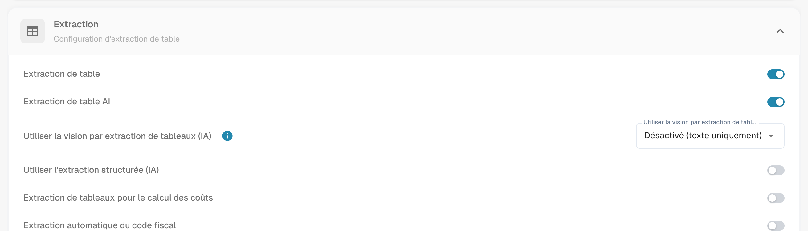<figcaption>
Les interrupteurs qui décident si le tableau AI existe.
</figcaption></figure>

* **Extraction de table** active le tableau classique.
* **Extraction de table AI** active ou désactive le tableau AI pour l'organisation.
* **Utiliser l'extraction structurée (IA)** : l'IA renvoie le tableau dans une structure fixe qui correspond directement à vos colonnes configurées, au lieu de reprendre les en-têtes du fournisseur. Les noms de colonnes correspondent alors toujours à votre configuration ; une colonne imprimée par le fournisseur mais que vous n'avez pas configurée n'est pas extraite.
* **Règles d'extraction enregistrées (Administrateur uniquement)** : lorsque l'option est activée, seuls les administrateurs de l'organisation peuvent enregistrer et exporter les règles d'extraction.

<figure>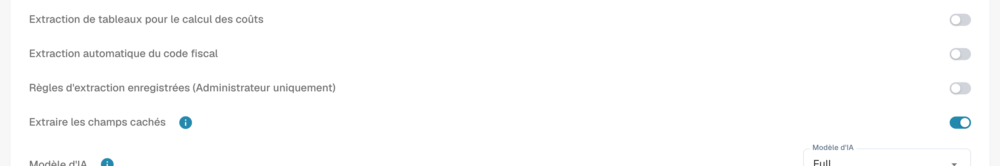<figcaption>
<strong>Règles d'extraction enregistrées (Administrateur uniquement)</strong> détermine qui peut utiliser <strong>Enregistrer comme formation</strong>.
</figcaption></figure>

### Utiliser l'IA par colonne

Chaque colonne de tableau possède un indicateur **Utiliser l'IA** (Paramètres → Paramètres globaux → Types de documents → [Table Columns](../../../administration-and-setup/settings/global-settings/document-types/table-columns/)). Lorsqu'il est activé, l'IA remplit cette colonne même si le fournisseur dispose de règles enregistrées ; les autres colonnes continuent de provenir des règles. Cas d'usage typique : une colonne de description en texte libre que les règles entraînées capturent mal.

L'IA devine alors cette colonne à partir de la ligne entière. Si elle y place systématiquement la mauvaise valeur, par exemple le total de ligne dans _Frais_, désactivez **Utiliser l'IA** pour cette colonne ou ajoutez une instruction qui indique à l'IA ce que représente la colonne.

## Pages associées

* [Étiquettes de tableau AI](ai-table-tags.md)
* [Formation des Champs de Ligne/Table de Formation](../../../administration-and-setup/setup/document-training/training-line-fields-table-training/)
* [Touchless Intelligence](../../../administration-and-setup/analytics-dashboard/touchless-intelligence/)
