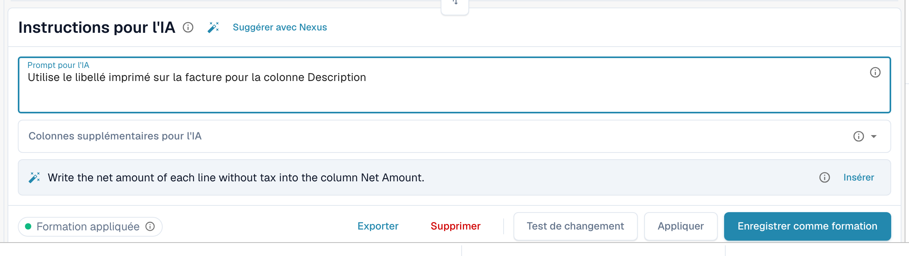

# Étiquettes et instructions du tableau AI

Les étiquettes sont le moyen d'indiquer à l'IA ce qu'elle doit faire d'un tableau. Dans la carte **Instructions pour l'IA** sous le tableau AI (voir [Tableau AI](README.md)), vous donnez deux types d'étiquettes :

| Type | Où le saisir | Ce que l'IA en fait |
| --- | --- | --- |
| **Instruction** | **Prompt pour l'IA**, une instruction par ligne | La suit pendant la lecture du tableau, par exemple pour un calcul ou le choix d'un libellé. |
| **Colonne** | **Colonnes supplémentaires pour l'IA** | Doit renvoyer cette colonne en plus des colonnes habituelles, même si le document ne l'indique pas clairement. |

Les deux sont enregistrées ensemble comme étiquettes IA du fournisseur lorsque vous utilisez **Enregistrer comme formation**.

<figure><figcaption>
Une instruction par ligne dans <strong>Prompt pour l'IA</strong>.
</figcaption></figure>

## Ajouter des étiquettes pas à pas

1. Ouvrez le document sur l'écran de validation et restez sur l'onglet **Tableau extrait IA**.
2. Dans **Prompt pour l'IA**, écrivez ce que l'IA doit faire, une instruction par ligne. Tapez **@** pour insérer une colonne de votre configuration.
3. Ou ouvrez **Colonnes supplémentaires pour l'IA** et choisissez les colonnes que l'IA doit renvoyer.
4. Vous ne savez pas quoi écrire ? Cliquez sur **Suggérer avec Nexus** et utilisez **Insérer** ou **Add column** sur une suggestion.
5. Cliquez sur **Test de changement** pour comparer le résultat au tableau actuel. Rien n'est encore écrit.
6. Satisfait ? Cliquez sur **Appliquer** (ou sur **Appliquer le résultat à ce document** dans la boîte de dialogue de test) pour placer le résultat dans ce document.
7. Si chaque document de ce fournisseur en a besoin, cliquez sur **Enregistrer comme formation**. **Supprimer** retire les étiquettes et les règles enregistrées de la mise en page du fournisseur.


Chaque ligne de **Prompt pour l'IA** est une instruction, même un seul mot (DocBits ajoute un point final pour que l'IA ne le prenne pas pour un nom de colonne). Les colonnes se placent dans **Colonnes supplémentaires pour l'IA**.


## Rédiger de bonnes instructions

* **Nommez la colonne et le libellé du document.** *Remplis la colonne Remise avec la colonne nommée « Rabatt ».* fonctionne mieux que *trouve la remise*.
* **Une seule chose par ligne.** Les lignes courtes sont plus faciles à tester et à supprimer.
* **Décrivez les calculs simplement.** *Le prix unitaire est le montant net divisé par la quantité.*
* **Dites ce qu'il faut laisser tel quel.** *Ignore les lignes de frais de port en bas du tableau.*
* **Vérifiez l'ensemble du tableau.** Un prompt modifié relance l'IA et peut modifier toutes les colonnes.
* **Ne répétez pas ce qui est déjà connu.** Une étiquette de colonne qui duplique une autre étiquette, ou qui correspond à un champ d'en-tête, est ignorée.

## Exemples

| Problème | Étiquette |
| --- | --- |
| La colonne de remise reste vide | Colonne supplémentaire **Remise** et l'instruction *Remplis la colonne Remise avec la colonne nommée « Rabatt ».* |
| La quantité et l'unité sont dans une seule cellule | *Place le nombre dans Quantité et l'unité de mesure dans Unité.* |
| Le prix unitaire n'est pas imprimé | *Le prix unitaire est le montant net divisé par la quantité.* |
| Les dates doivent être au format ISO | *Écris toutes les dates au format AAAA-MM-JJ.* |
| Montants dans une devise étrangère | *Arrondis tous les montants à deux décimales.* |

Les colonnes que vous pouvez choisir sont les colonnes de tableau configurées pour le type de document, voir [Table Columns](../../../administration-and-setup/settings/global-settings/document-types/table-columns/README.md).

## Avant d'enregistrer

* Utilisez d'abord **Test de changement**. Il n'écrit jamais rien.
* **Enregistrer comme formation** s'applique à la mise en page du fournisseur : les documents suivants sont donc lus avec vos étiquettes. Vérifiez sur le prochain document que la pastille indique **Formation appliquée**.
* Si **Règles d'extraction enregistrées (Administrateur uniquement)** est activé, demandez à un administrateur de l'organisation d'enregistrer.
* Les étiquettes modifient la façon dont l'IA lit le tableau. Pour des positions de colonnes stables dans une mise en page récurrente, [entraînez plutôt le tableau](../../../administration-and-setup/setup/document-training/training-line-fields-table-training/README.md).
