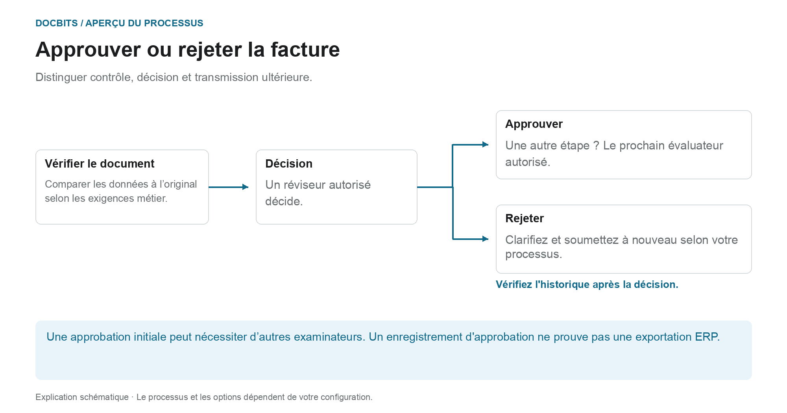
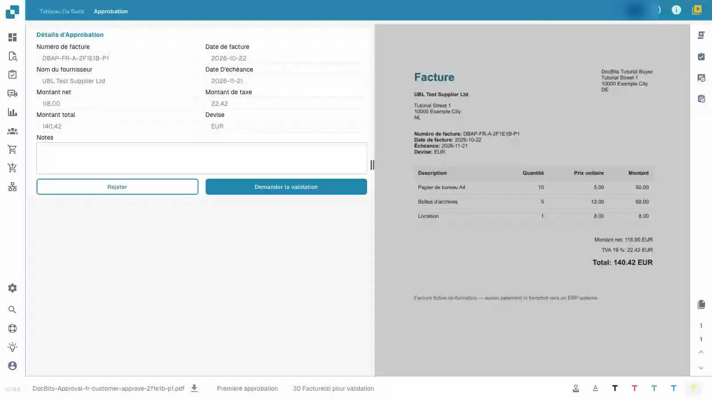
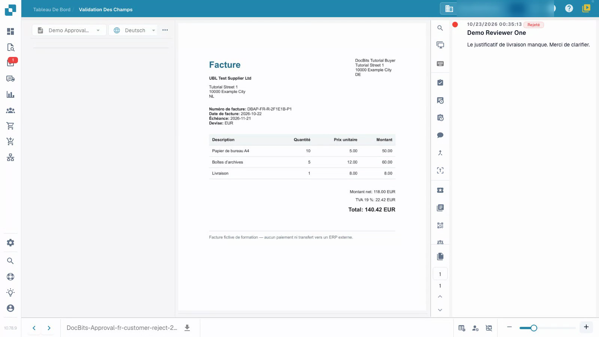

# Approuver ou rejeter une facture

## Ce qui suit une décision d’approbation commerciale

<figure><figcaption>
Distinguer contrôle, décision et transmission ultérieure. Le diagramme est schématique ; les paramètres actifs de votre organisation déterminent le comportement réel.
</figcaption></figure>

La validation technique vérifie les données du document ; l'approbation enregistre la décision commerciale d'un réviseur autorisé. Même une facture techniquement valable peut nécessiter une ou plusieurs approbations.

1. **Vérifiez la responsabilité :** Ouvrez la facture attribuée et vérifiez le niveau d'approbation que vous êtes autorisé à décider.
2. **Examinez la facture :** Comparez les valeurs d'en-tête, les éléments de ligne et les taxes avec le document d'origine et les exigences de votre entreprise.
3. **Documenter la décision :** Approuvez une facture correcte ou rejetez-la avec une raison spécifique. Attendez la réponse, puis vérifiez l'historique des approbations.
4. **Identifiez l'étape suivante :** Si des étapes d'approbation supplémentaires sont configurées, la facture attend leurs décisions. Après le rejet, la clarification, la correction et toute nouvelle soumission, suivez votre processus configuré. Le processus d'exportation distinct détermine si les données ont atteint le système cible.

### Trois affirmations qui ne veulent pas dire la même chose

| déclaration | Ce qu'il ne prouve pas automatiquement |
| --- | --- |
| **Les données sont validées.** | Qu'un examinateur commercial agréé l'a approuvé. |
| **Un évaluateur a approuvé.** | Que toutes les étapes d’approbation requises ont été franchies. |
| **Les approbations ont été complétées.** | Que la facture a déjà été exportée ou comptabilisée dans ERP. |

Utilisez [Documenter les tâches](tasks.md) pour traiter le travail assigné et [Statut du document](dashboard/document-status.md) pour classer l'état actuel.

La vidéo présente l’approbation du point de vue d’une personne chargée de vérifier les factures.


Approuver ou rejeter une facture


[Regarder la vidéo avec sous-titres](https://docbits-videos.fra1.cdn.digitaloceanspaces.com/settings-assistant/invoice-approval-customer/v1/fr.html)

L'application réelle est affichée ; la formulation des options peut dépendre de la version déployée.

Utilisez l’approbation pour enregistrer votre décision après avoir vérifié le contenu d’une facture déjà validée. Vous avez besoin d'accéder au document et de l'autorisation pour son étape d'approbation actuelle. La vidéo utilise un compte de vérification standard.

## Examiner et décider

1. Ouvrez la facture qui vous est assignée et vérifiez l'étape d'approbation actuelle.
2. Comparez le numéro de facture, le fournisseur, les dates et le total avec l'original. Examinez également les lignes d'articles et les taxes. La validation technique ne remplace pas votre vérification métier.
3. Enregistrez une note d'examen claire. Approuvez une facture correcte, ou rejetez-la avec une raison spécifique lorsqu'elle nécessite des éclaircissements. Attendez que l'opération se termine.
4. Rouvrez le document et inspectez son historique d'approbation. Vérifiez que le nom du vérificateur, l’heure, la décision et la note complète ont bien été enregistrés.

<figure><figcaption>
Formulaire de facture rempli comparé à l&#x27;original.
</figcaption></figure>

<figure><figcaption>
Refus enregistré et motif conservé.
</figcaption></figure>

## Vérifier l'étape suivante

Lorsqu'une deuxième approbation est configurée, votre première approbation laisse la facture en attente d'un autre vérificateur autorisé. Elle n'est pas encore totalement approuvée. Un rejet nécessite des clarifications métier ; la correction et la nouvelle soumission suivent votre processus configuré.

Une entrée dans l'historique d'approbation ne prouve pas que les données ont atteint un système ERP. Dans cet exemple isolé, le canal de récupération n'a pas de cible ERP externe. Le statut technique `pending_data_fetch`, lorsqu'il est affiché, signifie que le document est en attente de récupération des données.

## Pages associées

- [Écran de validation](validation-screen/README.md)
- [Tâches de document](tasks.md)
