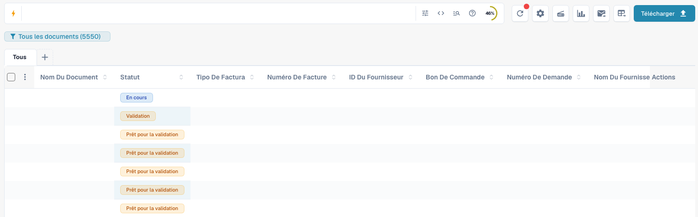
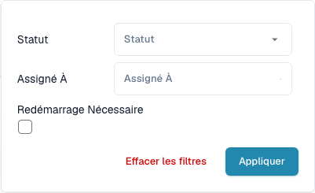
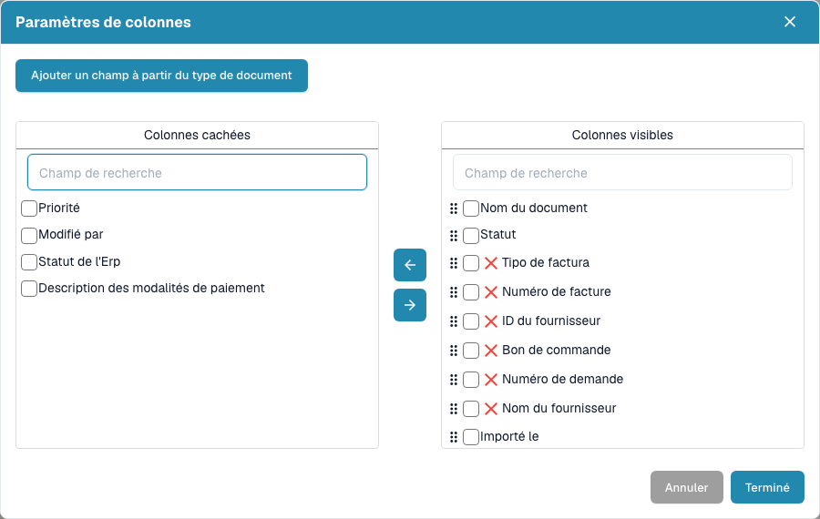
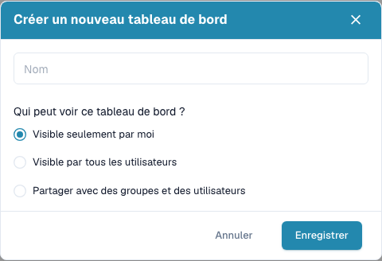

# Tableau de bord

Le tableau de bord est votre liste de travail quotidienne dans DocBits. Retrouvez les documents importés, consultez leur statut, ouvrez-les pour les valider et organisez le travail en équipe.


Les commandes disponibles dépendent de vos autorisations, du statut du document et des modules activés pour votre organisation. Certaines commandes peuvent être absentes. Dans les fenêtres de bureau plus étroites, les actions supplémentaires figurent sous **Plus**.


<figure><figcaption>
Le tableau de bord actuel : recherche, outils, vues enregistrées, types de document et tableau. Les valeurs des documents sont masquées pour protéger les données.
</figcaption></figure>

## La recherche au quotidien en vidéo

Cet exemple commence au bureau d’une utilisatrice fictive à Paris. L’interface française de DocBits occupe ensuite tout l’écran : saisir une partie du nom du fichier, appuyer sur Entrée et vérifier le résultat. Le second exemple montre comment inclure le contenu des documents lorsque le module de recherche plein texte est activé.



[Ouvrir l’exemple avec narration française](https://docbits-videos.fra1.cdn.digitaloceanspaces.com/settings-assistant/dashboard-search-customer/v1/fr.mp4) · [Sous-titres français (VTT)](https://docbits-videos.fra1.cdn.digitaloceanspaces.com/settings-assistant/dashboard-search-customer/v1/fr.vtt) · [Transcription française](https://docbits-videos.fra1.cdn.digitaloceanspaces.com/settings-assistant/dashboard-search-customer/v1/fr.txt)

L’utilisatrice et le bureau sont générés par IA. Les manipulations et les résultats proviennent de véritables enregistrements dans le compte de test DocBits.

## Visite complète du tableau de bord

La cliente de Paris présente la recherche combinée avec AND, les filtres de statut, l’aide à la recherche, les paramètres des colonnes, les statistiques et l’actualisation.



[Ouvrir le lecteur avec sous-titres](https://docbits-videos.fra1.cdn.digitaloceanspaces.com/settings-assistant/dashboard-tour-customer/v4/fr.html) · [Sous-titres français (VTT)](https://docbits-videos.fra1.cdn.digitaloceanspaces.com/settings-assistant/dashboard-tour-customer/v4/fr.vtt) · [Transcription](https://docbits-videos.fra1.cdn.digitaloceanspaces.com/settings-assistant/dashboard-tour-customer/v4/fr.txt)

## Commencer votre travail quotidien

1. Vérifiez l’organisation active et, si disponible, la sous-organisation.
2. Choisissez un type de document ou conservez **Tous**.
3. Utilisez la recherche et les filtres.
4. Consultez **Statut** et **Assigné à**, puis ouvrez la ligne du document pour le traiter.
5. Actualisez la liste après le traitement ou l’importation de documents.

## Rechercher et filtrer les documents

Saisissez un nom de document, un numéro de facture ou une autre valeur métier, puis appuyez sur **Entrée**. L’icône de filtre de la recherche permet de choisir le **Statut**, la personne assignée et les documents nécessitant un redémarrage. Cliquez sur **Appliquer**. Supprimez des filtres individuels ou effacez les filtres si un document semble manquer. Les onglets de types de document et les vues enregistrées limitent aussi la liste.

La recherche propose des filtres structurés, une vue de requête directe et une aide sur les champs et la syntaxe. Reprenez les noms de champ et les exemples de cette aide. Les noms techniques des champs ne changent pas avec la langue. Les fonctions avancées dépendent des capacités de recherche activées.

Lorsque la recherche plein texte est activée, le menu de contenu contrôle les recherches en texte simple : le mode automatique recherche d’abord dans les champs métier, puis dans le contenu si les champs ne donnent aucun résultat ; l’inclusion du contenu ajoute ses résultats ; le mode champs uniquement exclut le contenu. Un indicateur signale les résultats provenant du contenu. Un `+` après le nombre de résultats indique une fenêtre limitée : affinez la recherche.

Si le sélecteur de dates séparé est affiché, choisissez une période d’import prédéfinie ou personnalisée. Il est masqué avec la recherche plein texte ; utilisez alors les champs de date de la barre de recherche.

<figure><figcaption>
Filtrez par statut, personne assignée et nécessité de redémarrage.
</figcaption></figure>

## Lire et organiser le tableau

Chaque ligne représente un document. Selon les colonnes configurées, elle indique son nom, son statut, son type, ses données de facture, son fournisseur, son responsable, ses dates et ses montants. Cliquez sur un en-tête triable pour modifier l’ordre. Faites défiler horizontalement pour voir d’autres colonnes et utilisez la pagination et le nombre de documents par page pour parcourir les résultats.

Si le regroupement est disponible, sélectionnez un champ au-dessus du tableau. Pour les dates, choisissez le jour, la semaine ou le mois. Ouvrez un groupe pour voir ses documents, ou retirez le regroupement pour revenir à la liste normale.

Le bouton **+** à côté des onglets permet d’afficher d’autres types de document. Réorganisez les onglets en les faisant glisser. Retirer un onglet modifie uniquement la vue et ne supprime aucun document.

Ouvrez l’engrenage, puis les paramètres des colonnes. Déplacez les colonnes entre les listes masquées et visibles et faites glisser les colonnes visibles pour les ordonner. Vous pouvez aussi ajouter les champs d’un type de document. Voir [Modifier les colonnes de document](change-document-columns.md).

<figure><figcaption>
Choisissez et ordonnez les informations affichées dans les paramètres des colonnes.
</figcaption></figure>

## Comprendre les statuts et les actions

Les statuts de traitement indiquent des étapes telles que l’OCR, la classification ou l’export. **Prêt pour la validation** signifie que le document peut être vérifié. Les statuts d’approbation indiquent une approbation en attente. **Terminé** indique que l’export du document est achevé. Cliquez sur le statut **Erreur** pour consulter les détails disponibles.

Si des durées de traitement sont disponibles, survolez un statut pour voir les phases et leur durée. Une icône de doublon apparaît pour les documents ayant des doublons possibles ; ouvrez-la pour comparer les documents associés.

Ouvrez une ligne pour travailler dans l’écran de validation. Le menu d’actions propose les opérations autorisées : attribution, téléchargement, historique ou redémarrage du traitement. Les variantes de téléchargement dépendent du document et peuvent inclure des annotations ou des formats de facture électronique.

Cochez plusieurs documents et ouvrez le menu de l’en-tête pour les actions groupées autorisées : attribution, fusion, redémarrage, relance d’export ou suppression. Vérifiez la sélection et chaque confirmation. Ces actions peuvent modifier les documents ; enregistrer une vue change uniquement la présentation de la liste.

## Enregistrer un tableau de bord personnel

Ouvrez le bouton bleu de vue sous la recherche et créez un nouveau tableau de bord. Donnez-lui un nom et choisissez une visibilité privée, pour tous ou pour certains groupes et utilisateurs. Enregistrez les filtres, le tri et les colonnes pour les tâches récurrentes.

Sélectionnez les vues enregistrées dans le même menu. Enregistrez les modifications lorsque la vue vous appartient et a changé. Vous ne pouvez pas écraser une vue partagée avec vous : créez votre propre vue. Partager une vue n’accorde aucun accès supplémentaire aux documents. Voir [Tableaux de bord personnels](personal-dashboards.md).

<figure><figcaption>
Créez un tableau de bord nommé et choisissez qui peut le voir.
</figcaption></figure>

## Importer des documents et utiliser les outils

Choisissez **Télécharger**, déposez des fichiers dans la boîte de dialogue ou sélectionnez-les sur votre ordinateur, puis lancez l’importation. Si disponible, l’option de classification permet de fixer explicitement le type de document. Sinon, DocBits classe les fichiers automatiquement.

Les autres outils actualisent la liste, ouvrent les paramètres avancés, démarrent un scanner, affichent les statistiques de statut, lancent l’import de courriels configuré ou demandent un export CSV/Excel. La numérisation et l’export nécessitent une configuration adaptée. L’export du tableau est distinct de l’export d’un document vers votre ERP. Enregistrez les modifications de colonnes de votre vue avant l’export, car celui-ci utilise la configuration enregistrée. Voir [Outils du tableau de bord](dashboard-tools.md).

<figure><figcaption>
Importez des fichiers et choisissez leur type de document avant l’importation si nécessaire.
</figcaption></figure>

## Si un document ou une commande manque

Vérifiez d’abord l’organisation, la vue active, le type de document, le texte recherché et les filtres. Actualisez la liste et consultez les autres pages. Si une commande reste absente, demandez à votre administrateur de vérifier les autorisations et les modules.

**Ctrl/Cmd + K** ouvre la recherche rapide globale ; **Ctrl/Cmd + Q** actualise le tableau de bord ; **Ctrl/Cmd + H** ouvre l’aide. Le menu de l’engrenage contient la référence des raccourcis. Le compteur de documents en attente de toute l’organisation, s’il est affiché, est un indicateur d’administration, pas votre compteur personnel de tâches.

Utilisez Ctrl sous Windows/Linux et Cmd sous macOS. Les raccourcis du navigateur ou du système peuvent avoir la priorité.
