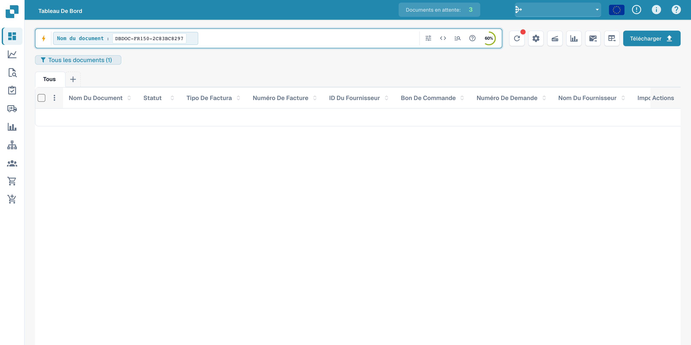
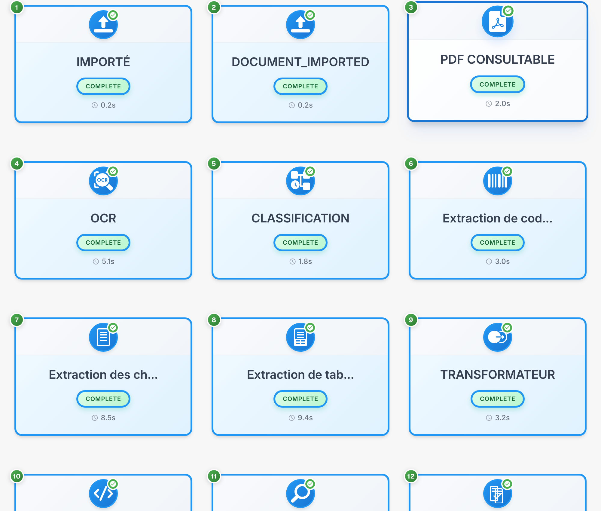

# Flux du document

Le flux du document montre l’ordre, le statut et la durée des étapes de traitement. L’exemple utilise une facture fictive.

## Ouvrir le flux

Recherchez le document dans le tableau de bord. Les valeurs des documents sont masquées.

<figure><figcaption>
Recherche du document fictif dans le tableau de bord ; les valeurs sont masquées.
</figcaption></figure>

Ouvrez la validation des champs, puis le menu d’options de la barre droite pour consulter le flux du document.

<figure><figcaption>
Menu d’options de validation permettant d’ouvrir le flux du document.
</figcaption></figure>

## Lire les étapes

Chaque carte représente une étape, comme l’import, l’OCR, la classification ou l’extraction des champs. Suivez leur numérotation.

<figure><figcaption>
Étapes de traitement d’une facture fictive ; les codes techniques restent inchangés.
</figcaption></figure>

Les identifiants techniques comme `DOCUMENT_IMPORTED` et `COMPLETE` restent inchangés. `COMPLETE` indique une étape terminée.

## Consulter les détails

Sélectionnez une carte pour consulter ses détails et journaux disponibles.

| Détail | Signification |
| --- | --- |
| Module | Composant de traitement de l’étape |
| Statut | État actuel de cette étape |
| Durée | Temps de traitement enregistré |
| Journaux | Messages techniques disponibles |

Examinez les messages d’une étape en attente ou en échec avant de relancer le traitement. Certains titres de diagnostic peuvent rester en anglais dans le produit.

Les détails de chaque étape présentent le composant de traitement, le statut, la durée et les journaux techniques disponibles.
