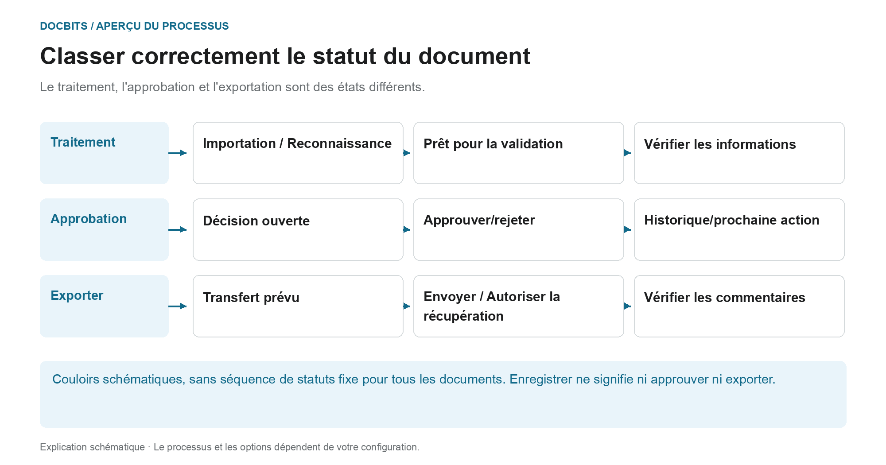
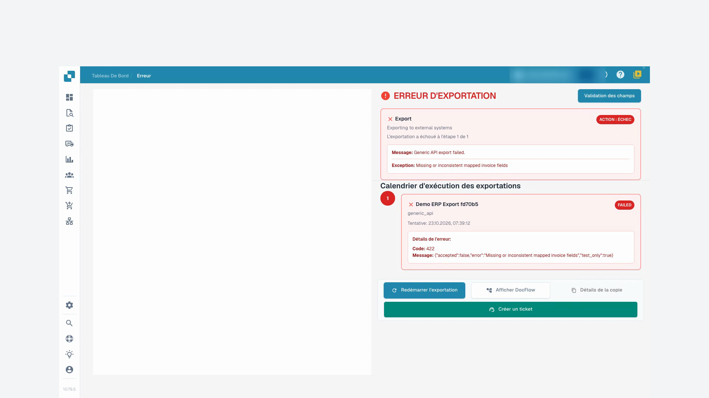
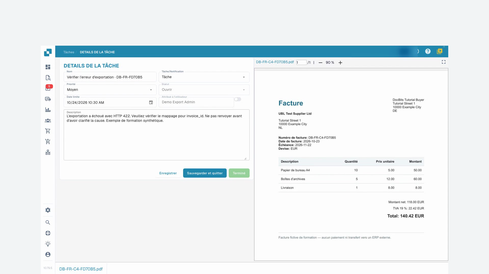

# Statut des documents

## Trois questions de statut au lieu d'une seule chaîne de statut

<figure><figcaption>
Le traitement, l&#x27;approbation et l&#x27;exportation sont des états différents. Le diagramme est schématique ; les paramètres actifs de votre organisation déterminent le comportement réel.
</figcaption></figure>

Un document peut encore attendre une décision d'approbation commerciale même si la reconnaissance est terminée. Lisez le statut affiché dans le contexte de l'étape de traitement et de votre processus d'approbation.

| Question | Signification | Étape suivante |
| --- | --- | --- |
| **Le traitement est-il terminé ?** | OCR, la classification et l'extraction préparent le document pour révision. « Prêt pour la validation » n'est pas une approbation commerciale. | Ouvrez le document, comparez les informations avec l'original et modifiez les erreurs des champs obligatoires. |
| **La décision d’approbation métier est-elle terminée ?** | Une approbation peut avoir plusieurs niveaux. Une première approbation ne complète pas automatiquement toutes les étapes. | Vérifiez le niveau actuel, l’examinateur responsable et l’historique des approbations. |
| **Le document a-t-il été transféré ?** | Le statut de l'exportation et les commentaires décrivent le transfert technique. Une valeur stockée ou une entrée d'approbation ne prouve pas le traitement ERP. | Lisez les détails de l'exportation et, si nécessaire, reproduisez le processus dans le système cible. |

Le graphique organise ces questions en trois pistes. Il ne s'agit pas d'une liste exhaustive des codes d'état technique et n'établit pas un ordre universel. Les transitions réelles dépendent du type de document, du flux de travail et du chemin d'exportation.

### Si des erreurs se produisent, commencez à l’étape concernée

Ouvrez l'état d'erreur et lisez le message. Si une valeur requise est manquante, vérifiez-la et corrigez-la par rapport à l'original. Si le destinataire signale une erreur d’exportation, résolvez-en la cause avant de réessayer. Utilisez [Flux de documents](document-flow.md) pour les étapes de traitement et le guide [Approbation](../approve-or-reject-invoices.md) pour les décisions d'approbation commerciale.

Les statuts de traitement indiquent des étapes telles que l’OCR, la classification ou l’export. **Prêt pour la validation** signifie que le document peut être vérifié. Les statuts d’approbation indiquent une approbation en attente. **Terminé** indique que l’export du document est achevé. Cliquez sur le statut **Erreur** pour consulter les détails disponibles.

Si des durées de traitement sont disponibles, survolez un statut pour voir les phases et leur durée. Une icône de doublon apparaît pour les documents ayant des doublons possibles ; ouvrez-la pour comparer les documents associés.

Ouvrez une ligne pour travailler dans l’écran de validation. Le menu d’actions propose les opérations autorisées : attribution, téléchargement, historique ou redémarrage du traitement. Les variantes de téléchargement dépendent du document et peuvent inclure des annotations ou des formats de facture électronique.

Cochez plusieurs documents et ouvrez le menu de l’en-tête pour les actions groupées autorisées : attribution, fusion, redémarrage, relance d’export ou suppression. Vérifiez la sélection et chaque confirmation. Ces actions peuvent modifier les documents ; enregistrer une vue change uniquement la présentation de la liste.

Le [guide du tableau de bord](README.md) présente la recherche, les actions et les vues enregistrées.

## Tutoriel vidéo: Traiter une facture bloquée


Traiter une facture bloquée


[Voir avec sous-titres et chapitres](https://docbits-videos.fra1.cdn.digitaloceanspaces.com/settings-assistant/blocked-invoices-customer/v1/fr.html)

Certains libellés natifs peuvent rester dans une autre langue. Les identifiants techniques des champs sont conservés.

J'ouvre la facture dans la validation des champs. Dans cet exemple, le numéro de facture est manquant. Les autres valeurs sont déjà remplies. Je les compare avec l'original avant de modifier quoi que ce soit.

Maintenant, je saisis le numéro de facture et je quitte le champ. Ensuite, j'enregistre la facture. J'attends le retour et je recharge le document. Ainsi, je vois si la correction est vraiment conservée.

Le numéro est toujours présent après la réouverture. L’erreur du champ obligatoire est corrigée. Mais l’enregistrement ne signifie pas que la facture a été approuvée ou exportée vers l’ERP.

Pour une deuxième facture, la liste affiche une erreur d'exportation. J'ouvre le statut et je lis les détails. Le destinataire de test a rejeté les données transmises avec le code d'erreur 422. Le mappage technique doit être vérifié ici. Je ne redémarre pas simplement l'exportation plusieurs fois.

<figure><figcaption>
Erreur d’export et réponse du destinataire
</figcaption></figure>

Dans les tâches du document, je crée une tâche précise pour notre administrateur de test. J’indique le code d’erreur et je lui demande de vérifier le numéro de facture dans le mappage. Pour cette formation, l’envoi d’e-mails reste désactivé.

Après le rechargement, je vérifie que la tâche est enregistrée et assignée à la bonne personne. La tâche reste ouverte jusqu'à ce que la cause soit clarifiée. Créer une tâche n'est pas encore une exportation réussie.

<figure><figcaption>
Tâche de transmission enregistrée et attribuée à l’administrateur
</figcaption></figure>
