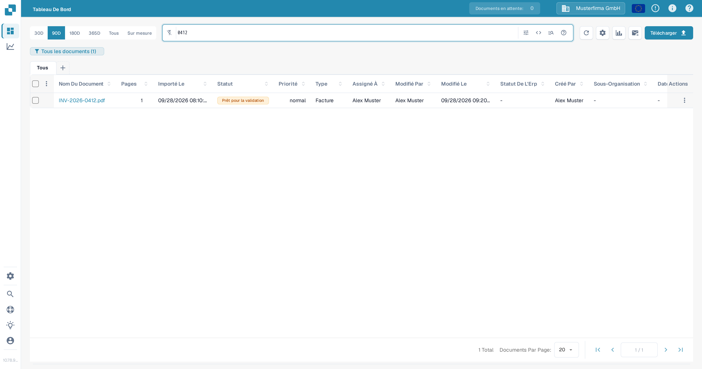
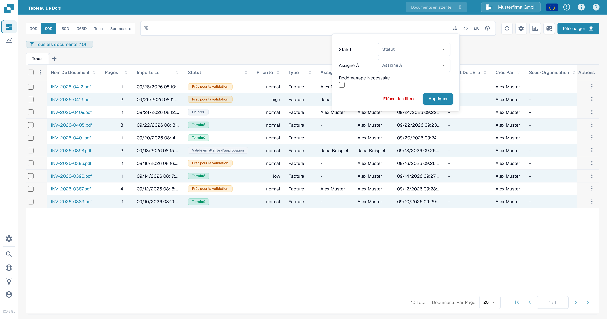
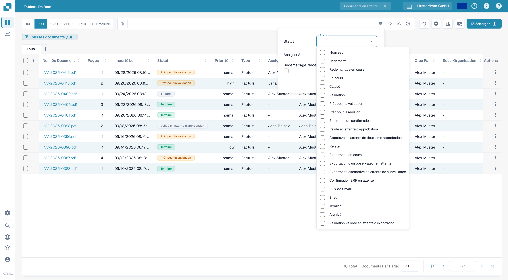
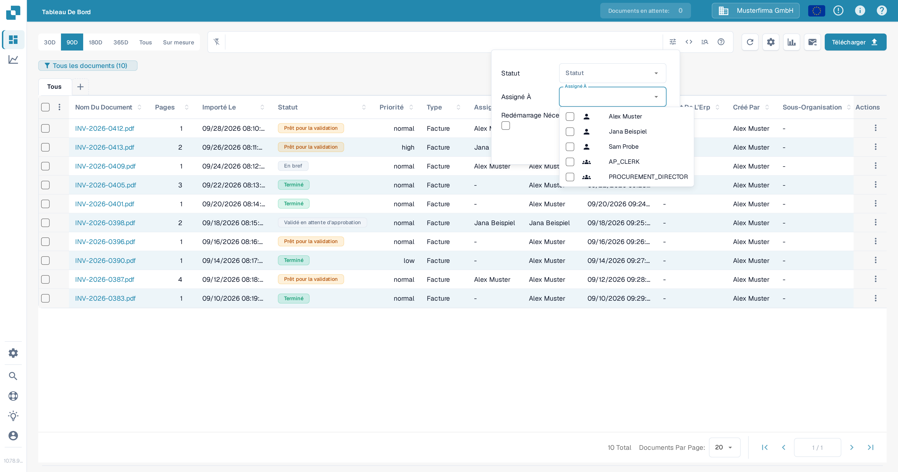
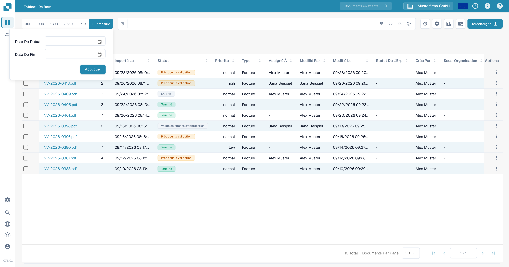
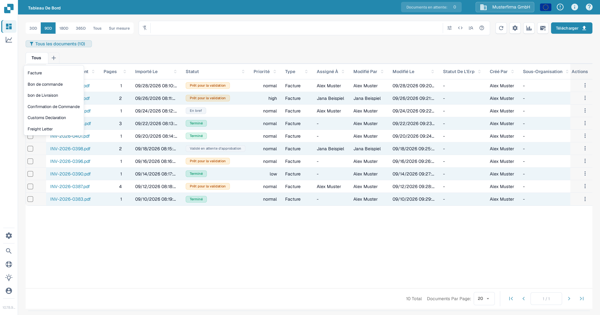
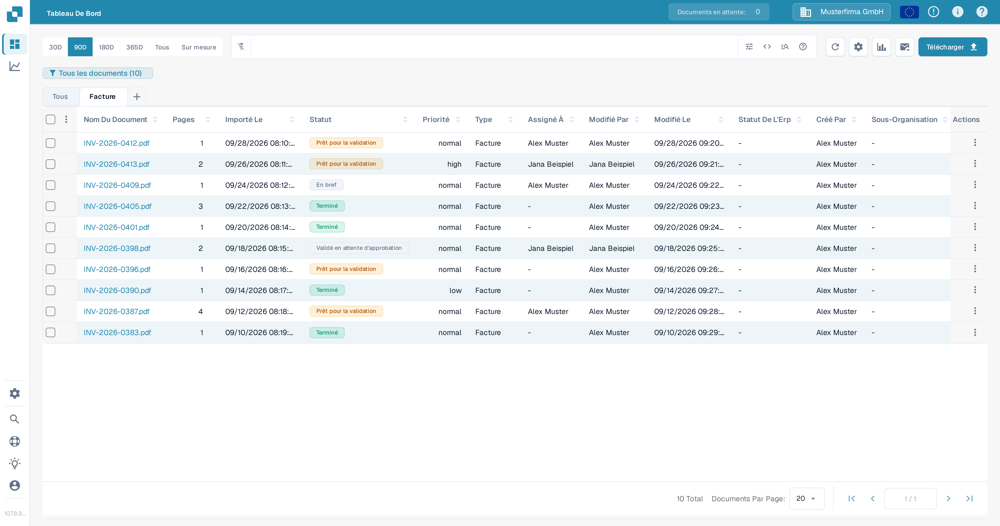

# Filtrage des documents

Utilisez la barre de recherche du tableau de bord, le panneau de filtres, la plage de dates et les onglets de types de documents pour restreindre la liste des documents. Les commandes fonctionnent ensemble : un document doit correspondre à la recherche active et aux filtres actifs pour rester dans le tableau.

## Trouver un document par son nom

1. Ouvrez le **Tableau de bord**.
2. Saisissez une partie du nom d'un document dans la barre de recherche au-dessus du tableau et appuyez sur **Entrée**. Le compteur du badge du tableau de bord et le tableau se mettent à jour pour afficher les documents correspondants.
3. Remplacez le terme recherché lorsque vous voulez chercher un autre document. Pour les recherches par champ et la syntaxe de recherche, consultez [Recherche rapide](quick-search.md).

<figure><figcaption>Une recherche par nom de document restreint la liste des documents de test.</figcaption></figure>

## Filtrer par statut, responsable ou redémarrage requis

1. Sélectionnez l'**icône de filtres** (curseurs) à l'extrémité droite de la barre de recherche.
2. Choisissez une ou plusieurs valeurs de **Statut**. Vous pouvez sélectionner plusieurs statuts à la fois.
3. Dans **Assigné À**, sélectionnez les utilisateurs dont vous voulez voir les documents. Si votre organisation a activé les permissions de groupe, des groupes peuvent apparaître dans cette même liste. Il n'existe pas de champ distinct **Assigné au groupe** dans ce panneau.
4. Sélectionnez **Redémarrage Nécessaire** pour afficher les documents qui nécessitent un redémarrage.
5. Sélectionnez **Appliquer**. Sélectionnez **Effacer les filtres** dans ce panneau pour supprimer ces sélections ; le texte de recherche et la plage de dates sont des commandes distinctes.

<figure><figcaption>Le panneau de filtres actuel comporte trois critères et deux actions.</figcaption></figure>

<figure><figcaption>Sélectionnez les statuts de traitement dont vous avez besoin.</figcaption></figure>

<figure><figcaption>Sélectionnez un utilisateur dans Assigné À.</figcaption></figure>

Pour une explication de la signification de chaque statut de traitement, consultez [État du document](document-status.md).

## Choisir une plage de dates d'importation

Au-dessus de la barre de recherche, sélectionnez **30D**, **90D**, **180D**, **365D** ou **Tous** pour modifier la plage de dates d'importation. Sélectionnez **Sur mesure**, choisissez **Date De Début** et **Date De Fin**, puis sélectionnez **Appliquer** pour une plage spécifique. Le choix actuel est mis en évidence.

<figure><figcaption>Utilisez Sur mesure lorsque les plages de dates prédéfinies ne conviennent pas.</figcaption></figure>

## Utiliser les onglets de types de documents

1. Sélectionnez **+** à côté de **Tous**. Le menu liste les types de documents disponibles pour votre organisation.
2. Sélectionnez un type, par exemple **Facture**, pour ajouter son onglet. Sélectionnez ensuite le nouvel onglet pour filtrer le tableau sur ce type. **Tous** supprime la restriction de type sans supprimer l'onglet.
3. Pour supprimer un onglet de type, sélectionnez son **×**. L'onglet **Tous** ne peut pas être supprimé.

<figure><figcaption>Ajoutez un onglet de type de document depuis le menu plus.</figcaption></figure>

<figure><figcaption>Choisissez l'onglet pour appliquer le filtre de type ; utilisez × pour supprimer l'onglet.</figcaption></figure>

Si le menu **+** ne contient aucun type, demandez à un administrateur de vérifier quels types de documents sont actifs pour votre organisation. Consultez [Document Types](../../../administration-and-setup/settings/global-settings/document-types/README.md). Pour enregistrer une combinaison de filtres pour plus tard, consultez [Tableaux de bord personnels](personal-dashboards.md).
