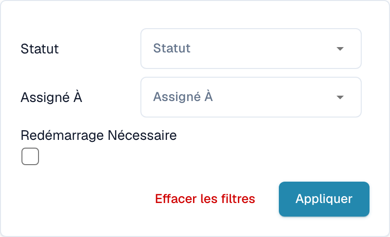

# Filtrer les documents

Dans le tableau de bord, sélectionnez l’icône **Filtres** (trois curseurs) à l’extrémité droite de la barre de recherche. Vous pouvez limiter la liste par **Statut**, **Assigné à** ou **Redémarrage nécessaire**.

<figure><figcaption>
Filtres du tableau de bord par affectation et besoin de redémarrage.
</figcaption></figure>

Choisissez le statut ou la personne responsable prévue, puis sélectionnez **Appliquer**. Effacez les filtres pour retirer les restrictions. Les options de date dépendent de la configuration et de la vue. Vérifiez les filtres actifs avant d’interpréter le nombre de documents.
