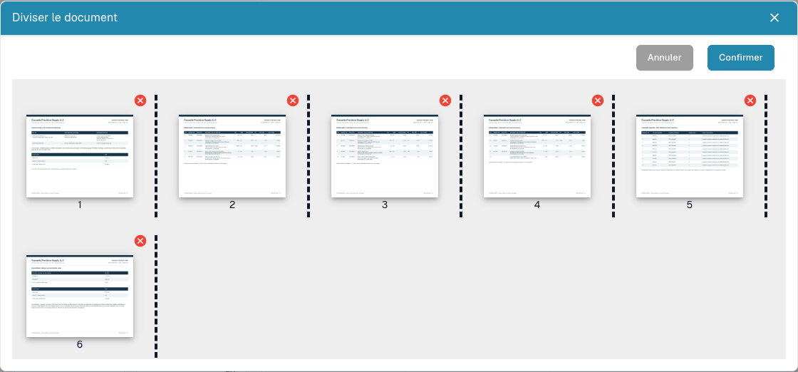

# Diviser un PDF et organiser ses pages

<figure><figcaption>
Miniatures, séparateurs et commandes de retrait avant de soumettre une division.
</figcaption></figure>

Utilisez la division manuelle lorsqu'un PDF contient plusieurs documents indépendants. Exemple : facture A aux pages 1–3, facture B aux pages 4–7, bon de livraison aux pages 8–10. Chaque document doit être traité séparément.

## Préparer

Vous devez disposer du droit de modification et d'un document de plusieurs pages. Conservez l'original. Faites lever un verrouillage avec la personne responsable avant de modifier le document.

## Étapes

1. Ouvrez le document depuis le tableau de bord et examinez toutes ses pages.
2. Dans la visionneuse, ouvrez les options supplémentaires et choisissez la division du document.
3. Vérifiez les miniatures numérotées. Placez un séparateur après la dernière page de chaque document : après les pages **3** et **7** dans l'exemple.
4. Faites glisser les miniatures pour corriger l'ordre. Vérifiez à nouveau l'ordre et les séparateurs.
5. Retirez une page avec la **croix rouge** uniquement si elle doit être exclue. Une page intercalaire vide peut être inutile ; un détail fiscal ou une annexe peut être indispensable.
6. Choisissez **Confirmer**, lisez la demande de confirmation et poursuivez lorsque les groupes sont corrects. **Annuler** permet de quitter sans soumettre la division.
7. Ouvrez chaque document obtenu dans le tableau de bord. Vérifiez première et dernière page, nombre de pages, type et valeurs extraites.

## Vérifier et diagnostiquer

Chaque page d'origine doit appartenir à un document prévu ou être volontairement exclue. Une division ne prouve ni l'extraction réussie, ni l'approbation, ni l'export vers l'ERP.

Si l'option manque, vérifiez nombre de pages, droits, verrouillage et statut. Sans séparation, réorganisation ou retrait, le dialogue peut signaler qu'aucune modification n'est sélectionnée. Après une erreur, inspectez le tableau de bord avant de répéter une opération au résultat incertain.

Voir [Fusion de documents](document-merging.md) et [Classification et extraction](../../../administration-and-setup/settings/document-processing/classification-and-extraction/README.md) pour la séparation automatique par code-barres.
