# Recherche rapide

La **Recherche rapide** est le moyen le plus rapide de trouver des documents sur le tableau de bord. Vous tapez ce que vous cherchez — un nom, un statut, un montant, une date — et la liste des documents se filtre instantanément.

Ce guide est organisé selon la façon dont la recherche se construit :

1. **Champs standard** — les colonnes que possède chaque document (nom du document, statut, dates). Toujours disponibles.
2. **Champs plein texte** — contenu extrait (fournisseur, commande d'achat, numéro de facture, montants, lignes). Disponibles lorsque la recherche plein texte est activée.
3. **Opérateurs, raccourcis et recettes** — la référence complète, une fois que vous êtes à l'aise.

> Vous n'avez rien à mémoriser : cliquez dans la barre de recherche et choisissez un champ et une valeur dans la liste — la Recherche rapide construit la requête pour vous. Les exemples ci-dessous montrent aussi la forme saisie afin que vous puissiez les copier directement.

<figure>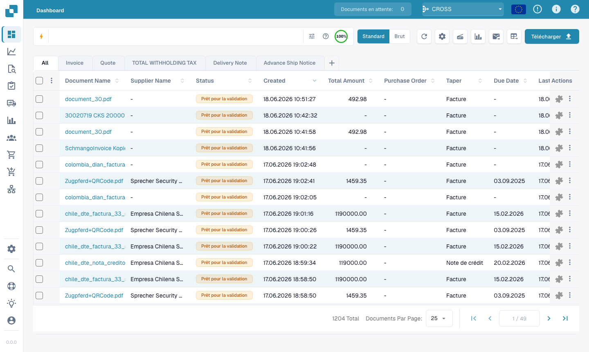<figcaption><p>La barre de Recherche rapide en haut du tableau de bord.</p></figcaption></figure>

---

## Fonctionnement de la barre de recherche — chips, barre d'outils et vue brute

Avant de voir les champs eux-mêmes, il est utile de savoir comment la barre est organisée.

### Les conditions deviennent des chips

Lorsque vous complétez une condition (un champ, un opérateur et une valeur), la Recherche rapide la transforme en **chip** — une pastille colorée dans la barre — et en commence une nouvelle. Un chip affiche le **champ**, l'**opérateur** et la **valeur**, avec un **×** pour le supprimer. Les chips sont colorés selon l'emplacement des données :

| Couleur du chip | Type de champ |
|-----------------|---------------|
| **Bleu** | Colonne standard (nom du document, statut, dates) |
| **Orange** | Champ plein texte / extrait (fournisseur, montant, numéro de facture) |
| **Violet** | Recherche vectorielle (sémantique) |
| **Vert** | Recherche dans le texte OCR |

Cliquez sur un chip pour le modifier (il redevient du texte) ; cliquez sur **×** pour le supprimer.
Plusieurs chips combinés sont lus comme un **AND** par défaut.

### La barre d'outils

À l'extrémité droite de la barre :

- **ⓘ Aide** — ouvre la référence intégrée **Dashboard Search — Fields & Syntax**, qui liste tous les champs, opérateurs et raccourcis disponibles dans votre espace de travail.
- **Filtres (tune)** — un panneau rapide pour les filtres courants Statut / Utilisateur / Redémarrage, avec **Clear filters** et **Apply**.
- **Anneau d'index** — un petit anneau de progression indiquant quelle part de votre index plein texte est construite (affiché uniquement lorsque la recherche plein texte est activée).

### Vue standard ou vue brute

La barre affiche normalement votre requête sous forme de chips (**vue standard**). Passez en **vue brute** pour voir et modifier la requête en texte simple (p. ex. `status=ready_for_validation AND supplier_name=Test`) — pratique pour copier, partager ou taper directement une longue requête. Votre requête est conservée lors du changement de vue et mémorisée lorsque vous rechargez le tableau de bord.

---

## Partie 1 — Champs standard

Les champs standard sont les colonnes propres du document. Ils sont **toujours disponibles**, que la recherche plein texte soit activée ou non.

### Trouver des documents par nom

Le nom du document est la recherche la plus courante. Il existe trois façons de le faire correspondre — toutes **insensibles à la casse** :

#### `=` → commence par

```
filename=invoice
```

Trouve les documents dont le nom **commence par** « invoice ». La casse étant ignorée, tous ceux-ci correspondent à `filename=invoice` :

```
Invoice.pdf   iNVoice.pdf   iNvoiCE.pdf   INVOICE.pdf
Invoice.xml   iNVoice.xml   iNvoiCE.edi   …
```

Ne correspond **pas** à `XYZ_Invoice.pdf` (ici « invoice » est au milieu — utilisez `:` dans ce cas).

<figure>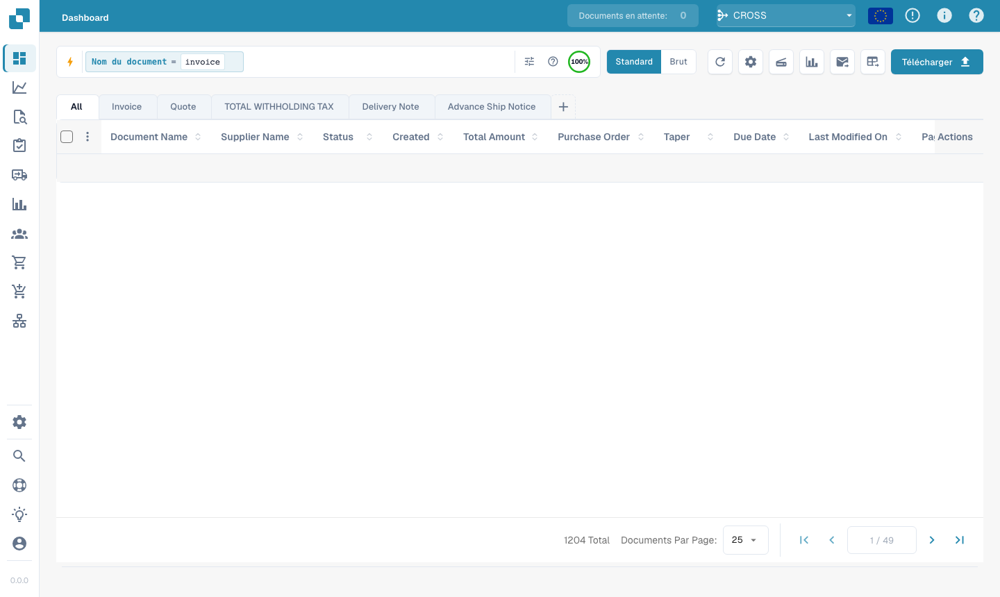<figcaption><p><code>filename=invoice</code> — uniquement les noms qui <strong>commencent par</strong> « invoice », quelle que soit la casse (<code>Invoice.pdf</code>, <code>iNVoice.pdf</code>, <code>INVOICE_2026.pdf</code> … correspondent tous). Comparez avec <code>:</code> ci-dessous.</p></figcaption></figure>

#### `:` → contient (n'importe où)

```
filename:invoice
```

Utilisez `:` pour faire correspondre le mot **n'importe où** dans le nom — `2026_Invoice.pdf`, `vietnam_einvoice_sample.xml`, `scan_invoice_copy.pdf`.

<figure>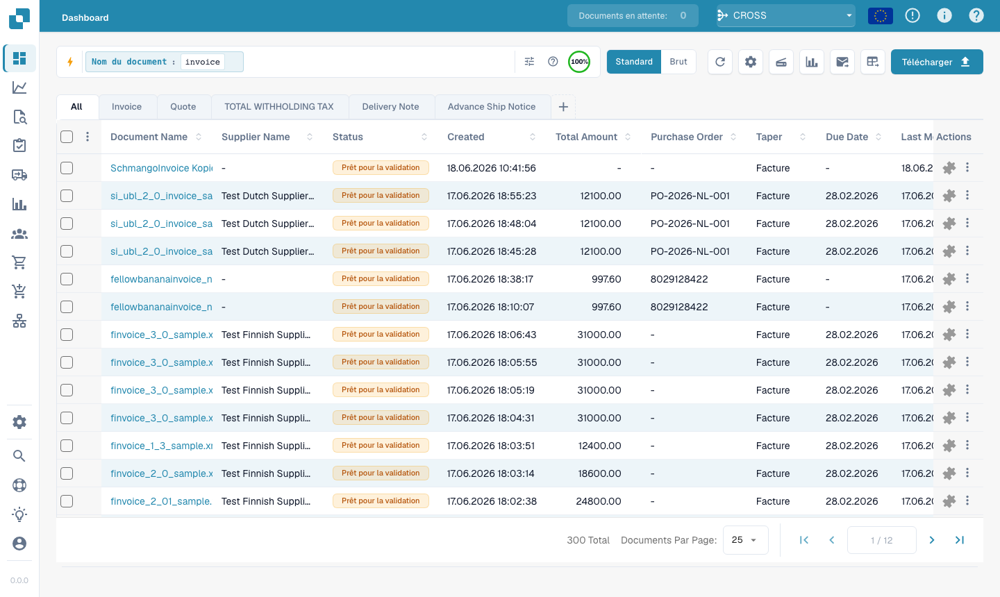<figcaption><p><code>filename:invoice</code> — correspond au mot à n'importe quelle position dans le nom du document.</p></figcaption></figure>

#### `="…"` → commence *ou* finit par

```
filename="invoice"
```

Les guillemets font que `=` correspond aux noms qui **commencent ou finissent** par la valeur — pratique pour un code en tête ou une fin de fichier.

> **Les trois en une ligne :** `=` → commence par · `:` → contient · `="…"` → commence ou finit par. Toutes ignorent les majuscules/minuscules. Vous pouvez voir ce résumé à tout moment via l'**icône d'aide** dans la barre de recherche (section suivante).

### Trouver des documents par statut

```
status=ready_for_validation
```

Le statut est une liste fixe, donc `=` est une correspondance **exacte** et la barre propose un sélecteur de valeurs lorsque vous tapez `status=`.

<figure>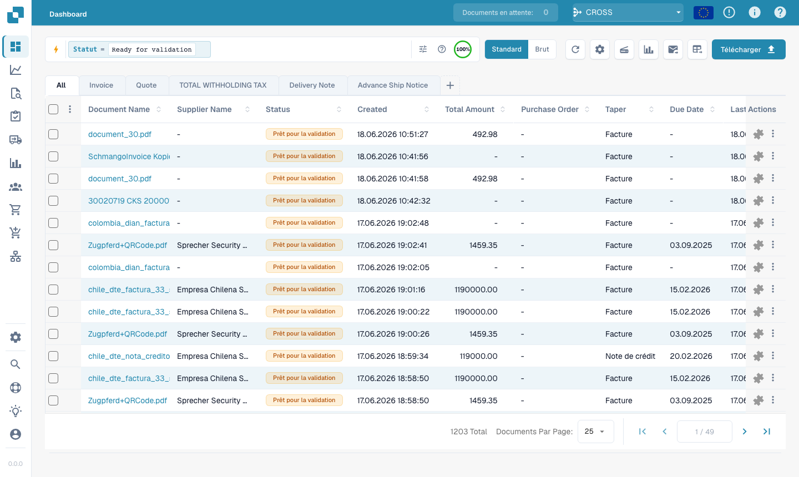<figcaption><p><code>status=ready_for_validation</code> — correspondance exacte sur un champ à liste fixe.</p></figcaption></figure>

### Trouver des documents par date

```
created_on>2026-05-25
```

Utilisez `>`, `<`, `>=`, `<=` pour des plages de dates. Vous pouvez aussi utiliser des dates **relatives** : `today()`, `today()-7` (7 derniers jours), `today()+30` (30 prochains jours).

<figure><figcaption><p><code>created_on&#62;2026-05-25</code> — documents créés après une date.</p></figcaption></figure>

### Trouver des documents par sous-type de facture

```
invoice_sub_type="Cost Invoice"
```

Le sous-type de facture est une liste fixe (par exemple **Cost Invoice** ou **Purchase Invoice**), donc `=` est une correspondance **exacte** et la barre propose un sélecteur de valeurs lorsque vous tapez `invoice_sub_type=`. Utilisez `invoice_sub_type!="Cost Invoice"` pour tout sauf ce sous-type.

---

## Partie 2 — Champs plein texte

Les champs plein texte recherchent dans le **contenu extrait** de vos documents — fournisseur, commande d'achat, numéro de facture, montants, lignes. Ils apparaissent en **orange** et sont disponibles lorsque la **recherche plein texte est activée** pour votre organisation. Les règles de correspondance sont exactement les mêmes que pour les champs texte standard (`=` commence par, `:` contient, `="…"` commence ou finit par).

### Trouver des documents d'un fournisseur

```
supplier_name=Test
```

Commence par sur le nom de fournisseur extrait. Utilisez `supplier_name:fuji` pour une correspondance n'importe où, ou `supplier_name:"Ruiz Foods"` pour mettre entre guillemets une valeur contenant des espaces.

<figure>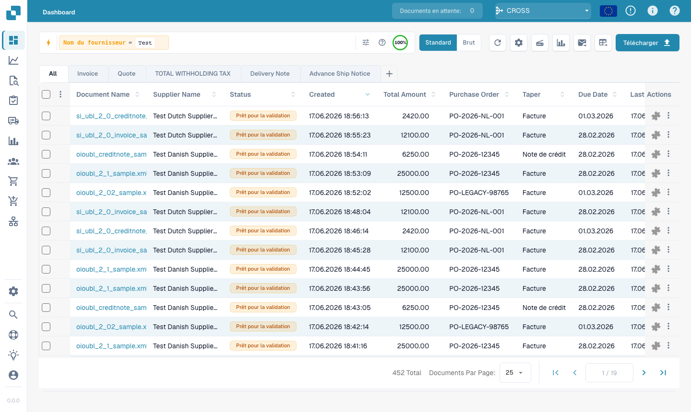<figcaption><p><code>supplier_name=Test</code> — le fournisseur de chaque résultat commence par « Test ».</p></figcaption></figure>

### Trouver des documents par commande d'achat

```
purchase_order=PO
```

Commence par sur le numéro de commande extrait — idéal pour un préfixe de commande.

<figure><figcaption><p><code>purchase_order=PO</code> — documents dont le numéro de commande commence par « PO ».</p></figcaption></figure>

### Trouver des documents par montant

```
total_amount>5000
```

Utilisez `>`, `<`, `>=`, `<=` ou `between 100 and 500` pour une plage.

<figure>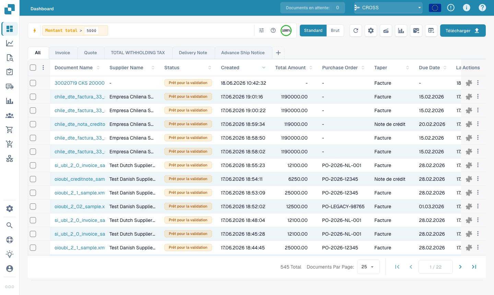<figcaption><p><code>total_amount&#62;5000</code> — factures supérieures à 5 000.</p></figcaption></figure>

Pour une fenêtre, utilisez `between` :

```
total_amount between 1000 and 5000
```

C'est un raccourci pour `total_amount>=1000 AND total_amount<=5000`.

<figure>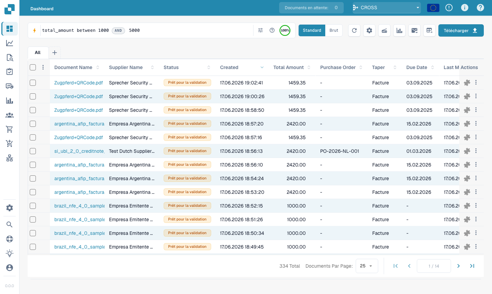<figcaption><p><code>total_amount between 1000 and 5000</code> — chaque résultat se situe dans la fenêtre.</p></figcaption></figure>

### Trouver ce qui manque

```
supplier_name=""
```

`=""` signifie « ce champ **n'est pas renseigné** » ; `supplier_name!=""` signifie « a un fournisseur quelconque ».

<figure>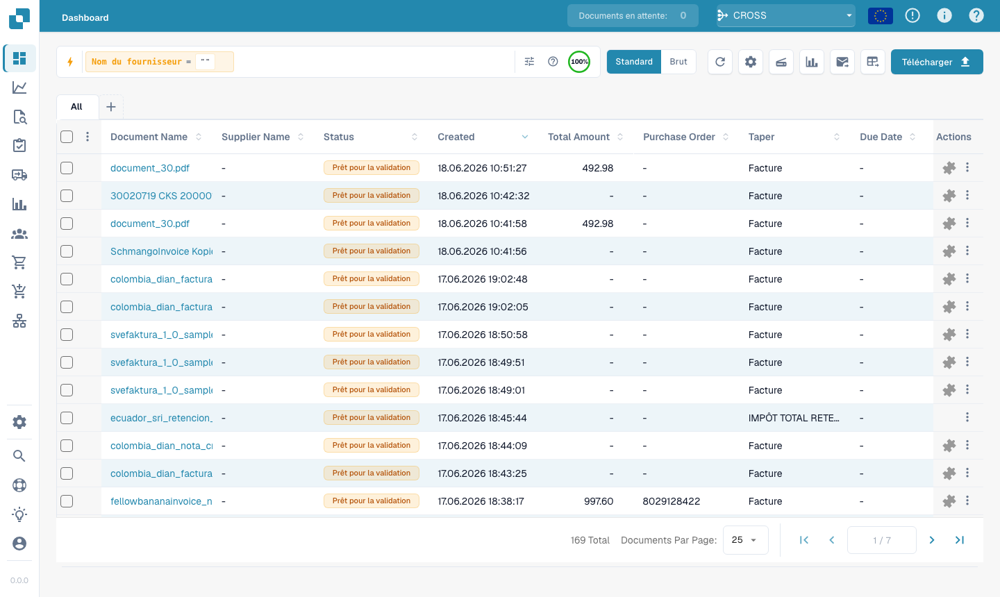<figcaption><p><code>supplier_name=""</code> — documents qui n'ont pas encore de fournisseur.</p></figcaption></figure>

La même vérification de présence fonctionne sur n'importe quel champ — par exemple les documents auxquels il manque encore un code d'affectation AP :

```
ap_assignment_code=""
```

<figure>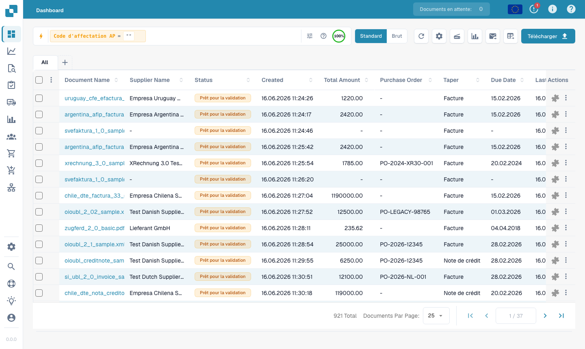<figcaption><p><code>ap_assignment_code=""</code> — documents qui n'ont pas de code d'affectation AP. Utilisez <code>ap_assignment_code!=""</code> pour ceux qui en ont un.</p></figcaption></figure>

---

## Filtres intelligents — un clic

En haut du menu déroulant de la Recherche rapide (cliquez dans la barre de recherche), vous trouverez les **Filtres intelligents** : des recherches prêtes à l'emploi que vous appliquez en un seul clic. Chacun est simplement un raccourci pour une requête que vous pourriez aussi taper vous-même :

| Filtre intelligent | Trouve | Équivaut à |
|--------------------|--------|------------|
| ⚠️ **En retard** | Date d'échéance dépassée | `invoice_due_date<today()` |
| 🕐 **Bientôt dû** | Dans les 7 prochains jours | `invoice_due_date<=today()+7` |
| 👤 **Affecté à moi** | Éléments en attente de votre action | `assigned_to=<you>` |
| 📅 **Boîte du jour** | Importés aujourd'hui | `imported_on>=today()` |
| 📋 **En attente de validation** | Prêts à être validés | `status=ready_for_validation` |
| 🧾 **Documents électroniques** | E-factures (XML, ZUGFeRD, EDI) | `is_edoc=true` |
| ✅ **Correspondance PO totale** | Totalement rapprochés d'une commande d'achat | `po_match_status=full_matched` |
| ➗ **Correspondance PO partielle** | Partiellement rapprochés d'une commande d'achat | `po_match_status=partial_matched` |
| 📉 **Correspondance PO inférieure** | Quantité ou prix unitaire inférieur à la commande d'achat | `po_match_status=under_matched` |

Les trois filtres **correspondance PO** et les champs plein texte nécessitent que la recherche plein texte soit activée pour votre organisation.

<figure><figcaption><p>Les filtres intelligents en haut du menu déroulant de la Recherche rapide — un clic applique le filtre (En retard, Bientôt dû, Affecté à moi, Boîte du jour, En attente de validation, Documents électroniques, Correspondance PO totale / partielle / inférieure).</p></figcaption></figure>

---

## Grouper les résultats

Au lieu d'une liste plate, vous pouvez **grouper** les résultats par n'importe quel champ — fournisseur, statut, type de document, sous-organisation ou un intervalle de dates. Ajoutez un groupement depuis la barre de recherche :

```
group by supplier_name
```

La liste affiche alors des **en-têtes de groupe** repliables, chacun avec le nom du groupe et un **compte** (p. ex. *Ruiz Foods (12)*). Cliquez sur un en-tête pour déplier ou replier ce groupe. Pour les champs de date, vous pouvez grouper par **jour, semaine ou mois**.

<figure>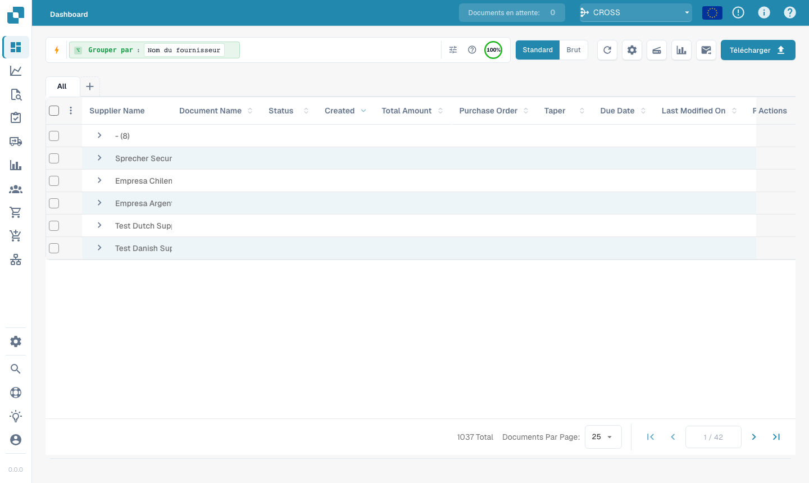<figcaption><p><code>group by supplier_name</code> — les résultats se replient en un en-tête extensible par fournisseur.</p></figcaption></figure>

Le groupement se combine avec n'importe quel filtre — `status=ready_for_validation group by supplier_name` ne groupe que les documents correspondants. Cliquer dans un groupe permet d'**explorer en détail** : la valeur de ce groupe est appliquée comme filtre et vous revenez à la liste plate pour cette sélection.

---

## Partie 3 — Opérateurs, connecteurs, raccourcis

### L'aide intégrée

L'**icône d'aide** dans la barre de recherche ouvre une référence complète de tous les champs, opérateurs et raccourcis disponibles dans votre espace de travail — y compris quels champs sont standard ou plein texte.

<figure><figcaption><p>L'aide intégrée <strong>Dashboard Search — Fields &#38; Syntax</strong> liste chaque opérateur et la façon dont les valeurs correspondent.</p></figcaption></figure>

### Ce que signifie `=` selon le type de champ

Toute correspondance de texte ignore la casse.

| Type de champ | Exemple | `=` signifie |
|---------------|---------|--------------|
| Texte (nom, fournisseur, commande d'achat) | `filename=invoice` | **commence par** |
| Texte, n'importe où | `filename:invoice` | **contient** |
| Texte, début *ou* fin | `filename="invoice"` | **commence ou finit par** |
| Statut / type / correspondance PO (listes fixes) | `status=finished` | **exact** |
| Identifiants (numéro de facture, id fournisseur) | `invoice_number=INV-100` | **exact** |
| Nombre | `total_amount>5000` | plage (`> < >= <= between`) |
| Date | `created_on>2026-01-01` | plage + `today()±N` |

### Opérateurs

| Opérateur | Signification |
|-----------|---------------|
| `=` | commence par (texte) / exact (liste, nombre, date) |
| `:` | contient (texte, n'importe où) |
| `="…"` | commence par ou finit par (texte) |
| `!=` | l'inverse de `=` |
| `>` `<` `>=` `<=` | supérieur / inférieur à |
| `between … and …` | plage inclusive |
| `field=""` / `field!=""` | est vide / est renseigné |
| `today()`, `today()-7`, `today()+30` | dates relatives |

### Connecteurs

Combinez des conditions avec **AND** (les deux vraies), **OR** (l'une ou l'autre), **NOT** et des parenthèses `( … )` pour grouper :

```
status=ready_for_validation AND supplier_name=Test
(status=error OR status=failed) AND created_on>today()-1
```

<figure><figcaption><p><code>status=ready_for_validation AND supplier_name=Test</code> — deux conditions combinées.</p></figcaption></figure>

### Raccourcis

Des formulations plus courtes pour les mêmes requêtes — utilisez celle qui vous paraît la plus lisible :

| Raccourci | Équivaut à | Description |
|-----------|------------|-------------|
| `total_amount gt 5000` | `total_amount>5000` | Alias en toutes lettres pour les opérateurs de comparaison (`gt`/`gte`/`lt`/`lte`/`eq`/`ne`) |
| `due_date > today` | `due_date>today()` | `today` / `yesterday` / `tomorrow` sans parenthèses |
| `imported_on this_week` | `imported_on>=today()-7 AND imported_on<=today()` | Périodes relatives (`this_week`, `last_week`, `this_month`, …) |
| `ap_assignment_code is empty` | `ap_assignment_code=""` | Indique si un champ a une valeur quelconque |
| `status:open` | `status=ready_for_validation` | Libellé de statut simplifié (`open`/`closed`/`failed`/`done`) |
| `total_amount not between 100, 200` | `total_amount<100 OR total_amount>200` | Valeur hors d'une fenêtre |
| `status in (finished, error)` | `status=finished OR status=error` | Correspond à n'importe quelle valeur d'une liste |
| `not status=finished` | `status!=finished` | Nie n'importe quel prédicat |
| `filename contains rechnung` | `filename:rechnung` | Correspondance de chaîne (`contains`/`starts_with`/`ends_with`) |
| `total_amount > 5k` | `total_amount>5000` | Suffixe de devise `k` (×1 000), `M` (×1 000 000) |
| `overdue` | `invoice_due_date<today() AND status!=finished` | Factures impayées après l'échéance |
| `#INV-1234` | `invoice_id:INV-1234` | Préfixe de type Twitter pour l'ID de facture |
| `@User` | `assigned_to:User` | Préfixe de type Twitter pour la personne assignée |
| `$5000+` | `total_amount>=5000` | Préfixe `$` pour les seuils de montant |

### Raccourcis : requête et galerie de résultats

Ces exemples montrent chaque modèle de raccourci avec la requête que vous saisissez et le résultat affiché par le tableau de bord. Le premier groupe utilise des champs standard et fonctionne même lorsque la recherche plein texte n'est pas activée. Le second groupe utilise des champs réservés au plein texte, comme le montant ou la date d'échéance de la facture.

#### Fonctionne sans plein texte

##### Alias d'opérateurs

- Requête : `created_on gt 2026-05-25`
- Équivaut à : `created_on>2026-05-25`
- Résultat : filtre sur Created après le 25 mai 2026.

<figure><figcaption><p><code>created_on gt 2026-05-25</code> - filtre sur Created après le 25 mai 2026.</p></figcaption></figure>

##### Mots de date sans parenthèses

- Requête : `created_on < today`
- Équivaut à : `created_on<today()`
- Résultat : transforme le mot today en today().

<figure><figcaption><p><code>created_on &lt; today</code> - transforme le mot today en today().</p></figcaption></figure>

##### Période relative

- Requête : `created_on this_month`
- Équivaut à : `created_on>=first day of this month AND created_on<=last day of this month`
- Résultat : transforme this_month en fenêtre de dates.

<figure><figcaption><p><code>created_on this_month</code> - transforme this_month en fenêtre de dates.</p></figcaption></figure>

##### Mots vide/renseigné

- Requête : `assigned_to is empty`
- Équivaut à : `assigned_to=""`
- Résultat : trouve les documents sans personne assignée.

<figure><figcaption><p><code>assigned_to is empty</code> - trouve les documents sans personne assignée.</p></figcaption></figure>

##### Statut simplifié

- Requête : `status:open`
- Équivaut à : `status=ready_for_validation`
- Résultat : fait correspondre open au statut de validation.

<figure><figcaption><p><code>status:open</code> - fait correspondre open au statut de validation.</p></figcaption></figure>

##### Pas entre

- Requête : `created_on not between 2026-06-01, 2026-06-15`
- Équivaut à : `(created_on<2026-06-01 OR created_on>2026-06-15)`
- Résultat : trouve les valeurs en dehors d'une fenêtre de dates.

<figure>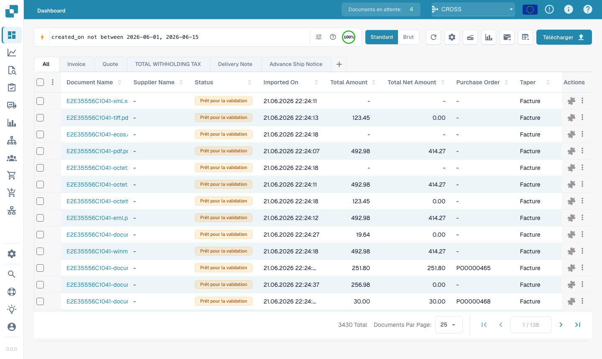<figcaption><p><code>created_on not between 2026-06-01, 2026-06-15</code> - trouve les valeurs en dehors d'une fenêtre de dates.</p></figcaption></figure>

##### Liste in

- Requête : `status in (ready_for_validation, exported)`
- Équivaut à : `status=ready_for_validation OR status=exported`
- Résultat : correspond à n'importe quel statut listé.

<figure><figcaption><p><code>status in (ready_for_validation, exported)</code> - correspond à n'importe quel statut listé.</p></figcaption></figure>

##### Préfixe de négation

- Requête : `not status=finished`
- Équivaut à : `status!=finished`
- Résultat : inverse le prédicat du statut finished.

<figure><figcaption><p><code>not status=finished</code> - inverse le prédicat du statut finished.</p></figcaption></figure>

##### Chaîne contient

- Requête : `filename contains E2E`
- Équivaut à : `filename:E2E`
- Résultat : utilise contains comme recherche de sous-chaîne dans le nom de fichier.

<figure><figcaption><p><code>filename contains E2E</code> - utilise contains comme recherche de sous-chaîne dans le nom de fichier.</p></figcaption></figure>

##### Préfixe facture

- Requête : `#INV-1234`
- Équivaut à : `invoice_id:INV-1234`
- Résultat : fait correspondre #... à une recherche par ID de facture.

<figure><figcaption><p><code>#INV-1234</code> - fait correspondre #... à une recherche par ID de facture.</p></figcaption></figure>

##### Préfixe personne assignée

- Requête : `@Daniel`
- Équivaut à : `assigned_to:"Daniel"`
- Résultat : fait correspondre @... à une recherche par nom de personne assignée.

<figure><figcaption><p><code>@Daniel</code> - fait correspondre @... à une recherche par nom de personne assignée.</p></figcaption></figure>

#### Nécessite la recherche plein texte

Si vous utilisez le même raccourci avec un champ réservé au plein texte, la requête nécessite quand même le plein texte. Par exemple, `ap_assignment_code is empty` utilise le même raccourci vide/renseigné que `assigned_to is empty`, mais le champ d'affectation AP est réservé au plein texte.

##### Suffixe de devise

- Requête : `total_amount > 5k`
- Équivaut à : `total_amount>5000`
- Résultat : transforme k en milliers sur un champ de montant.

<figure><figcaption><p><code>total_amount &gt; 5k</code> - transforme k en milliers sur un champ de montant.</p></figcaption></figure>

##### Raccourci en retard

- Requête : `overdue`
- Équivaut à : `invoice_due_date<today() AND status!=finished`
- Résultat : trouve les factures non terminées après leur date d'échéance.

<figure>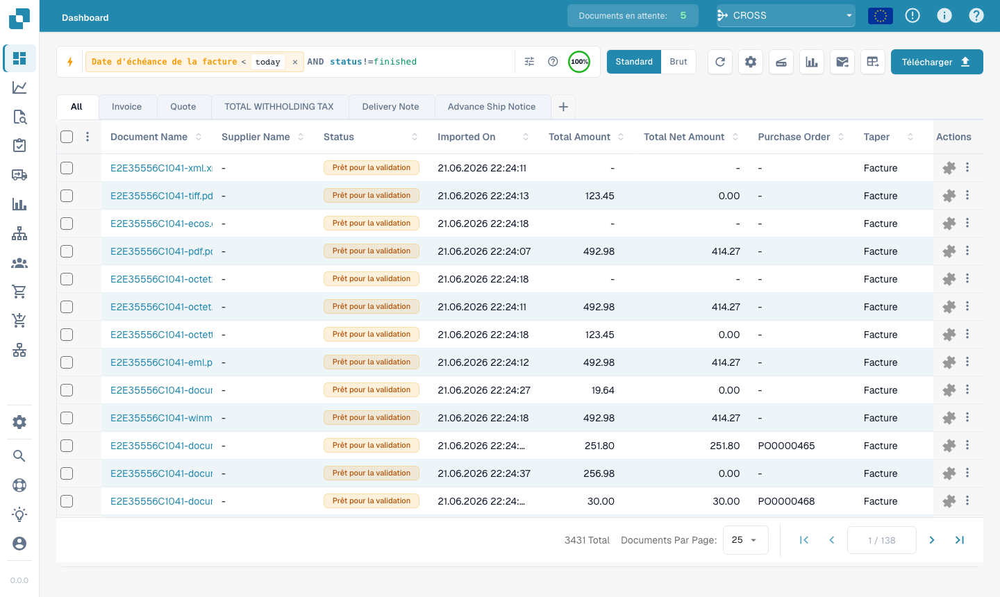<figcaption><p><code>overdue</code> - trouve les factures non terminées après leur date d'échéance.</p></figcaption></figure>

##### Préfixe de montant

- Requête : `$5000+`
- Équivaut à : `total_amount>=5000`
- Résultat : fait correspondre $...+ à un seuil de montant.

<figure><figcaption><p><code>$5000+</code> - fait correspondre $...+ à un seuil de montant.</p></figcaption></figure>

---

## Partie 4 — Modes de recherche avancés

Au-delà de la recherche par champs, trois modes à préfixe recherchent dans le contenu même des documents.

### Recherche vectorielle (sémantique) — `vector:`

Correspond par **sens**, et non par texte exact — utile pour « trouver les documents sur XYZ ». Nécessite le module Vector ; s'applique au contenu des documents.

```
vector: invoices about office supplies
vector: shipping delays with Hamburg port
```

<figure>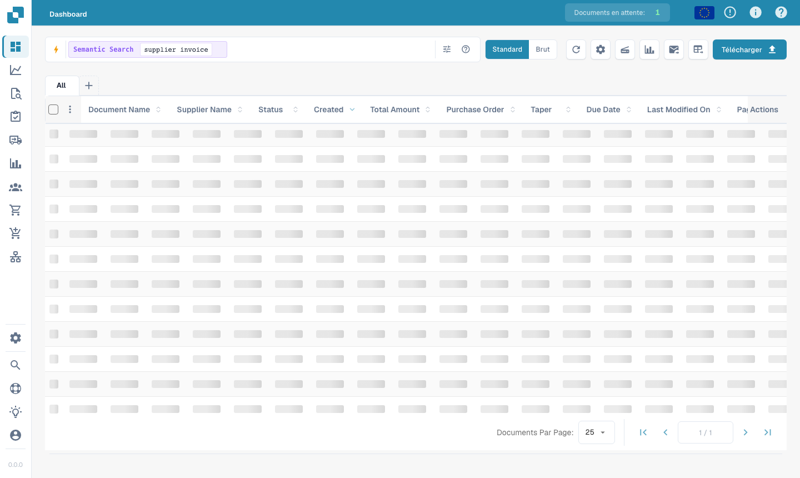<figcaption><p><code>vector: supplier invoice</code> — documents sémantiquement proches, même sans ces mots exacts.</p></figcaption></figure>

### Recherche dans le texte OCR — `ocr:`

Recherche **dans le texte des pages** extrait par le moteur OCR — pas seulement dans les colonnes structurées. Utile lorsque la valeur dont vous vous souvenez se trouve dans le corps du document.

```
ocr: Versandkosten
ocr: "purchase order PO-12345"
ocr: Hamburg AND doc_type=INVOICE
ocr: IBAN
```

<figure>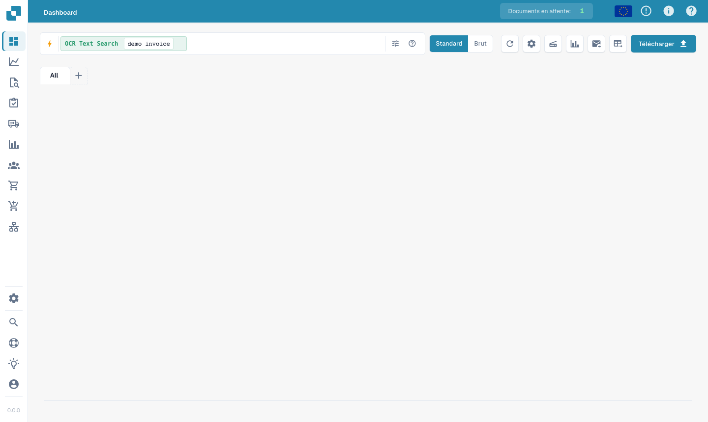<figcaption><p><code>ocr: demo invoice</code> — correspond au texte trouvé n'importe où sur les pages du document.</p></figcaption></figure>

### Recherche en langage naturel (IA) — `ai:`

Décrivez en langage courant ce que vous voulez ; l'IA lit votre phrase et en extrait des filtres (fournisseur, dates, montants) pour former une requête structurée. Contrairement à Vector, elle **construit une requête** au lieu de trouver des documents similaires.

```
ai: invoices from Ruiz over 1000 last quarter
ai: overdue invoices waiting on approval
ai: shipping documents from Hamburg last month
```

<figure>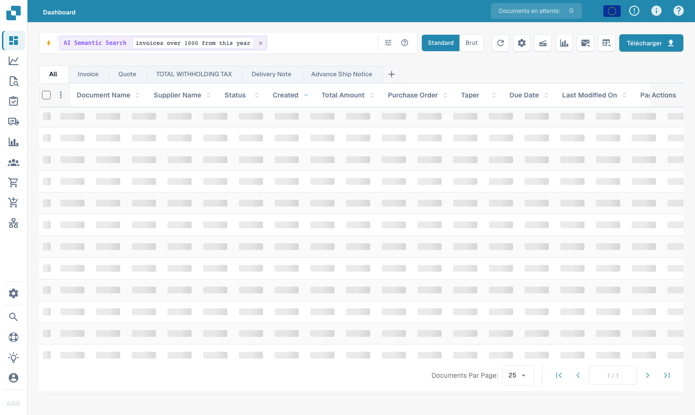<figcaption><p><code>ai: invoices over 1000 from this year</code> — l'IA transforme automatiquement la phrase en filtres.</p></figcaption></figure>

---

### Recettes

| Vous voulez… | Tapez ceci |
|--------------|------------|
| Prêts à valider, totalement rapprochés | `status=ready_for_validation AND po_match_status=full_matched` |
| Ce fournisseur, cette semaine | `supplier_name=Test AND created_on>today()-7` |
| Factures en retard de montant élevé | `total_amount>5000 AND invoice_due_date<today()` |
| Deux fournisseurs à la fois | `supplier_name=fuji OR supplier_name=acme` |
| Documents en erreur d'aujourd'hui | `(status=error OR status=failed) AND created_on>today()-1` |
| Avoirs électroniques | `is_edoc=true AND sub_doc_type=CREDIT_NOTE` |
| Par préfixe de commande d'achat | `purchase_order=PO-2026` |

> Les champs orange (plein texte) nécessitent que la **recherche plein texte** soit activée pour votre organisation. Un `%` ou un `_` littéral dans une valeur est traité comme un caractère normal.
