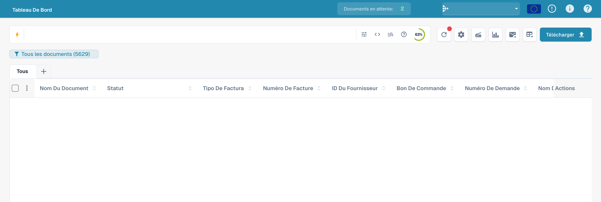
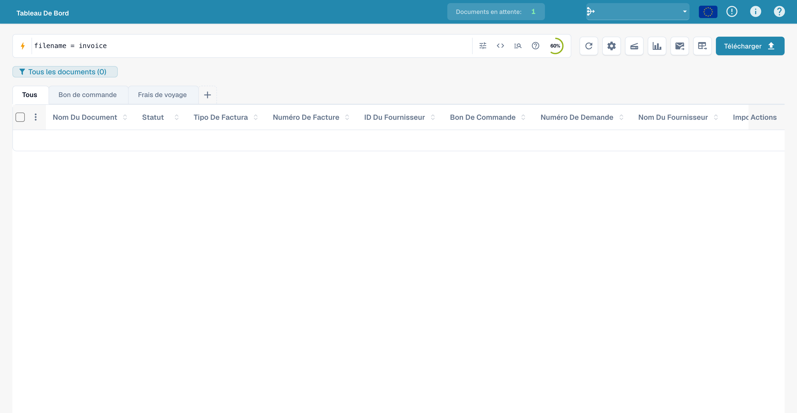
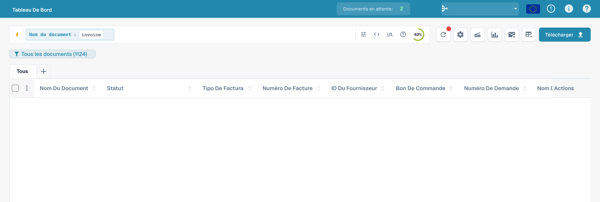
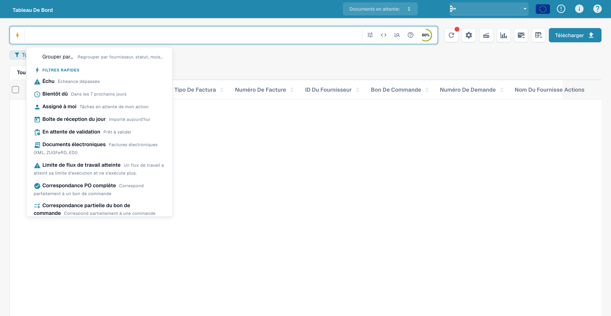
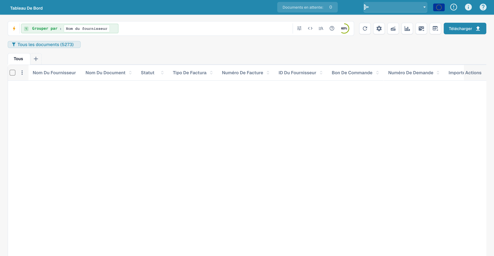
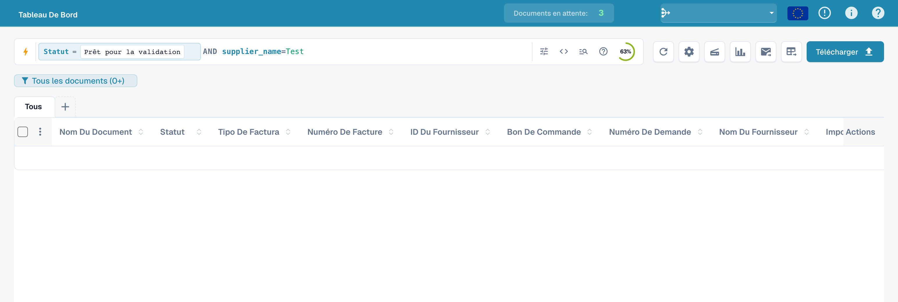
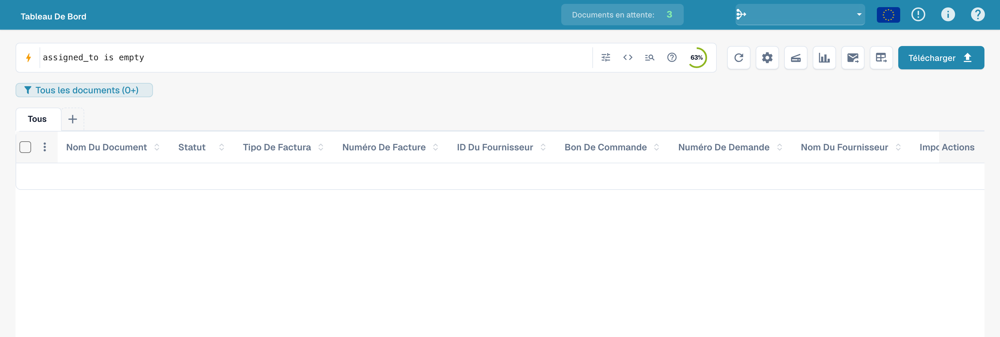
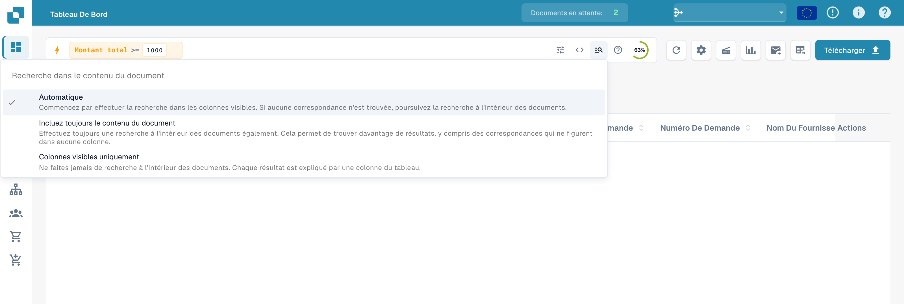
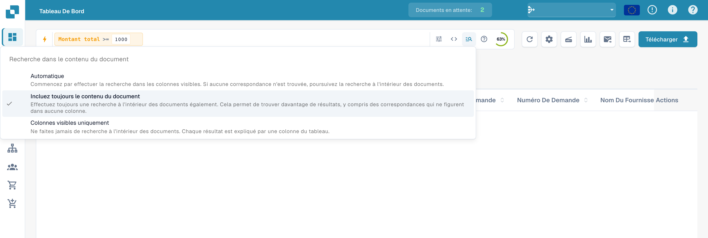
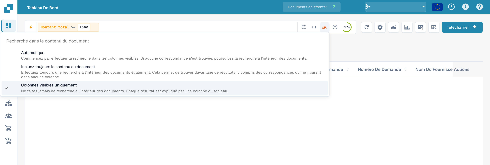

# Recherche rapide

La **Recherche rapide** est le moyen le plus rapide de trouver des documents sur le tableau de bord. Vous tapez ce que vous cherchez — un nom, un statut, un montant, une date — et la liste des documents se filtre instantanément.

Ce guide est organisé selon la façon dont la recherche se construit :

1. **Champs standard** — les colonnes que possède chaque document (nom du document, statut, dates). Toujours disponibles.
2. **Champs plein texte** — contenu extrait (fournisseur, commande d'achat, numéro de facture, montants, lignes). Disponibles lorsque la recherche plein texte est activée.
3. **Opérateurs, raccourcis et recettes** — la référence complète, une fois que vous êtes à l'aise.

> Vous n'avez rien à mémoriser : cliquez dans la barre de recherche et choisissez un champ et une valeur dans la liste — la Recherche rapide construit la requête pour vous. Les exemples ci-dessous montrent aussi la forme saisie afin que vous puissiez les copier directement.

<figure><figcaption><p>Recherche rapide dans le tableau de bord français.</p></figcaption></figure>

---

## Fonctionnement de la barre de recherche — chips, barre d'outils et vue brute

Avant de voir les champs eux-mêmes, il est utile de savoir comment la barre est organisée.

### Les conditions deviennent des chips

Lorsque vous complétez une condition (un champ, un opérateur et une valeur), la Recherche rapide la transforme en **chip** — une pastille colorée dans la barre — et en commence une nouvelle. Un chip affiche le **champ**, l'**opérateur** et la **valeur**, avec un **×** pour le supprimer. Les chips sont colorés selon l'emplacement des données :

| Couleur du chip | Type de champ |
|-----------------|---------------|
| **Bleu** | Colonne standard (nom du document, statut, dates) |
| **Orange** | Champ plein texte / extrait (fournisseur, montant, numéro de facture) |
| **Violet** | Recherche vectorielle (sémantique) |
| **Vert** | Recherche dans le texte OCR |

Cliquez sur un chip pour le modifier (il redevient du texte) ; cliquez sur **×** pour le supprimer.
Plusieurs chips combinés sont lus comme un **AND** par défaut.

### La barre d'outils

À l'extrémité droite de la barre :

- **ⓘ Aide** — ouvre la référence intégrée **Recherche dans le tableau de bord — Champs et syntaxe**, qui liste tous les champs, opérateurs et raccourcis disponibles dans votre espace de travail.
- **Filtres (tune)** — un panneau rapide pour les filtres courants Statut / Utilisateur / Redémarrage, avec **Effacer les filtres** et **Appliquer**.
- **Anneau d'index** — un petit anneau de progression indiquant quelle part de votre index plein texte est construite (affiché uniquement lorsque la recherche plein texte est activée).

### Vue standard ou vue brute

La barre affiche normalement votre requête sous forme de chips (**vue standard**). Passez en **vue brute** pour voir et modifier la requête en texte simple (p. ex. `status=ready_for_validation AND supplier_name=Test`) — pratique pour copier, partager ou taper directement une longue requête. Votre requête est conservée lors du changement de vue et mémorisée lorsque vous rechargez le tableau de bord.

---

## Partie 1 — Champs standard

Les champs standard sont les colonnes propres du document. Ils sont **toujours disponibles**, que la recherche plein texte soit activée ou non.

### Trouver des documents par nom

Le nom du document est la recherche la plus courante. Il existe trois façons de le faire correspondre — toutes **insensibles à la casse** :

#### `=` → commence par

```
filename=invoice
```

Trouve les documents dont le nom **commence par** « invoice ». La casse étant ignorée, tous ceux-ci correspondent à `filename=invoice` :

```
Invoice.pdf   iNVoice.pdf   iNvoiCE.pdf   INVOICE.pdf
Invoice.xml   iNVoice.xml   iNvoiCE.edi   …
```

Ne correspond **pas** à `XYZ_Invoice.pdf` (ici « invoice » est au milieu — utilisez `:` dans ce cas).

<figure><figcaption><p>Saisie d’une requête par nom de fichier.</p></figcaption></figure>

#### `:` → contient (n'importe où)

```
filename:invoice
```

Utilisez `:` pour faire correspondre le mot **n'importe où** dans le nom — `2026_Invoice.pdf`, `vietnam_einvoice_sample.xml`, `scan_invoice_copy.pdf`.

<figure><figcaption><p>Saisie d’une recherche sur une partie du nom de fichier : filename:invoice.</p></figcaption></figure>

#### `="…"` → commence *ou* finit par

```
filename="invoice"
```

Les guillemets font que `=` correspond aux noms qui **commencent ou finissent** par la valeur — pratique pour un code en tête ou une fin de fichier.

> **Les trois en une ligne :** `=` → commence par · `:` → contient · `="…"` → commence ou finit par. Toutes ignorent les majuscules/minuscules. Vous pouvez voir ce résumé à tout moment via l'**icône d'aide** dans la barre de recherche (section suivante).

### Trouver des documents par statut

```
status=ready_for_validation
```

Le statut est une liste fixe, donc `=` est une correspondance **exacte** et la barre propose un sélecteur de valeurs lorsque vous tapez `status=`.

<figure><figcaption><p>Saisie du filtre de statut technique ready_for_validation.</p></figcaption></figure>

### Trouver des documents par date

```
created_on>2026-05-25
```

Utilisez `>`, `<`, `>=`, `<=` pour des plages de dates. Vous pouvez aussi utiliser des dates **relatives** : `today()`, `today()-7` (7 derniers jours), `today()+30` (30 prochains jours).

<figure><figcaption><p>Saisie d’une recherche de documents créés après le 25 mai 2026.</p></figcaption></figure>

### Trouver des documents par sous-type de facture

```
invoice_sub_type="Cost Invoice"
```

Le sous-type de facture est une liste fixe (par exemple **Facture de coût** ou **Facture d'achat**), donc `=` est une correspondance **exacte** et la barre propose un sélecteur de valeurs lorsque vous tapez `invoice_sub_type=`. Utilisez `invoice_sub_type!="Cost Invoice"` pour tout sauf ce sous-type.

---

## Partie 2 — Champs plein texte

Les champs plein texte recherchent dans le **contenu extrait** de vos documents — fournisseur, commande d'achat, numéro de facture, montants, lignes. Ils apparaissent en **orange** et sont disponibles lorsque la **recherche plein texte est activée** pour votre organisation. Les règles de correspondance sont exactement les mêmes que pour les champs texte standard (`=` commence par, `:` contient, `="…"` commence ou finit par).

### Trouver des documents d'un fournisseur

```
supplier_name=Test
```

Commence par sur le nom de fournisseur extrait. Utilisez `supplier_name:Example` pour une correspondance n'importe où, ou `supplier_name:"Example"` pour mettre entre guillemets une valeur contenant des espaces.

<figure><figcaption><p>Exemple de requête fournisseur : supplier_name=Test.</p></figcaption></figure>

### Trouver des documents par commande d'achat

```
purchase_order=PO
```

Commence par sur le numéro de commande extrait — idéal pour un préfixe de commande.

<figure><figcaption><p>Exemple de requête de commande : purchase_order=PO.</p></figcaption></figure>

### Trouver des documents par montant

```
total_amount>5000
```

Utilisez `>`, `<`, `>=`, `<=` ou `between 100 and 500` pour une plage.

<figure><figcaption><p>Saisie d’un filtre sur un montant total supérieur à 5000.</p></figcaption></figure>

Pour une fenêtre, utilisez `between` :

```
total_amount between 1000 and 5000
```

C'est un raccourci pour `total_amount>=1000 AND total_amount<=5000`.

<figure><figcaption><p>Saisie d’une requête de montant entre 1000 et 5000.</p></figcaption></figure>

### Trouver ce qui manque

```
supplier_name=""
```

`=""` signifie « ce champ **n'est pas renseigné** » ; `supplier_name!=""` signifie « a un fournisseur quelconque ».

<figure><figcaption><p>Saisie d’un filtre sur un nom de fournisseur vide.</p></figcaption></figure>

La même vérification de présence fonctionne sur n'importe quel champ — par exemple les documents auxquels il manque encore un code d'affectation AP :

```
ap_assignment_code=""
```

<figure><figcaption><p>Saisie d’une recherche sans affectation AP.</p></figcaption></figure>

---

## Filtres intelligents — un clic

En haut du menu déroulant de la Recherche rapide (cliquez dans la barre de recherche), vous trouverez les **Filtres intelligents** : des recherches prêtes à l'emploi que vous appliquez en un seul clic. Chacun est simplement un raccourci pour une requête que vous pourriez aussi taper vous-même :

| Filtre intelligent | Trouve | Équivaut à |
|--------------------|--------|------------|
| ⚠️ **En retard** | Date d'échéance dépassée | `invoice_due_date<today()` |
| 🕐 **Bientôt dû** | Dans les 7 prochains jours | `invoice_due_date<=today()+7` |
| 👤 **Affecté à moi** | Éléments en attente de votre action | `assigned_to=<you>` |
| 📅 **Boîte du jour** | Importés aujourd'hui | `imported_on>=today()` |
| 📋 **En attente de validation** | Prêts à être validés | `status=ready_for_validation` |
| 🧾 **Documents électroniques** | E-factures (XML, ZUGFeRD, EDI) | `is_edoc=true` |
| ✅ **Correspondance PO totale** | Totalement rapprochés d'une commande d'achat | `po_match_status=full_matched` |
| ➗ **Correspondance PO partielle** | Partiellement rapprochés d'une commande d'achat | `po_match_status=partial_matched` |
| 📉 **Correspondance PO inférieure** | Quantité ou prix unitaire inférieur à la commande d'achat | `po_match_status=under_matched` |

Les trois filtres **correspondance PO** et les champs plein texte nécessitent que la recherche plein texte soit activée pour votre organisation.

<figure><figcaption><p>Aide aux requêtes et filtres de la recherche rapide.</p></figcaption></figure>

---

## Grouper les résultats

Au lieu d'une liste plate, vous pouvez **grouper** les résultats par n'importe quel champ — fournisseur, statut, type de document, sous-organisation ou un intervalle de dates. Ajoutez un groupement depuis la barre de recherche :

```
group by supplier_name
```

La liste affiche alors des **en-têtes de groupe** repliables, chacun avec le nom du groupe et un **compte** (p. ex. *Example (12)*). Cliquez sur un en-tête pour déplier ou replier ce groupe. Pour les champs de date, vous pouvez grouper par **jour, semaine ou mois**.

<figure><figcaption><p>Saisie d’une requête avec regroupement par fournisseur.</p></figcaption></figure>

Le groupement se combine avec n'importe quel filtre — `status=ready_for_validation group by supplier_name` ne groupe que les documents correspondants. Cliquer dans un groupe permet d'**explorer en détail** : la valeur de ce groupe est appliquée comme filtre et vous revenez à la liste plate pour cette sélection.

---

## Partie 3 — Opérateurs, connecteurs, raccourcis

### L'aide intégrée

L'**icône d'aide** dans la barre de recherche ouvre une référence complète de tous les champs, opérateurs et raccourcis disponibles dans votre espace de travail — y compris quels champs sont standard ou plein texte.

<figure><figcaption><p>L'aide intégrée <strong>Dashboard Search — Fields &#38; Syntax</strong> liste chaque opérateur et la façon dont les valeurs correspondent.</p></figcaption></figure>

### Ce que signifie `=` selon le type de champ

Toute correspondance de texte ignore la casse.

| Type de champ | Exemple | `=` signifie |
|---------------|---------|--------------|
| Texte (nom, fournisseur, commande d'achat) | `filename=invoice` | **commence par** |
| Texte, n'importe où | `filename:invoice` | **contient** |
| Texte, début *ou* fin | `filename="invoice"` | **commence ou finit par** |
| Statut / type / correspondance PO (listes fixes) | `status=finished` | **exact** |
| Identifiants (numéro de facture, id fournisseur) | `invoice_number=INV-100` | **exact** |
| Nombre | `total_amount>5000` | plage (`> < >= <= between`) |
| Date | `created_on>2026-01-01` | plage + `today()±N` |

### Opérateurs

| Opérateur | Signification |
|-----------|---------------|
| `=` | commence par (texte) / exact (liste, nombre, date) |
| `:` | contient (texte, n'importe où) |
| `="…"` | commence par ou finit par (texte) |
| `!=` | l'inverse de `=` |
| `>` `<` `>=` `<=` | supérieur / inférieur à |
| `between … and …` | plage inclusive |
| `field=""` / `field!=""` | est vide / est renseigné |
| `today()`, `today()-7`, `today()+30` | dates relatives |

### Connecteurs

Combinez des conditions avec **AND** (les deux vraies), **OR** (l'une ou l'autre), **NOT** et des parenthèses `( … )` pour grouper :

```
status=ready_for_validation AND supplier_name=Test
(status=error OR status=failed) AND created_on>today()-1
```

<figure><figcaption><p>Saisie de conditions de statut et de fournisseur reliées par AND.</p></figcaption></figure>

### Raccourcis

Des formulations plus courtes pour les mêmes requêtes — utilisez celle qui vous paraît la plus lisible :

| Raccourci | Équivaut à | Description |
|-----------|------------|-------------|
| `total_amount gt 5000` | `total_amount>5000` | Alias en toutes lettres pour les opérateurs de comparaison (`gt`/`gte`/`lt`/`lte`/`eq`/`ne`) |
| `due_date > today` | `due_date>today()` | `today` / `yesterday` / `tomorrow` sans parenthèses |
| `imported_on this_week` | `imported_on>=today()-7 AND imported_on<=today()` | Périodes relatives (`this_week`, `last_week`, `this_month`, …) |
| `ap_assignment_code is empty` | `ap_assignment_code=""` | Indique si un champ a une valeur quelconque |
| `status:open` | `status=ready_for_validation` | Libellé de statut simplifié (`open`/`closed`/`failed`/`done`) |
| `total_amount not between 100, 200` | `total_amount<100 OR total_amount>200` | Valeur hors d'une fenêtre |
| `status in (finished, error)` | `status=finished OR status=error` | Correspond à n'importe quelle valeur d'une liste |
| `not status=finished` | `status!=finished` | Nie n'importe quel prédicat |
| `filename contains rechnung` | `filename:rechnung` | Correspondance de chaîne (`contains`/`starts_with`/`ends_with`) |
| `total_amount > 5k` | `total_amount>5000` | Suffixe de devise `k` (×1 000), `M` (×1 000 000) |
| `overdue` | `invoice_due_date<today() AND status!=finished` | Factures impayées après l'échéance |
| `#INV-1234` | `invoice_id:INV-1234` | Préfixe de type Twitter pour l'ID de facture |
| `@User` | `assigned_to:User` | Préfixe de type Twitter pour la personne assignée |
| `$5000+` | `total_amount>=5000` | Préfixe `$` pour les seuils de montant |

### Exemples de requêtes

Les images montrent les requêtes saisies dans l’interface française. Les données des documents sont masquées. Une image de la barre de filtres ne démontre pas un nombre précis de résultats.

#### Opérateur de comparaison écrit

```
created_on gt 2026-05-25
```

<figure><figcaption><p>Opérateur de comparaison gt dans une requête de date.</p></figcaption></figure>

#### Avant aujourd’hui

```
created_on < today()
```

<figure><figcaption><p>Comparaison de created_on avec today().</p></figcaption></figure>

#### Depuis une date de création

```
created_on >= 2026-06-01
```

<figure><figcaption><p>Saisie d’une date de création à partir du 1er juin 2026.</p></figcaption></figure>

#### Sans responsable affecté

```
assigned_to is empty
```

<figure><figcaption><p>Saisie d’une recherche de documents sans responsable affecté.</p></figcaption></figure>

#### Filtre de statut

```
status=ready_for_validation
```

<figure><figcaption><p>Exemple de filtre de statut dans la recherche rapide.</p></figcaption></figure>

#### En dehors d’une période

```
created_on not between 2026-06-01 and 2026-06-15
```

<figure><figcaption><p>Saisie d’une recherche hors d’un intervalle de dates.</p></figcaption></figure>

#### Statuts alternatifs

```
status=ready_for_validation OR status=exported
```

<figure><figcaption><p>Saisie de deux statuts techniques reliés par OR.</p></figcaption></figure>

#### Exclure une condition fournisseur

```
NOT supplier_name=Test
```

<figure><figcaption><p>Exclusion d’une condition fournisseur avec NOT.</p></figcaption></figure>

#### Partie du nom de fichier

```
filename:invoice
```

<figure><figcaption><p>Recherche d’un terme dans les noms de fichier.</p></figcaption></figure>

#### Requête de numéro de facture

```
invoice_number=INV
```

<figure><figcaption><p>Exemple de requête utilisant invoice_number.</p></figcaption></figure>

#### Affectation vide

```
assigned_to=""
```

<figure><figcaption><p>Saisie d’une affectation vide : assigned_to=&quot;&quot;.</p></figcaption></figure>

#### Requête de devise

```
currency=EUR
```

<figure><figcaption><p>Saisie d'une requête en euros : monnaie=EUR.</p></figcaption></figure>

#### Échéance antérieure à aujourd’hui

```
invoice_due_date<today()
```

<figure><figcaption><p>Saisie d’une date d’échéance antérieure à today().</p></figcaption></figure>

#### Seuil de montant

```
total_amount>=1000
```

<figure><figcaption><p>Saisie d’un montant total d’au moins 1000.</p></figcaption></figure>

## Inclure le contenu des documents

Le menu de recherche dans le contenu détermine si la recherche inclut aussi le texte des documents. Ce choix est distinct des préfixes techniques comme `vector:`, `ocr:` ou `ai:`.

### Automatique

Recherche d’abord dans les colonnes visibles. En l’absence de correspondance, inclut le contenu si l’organisation dispose des fonctions nécessaires.

<figure><figcaption><p>Inclusion automatique du contenu des documents dans la recherche rapide.</p></figcaption></figure>

### Toujours inclure le contenu

Inclut explicitement le contenu des documents. Les fonctions de recherche correspondantes doivent être disponibles.

<figure><figcaption><p>Inclusion systématique du contenu des documents dans la recherche rapide.</p></figcaption></figure>

### Colonnes visibles uniquement

Limite la recherche aux colonnes visibles du tableau de bord.

<figure><figcaption><p>Recherche limitée aux colonnes visibles.</p></figcaption></figure>

### Recettes

| Vous voulez… | Tapez ceci |
|--------------|------------|
| Prêts à valider, totalement rapprochés | `status=ready_for_validation AND po_match_status=full_matched` |
| Ce fournisseur, cette semaine | `supplier_name=Test AND created_on>today()-7` |
| Factures en retard de montant élevé | `total_amount>5000 AND invoice_due_date<today()` |
| Deux fournisseurs à la fois | `supplier_name=ExampleA OR supplier_name=ExampleB` |
| Documents en erreur d'aujourd'hui | `(status=error OR status=failed) AND created_on>today()-1` |
| Avoirs électroniques | `is_edoc=true AND sub_doc_type=CREDIT_NOTE` |
| Par préfixe de commande d'achat | `purchase_order=PO-2026` |

> Les champs orange (plein texte) nécessitent que la **recherche plein texte** soit activée pour votre organisation. Un `%` ou un `_` littéral dans une valeur est traité comme un caractère normal.
