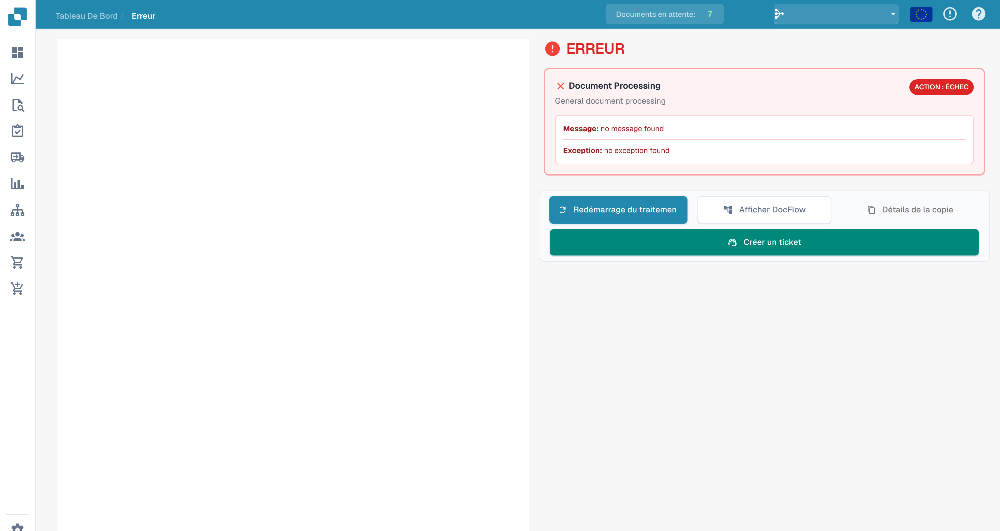
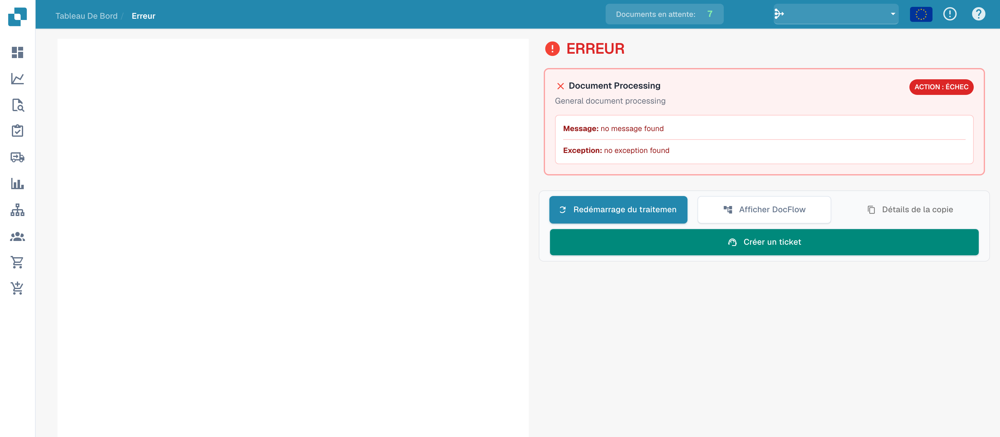

# Vue d’erreur

Lorsqu’un traitement échoue, la vue d’erreur permet d’examiner l’étape concernée, le message et l’exception disponibles.

## Examiner les détails

<figure><figcaption>
Message et exception de la vue d’erreur sans message enregistré.
</figcaption></figure>

Cet exemple présente l’interface sans erreur enregistrée. Les textes `no message found` et `no exception found` ne constituent pas le diagnostic d’un incident. Pour une erreur réelle, examinez les messages disponibles et le flux du document.

## Actions disponibles

<figure><figcaption>
Actions de la vue d’erreur ; aucun détail d’erreur n’est enregistré dans cet exemple.
</figcaption></figure>

| Action | Utilisation |
| --- | --- |
| Relancer le traitement | Recommencer après avoir vérifié ou corrigé la cause. |
| Ouvrir DocFlow | Examiner les étapes et leurs états. |
| Copier les détails | Recueillir les informations techniques disponibles. |
| Créer un ticket | Préparer une demande d’assistance. |

Les commandes de document et d’aperçu dépendent du chargement du document. L’ancienne barre d’outils PDF n’est pas une partie fiable de cette vue.

Si l’erreur revient, indiquez à l’assistance l’ID du document, le message exact, l’heure et les vérifications effectuées. Contrôlez les informations confidentielles avant de partager les détails.
