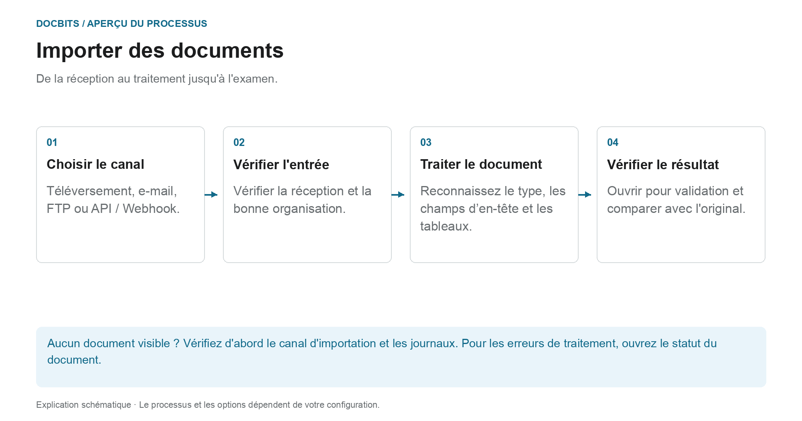

# Comment importer des documents

## De la réception au document prêt à être révisé

<figure><figcaption>
De la réception au traitement jusqu&#x27;à l&#x27;examen. Le diagramme est schématique ; les paramètres actifs de votre organisation déterminent le comportement réel.
</figcaption></figure>

Sélectionnez d’abord l’itinéraire d’importation. L'envoi réussi d'un e-mail ou la soumission d'une demande API ne prouve pas que le document a été entièrement traité. Vérifiez sa réception dans DocBits puis son statut de document.

1. **Sélectionnez le canal d'importation :** Utilisez le téléchargement manuel pour les fichiers individuels ou configurez un canal automatique pour les entrées régulières.
2. **Chèque reçu :** Localisez le document dans la bonne organisation. Pour les e-mails entrants, vérifiez les journaux d'importation si nécessaire ; le format et les règles de l'expéditeur prennent-ils en charge la pièce jointe ?
3. **Attendez le traitement :** DocBits traite le document en fonction du type de document et des paramètres actifs. Pour PDFs, OCR ou le texte PDF existant peut être utilisé ; les documents électroniques peuvent fournir des données structurées. Toutes les importations ne passent pas par le même chemin d’extraction.
4. **Ouvrez le résultat :** Une fois le document prêt à être validé, comparez les valeurs reconnues avec l'original. L'importation d'un document ne l'approuve pas et ne l'exporte pas vers le ERP.

### Trouver le bon itinéraire d'importation

| Entrée | Instructions |
| --- | --- |
| Télécharger des documents individuels | [Importation manuelle](manual-import.md) |
| Connecter la boîte aux lettres ou transférer des e-mails | [Importation d'e-mails](email/README.md) |
| Récupérer des fichiers via un canal FTP configuré | [FTP](ftp.md) |
| Transférer des documents depuis une application | [Webhook / API](webhook.md) |

**S'il manque quelque chose :** Vérifiez d'abord le canal d'entrée. Si le document existe déjà dans DocBits, [Statut du document](../dashboard/document-status.md) et [Flux de documents](../dashboard/document-flow.md) permettent de trouver l'étape de traitement concernée.


Tutoriel d’importation DocBits : téléverser des documents, glisser-déposer et classification manuelle ou automatique


Un guide pour télécharger des documents sur DocBits.
