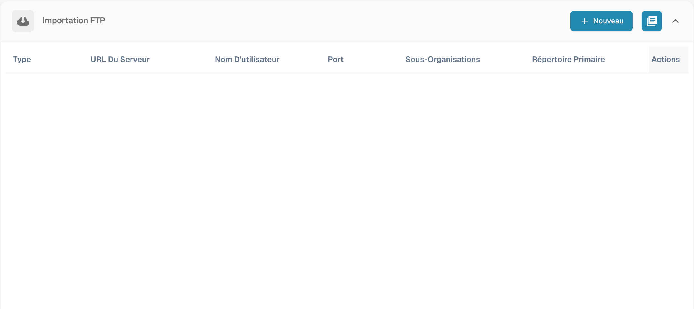
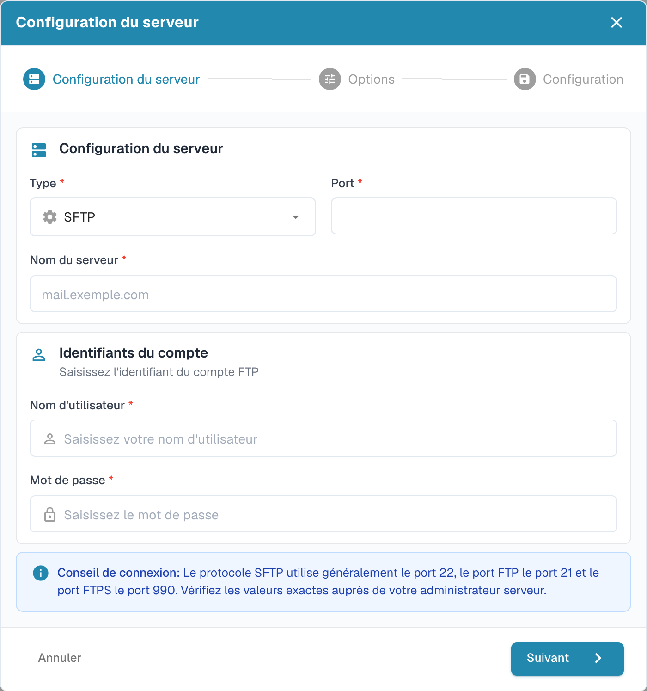

# Import FTP et SFTP

L’import automatique nécessite les paramètres de connexion approuvés et un dossier accessible au compte du serveur.

## Créer une connexion

Ouvrez les paramètres d’import et créez une nouvelle connexion dans la section FTP.

<figure><figcaption>
Vue d’ensemble des connexions FTP avec les données de connexion masquées.
</figcaption></figure>

L’assistant commence par la configuration du serveur. Choisissez le protocole, le serveur, le port et les identifiants prévus. Utilisez les valeurs fournies par l’administrateur du serveur.

<figure><figcaption>
Première étape de l’assistant d’import FTP : configuration du serveur.
</figcaption></figure>

Passez aux options et à la configuration. Vérifiez toute la connexion avant de l’enregistrer.

## Archivage des fichiers

Si la connexion propose l’archivage, configurez-le dans les options d’import. Vérifiez que le compte peut écrire dans le dossier d’archive et testez le comportement avec un fichier d’exemple. L’ancien formulaire d’archivage séparé est remplacé par l’assistant actuel.
