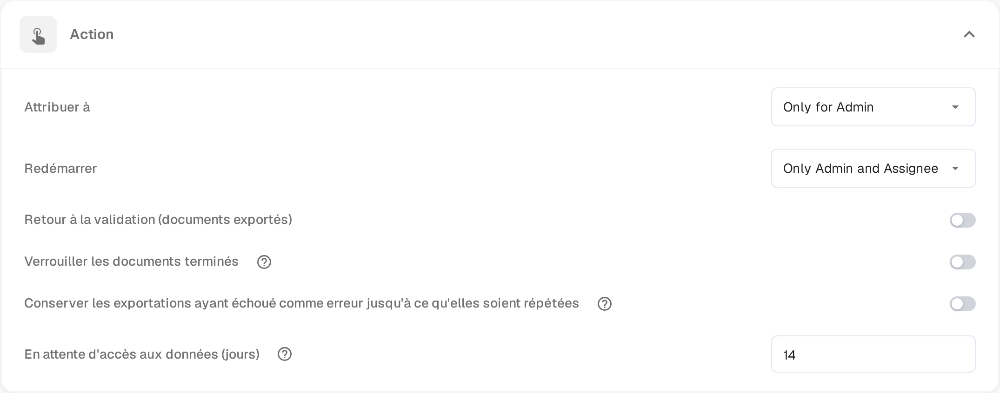

# Pending Input

**Pending Input** met un document en pause pendant que vous attendez la réponse d'un collègue. Vous posez la question dans le flux d'activité du document et vous identifiez les personnes qui doivent répondre. Le document quitte la file active jusqu'à leur réponse, et les personnes identifiées peuvent l'ouvrir en lecture seule grâce à un lien reçu par e-mail.

Le statut apparaît dans le [tableau de bord](dashboard/README.md) sous la forme **Pending Input**, et vous pouvez filtrer la liste de travail sur ce statut.

## Demander une information

1. Ouvrez le document dans un écran qui propose le flux d'activité – les écrans d'approbation et de révision le proposent – puis sélectionnez l'icône de bulle de dialogue dans la barre d'outils.
2. Rédigez votre question et tapez **@** suivi du nom de la personne à interroger. Choisissez-la dans la liste qui s'affiche. C'est cette identification qui donne l'accès : seules les personnes identifiées reçoivent le lien vers le document.
3. Dès qu'une personne est identifiée, un encadré apparaît sous la zone de saisie avec deux possibilités :

* **Comment only** (commentaire uniquement) – la question est publiée dans le flux d'activité et le statut reste inchangé. Utilisez cette possibilité si vous attendez seulement une réponse sans vouloir bloquer le document.
* **Send & set to Pending Input** (envoyer et passer en Pending Input) – la question est publiée et le document passe en attente. Il quitte la file active et reste en pause jusqu'à la réponse de la personne identifiée.

Les personnes identifiées reçoivent un e-mail contenant un lien vers le document. **Entrée** ou l'icône d'envoi publient toujours un commentaire ordinaire, sans donner d'accès ; **Maj+Entrée** commence une nouvelle ligne. Sur un document déjà en pause, ou sur un document qui ne peut pas encore être mis en pause, l'encadré propose la question sans l'option de mise en pause.

## Répondre à une demande

Vous êtes sollicité lorsqu'un collègue vous identifie dans le flux d'activité.

* Ouvrez le lien reçu par e-mail. La page **Pending Input** affiche les pages du document à gauche et le flux d'activité à droite, avec le badge **Pending Input**.
* Votre accès est en lecture seule : vous pouvez lire le document et répondre dans le flux d'activité, mais vous ne pouvez ni modifier des champs ni exporter.
* Rédigez votre réponse dans le flux d'activité et envoyez-la. La personne qui a posé la question est avertie et l'échange reste dans l'historique du document.
* L'en-tête de la page indique la durée de votre accès, par exemple **Read-only access until 09.11.2026**. L'accès se termine également dès que le document avance.

Si vous ouvrez le lien après la réponse à la demande ou après la fin de votre accès, la page vous indique que la demande a été traitée ou qu'elle a expiré et qu'aucune action n'est nécessaire.

## Clôturer la demande

Le document reste en pause jusqu'à ce que la personne assignée reprenne la réponse.

1. Ouvrez le document depuis le tableau de bord. Un document en pause s'ouvre directement sur sa page **Pending Input**.
2. Lisez la réponse dans le flux d'activité.
3. Sélectionnez **Resolve & Proceed** (clôturer et continuer). Le document reprend au statut suivant de son workflow : vous arrivez donc directement sur l'écran où vous poursuivez le travail.

Seule la personne assignée au document, ou un membre du groupe auquel il est assigné, peut clôturer la demande. Les administrateurs et les approbateurs peuvent ouvrir un document en pause en lecture seule pour voir pourquoi il attend.

## Définir la durée d'accès

La fonction est disponible dans toutes les organisations. Ce que vous pouvez configurer, c'est la durée pendant laquelle une personne interrogée garde l'accès au document :

1. Ouvrez **Paramètres → Tableau de bord**.
2. Dépliez **Action**.
3. Saisissez dans **En attente d'accès aux données (jours)** un nombre entier de jours. La valeur par défaut est **14** et au moins un jour est requis.
4. Enregistrez vos modifications.

Le délai démarre à l'envoi de la demande. Il se termine plus tôt lorsque le document est clôturé ou passe à un autre statut.

<figure><figcaption>
En attente d'accès aux données (jours) dans la section Action des paramètres du tableau de bord. Les valeurs de permission situées au-dessus sont encore affichées en anglais par le produit.
</figcaption></figure>
