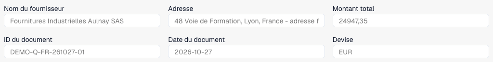
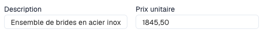

# Vérifier les lignes et les prix d'un devis

La vue des devis concerne les documents configurés pour ce traitement. Type, présentation, droits et workflow déterminent les champs et actions proposés. Elle est distincte du rapprochement des commandes.

<figure><figcaption>
En-tête d’un devis fictif français de trois pages dans DocBits : fournisseur, référence, date, devise et total. Cet extrait montre les six premiers champs.
</figcaption></figure>

Télécharger le devis fictif de trois pages (PDF)



## Examiner et corriger

<figure><figcaption>
Description et prix unitaire de la première ligne sélectionnée. Aucune valeur n’a été modifiée ni enregistrée.
</figcaption></figure>

1. Ouvrez le bon devis. Comparez fournisseur, référence, date et devise à l'original.
2. Vérifiez articles, descriptions, quantités, unités, prix et montants. Un identifiant article identique ne prouve pas un prix ou une unité identique.
3. Sélectionnez une ligne pour afficher ses détails sous le tableau.
4. Utilisez la recherche de données de référence configurée lorsqu'elle est disponible. Vérifiez sélection et valeurs reprises ; examinez les avertissements.
5. Corrigez la ligne puis choisissez **Enregistrer** ou **Enregistrer et suivant**. **Annuler** ferme l'éditeur sans soumettre ces modifications de ligne.
6. Copiez les valeurs par défaut vers la ligne suivante uniquement si elles conviennent. Vérifiez les valeurs copiées.
7. Rouvrez document et ligne pour contrôler les valeurs enregistrées. Pour une ligne rejetée, consultez la note disponible et résolvez le motif métier.

## Cas particuliers

Ajouter une ligne crée une position manuelle lorsque la modification est autorisée. Comparez-la à l'original et remplissez les champs obligatoires. Retirer une ligne manuelle est une action distincte ; ne supprimez pas une vraie position pour faire correspondre les totaux.

Pour un document en lecture seule, vérifiez droits, verrouillage et étape. Pour des lignes absentes, examinez original, extraction et présentation.

Les contrôles automatiques contre les prix gérés, précédents ou contractuels utilisent les [Cartes de comparaison des devis](../../administration-and-setup/workflow/cards-overview/quote-comparison-guide.md). Enregistrer ne prouve ni leur exécution, ni l'approbation, ni la fin de l'export ERP.
