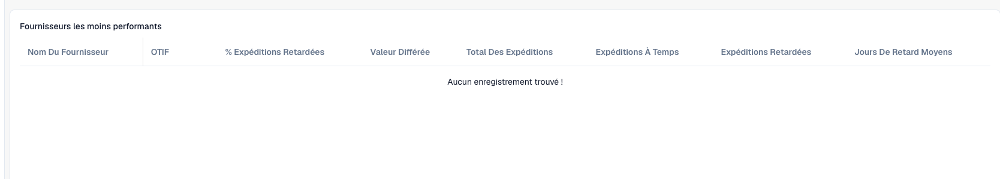

# Comprendre les statistiques de livraison des fournisseurs

Ces statistiques permettent de repérer les performances de livraison à examiner. L'administrateur doit activer le module et les données d'expédition appropriées doivent exister. Les indicateurs dépendent des enregistrements de votre organisation.

<figure><figcaption>
Colonnes des statistiques fournisseurs dans une organisation sans données de livraison. Une table vide ne prouve pas une bonne performance de livraison.
</figcaption></figure>

## Examiner un fournisseur

1. Ouvrez **Statistiques des fournisseurs**. Si l'option manque, faites vérifier module et accès.
2. Identifiez le fournisseur dans le tableau des moins bonnes performances.
3. Comparez expéditions totales, à l'heure et en retard avant de juger les pourcentages. Deux et deux mille expéditions représentent des échantillons différents.
4. Examinez ensemble **OTIF**, pourcentage de retards, valeur en retard et retard moyen en jours. OTIF signifie *On Time In Full* : une livraison à l'heure n'est pas nécessairement complète.
5. Comparez les graphiques OTIF et retards. Utilisez le nombre de fournisseurs par page et la pagination pour consulter d'autres lignes.
6. Remontez aux expéditions concernées : dates promises/réelles, quantités, identifiants fournisseur et devise avant de contacter le fournisseur.

## Interpréter et rechercher la cause

Les nombres indiquent la taille de l'échantillon, le retard moyen sa durée et la valeur l'importance financière concernée. Ne déduisez pas OTIF du seul nombre de livraisons ponctuelles. N'additionnez pas des devises différentes sans conversion convenue.

Un tableau vide ou un graphique à zéro ne prouve pas une performance parfaite. Vérifiez disponibilité et synchronisation des données. Le résumé ne remplace pas l'analyse d'une expédition.

En cas d'écart, conservez identifiant fournisseur, expéditions, dates et calcul attendu. Faites vérifier les valeurs sources et la base de l'indicateur.

Voir [Modules](../../administration-and-setup/settings/document-processing/module/README.md) et [Synchronisation des données](../../administration-and-setup/settings/log-settings/data-synchronization.md).
