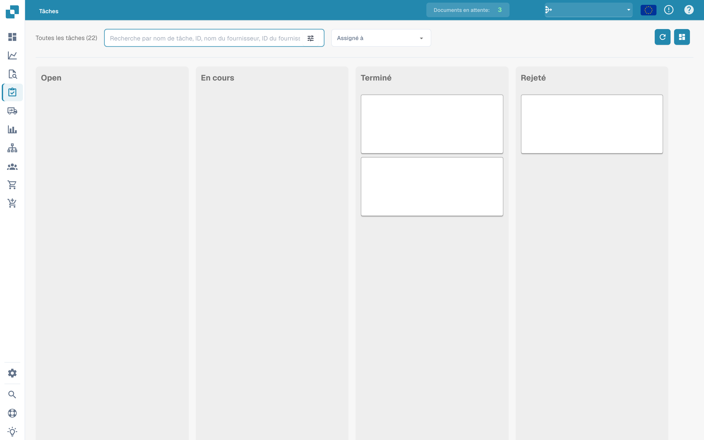
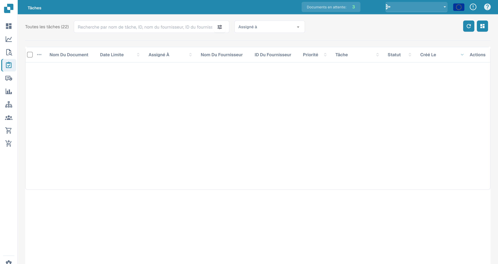

# Tâches


DocBits Tasks & Notifications Tutorial: Assign Work, Track Status & Handle Workflow Tasks


C'est ici que vous pouvez garder un œil sur vos tâches. Vous pouvez choisir entre deux mises en page différentes – l'une est un peu plus détaillée que l'autre. Vous pouvez également filtrer les tâches selon différents critères, comme si elles vous sont assignées ou l'état de la tâche.

<figure><figcaption>
Tableau des tâches par statut ; le contenu des tâches est masqué.
</figcaption></figure>

<figure><figcaption>
Liste des tâches avec les données des documents masquées.
</figcaption></figure>
