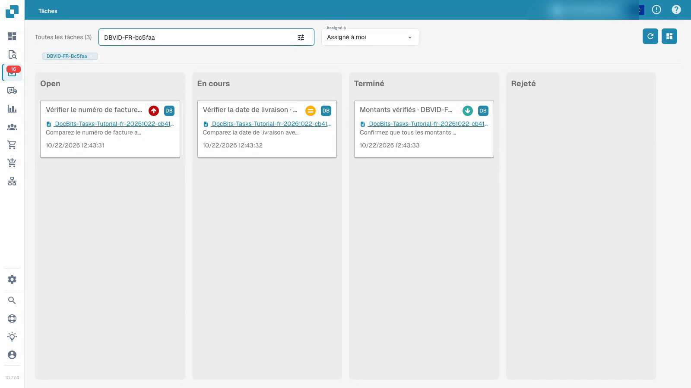
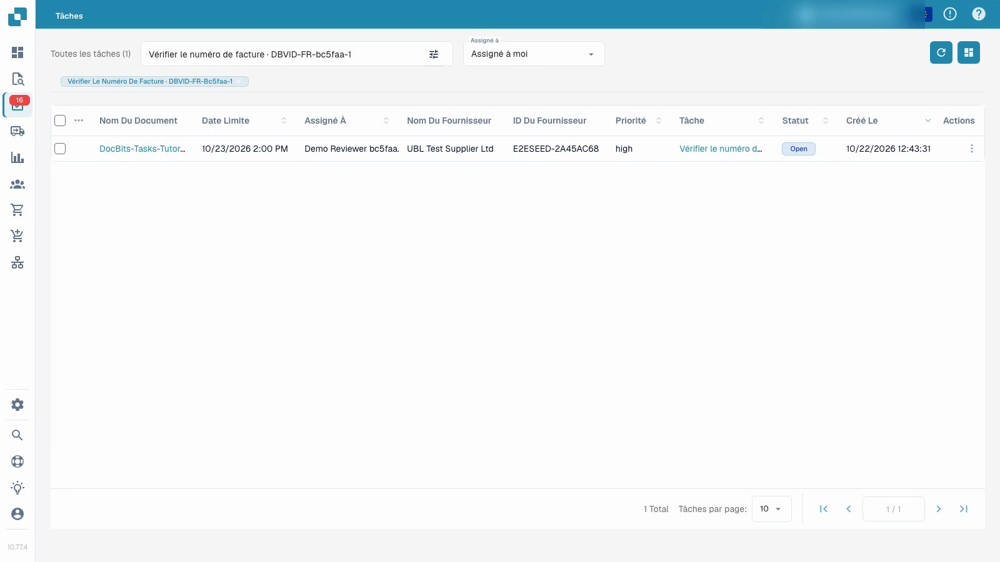

# Tâches

La vidéo montre un utilisateur de test ordinaire travaillant sur une tâche avec des documents synthétiques.


Tâches


[Regarder avec des sous-titres](https://docbits-videos.fra1.cdn.digitaloceanspaces.com/settings-assistant/document-tasks-customer/v1/fr.html)

Remarque : Certaines étiquettes de produits natifs peuvent ne pas être traduites. L'enregistrement préserve l'interface utilisateur réelle.

Utilisez l'aperçu des tâches pour trouver le travail assigné et suivre sa progression. Le tableau regroupe les tâches par statut ; la liste fournit plus de détails. Filtrez par assignation et utilisez la recherche pour localiser une tâche particulière. La priorité et la date limite aident à planifier l'ordre du travail.

## Travailler sur une tâche de document assignée

1. Ouvrez une tâche et lisez sa description et son assignation.
2. Inspectez le document original lié. Un titre de tâche seul ne prouve pas que le document est correct.
3. Définissez la tâche sur en cours et enregistrez tout en effectuant le travail.
4. Enregistrez le résultat dans la description de la tâche.
5. Terminez la tâche, enregistrez-la et rechargez pour confirmer le statut et les commentaires stockés. Vérifiez sa position dans l'aperçu des tâches.

La vidéo utilise un utilisateur de test ordinaire et des documents synthétiques. Terminer une tâche est distinct de l'approbation ou de l'exportation de sa facture. Les actions disponibles dépendent des autorisations du compte.

<figure><figcaption>
Aperçu des tâches avec des données synthétiques. Open reste en anglais dans la première colonne de la version illustrée.
</figcaption></figure>

<figure><figcaption>
Liste des tâches avec des données synthétiques. Les valeurs natives Open et high restent en anglais dans cette version.
</figcaption></figure>

## Enregistrement supplémentaire


Tâches

