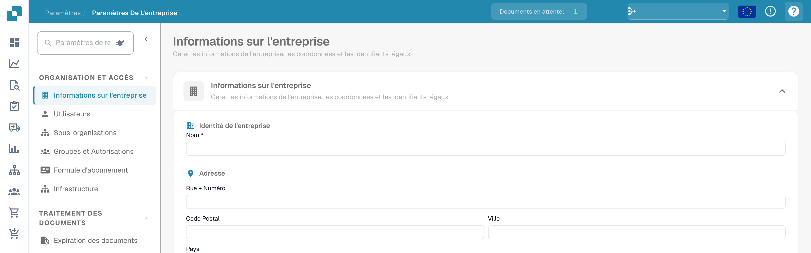

# Icônes d'aide

Des icônes d'aide ont été placées tout autour de DocBits afin de vous aider à apprendre et comprendre ce que fait vraiment une fonctionnalité et comment elle peut vous aider dans le traitement de vos documents.

Ces icônes d'aide ressemblent à ceci

<figure><figcaption>
Icône d’aide en haut à droite des paramètres.
</figcaption></figure>
