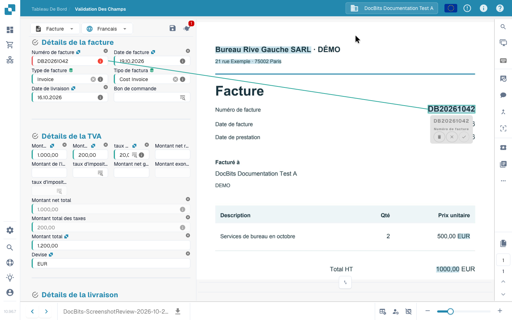

# Écran de validation

## Vérifier une facture et terminer son traitement

Suivez une facture du tableau de bord à sa transmission : comparez le fournisseur, les dates, le numéro, les montants et la devise avec l’original et consultez un avertissement de champ obligatoire. Sélectionnez le numéro directement dans le document, confirmez son association et conservez la règle d’extraction avec **Save Rules**. La facture vérifiée est ensuite transmise pour approbation dans cet exemple. Les actions disponibles dépendent de vos droits et de votre processus.



## Ouvrir et utiliser l’écran de validation

Ouvrez un document depuis le tableau de bord. Dans la **validation des champs**, comparez les champs modifiables avec le document original affiché à côté. Le type de document et la mise en page configurée déterminent les champs, tableaux et boutons disponibles. Déplacez la séparation pour agrandir l’une des deux zones.

Utilisez les commandes de page pour un document de plusieurs pages et le zoom pour lire les petits caractères. Les flèches en bas permettent de passer d’un document à l’autre ; elles sont distinctes des commandes de page.

### Origine du document

Vérifiez l’**origine du document** avant les dates et les montants. Elle détermine l’interprétation des formats de date et de nombre ; elle ne traduit pas le document et ne change pas la langue de l’interface. Choisissez l’origine correspondant au document et comparez les valeurs affichées avec l’original.

Un changement d’origine ouvre une boîte de dialogue de confirmation. Si vous continuez, le traitement du document redémarre. Vérifiez les nouvelles valeurs extraites une fois le traitement terminé.

## Corriger un champ et apprendre sa zone source à DocBits

Si le numéro de facture est mal lu :

1. Sélectionnez le champ **Numéro de facture**.
2. Double-cliquez sur le numéro complet dans l’original ou sélectionnez la zone qui le contient.
3. Vérifiez le champ proposé et confirmez l’association avec la coche si nécessaire.
4. Contrôlez la valeur et la zone source surlignée. Recommencez la sélection si le numéro est incomplet ou associé au mauvais champ.
5. Enregistrez le document. Pour conserver l’apprentissage d’extraction, utilisez aussi **Save Rules** et confirmez la boîte de dialogue.

<figure><figcaption>
Le numéro sélectionné sur l’original et son association au champ. Confirmez cette association avant d’enregistrer la règle.
</figcaption></figure>


Saisir une nouvelle valeur corrige ce document, mais ne crée pas l’association à la zone source nécessaire à cet apprentissage. Sélectionnez la valeur dans l’original, confirmez l’association et enregistrez la règle pour la réutiliser sur les documents correspondants de ce fournisseur. Cet apprentissage à partir de l’image n’est pas disponible pour les documents lus directement comme données de facture électronique.


## Enregistrer, conserver les règles et poursuivre

| Action | Effet |
| --- | --- |
| **Enregistrer** — disquette au-dessus des champs | Enregistre les modifications du document actuel, sans l’approuver ni l’exporter à elle seule. |
| **Save Rules** | Conserve les règles d’extraction à partir du document et de ses associations aux zones sources. C’est distinct de l’enregistrement des valeurs. |
| **Exporter / Export**, approbation ou autre action configurée | Transmet le document à l’étape configurée suivante après les contrôles applicables. L’action et le statut obtenu dépendent du processus et de vos droits. |

Dans la vidéo, la facture vérifiée est soumise pour approbation. Un bouton **Export** ne garantit pas que la facture est déjà arrivée dans l’ERP cible. Vérifiez son nouveau statut dans le tableau de bord et les éventuelles erreurs de traitement.

## Champs obligatoires et messages de contrôle

Une bordure rouge ou une icône d’avertissement attire l’attention sur un champ. Lisez son message : une valeur obligatoire manque-t-elle, faut-il vérifier l’extraction ou un contrôle configuré a-t-il échoué ? La présence d’une valeur ne suffit pas à prouver sa validité.

Comparez fournisseur, numéro, dates, montants et devise avec l’original. Pour les totaux, vérifiez les champs d’en-tête concernés et les lignes éventuelles. Corrigez la cause indiquée avant de poursuivre. Les contrôles dépendent du type de document et de la configuration de l’organisation ; voir [Contrôles automatiques](automatic-checks-on-the-validation-screen.md).

## Utiliser l’assistant

Le bouton **Assistant** au-dessus des champs indique les problèmes de validation ouverts. Ouvrez-le et utilisez **Aller au champ** pour examiner le champ concerné. Les questions et suggestions IA dépendent de l’activation pour votre organisation et de vos droits. Si elles sont indisponibles, lisez le message du panneau. Les suggestions modifient le formulaire : vérifiez-les puis enregistrez le document pour conserver les changements.

## Sélectionner des données de référence

Les champs disposant d’une recherche configurée peuvent consulter les fournisseurs, commandes ou autres données de référence. Ouvrez la recherche du champ, filtrez les résultats et sélectionnez le bon enregistrement. Plusieurs champs liés peuvent être renseignés : contrôlez-les également. Ces valeurs proviennent du référentiel et peuvent différer du libellé imprimé. Voir [Données floues](fuzzy-data.md).

## Vérifier les lignes de facture

Si la mise en page comprend des tableaux, comparez lignes, descriptions, quantités, prix et montants avec le document. **TABLEAU EXTRAIT** et **TABLEAU EXTRAIT IA** correspondent à des vues d’extraction différentes. Leur disponibilité dépend des méthodes activées et de la mise en page. Un onglet vide ou absent ne suffit pas à expliquer un problème d’extraction.

Corrigez les cellules et les lignes manquantes ou dupliquées avec les commandes disponibles. Ces modifications concernent le document actuel. L’apprentissage de tableau réutilisable, les tags IA et l’apprentissage des champs d’en-tête sont des opérations distinctes. Voir [Tags des tableaux IA](../ai-table/ai-table-tags.md) et [Apprentissage des tableaux](../../../administration-and-setup/setup/document-training/training-line-fields-table-training/README.md).

Lisez les messages sur les colonnes obligatoires, calculs de ligne et totaux. Avant de relancer une extraction IA ou de réextraire un tableau, lisez la confirmation : des associations existantes aux commandes peuvent devoir être supprimées puis recréées.

## Affichage et collaboration

Survolez une icône pour lire son libellé. Certains outils dépendent des modules, du type de document ou des droits.

| Outil | Utilisation |
| --- | --- |
| **Loupe** et zoom | Examiner les petits détails de l’original. |
| **Ouvrir l’image dans une nouvelle fenêtre** | Afficher la même image dans une fenêtre séparée, par exemple sur un second écran. L’interface indique qu’il s’agit d’une fonction Chrome. |
| **Raccourcis clavier** | Ouvrir l’aide ; voir [Raccourcis clavier](keyboard-shortcuts.md). |
| **Tâches** | Créer et suivre le travail interne attribué à une personne ou à un groupe. |
| **Flux d’activité** | Consulter les activités enregistrées sur le document. |
| **Historique de l’approbation** | Consulter approbations et rejets lorsque la fonction est activée. |
| **Mode d’annotation** | Ajouter des notes sur le document si les annotations sont activées. |
| **Fusionner / ajouter des pages** | Regrouper des documents ou ajouter des pages manquantes avec la boîte de dialogue disponible. Vérifier les pages sélectionnées avant de confirmer. |
| **Vue OCR** | Consulter le texte déjà reconnu. Son ouverture ne lance pas de nouvelle extraction OCR. Elle n’est pas disponible pour certains documents électroniques. |
| **Créer un ticket** | Préparer une demande d’assistance avec le contexte du document et une description du problème. Les tâches internes sont traitées séparément. |
| **Journaux de script de document** | Lire les messages des scripts du document lorsque le module est activé. Il s’agit d’un affichage des journaux, pas d’un éditeur de scripts. |

## Autres options et réglages administrateur

Pour les factures, **Plus d’options → Flux de documents** ouvre le parcours de traitement. Selon vos droits et la configuration, le menu peut aussi proposer le fractionnement, l’accès au modèle de mise en page et les préférences d’extraction du fournisseur.

**Utiliser l’E-Texte s’il est disponible**, **Utiliser l’extraction structurée (IA)** et **Modèle d’IA** sont des paramètres d’extraction du fournisseur. Seuls les administrateurs autorisés peuvent les modifier. Respectez la confirmation de redémarrage lorsqu’un nouveau traitement est nécessaire. Un modèle de mise en page configure le formulaire de validation ; il ne modifie pas la présentation imprimée de la facture. Voir [Modèle IA par fournisseur](supplier-specific-ai-model-for-field-and-table-extraction.md).

## Si vous ne pouvez pas modifier ou poursuivre

Lisez la raison affichée : document verrouillé, en lecture seule, dans un autre statut ou accès limité par votre rôle. Corrigez les messages de contrôle et contactez la personne responsable ou l’administrateur pour les droits et réglages. Si l’erreur persiste, consultez le [Dépannage](troubleshooting/README.md) ou préparez un ticket avec le document et le message exact.
