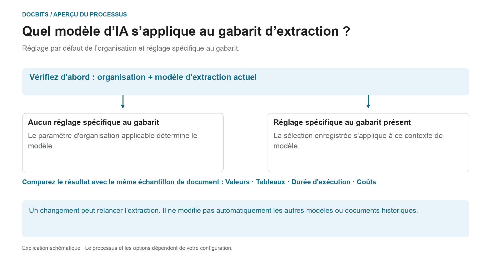
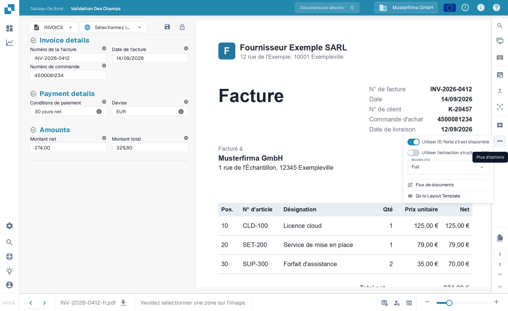
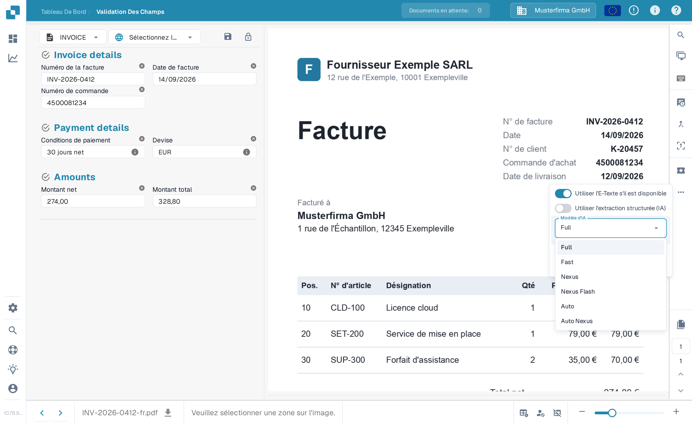

# Modèle d'IA Spécifique au Fournisseur pour l'Extraction de Champs et de Tableaux

## De la norme organisationnelle au modèle efficace

<figure><figcaption>
Réglage par défaut de l’organisation et réglage spécifique au gabarit. Le diagramme est schématique ; les paramètres actifs de votre organisation déterminent le comportement réel.
</figcaption></figure>

L'entrée dans l'écran de validation est appelée modèle d'IA spécifique au fournisseur. Cependant, le **contexte actuel du modèle d'extraction** est crucial : le remplacement est enregistré par organisation et par modèle. Un fournisseur peut disposer de plusieurs modèles avec des paramètres différents.

1. **Déterminez le contexte :** Examinez l'organisation, le document et le modèle d'extraction actuel avant de modifier un modèle.
2. **Vérifiez le remplacement :** Si un modèle est stocké pour ce modèle, cette sélection prend effet dans sa portée. Si un remplacement est manquant, le paramètre d'organisation applicable s'applique.
3. **Confirmez délibérément le changement :** Sélectionnez uniquement une option disponible dans votre environnement. Un changement peut nécessiter une confirmation et déclencher à nouveau l’extraction. L'ouverture du menu seule ne modifie pas la sélection.
4. **Comparez les résultats :** Vérifiez les valeurs des champs, les tables, le temps d'exécution et les coûts avec un échantillon fixe. Un niveau de modèle différent ne garantit pas une meilleure extraction, une validation réussie ou une correspondance PO.

**Exemple :** Le fournisseur A utilise les modèles « Facture nationale » et « Facture étrangère ». Un remplacement de « Facture nationale » ne modifie pas toutes les factures de ce fournisseur. Pour un autre document, vérifiez à nouveau son modèle et ses paramètres effectifs.

Le graphique montre la hiérarchie de sélection, et non une recommandation pour un niveau de modèle spécifique. Les informations sur le diagnostic [Norme organisationnelle et remplacements](../../../administration-and-setup/settings/document-processing/classification-and-extraction/ai-model.md) et [Quel chemin d’extraction a été utilisé ?](../../../overview-and-basics/faq/document-processing/which-extraction-path-was-used.md) aident à classer le résultat réel.

Les outils de l’écran de validation permettent de choisir le modèle d’extraction des champs et des tableaux pour le contexte du modèle d’extraction actuel. La préférence est enregistrée par organisation et modèle d’extraction (`tfidf_id`) ; elle ne modifie pas automatiquement tous les modèles ou documents historiques du même fournisseur. Sans préférence spécifique, la configuration applicable de l’organisation est utilisée.

Ouvrez **Plus d’options**, puis le sélecteur du modèle d’IA. Le menu propose **Full**, **Fast**, **Nexus**, **Nexus Flash**, **Auto** et **Auto Nexus**. Consultez les options et les coûts actuels de votre environnement ainsi que les conditions convenues. Aucun choix n’est toujours le plus précis ou le plus rapide ; Fast n’est pas une valeur par défaut universelle.

Un changement peut nécessiter une confirmation et relancer l’extraction. Vérifiez d’abord le document et la portée du changement. L’ouverture du menu ne modifie pas la préférence ; les illustrations ne prouvent pas qu’un changement a été exécuté.

<figure><figcaption>
Exemple synthétique conservé de l’écran de validation et du sélecteur Modèle d’IA. La préférence porte sur l’organisation et le modèle d’extraction, pas automatiquement sur tous les documents du fournisseur. Invoice details, Payment details, Amounts et Go to Layout Template restent en anglais dans cette version illustrée.
</figcaption></figure>

<figure><figcaption>
Exemple synthétique conservé du menu Modèle d’IA : Full, Fast, Nexus, Nexus Flash, Auto et Auto Nexus. Ces noms désignent des niveaux du produit ; aucune option n’a été appliquée pour cette illustration. Les en-têtes Invoice details, Payment details et Amounts restent en anglais.
</figcaption></figure>

Comparez les modèles avec des documents de test autorisés et contrôlez les valeurs, les temps et les coûts. Un changement peut retraiter un document et ne garantit pas une amélioration. Pour configurer la valeur de l’organisation ou examiner les préférences des modèles d’extraction, consultez la documentation associée.

[**ici**](../../../administration-and-setup/settings/document-processing/classification-and-extraction/ai-model.md)
