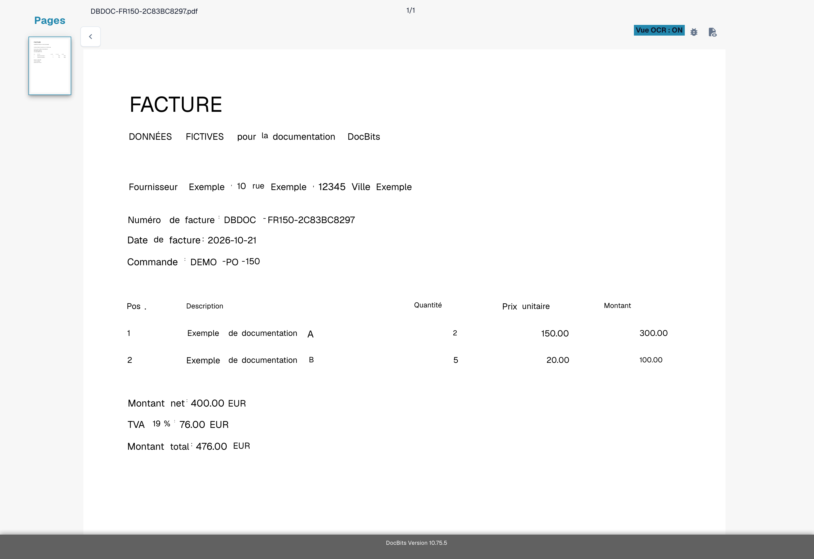
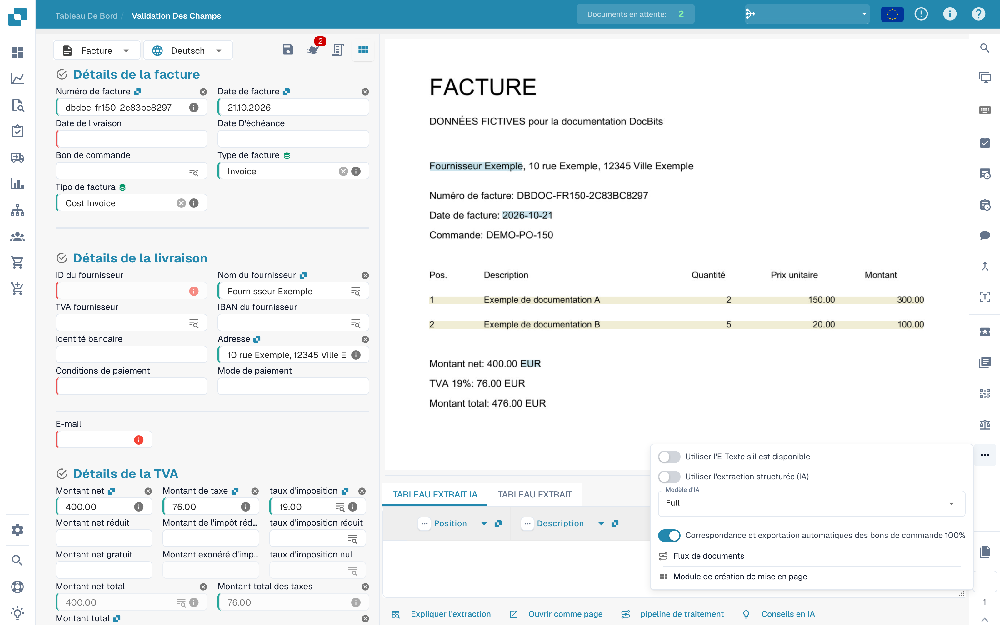
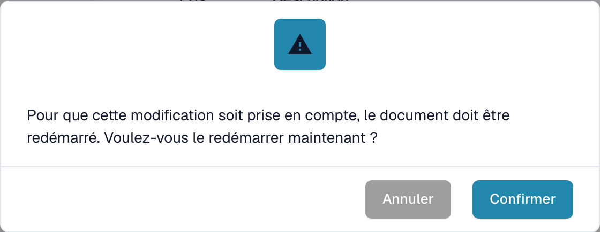
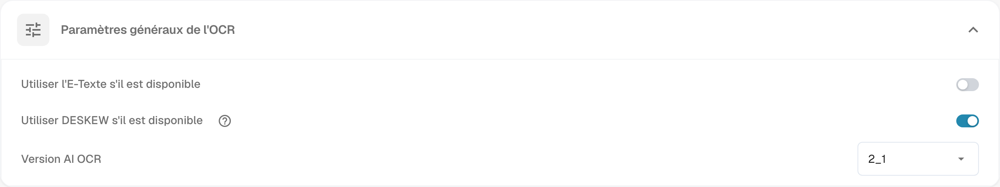
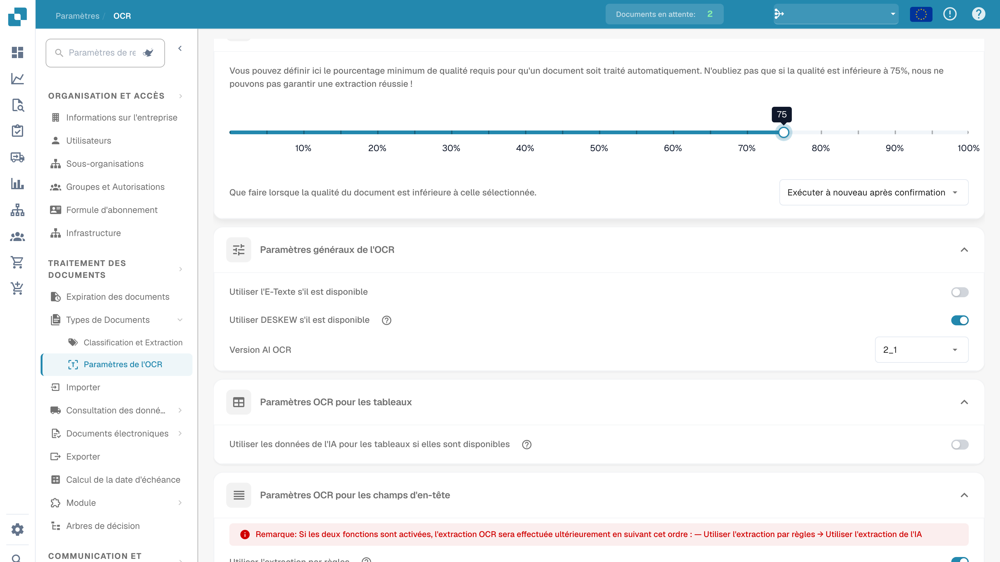

# Texte manquant dans l'extraction OCR

## **Problème**

Dans certains cas, du texte peut sembler manquer dans la **Vue OCR**, ce qui empêche son extraction via la fonctionnalité d'extraction.

<figure><figcaption>
Contrôle des champs extraits sur une facture fictive.
</figcaption></figure>

Pour vérifier cela, cliquez sur le bouton **Vue OCR** dans la barre d'outils à droite. Si le texte n'apparaît pas là, cela signifie qu'il n'est pas disponible pour l'extraction.

<figure><figcaption>
Vue OCR du texte reconnu sur la facture fictive.
</figcaption></figure>

## **Cause**

La cause la plus probable est que le texte que vous essayez d'extraire fait partie d'une image (par exemple, un logo ou une section numérisée) dans le document.\
Lorsque la fonctionnalité E-Text est activée, le texte qui apparaît sur les images ou les logos n'est pas inclus dans la couche de texte extraite. En conséquence, ce texte ne peut pas être accessible ou extrait par la logique d'extraction standard.

## **Solution**

Pour résoudre ce problème, désactivez la fonctionnalité E-Text—soit pour le [fournisseur spécifique](missing-text-in-ocr-extraction.md#desactiver-e-text-pour-un-fournisseur-specifique), soit pour [l'ensemble de l'organisation](missing-text-in-ocr-extraction.md#desactiver-e-text-pour-lensemble-de-lorganisation). Une fois E-Text désactivé, DocBits s'appuiera uniquement sur l'OCR, qui est capable d'extraire du texte à partir d'images et de logos dans le document.

### **Désactiver E-Text pour un Fournisseur Spécifique**

1. Ouvrez un document du fournisseur spécifique dans la **Validation de Champ**.
2.  Cliquez sur le menu à trois points dans la barre d'outils à droite.

<figure><figcaption>
Menu d’options supplémentaires dans la validation des champs.
</figcaption></figure>

3.  Décochez **Utiliser l'E-Texte s'il est disponible**.

<figure><figcaption>
Option d’utilisation du texte électronique dans le menu du document.
</figcaption></figure>

4.  Cliquez sur **Confirmer** pour redémarrer le traitement du document.

<figure><figcaption>
Confirmation avant modification de l’utilisation du texte électronique.
</figcaption></figure>

### Désactiver E-Text pour l'Ensemble de l'Organisation

1.  Allez dans **Paramètres → Traitement des documents → Paramètres de l'OCR**.

<figure><figcaption>
Paramètres OCR de l’interface française.
</figcaption></figure>

2.  Sous **Paramètres généraux de l'OCR**, décochez l'option **Utiliser l'E-Texte s'il est disponible**.

<figure><figcaption>
Paramètres OCR généraux avec l’option d’utilisation du texte électronique.
</figcaption></figure>

Les images utilisent une facture fictive avec du texte OCR disponible. Elles illustrent des vérifications de l’interface, pas un incident reproduit de texte manquant.
