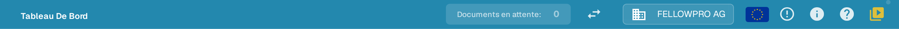
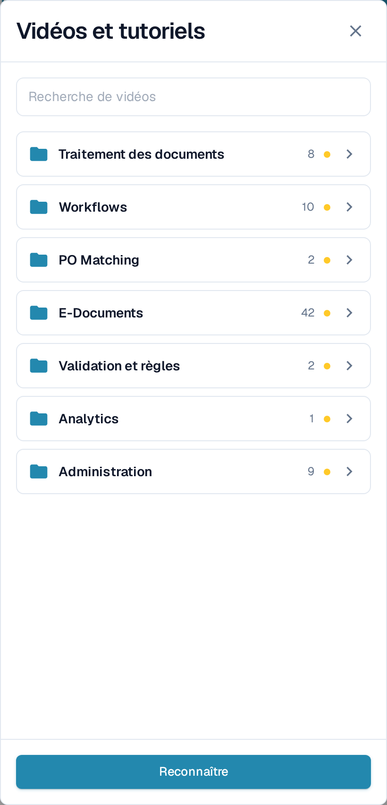
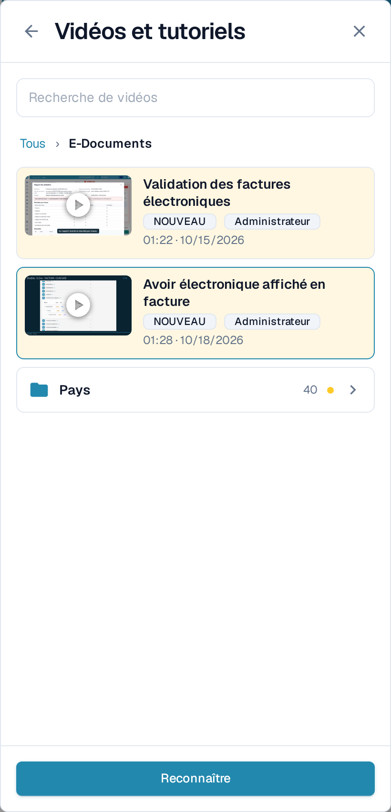
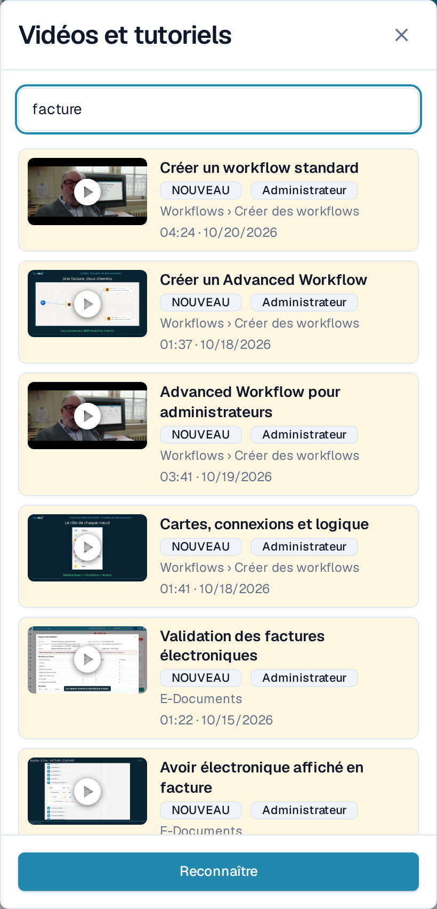
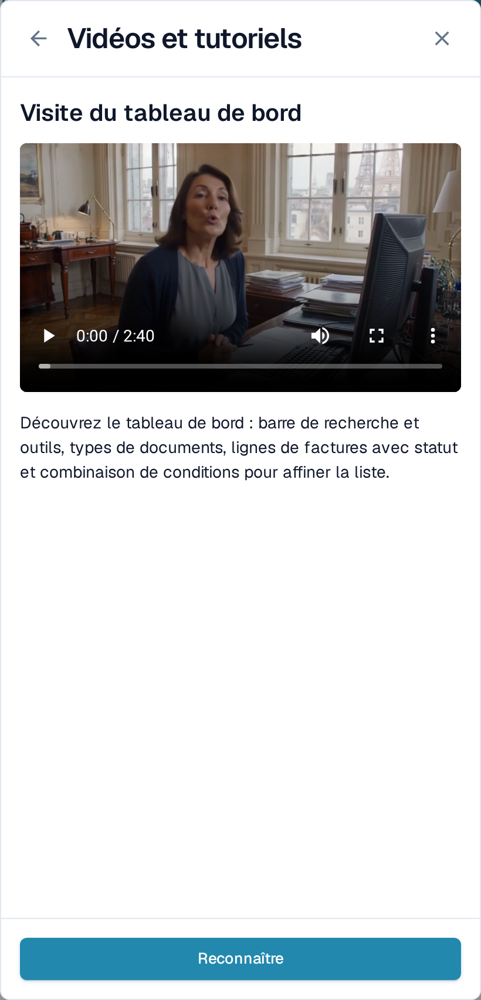

# Vidéos et tutoriels

**Vidéos et tutoriels** lit de courtes vidéos DocBits sans que vous quittiez la page sur laquelle vous travaillez. Les vidéos sont regroupées par thème, ce qui vous permet de trouver rapidement celle qui correspond à votre tâche.

## Ouvrir le panneau

L'icône vidéo se trouve à l'extrémité droite de la barre supérieure, après l'icône d'aide.

<figure><figcaption>
L'icône vidéo est la dernière icône de la barre supérieure.
</figcaption></figure>

* L'icône est **jaune avec un petit point** tant qu'au moins une vidéo n'a pas été marquée comme vue.
* Elle reprend la couleur des autres icônes de la barre dès que vous avez marqué toutes les vidéos comme vues.

Sélectionnez l'icône pour ouvrir **Vidéos et tutoriels** sous forme de panneau sur la droite.

<figure><figcaption>
Le panneau s'ouvre sur la liste des thèmes. Chaque thème est un dossier accompagné de son nombre de vidéos.
</figcaption></figure>

## Parcourir un thème

Le panneau s'ouvre sur les **dossiers de thèmes**, par exemple **Traitement des documents**, **Workflows**, **E-Documents** ou **Administration**. Un dossier indique le nombre de vidéos qu'il contient et affiche la mention **NOUVEAU** tant qu'il renferme une vidéo que vous n'avez pas encore marquée comme vue.

Sélectionnez un dossier pour l'ouvrir. Vous y trouvez les vidéos de ce thème et, lorsque le thème est vaste, d'autres dossiers qui les regroupent, comme **Pays** sous **E-Documents**. Le fil d'Ariane en haut et la flèche de retour vous font remonter d'un niveau. Une vidéo ouverte depuis un dossier revient dans ce dossier lorsque vous la fermez.

<figure><figcaption>
Ouvrez un thème pour voir ses vidéos et ses sous-dossiers.
</figcaption></figure>

## Rechercher une vidéo

Saisissez un terme dans **Recherche de vidéos** pour parcourir tous les thèmes à la fois. Chaque résultat indique le dossier auquel il appartient, par exemple **Workflows › Créer des workflows**, afin que vous sachiez où se trouve la vidéo. La recherche porte aussi sur les noms de thèmes et de dossiers et ignore les majuscules et les accents.

<figure><figcaption>
La recherche couvre tous les thèmes et indique le dossier de chaque résultat.
</figcaption></figure>

Videz le champ de recherche pour revenir aux dossiers de thèmes.

## Regarder une vidéo et la marquer comme vue

Sélectionnez une vidéo pour la lire dans le panneau. Le titre et une courte description indiquent ce que la vidéo couvre.

<figure><figcaption>
Lisez la vidéo dans le panneau, puis marquez-la comme vue.
</figcaption></figure>

Sélectionnez **Reconnaître** lorsque vous avez regardé la vidéo. Elle est alors considérée comme vue pour votre seul utilisateur : la mention **NOUVEAU** disparaît pour vous sur la vidéo et sur son dossier, et l'icône de la barre supérieure devient grise dès qu'il ne reste plus rien à marquer. Les autres utilisateurs continuent de voir leurs propres vidéos non marquées.

## Vidéos destinées aux administrateurs et aux utilisateurs

* Les vidéos portant la mention **Administrateur** s'adressent aux administrateurs. Les administrateurs voient dans le panneau les vidéos destinées aux administrateurs et celles destinées aux utilisateurs finaux ; les utilisateurs finaux ne voient que ces dernières.
* Si une vidéo n'est pas disponible dans la langue de votre interface, la version anglaise est affichée avec un code de langue tel que **EN**.


Les captures d'écran montrent l'organisation de test DocBits avec l'application configurée en français.

