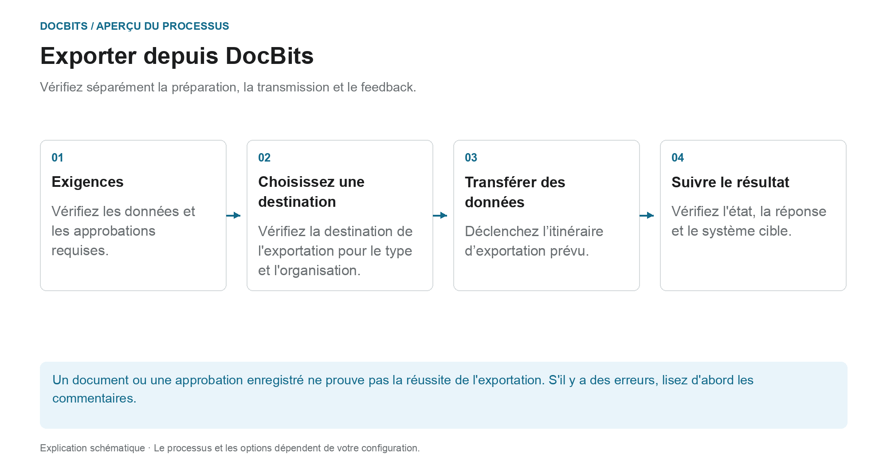

# Exportation dans DocBits

## Du document vérifié au système cible

<figure><figcaption>
Vérifiez séparément la préparation, la transmission et le feedback. Le diagramme est schématique ; les paramètres actifs de votre organisation déterminent le comportement réel.
</figcaption></figure>

Lors de l'exportation, DocBits transfère les documents et les données vers une connexion établie. Le fait qu'une exportation soit proposée ou déclenchée automatiquement dépend du type de document, de son statut, du flux de travail et de la configuration de l'exportation.

1. **Vérifiez les conditions préalables :** Examinez les données du document, les tâches ouvertes et les approbations requises par votre processus. Une correspondance PO réussie ne remplace pas ces étapes.
2. **Clarifiez la destination de l'exportation :** Vérifiez quelle configuration s'applique au type de document et à l'organisation ou sous-organisation. La gestion des exportations prend en charge, entre autres, Infor, Infor & IDM, Webhook et SFTP. Le contenu réel de la livraison dépend de la connexion établie.
3. **Déclencher le transfert :** Utilisez l'action de document prévue ou le flux de travail configuré. Une exportation alternative est configurée séparément ; son statut de disponibilité n'est pas le statut à définir après l'export.
4. **Vérifiez les commentaires :** Vérifiez l'état du document et les réponses disponibles des destinataires. Pour une vérification de bout en bout, vous vérifiez également le processus associé dans le système cible. Pour Infor, d’autres étapes de traitement peuvent suivre dans ION et ERP.

### Si l'exportation échoue

Ouvrez les détails de l'erreur avant d'exporter à nouveau. Des envois répétés ne résoudront pas un mappage incorrect ou un rejet de la part du destinataire. Utilisez la réponse pour vérifier les valeurs du document, le mappage et la configuration cible, et vérifiez si une transaction a déjà été créée dans le système cible.

### Instructions supplémentaires

- [Module d'exportation](export-module.md) : Premiers pas avec l'administration.
- [Exporter la configuration](../../administration-and-setup/settings/document-processing/export.md) : Connexions et portées.
- [Exportation alternative](alternate-export.md) : chemin d’exportation distinct par type et statut de document.
- [Exporter vers Infor](../exporting-to-infor/README.md) : traitement Infor en aval.

Un guide pour exporter des documents dans DocBits.
