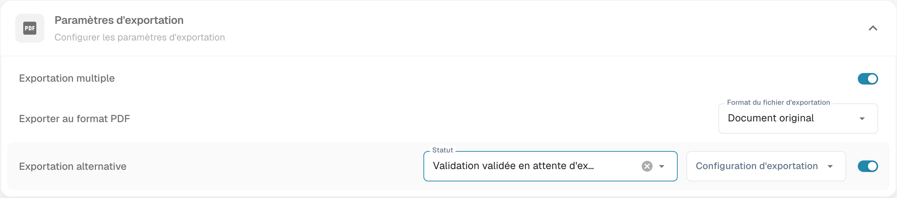

# Exportation alternative

## Étape 1 : préparer la destination

Ouvrez **Paramètres → Exporter** et définissez la configuration adaptée au destinataire et au type de document. Enregistrez-la et vérifiez qu’elle est désactivée pour l’exportation habituelle si votre flux la réserve à une exportation alternative.

## Étape 2 : configurer l’exportation alternative

1. Ouvrez **Paramètres → Types de Documents**, puis l’engrenage du type concerné.
2. Dépliez **Paramètres d’exportation** et repérez **Exportation alternative**.
3. Choisissez **Statut** pour définir quand cette option est disponible, puis la **Configuration d’exportation** de destination. Statut ne définit pas un état postérieur à l’exportation.

<figure><figcaption>
Paramètres d’exportation et Exportation alternative. Statut définit la disponibilité de cette option, et non le statut après export. Le libellé natif Validation validée en attente d’exportation est maladroit. Aucune exportation n’a été exécutée.
</figcaption></figure>

## Utiliser l’exportation alternative

Si le document remplit le statut configuré et que l’option est disponible dans son flux, choisissez la destination alternative dans l’écran de rapprochement des commandes. La carte de workflow correspondante permet également de configurer cette destination et ses conditions d’utilisation.

Pendant cette vérification, aucune destination n’a été créée, aucun réglage n’a été enregistré et aucune exportation n’a été exécutée.
