# Exporter les codes de taxe vers LN

## **Aperçu :**

\
Ce guide vous accompagnera dans le processus de configuration pour garantir que les codes de taxe sont correctement exportés de DocBits vers LN.

## **Codes de taxe uniques**

### **Étape 1 : Configurer la liste de valeurs**

1.  Allez dans **Paramètres** -> **Traitement des documents** -> **Liste de valeurs**.

    <figure><figcaption>
Liste de valeurs dans l’interface française actuelle. Les noms des listes propres à l’organisation sont masqués ; aucune liste n’a été créée.
</figcaption></figure>
2.  Cliquez sur **Nouveau**.

    <figure>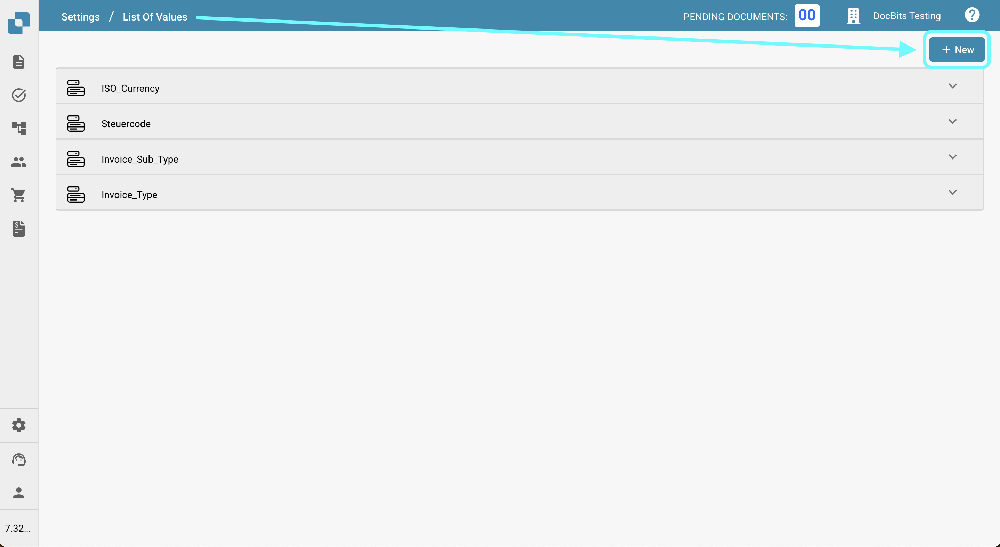<figcaption>Liste de valeurs avec les listes existantes</figcaption></figure>
3.  Créez une liste avec le nom `Tax_Country` et cliquez sur **ENREGISTRER**.

    <figure><figcaption>Créer la liste Tax_Country</figcaption></figure>
4.  Créez les trois listes supplémentaires suivantes :

    * `Tax_Code_Full`
    * `Tax_Code_Reduced`
    * `Tax_Code_Free`

    
<figure><figcaption>Créer la liste Tax_Code_Full</figcaption></figure> <figure><figcaption>Créer la liste Tax_Code_Reduced</figcaption></figure> <figure>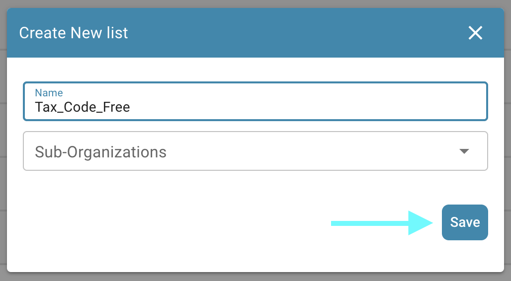<figcaption>Créer la liste Tax_Code_Free</figcaption></figure>

5.  Cliquez sur l'une des listes nouvellement créées pour l'ouvrir. Ensuite, appuyez sur le bouton **Ajouter une ligne** pour ajouter une nouvelle ligne.

    <figure><figcaption>Ajouter une ligne à la liste ouverte</figcaption></figure>
6.  Entrez les valeurs respectives souhaitées de **LN** et appuyez sur **ENREGISTRER** pour sauvegarder les modifications.

    * Pour plusieurs codes, ajoutez et enregistrez une ligne par valeur dans la liste concernée.

    
<figure>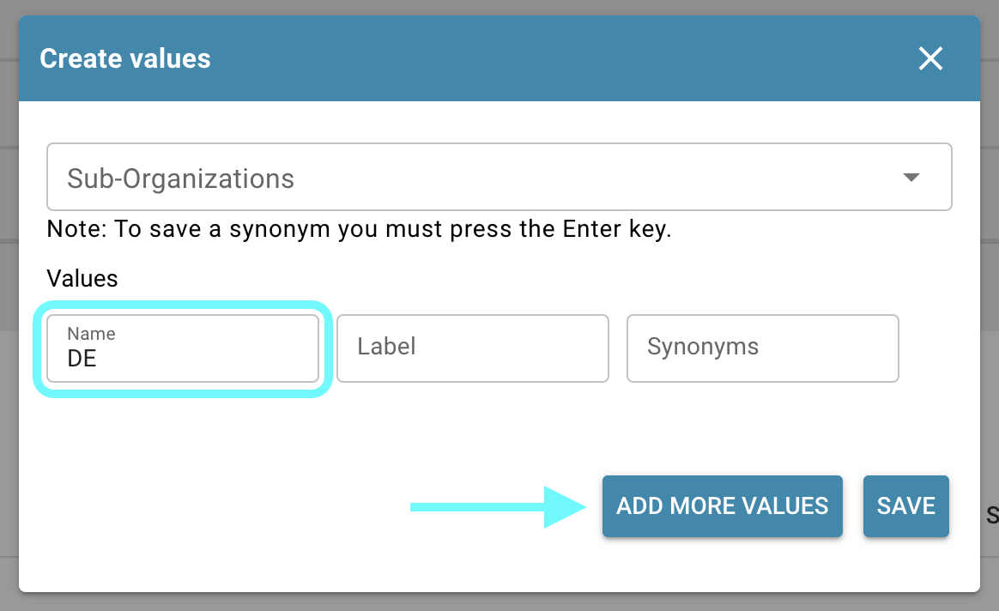<figcaption>Saisir le code de taxe LN dans le champ Nom</figcaption></figure> <figure><figcaption>
Formulaire français de création d’une valeur : valeur, sous-organisation, synonymes et traductions. Aucun code de taxe n’a été saisi ou enregistré ; le choix Anglais concerne la langue d’une traduction, pas celle de l’interface.
</figcaption></figure>

    * **REMARQUE :** Vous pouvez trouver les codes de taxe dans LN sous : **Common** → **Taxation** → **Master Data** → **Tax Codes** → **Tax Codes by Country**

    <figure><figcaption>LN : Common > Taxation > Master Data > Tax Codes > Tax Codes by Country</figcaption></figure>

### **Étape 2 : Ajouter des champs dans DocBits**

1.  Naviguez vers **Paramètres** -> **Paramètres globaux** -> **Types de documents**.

    <figure>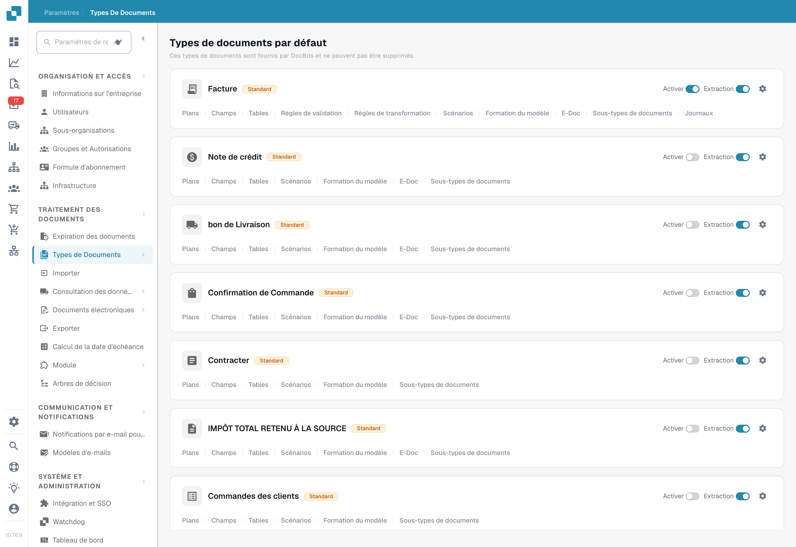<figcaption>
Types de documents dans l’interface française actuelle. Choisissez Champs dans la carte du type concerné ; aucun interrupteur n’a été modifié.
</figcaption></figure>
2.  Choisissez le menu **Champs** correspondant au type de document où vous souhaitez ajouter les champs.

    <figure><figcaption>Ouvrir le menu Champs du type de document</figcaption></figure>
3.  Sous **TVA et montants**, créez six nouveaux champs comme suit:

    <figure><figcaption>Onglet Champs : groupe TVA et montants</figcaption></figure>

<table data-header-hidden><thead><tr><th width="306"></th><th width="139"></th><th width="119"></th><th></th></tr></thead><tbody><tr><td><strong>Nom</strong></td><td><strong>Titre</strong></td><td><strong>Type de champ</strong></td><td><strong>Liste de valeurs</strong></td></tr><tr><td><code>tax_country</code></td><td>Pays de taxation</td><td>Dropdown</td><td>Tax_Country</td></tr><tr><td><code>tax_country_2</code></td><td>Pays de taxe réduit</td><td>Dropdown</td><td>Tax_Country</td></tr><tr><td><code>tax_country_3</code></td><td>Pays sans taxe</td><td>Dropdown</td><td>Tax_Country</td></tr><tr><td><code>tax_code_without_country</code></td><td>Code de taxe</td><td>Dropdown</td><td>Tax_Code_Full</td></tr><tr><td><code>tax_code_without_country_2</code></td><td>Code de taxe — taux réduit</td><td>Dropdown</td><td>Tax_Code_Reduced</td></tr><tr><td><code>tax_code_without_country_3</code></td><td>Code de taxe — sans taxe</td><td>Dropdown</td><td>Tax_Code_Free</td></tr></tbody></table>

<figure>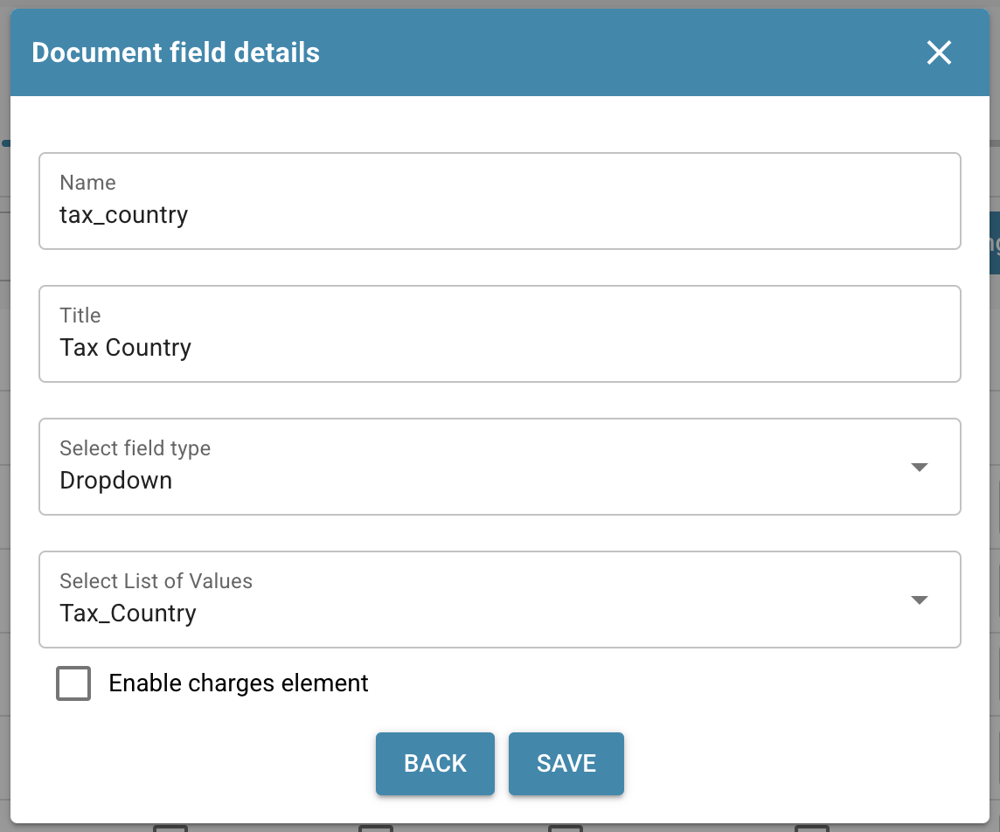<figcaption>Champ tax_country : Dropdown, liste Tax_Country</figcaption></figure> <figure>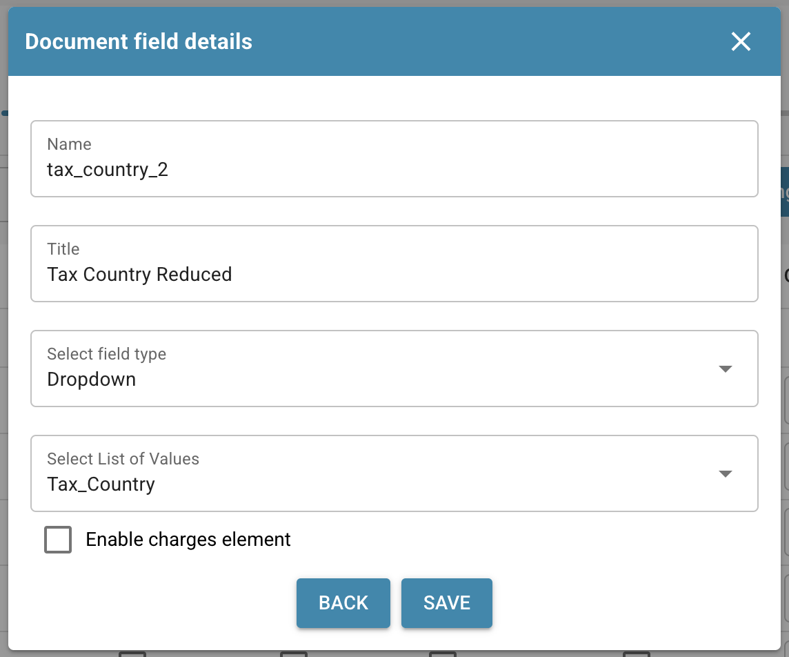<figcaption>Champ tax_country_2 : Dropdown, liste Tax_Country</figcaption></figure> <figure><figcaption>Champ tax_country_3 : Dropdown, liste Tax_Country</figcaption></figure>

<figure><figcaption>Champ tax_code_without_country : Dropdown, liste Tax_Code_Full</figcaption></figure> <figure><figcaption>Champ tax_code_without_country_2 : Dropdown, liste Tax_Code_Reduced</figcaption></figure> <figure>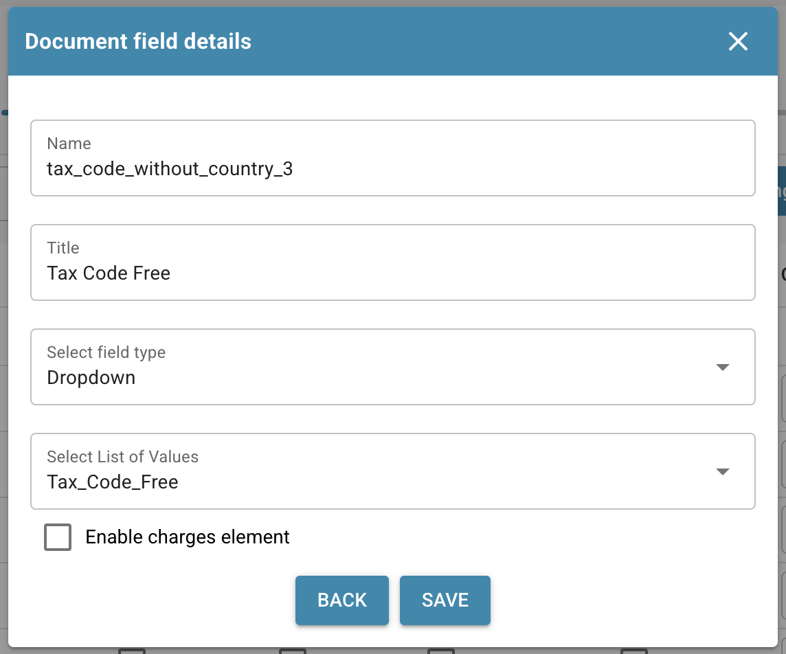<figcaption>Champ tax_code_without_country_3 : Dropdown, liste Tax_Code_Free</figcaption></figure>

4.  Après avoir enregistré chaque champ, cliquez sur **Enregistrer les paramètres** pour appliquer les modifications.

    <figure>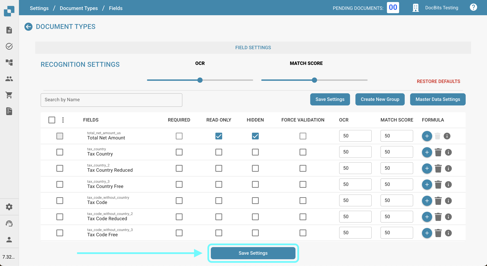<figcaption>Enregistrer les paramètres pour appliquer les nouveaux champs</figcaption></figure>

### **Étape 3 : Modifier la mise en page**

1.  Allez dans **Paramètres** -> **Paramètres globaux** -> **Types de documents**.

    <figure><figcaption>
Types de documents dans l’interface française actuelle. Choisissez Champs dans la carte du type concerné ; aucun interrupteur n’a été modifié.
</figcaption></figure>
2.  Ouvrez le menu **Modifier la mise en page** pour le type de document que vous souhaitez modifier.

    <figure><figcaption>Ouvrir Modifier la mise en page du type de document</figcaption></figure>
3.  Sélectionnez l'**Origine du document** appropriée pour laquelle vous souhaitez appliquer les codes de taxe

    <figure><figcaption>Layout Builder : sélectionner l'origine du document</figcaption></figure>
4.  Faites défiler jusqu'à la section **Tax Details**.

    <figure>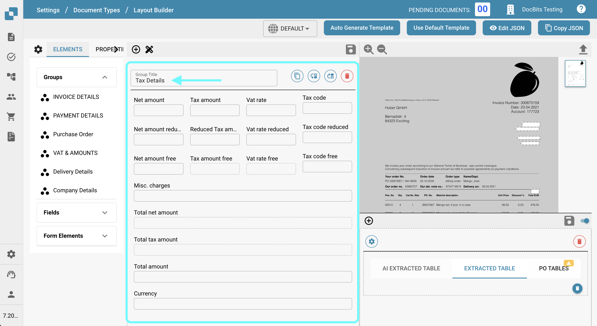<figcaption>Faire défiler jusqu'au groupe Détails de taxe</figcaption></figure>
5. Développez le menu déroulant **Éléments du formulaire**.
6.  Dans la section **Tax Details**, utilisez l'outil **Horizontal Separator**. Faites-le glisser et déposez-le entre les sous-sections dans la section fiscale pour les séparer clairement et réduire la confusion.

    <figure>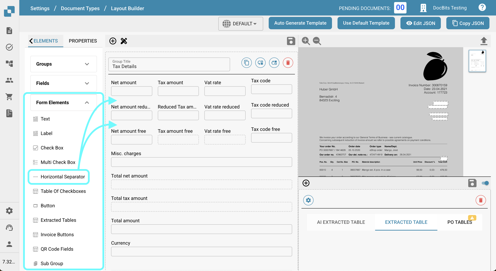<figcaption>Dérouler Éléments de formulaire</figcaption></figure>
7. Développez le menu déroulant **Champs**.
8.  Recherchez **Tax Country** et faites glisser le champ dans son domaine respectif.

    <figure>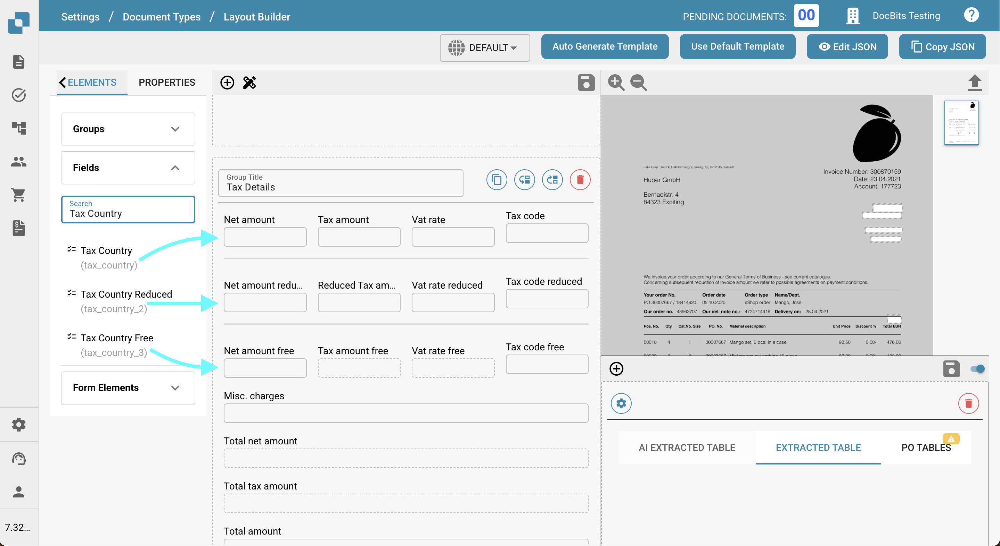<figcaption>Glisser Tax Country dans la zone Détails de taxe</figcaption></figure>
9.  Recherchez **Tax Code** et faites glisser le champ dans son domaine correspondant.

    <figure>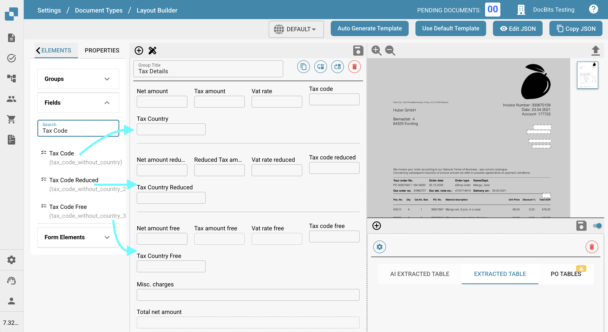<figcaption>Glisser Tax Code dans la zone Détails de taxe</figcaption></figure>
10. Enregistrez le modèle.

    <figure><figcaption>Modèle enregistré avec les deux champs de taxe</figcaption></figure>

### Étape 4 : Vérifiez que tout a fonctionné

Après avoir téléchargé un nouveau document dans DocBits avec les paramètres de document corrects sélectionnés, vous devriez maintenant être en mesure de sélectionner les codes de taxe que vous avez ajoutés aux listes à l'étape 1.

<figure><figcaption>Les nouvelles listes dans la vue de validation</figcaption></figure>

## Code de taxe multiple

### **Étape 1 : Configurer la liste de valeurs**

1.  Allez dans **Paramètres** -> **Traitement des documents** -> **Liste de valeurs**.

    <figure><figcaption>
Liste de valeurs dans l’interface française actuelle. Les noms des listes propres à l’organisation sont masqués ; aucune liste n’a été créée.
</figcaption></figure>
2.  Cliquez sur **Nouveau**.

    <figure><figcaption>Liste de valeurs avec les listes existantes</figcaption></figure>
3.  Créez une liste avec le nom `Tax_Country` et cliquez sur **ENREGISTRER**.

    <figure><figcaption>Créer la liste Tax_Country</figcaption></figure>
4.  Créez les trois listes supplémentaires suivantes :

    * `Tax_Code_Full`
    * `Tax_Code_Reduced`
    * `Tax_Code_Free`

    
<figure><figcaption>Créer la liste Tax_Code_Full</figcaption></figure> <figure><figcaption>Créer la liste Tax_Code_Reduced</figcaption></figure> <figure><figcaption>Créer la liste Tax_Code_Free</figcaption></figure>

5.  Cliquez sur l'une des listes nouvellement créées pour l'ouvrir. Ensuite, appuyez sur le bouton **Ajouter une ligne** pour ajouter une nouvelle ligne.

    <figure><figcaption>Ajouter une ligne à la liste ouverte</figcaption></figure>
6.  Entrez les valeurs respectives souhaitées de **LN** et appuyez sur **ENREGISTRER** pour sauvegarder les modifications.

    * Pour plusieurs codes, ajoutez et enregistrez une ligne par valeur dans la liste concernée.

    
<figure><figcaption>Saisir le code de taxe LN dans le champ Nom</figcaption></figure> <figure><figcaption>
Formulaire français de création d’une valeur : valeur, sous-organisation, synonymes et traductions. Aucun code de taxe n’a été saisi ou enregistré ; le choix Anglais concerne la langue d’une traduction, pas celle de l’interface.
</figcaption></figure>

    * **REMARQUE :** Vous pouvez trouver les codes de taxe dans LN sous : **Common** → **Taxation** → **Master Data** → **Tax Codes** → **Tax Codes by Country**

    <figure><figcaption>LN : Common > Taxation > Master Data > Tax Codes > Tax Codes by Country</figcaption></figure>

### **Étape 2 : Ajouter des champs dans DocBits**

1.  Naviguez vers **Paramètres** -> **Paramètres globaux** -> **Types de documents**.

    <figure><figcaption>
Types de documents dans l’interface française actuelle. Choisissez Champs dans la carte du type concerné ; aucun interrupteur n’a été modifié.
</figcaption></figure>
2.  Choisissez le menu **Champs** correspondant au type de document où vous souhaitez ajouter les champs.

    <figure><figcaption>Ouvrir le menu Champs du type de document</figcaption></figure>
3.  Sous **TVA et montants**, créez six nouveaux champs comme suit:

    <figure><figcaption>Onglet Champs : groupe TVA et montants</figcaption></figure>

<table data-header-hidden><thead><tr><th width="306"></th><th width="139"></th><th width="119"></th><th></th></tr></thead><tbody><tr><td><strong>Nom</strong></td><td><strong>Titre</strong></td><td><strong>Type de champ</strong></td><td><strong>Liste de valeurs</strong></td></tr><tr><td><code>tax_country</code></td><td>Pays de taxation</td><td>Dropdown</td><td>Tax_Country</td></tr><tr><td><code>tax_country_2</code></td><td>Pays de taxe réduit</td><td>Dropdown</td><td>Tax_Country</td></tr><tr><td><code>tax_country_3</code></td><td>Pays sans taxe</td><td>Dropdown</td><td>Tax_Country</td></tr><tr><td><code>tax_code_without_country</code></td><td>Code de taxe</td><td>Dropdown</td><td>Tax_Code_Full</td></tr><tr><td><code>tax_code_without_country_2</code></td><td>Code de taxe — taux réduit</td><td>Dropdown</td><td>Tax_Code_Reduced</td></tr><tr><td><code>tax_code_without_country_3</code></td><td>Code de taxe — sans taxe</td><td>Dropdown</td><td>Tax_Code_Free</td></tr></tbody></table>

<figure><figcaption>Champ tax_country : Dropdown, liste Tax_Country</figcaption></figure> <figure><figcaption>Champ tax_country_2 : Dropdown, liste Tax_Country</figcaption></figure> <figure><figcaption>Champ tax_country_3 : Dropdown, liste Tax_Country</figcaption></figure>

<figure><figcaption>Champ tax_code_without_country : Dropdown, liste Tax_Code_Full</figcaption></figure> <figure><figcaption>Champ tax_code_without_country_2 : Dropdown, liste Tax_Code_Reduced</figcaption></figure> <figure><figcaption>Champ tax_code_without_country_3 : Dropdown, liste Tax_Code_Free</figcaption></figure>

4.  Après avoir enregistré chaque champ, cliquez sur **Enregistrer les paramètres** pour appliquer les modifications.

    <figure><figcaption>Enregistrer les paramètres pour appliquer les nouveaux champs</figcaption></figure>

### **Étape 3 : Modifier la mise en page**

1.  Allez dans **Paramètres** -> **Paramètres globaux** -> **Types de documents**.

    <figure><figcaption>
Types de documents dans l’interface française actuelle. Choisissez Champs dans la carte du type concerné ; aucun interrupteur n’a été modifié.
</figcaption></figure>
2.  Ouvrez le menu **Modifier la mise en page** pour le type de document que vous souhaitez modifier.

    <figure><figcaption>Ouvrir Modifier la mise en page du type de document</figcaption></figure>
3.  Sélectionnez l'**Origine du document** appropriée pour laquelle vous souhaitez appliquer les codes de taxe

    <figure><figcaption>Layout Builder : sélectionner l'origine du document</figcaption></figure>
4.  Faites défiler jusqu'à la section **Tax Details**.

    <figure><figcaption>Faire défiler jusqu'au groupe Détails de taxe</figcaption></figure>
5. Développez le menu déroulant **Éléments du formulaire**.
6.  Dans la section Tax Details, utilisez l'outil **Sub Group**. Faites-le glisser et déposez-le à côté d'un champ existant.

    <figure><figcaption>Sélectionner l'outil Sous-groupe</figcaption></figure>
7.  Pour nommer votre sous-groupe, cliquez sur le sous-groupe et entrez le nom souhaité dans le champ **Étiquette**.

    
<figure>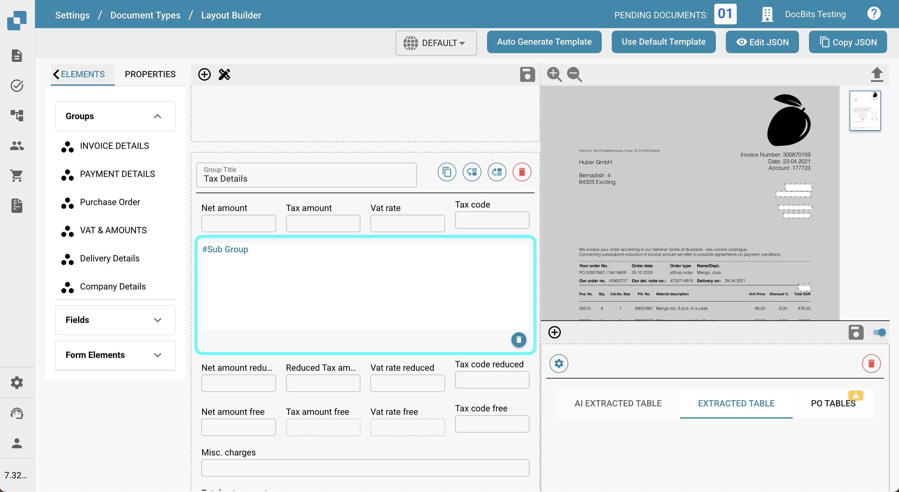<figcaption>Déposer le sous-groupe à côté d'un champ</figcaption></figure> <figure>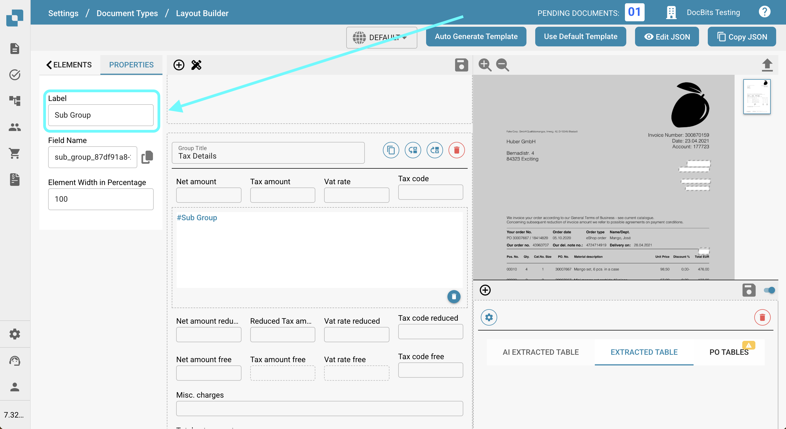<figcaption>Nommer le sous-groupe dans le champ Libellé</figcaption></figure>

8.  Faites glisser et déposez les champs qui correspondent à ce groupe dans le champ **Sub Group**.

    <figure><figcaption>Déplacer les champs de taxe dans le sous-groupe</figcaption></figure>
9. Développez le menu déroulant **Champs**.
10. Recherchez **Tax** et faites glisser et déposer les champs respectifs, tels que **Tax Country** et **Tax Code**, dans le sous-groupe correspondant.

    <figure><figcaption>Tax Country et Tax Code dans le sous-groupe</figcaption></figure>
11. Répétez les étapes 5 à 10 2 fois pour atteindre l'état suivant:

    <figure><figcaption>Trois sous-groupes : normal, réduit et exonéré</figcaption></figure>
12. Enregistrez le modèle.

    <figure><figcaption>Enregistrer le modèle multi-codes de taxe</figcaption></figure>

### Étape 4 : Vérifiez que tout a fonctionné et les changements résultants

Après avoir téléchargé un nouveau document dans DocBits avec les paramètres de document corrects sélectionnés, vous pourrez sélectionner les codes de taxe que vous avez ajoutés à l'étape 1 et ajouter plusieurs codes de taxe configurés à l'étape 3.

* Le document commencera par trois sections distinctes : une pour les montants au taux normal, une pour les montants au taux réduit et une pour les montants sans taxe.
* Cliquer sur le bouton plus dans une section créera un duplicata, permettant plusieurs soumissions au taux de taxe sélectionné.

<figure>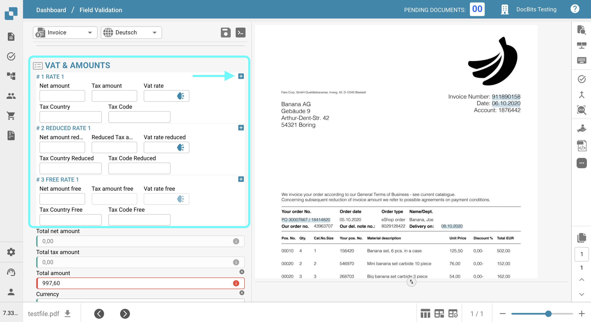<figcaption>Trois sections de taxe dans la vue de validation</figcaption></figure>

* Les sections peuvent être supprimées en cliquant sur le bouton de suppression.

<figure>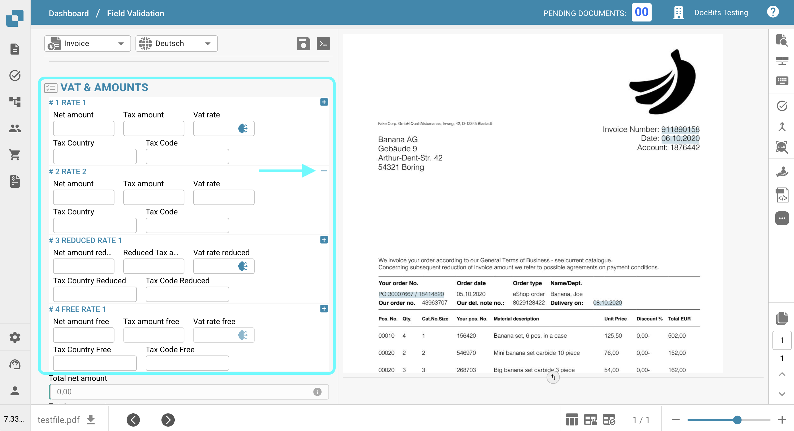<figcaption>Ajouter une section avec le bouton plus</figcaption></figure>

* Les montants totaux seront calculés comme une somme de toutes les sections.
* La validation du montant total sera modifiée en fonction de toutes les sections fiscales.
* Les scripts pour les nouvelles sections ne peuvent être appliqués qu'une fois que des champs ont été ajoutés à la vue.

### Remarque pour LN :

Dans **LN**, la position USt sera remplie en fonction du numéro de position du menu déroulant Tax Code/Tax Country. Seul le numéro de position sera envoyé à l'exportation.

<figure><figcaption>LN : Tax Lines by External Invoice</figcaption></figure>

<figure><figcaption>LN : le numéro de position est exporté comme USt Position</figcaption></figure>

#### **Mapping d'exportation**

Pour lier la ligne de taxe à la ligne de coût :

1. Ajoutez `TaxLine` à la liste **InvoiceCostFields**.
2. Ajoutez l'entrée suivante, suivant l'exemple ci-dessous :\
   `ICF_TaxLine = TF_position`

<figure><figcaption>Mappage d'export : ICF_TaxLine = TF_position</figcaption></figure>
