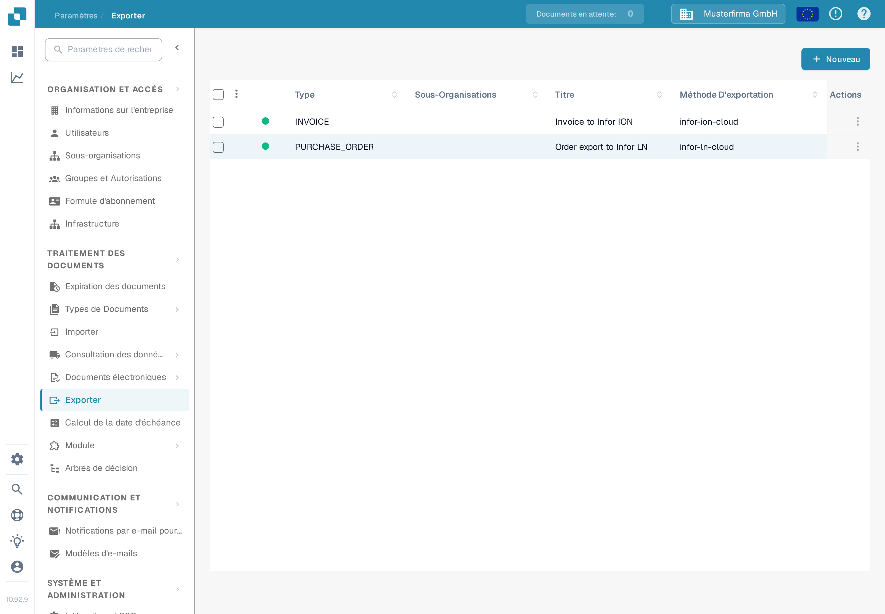
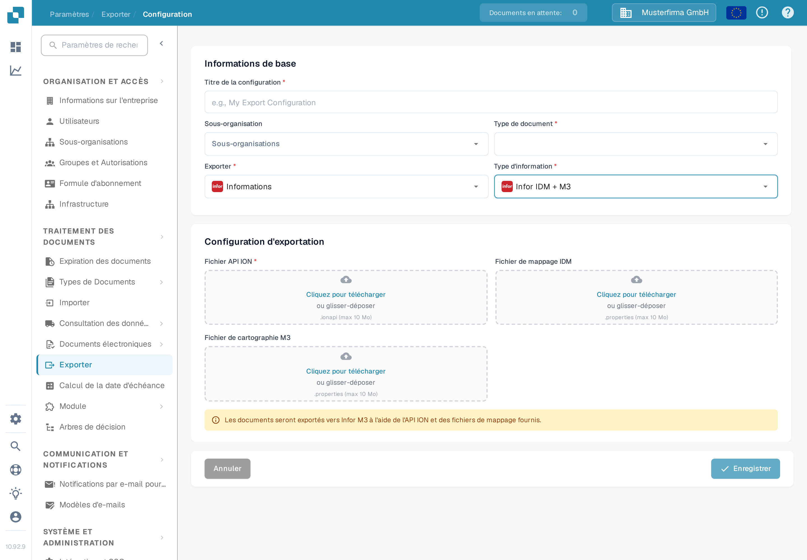

# Configurer un export vers Infor M3

Cette page explique les vérifications qui relient une configuration d'exportation DocBits à un flux de documents Infor ION pour M3. La page précédente contenait 38 captures d'écran issues d'un ancien tenant Infor, y compris des paramètres API et de mappage propres à cet environnement. Elles ne permettent pas d'établir la configuration dans votre tenant, c'est pourquoi le guide actuel renvoie aux instructions de Infor et montre le formulaire DocBits vérifié en anglais. Aucune connexion Infor ni export de facture n'a été testé pour cette mise à jour.

## Préparer le tenant Infor

Demandez à l'administrateur Infor le **point de terminaison ION API** approuvé, un fichier `.ionapi` propre au tenant, les fichiers `.properties` du **mappage IDM** et du **mappage M3**, ainsi que les noms des mappages BOD utilisés par le flux de factures de cette entreprise. Le fichier `.ionapi` contient des identifiants ; tenez-le à l'écart des captures d'écran, des pièces jointes Jira et de Git. Sa valeur `ci` est l'identifiant client, comme décrit dans [la référence des champs d'identifiants de Infor](https://docs.infor.com/crm/9.4.x/en-us/webclient/upi1639111995644.html).

Dans ION Desk, l'administrateur doit :

1. Importer et approuver les versions de mappage requises par le tenant actuel. Vérifiez les noms BOD d'entrée et de sortie du mappage au lieu de réutiliser des noms issus d'une ancienne capture d'écran.
2. Contrôler les points de connexion DocBits et M3, leurs identifiants logiques propres à l'environnement, les abonnements aux documents et les autorisations.
3. Construire le flux de documents avec les mappages approuvés et les éventuels filtres requis. Infor explique les [points de connexion, mappages et flux de documents](https://docs.infor.com/inforos/2024.x/en-us/useradminlib_cloud/iondeskceug_cloud_osm/lnj1556623308383.html).
4. Enregistrer, vérifier puis [activer le flux de documents](https://docs.infor.com/depm/2024.x/en-us/depmolh/configuring_ion/jex1510174562552.html) uniquement après le contrôle des routes. L'activation est distincte d'un export de documents réussi.

Pour un exemple historique ION complet, voir [Exportation vers Infor M3](README.md). Comparez chaque écran Infor de cette page avec votre tenant avant de le suivre.

## Configurer l'export dans DocBits

Dans l'organisation DocBits concernée, ouvrez **Paramètres → Exporter** et sélectionnez **Nouveau**. L'organisation Sandbox Test A française montrée ici n'a aucune configuration d'exportation enregistrée.

Saisissez un **Titre de la configuration**, choisissez le **Type de document** (Facture pour ce flux) et sélectionnez une **Sous-organisation** uniquement si nécessaire. Choisissez **Infor** pour **Exporter** et **Infor IDM + M3** pour **Type d'information**. Le formulaire actuel demande un **Fichier API ION** (`.ionapi`, obligatoire), un **Fichier de mappage IDM** (`.properties`) et un **Fichier de cartographie M3** (`.properties`). N'obtenez que les fichiers destinés à ce tenant et vérifiez-les avant l'enregistrement. La capture d'écran laisse délibérément tous les envois de fichiers vides.

Une fois le flux Infor actif, testez avec une facture hors production. Vérifiez son résultat dans DocBits, ION et M3. Une configuration enregistrée ou un flux activé seul ne prouve pas que la facture est arrivée.
