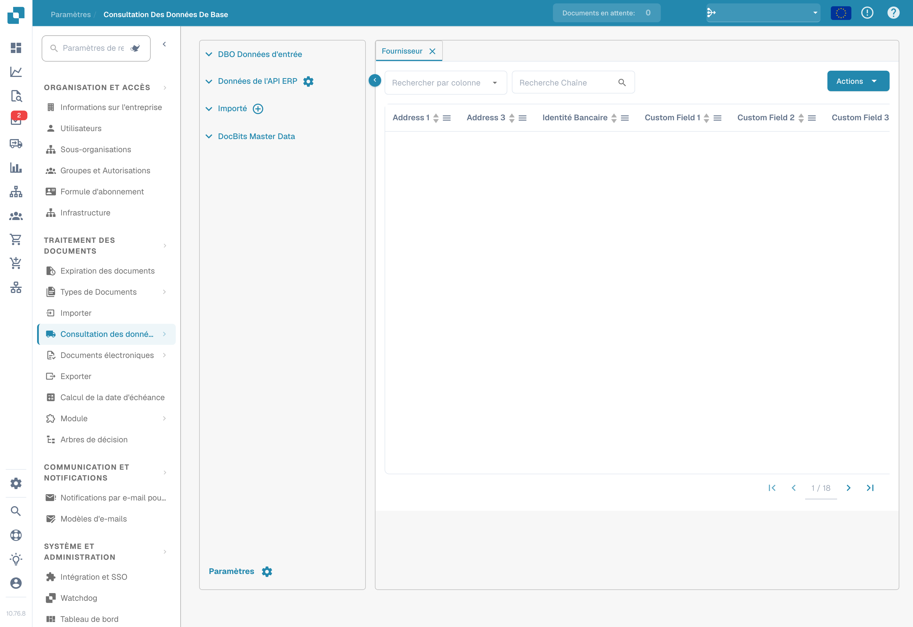
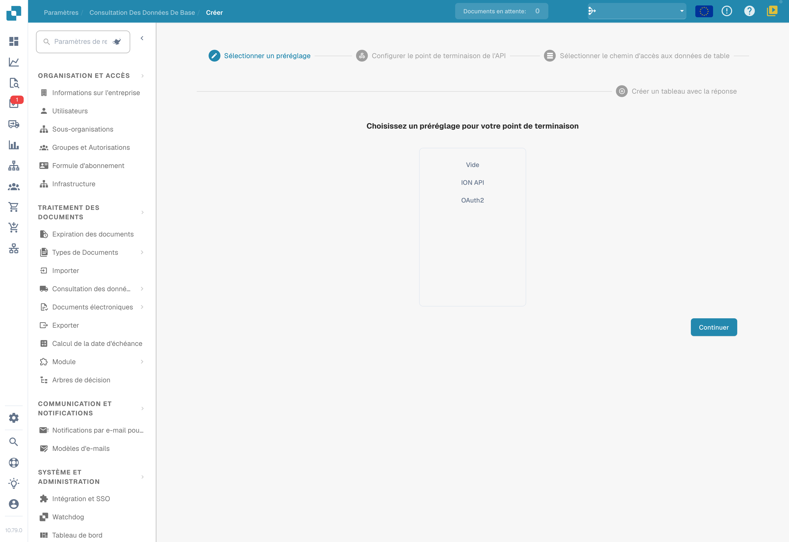
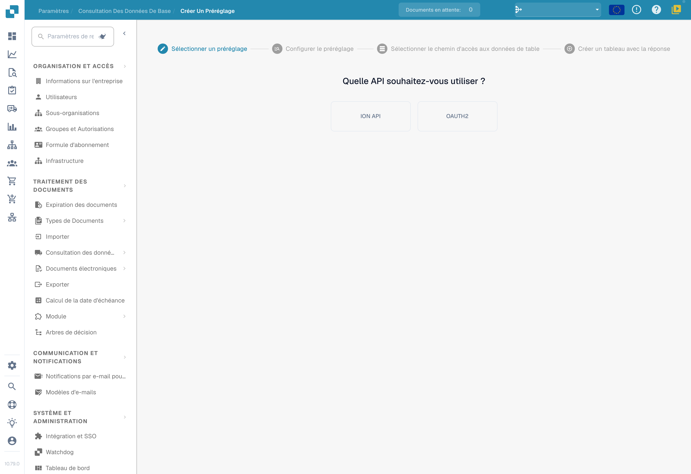

# Données de base personnalisées

Préparez les jeux de données nécessaires à votre organisation en vérifiant la source, les autorisations et la structure des réponses. Une capture du premier écran ne prouve pas une connexion API ou un jeu de données créé.

## Accès

Dans **Paramètres → Module → Intégration de documents**, examinez la fonction de données de base personnalisées. Ne l’activez que si votre configuration le requiert. Aucun interrupteur n’a été modifié pour les illustrations.

<figure><figcaption>
Module d’intégration des documents : option des données de base personnalisées, affichée sans modification.
</figcaption></figure>

Ouvrez ensuite la consultation des données de base et identifiez les jeux de votre organisation. Les lignes et noms privés masqués ne signifient pas que la liste est vide.

<figure><figcaption>
Consultation des données de base ; les données de l’organisation sont masquées.
</figcaption></figure>

## Choisir un préréglage

Le premier écran propose **Vide**, **ION API**, **OAuth2** ou un préréglage autorisé de votre organisation. Les noms des préréglages configurés sont masqués dans l’illustration.

<figure><figcaption>
Première étape du choix de préréglage avec Vide, ION API et OAuth2. Les noms des préréglages configurés sont masqués. Aucun choix, appel API ni tableau créé.
</figcaption></figure>

Suivez les étapes de votre assistant : point de terminaison de l’API, chemin des données de table, puis création à partir de la réponse. Examinez l’URL, la méthode, l’authentification et les paramètres de la source. Contrôlez la réponse et les correspondances de colonnes avant de créer le jeu.

Lorsqu’un champ demande un chemin de données, utilisez sa syntaxe prise en charge et vérifiez-le avec la réponse réelle. La [référence JSONPath](https://docs.hevodata.com/sources/engg-analytics/streaming/rest-api/writing-jsonpath-expressions/) distingue les expressions de chemins et leurs structures d’exemple.

## Préparer un préréglage réutilisable

**Créer un préréglage** commence par le choix **ION API** ou **OAUTH2**. Sélectionnez la méthode adaptée au service et complétez la configuration et les correspondances réellement demandées.

<figure><figcaption>
Première étape de Créer un préréglage avec ION API et OAUTH2. Ce sont des noms de protocoles ; aucun identifiant n’a été saisi et aucun préréglage n’a été enregistré.
</figcaption></figure>

Les identifiants et valeurs d’API appartiennent à leur organisation et à leur environnement. Ne recopiez pas ceux d’une illustration. Pendant cette vérification, aucune API n’a été sélectionnée, aucun identifiant n’a été saisi, aucune étape suivante n’a été ouverte et aucun tableau ni préréglage n’a été enregistré.
