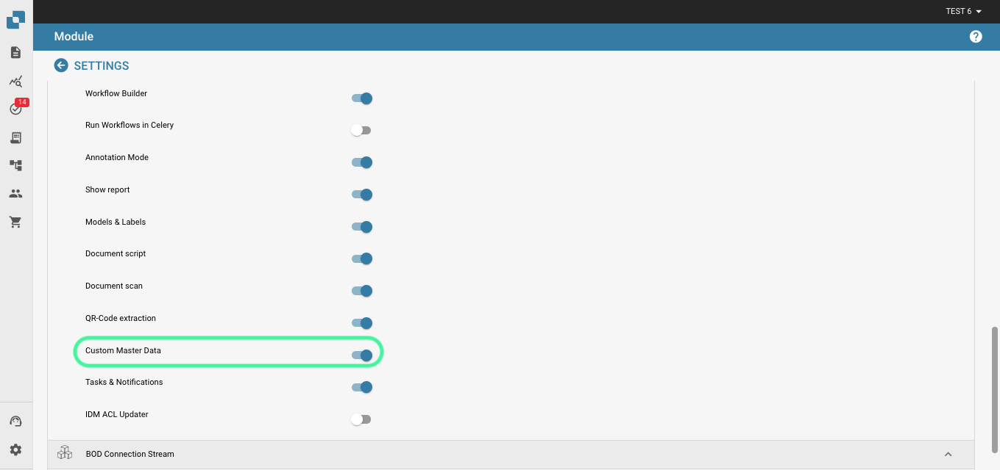

# Données de base personnalisées

#### Activer les données de base personnalisées 

Depuis le tableau de bord, accédez à Settings → Document Processing → Module.

.png>)

<figure><figcaption></figcaption></figure>

Dans Module, activez Custom Master Data en cliquant sur le curseur, comme illustré ci-dessous.

<figure><figcaption></figcaption></figure>

#### Aperçu de la fonctionnalité 

Pour ajouter vos propres données de base dans DocBits, accédez à Master Data Lookup dans Settings.

<figure><figcaption></figcaption></figure>

Cliquez sur « Custom Master Data ».

<figure><figcaption></figcaption></figure>

Vous pouvez ensuite choisir de créer un Template ou un Endpoint.

<figure><figcaption></figcaption></figure>

#### Créer un Template 

La première étape consiste à choisir entre utiliser le fichier API ION de votre organisation ou utiliser OAuth2 et saisir les données nécessaires.

<figure><figcaption></figcaption></figure>

Nous allons ensuite configurer les préréglages. Vous y saisirez le nom de la table de données de base et l'URL de l'appel d'API.

<figure><figcaption></figcaption></figure>

Vous devrez ensuite saisir le chemin JSON en notation pointée ; pour plus d'informations sur la notation pointée, cliquez [ici](https://docs.hevodata.com/sources/engg-analytics/streaming/rest-api/writing-jsonpath-expressions/).

Enfin, vous devrez mapper les données vers les colonnes que vous souhaitez créer, comme dans l'exemple ci-dessous.

<figure><figcaption></figcaption></figure>

Cela fait, cliquez sur Done pour que vos nouvelles données de base soient créées et alimentées.

#### Créer un Endpoint 

La première étape consiste à choisir entre utiliser le fichier API ION de votre organisation, utiliser OAuth2, ou laisser ce champ vide et saisir les données nécessaires.

<figure><figcaption></figcaption></figure>

Nous allons ensuite configurer les préréglages. Vous y saisirez le nom de la table de données de base et l'URL de l'appel d'API.

<figure><figcaption></figcaption></figure>

Vous devrez ensuite saisir le chemin JSON en notation pointée ; pour plus d'informations sur la notation pointée, cliquez [ici](https://docs.hevodata.com/sources/engg-analytics/streaming/rest-api/writing-jsonpath-expressions/).

Enfin, vous devrez mapper les données vers les colonnes que vous souhaitez créer, comme dans l'exemple ci-dessous.

<figure><figcaption></figcaption></figure>

Cela fait, cliquez sur Done pour que vos nouvelles données de base soient créées et alimentées.
