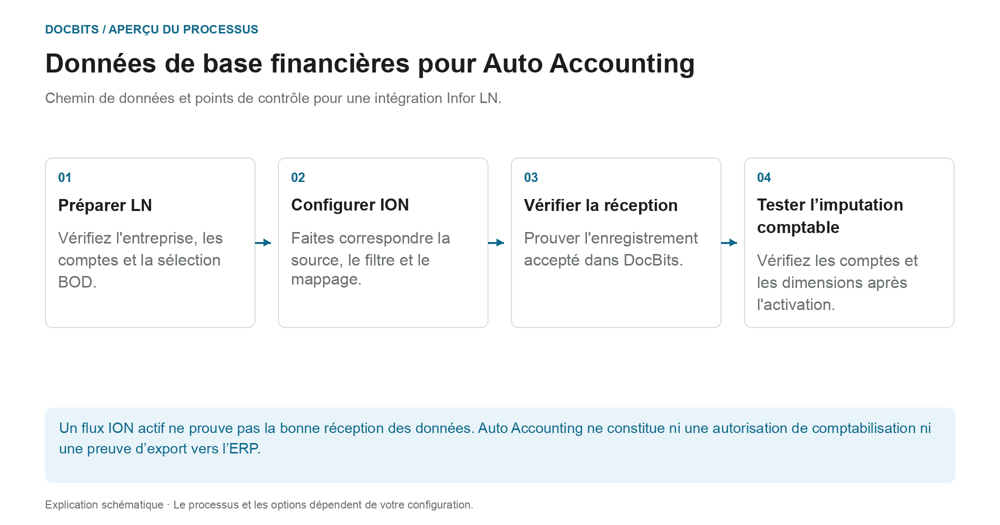
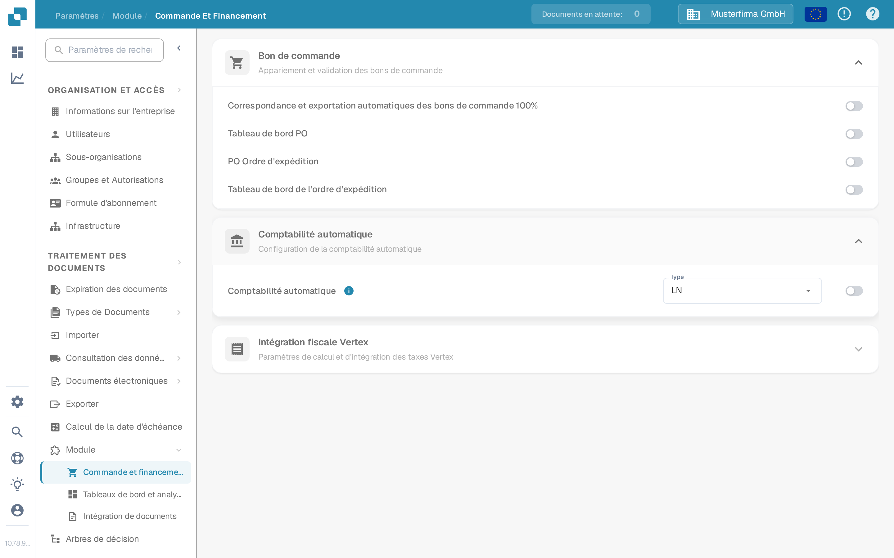

# Comptabilité automatique avec Infor LN

## De l'enregistrement de données de base LN à l'imputation contrôlée

<figure><figcaption>
Chemin de données et points de contrôle pour une intégration Infor LN. Le diagramme est schématique ; les paramètres actifs de votre organisation déterminent le comportement réel.
</figcaption></figure>

Ce guide couvre la fourniture de données de base financières pour une intégration LN. La sélection de **LN** ou l'activation de **Auto Accounting** ne remplace pas la fourniture des données ni la vérification du résultat de l'imputation.

| Remise de transfert | Ce que vous devez prouver |
| --- | --- |
| **LN → Publication BOD** | Corriger les données de l'entreprise et des comptes ou dimensions requises ; Commencez par compter ou simuler la sélection. |
| **BOD → ION** | Faire correspondre la version du document, la source, les filtres et le mappage ; tracez l'identifiant du test dans ION OneView. |
| **ION → DocBits** | Réception de la réponse du point final, organisation correcte et enregistrement accepté. Un flux activé seul ne suffit pas. |
| **DocBits → Résultat de l'imputation** | Après l'activation approuvée, utilisez des documents de test représentatifs pour vérifier que les comptes et les dimensions sont corrects pour le processus métier. |

**Exemple de traçabilité :** Utilisez un identifiant de test non sensible provenant d'un ensemble de données de test approuvé. Retrouvez le même identifiant dans la source BOD, dans ION et dans les logs de réception DocBits. Cela permet de localiser un mappage manquant lors d'un transfert spécifique au lieu de modifier le commutateur à plusieurs reprises.

L'exportation ultérieure et la comptabilisation ERP doivent être vérifiées séparément. Les images existantes dans ce guide montrent les commandes DocBits ; ils ne prouvent pas qu'un transfert LN a été effectué. La section suivante décrit la préparation et la vérification de bout en bout par les administrateurs responsables. Pour la remise technique, voir [Exporter depuis DocBits](../../exporting-in-docbits/README.md).

Utilisez ce guide lorsqu'un administrateur Infor LN souhaite que DocBits utilise les données maîtres financières importées pour la comptabilité automatique. L'ancienne page montrait 48 écrans d'un mandant Infor particulier. Les noms de points de connexion, les mappages, les identifiants et les adresses d'endpoint de ce mandant ne constituent pas une configuration réutilisable.

## Trouver le paramètre dans DocBits

Ouvrez **Paramètres → Module → Commande et financement → Comptabilité automatique** avec un compte administrateur. Le menu **Type** propose **LN** et **M3**. Pour une intégration LN, vérifiez que le type sélectionné est **LN**. N'activez le commutateur qu'après avoir vérifié la société LN visée, le flux BOD et les données maîtres importées. Modifier le type ou le commutateur peut influencer le comportement comptable ; suivez donc le processus de modification de votre organisation.

Les captures suivantes proviennent de la Sandbox synthétique **DocBits Documentation Test A**. Dans cette organisation, **LN** était sélectionné et la Comptabilité automatique était **désactivée**. Le menu a été ouvert sans sélectionner une autre valeur ; aucun paramètre n'a été enregistré.

<figure><figcaption>
Repérer la Comptabilité automatique et vérifier le type sélectionné avant de l'activer.
</figcaption></figure>

<figure><figcaption>
LN et M3 sont les types disponibles dans cette Sandbox ; aucune sélection n'a été modifiée.
</figcaption></figure>

## Préparer LN et ION

1. Confirmez la société LN, l'entité comptable, l'organisation DocBits et l'environnement cible. Convenez avec votre administrateur DocBits de l'opération API actuelle et du mappage de champs qui recevront les comptes et les dimensions. Conservez les identifiants API dans le coffre de secrets autorisé, jamais dans une capture d'écran ni dans une pièce jointe Jira.
2. Configurez la publication des BOD dans LN et validez le Publishing Data Setup. Infor documente **BOD Parameters (tcbod0100m000)** et **Validate Publishing Data Setup (tcbod0300m000)** dans son [guide de publication des BOD pour LN](https://docs.infor.com/ln/10.7.in/en-us/lnolh/help/tc/onlinemanual/000520.html).
3. Vérifiez quels nouns votre version de LN et l'opération de réception DocBits exigent. L'exemple précédent utilisait `Sync.ChartOfAccounts` et `Sync.CodeDefinition` pour les données de plan comptable et de dimension. Infor liste les options Chart of Accounts et CodeDefinition dans [Publish Financial Master Data (tfbia0200m000)](https://docs.infor.com/ln/2025.x/en-us/lnolh/tfolh/help/tf/bia/tfbia0200m000.html). Certains onglets CodeDefinition n'apparaissent qu'après avoir spécifié et approuvé le mappage des dimensions. Confirmez les versions de document et les champs exacts dans votre mandant avant de les router.
4. Dans **ION Desk → Connect → Connection Points**, reliez la source LN à la destination API DocBits autorisée. Dans **Data Flows**, routez les documents sélectionnés, vérifiez les filtres et le mappage, puis enregistrez et activez. Infor distingue [l'enregistrement de l'activation d'un flux](https://docs.infor.com/inforos/latest/en-us/useradminlib_cloud/iondeskceug/lsm1436532178755.html).
5. Dans LN, utilisez un identifiant de test non sensible. Dans **Publish Financial Master Data**, utilisez d'abord **Count** ou **Simulate** pour examiner la sélection, puis **Publish** uniquement dans le cadre de la modification approuvée par l'administrateur. L'action de publication n'est pas spécifique à une cible : selon Infor, elle livre à tous les abonnés. Suivez cet identifiant et les éventuelles erreurs dans [ION OneView](https://docs.infor.com/inforos/latest/en-us/useradminlib_cloud/iondeskceug/lsm1436532196155.html).

## Confirmer le résultat dans DocBits

Demandez à l'administrateur DocBits de vérifier l'enregistrement reçu, l'organisation et les champs comptables dans les journaux d'importation ou d'API actuels. Là où la table de correspondance concernée est exposée, recherchez le même identifiant sous **Paramètres → Traitement des documents → Consultation des données de base**. Un flux ION activé avec succès ne prouve pas à lui seul que DocBits a accepté un enregistrement. Si une valeur est absente, comparez le BOD source, le mappage ION, la réponse API et l'organisation cible avant d'activer la comptabilité automatique.

Aucun mandant LN ni transfert financier BOD réel n'était disponible pour un test de bout en bout. Les nouvelles images Sandbox ne vérifient que les contrôles actuels de DocBits. L'administrateur du mandant doit valider le mappage final et le résultat comptable.
