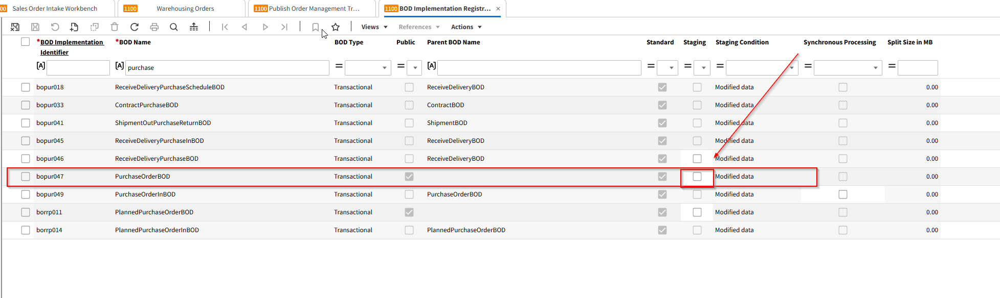

# Bon de commande - FAQ

**Où vérifier si les mises à jour de synchronisation du PurchaseOrderBOD sont correctement mises en œuvre ?**

Accédez à la session _BOD Implementation Registration (bobod1100m000)_ dans LN. Cette session vous permet de consulter, de modifier et d'enregistrer les implémentations de BOD standard et personnalisées, y compris le PurchaseOrderBOD.

\

<figure><figcaption></figcaption></figure>

**Comment identifier l'implémentation de BOD précise que je dois vérifier ?**

Repérez les champs BOD Implementation Identifier et BOD Name. Le BOD Name indique généralement le type de BOD (par ex. PurchaseOrderBOD). Le BOD Implementation Identifier est un identifiant unique de cette configuration de BOD.

\

**Que signifie la case « Public » dans la session BOD Implementation Registration ?**

La case Public indique si l'implémentation de BOD est disponible pour une communication externe.

• Cochée : le BOD peut être échangé en dehors de LN (interface publique et protégée).

• Décochée : le BOD est réservé au traitement interne de LN (interface protégée).

\

**Je vois un champ « Parent BOD Name ». À quoi sert-il ?**

Le champ Parent BOD Name affiche le BOD parent lorsque le BOD actuel est une version dérivée ou dépendante. Si la case Public est cochée, ce champ est vide. Sinon, il vous aide à comprendre la hiérarchie des implémentations de BOD.

\

**Comment savoir si l'implémentation de BOD est standard ou personnalisée ?**

Vérifiez la case Standard.

• Cochée : le BOD est une implémentation standard, fournie avec LN.

• Décochée : le BOD est une implémentation personnalisée, définie par votre équipe ou par un partenaire.

\

**À quoi sert la case « Staging » ?**

Lorsque la case Staging est cochée, les BOD sont d'abord mis en attente (staging) au lieu d'être publiés immédiatement. Ils peuvent ensuite être publiés depuis la session _Publish Staged BODs (bobod2200m000)_.

Remarque : pour le ProjectBudgetBOD, le staging est obligatoire et ne peut pas être modifié. Pour les BOD de données de base standard, le staging peut être activé manuellement, et pour les BOD personnalisés, il peut toujours être configuré.

\

**Comment la case « Synchronous Processing » influence-t-elle le traitement des BOD entrants ?**

Synchronous Processing détermine l'action à entreprendre si un processus de suivi échoue après la réception d'un BOD.

• Cochée : le BOD entrant et le processus de suivi doivent tous deux réussir, sinon aucun des deux n'est traité.

• Décochée : le BOD entrant est traité, mais si le processus de suivi échoue, il doit être géré manuellement.

\

**Où vérifier si la fonction « Stage » est active ou non pour mon BOD ?**

Dans la session _BOD Implementation Registration (bobod1100m000)_, vérifiez la case Staging. Si elle n'est pas cochée, le staging n'est pas actif pour ce BOD en particulier.

\

**Si le PurchaseOrderBOD n'est pas déclenché à chaque mise à jour, que dois-je vérifier d'autre ?**

• Vérifiez que l'option Staging est définie comme prévu. Si le staging est désactivé, le BOD doit être publié immédiatement.

• Vérifiez que le paramètre Synchronous Processing est correct pour votre flux de travail.

• Assurez-vous que le BOD Implementation Identifier et le BOD Name sont corrects et que vous travaillez sur la bonne configuration de BOD.

• Vérifiez si le BOD est standard ou personnalisé, et si des paramètres personnalisés remplacent le comportement standard.

\

**Existe-t-il des cas où je pourrais ne pas voir les mises à jour du PurchaseOrderBOD comme prévu ?**

Oui. Si le BOD n'est pas correctement configuré (mauvais paramètres pour Public, Staging ou Synchronous Processing) ou s'il s'agit d'une implémentation de BOD personnalisée qui ne correspond pas aux exigences de votre processus, les mises à jour peuvent ne pas se déclencher comme prévu. Passez en revue votre configuration dans la session _bobod1100m000_ et assurez-vous que tous les paramètres correspondent au flux de processus souhaité.
