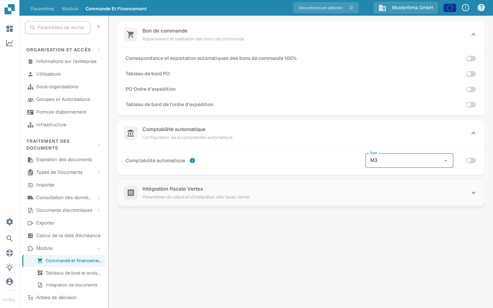
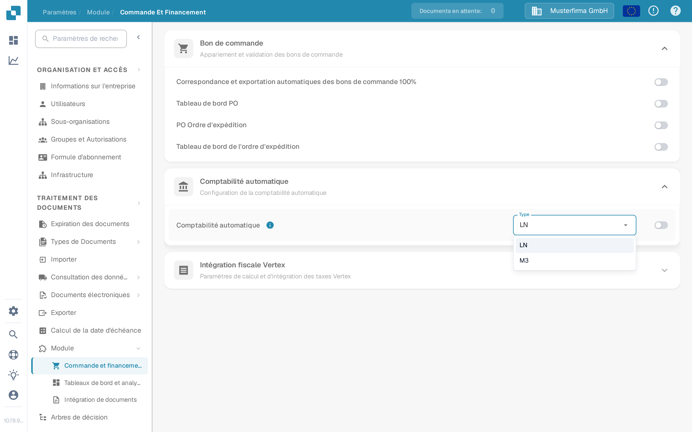

# Comptabilité automatique avec Infor M3

Utilisez ce guide pour planifier les données de base nécessaires à la comptabilité automatique M3 dans DocBits. Une option activée seule n'importe ni comptes ni éléments de coûts. Votre administrateur Infor doit confirmer le mappage BOD, l'opération de l'API DocBits et le résultat dans votre propre organisation.

## Vérifier l'option DocBits

Un administrateur peut ouvrir **Paramètres → Module → Commande et financement → Comptabilité automatique**. Le menu **Type** propose **LN** et **M3**. Choisissez **M3** uniquement pour une intégration M3, et activez l'interrupteur après avoir vérifié le flux de données et les données de base requises. L'option voisine **Intégration fiscale Vertex** du même accordéon ne fait pas partie de ce guide. Les captures d'écran suivantes montrent cette page dans l'environnement de test DocBits en français. L'interrupteur était **désactivé**, le Type actuel était **LN** et l'ouverture du menu n'a enregistré ni modifié aucune option.

<figure><figcaption>
Localisez Comptabilité automatique dans Commande et financement&nbsp;; dans cet exemple de l'environnement de test, elle est désactivée.
</figcaption></figure>

<figure><figcaption>
Le menu Type propose LN et M3. Aucune option n'a été sélectionnée dans cet exemple.
</figcaption></figure>

## Préparer le flux de données M3

1. Convenez de l'entreprise M3 et de l'organisation DocBits qui échangeront des données. Vérifiez auprès de votre administrateur DocBits quelle opération d'API actuelle accepte les données de base de comptabilité. Évitez de copier un endpoint ou des identifiants depuis la capture d'écran d'un ancien environnement.
2. Dans M3, confirmez que les BOD requis sont activés pour l'entité comptable concernée. L'exemple d'un ancien environnement utilisait `Sync.ChartOfAccounts` et `Sync.CodeDefinition` pour les dimensions comptables. Confirmez le nom (noun), la version et les champs exacts par rapport à votre configuration M3 et au contrat de l'API réceptrice. Infor décrit comment [activer la publication des BOD](https://docs.infor.com/m3core/2025.x/en-us/useradminlib_cloud/m3cecoreag_cloud/wbr1509377469290.html).
3. Dans **ION Desk → Connect → Connection Points**, configurez la source M3 et une destination d'API avec l'opération DocBits approuvée et un compte de service. Dans **Data Flows**, acheminez uniquement les documents approuvés, vérifiez les filtres et le mappage des champs, puis enregistrez et activez le flux. Consultez la [liste des points de connexion Infor](https://docs.infor.com/inforos/latest/en-us/useradminlib_cloud/iondeskceug/documentflowdesk_connectionpointmasterlist.html) et les [instructions d'activation des flux de données](https://docs.infor.com/inforos/latest/en-us/useradminlib_cloud/iondeskceug/lsm1436532178755.html).
4. Publiez un identifiant de test non sensible depuis M3. Un chargement initial peut utiliser **EVS006** de M3&nbsp;; les noms de l'action et de la table dépendent de la version de M3 installée. Suivez les [instructions de chargement initial d'Infor](https://docs.infor.com/m3core/2025.x/en-us/useradminlib_cloud/m3cecoreag_cloud/pbi1544012609638.html). Dans **ION OneView**, suivez l'identifiant à travers le flux et examinez le résultat de l'API avec [Infor OneView](https://docs.infor.com/inforos/latest/en-us/useradminlib_cloud/iondeskceug/lsm1436532196155.html).
5. Vérifiez le même identifiant dans DocBits sous **Paramètres → Traitement des documents → Consultation des données de base**. Le [guide de l'API M3 vers DocBits](import-from-infor-m3-to-docbits-via-api.md) explique les contrôles d'importation. Activez la comptabilité automatique M3 uniquement lorsque les enregistrements requis sont présents et que votre administrateur a validé le mappage.

## Éléments de coûts

L'exemple d'un ancien environnement exportait les éléments de coûts de M3 **PPS280** vers Excel, réduisait les colonnes et téléversait un CSV via un ancien écran d'API HTTP. Cette séquence de captures d'écran n'est pas une procédure d'importation générale sûre&nbsp;: les noms de colonnes, le délimiteur, l'endpoint et l'authentification doivent être confirmés pour l'environnement actuel. Utilisez le guide actuel de la [table des éléments de coûts](table-extraction-for-costing-element.md) pour préparer le fichier et examiner les contrôles CSV disponibles dans DocBits. Ne téléversez aucun fichier tant que l'administrateur n'a pas vérifié ses colonnes par rapport à la table cible.

Si un BOD atteint ION mais qu'aucune ligne n'apparaît dans DocBits, inspectez la route ION, la réponse de l'API, l'organisation, l'identifiant et le mappage avant d'activer la fonction. Ne déduisez pas le succès d'un flux activé ni de données de démonstration existantes.

Cette page remplace 43 captures d'écran d'un ancien environnement Infor par des contrôles DocBits actuels et des étapes liées aux sources. Aucun environnement Infor ni transfert de BOD en direct n'était disponible pour un test de bout en bout&nbsp;; l'administrateur de votre environnement doit valider le mappage, l'importation et le résultat comptable finaux.
