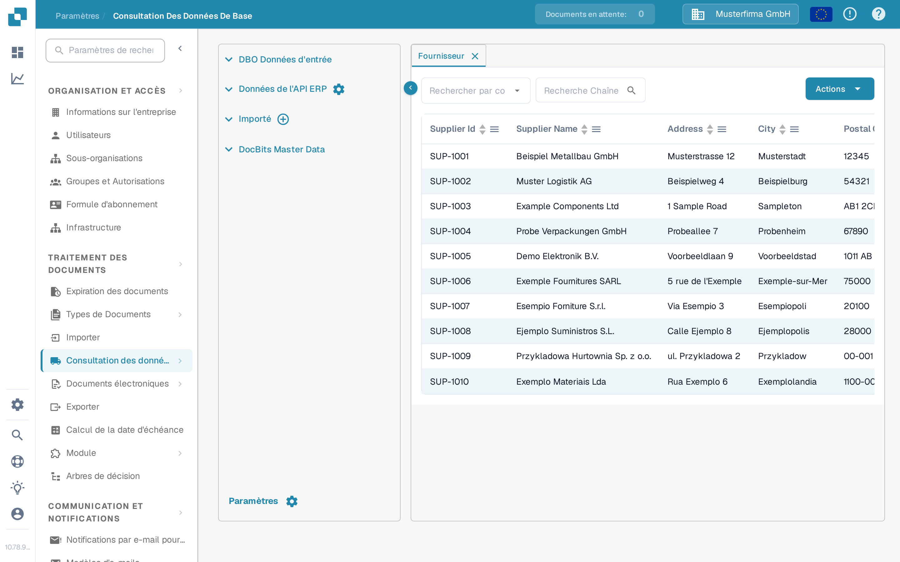
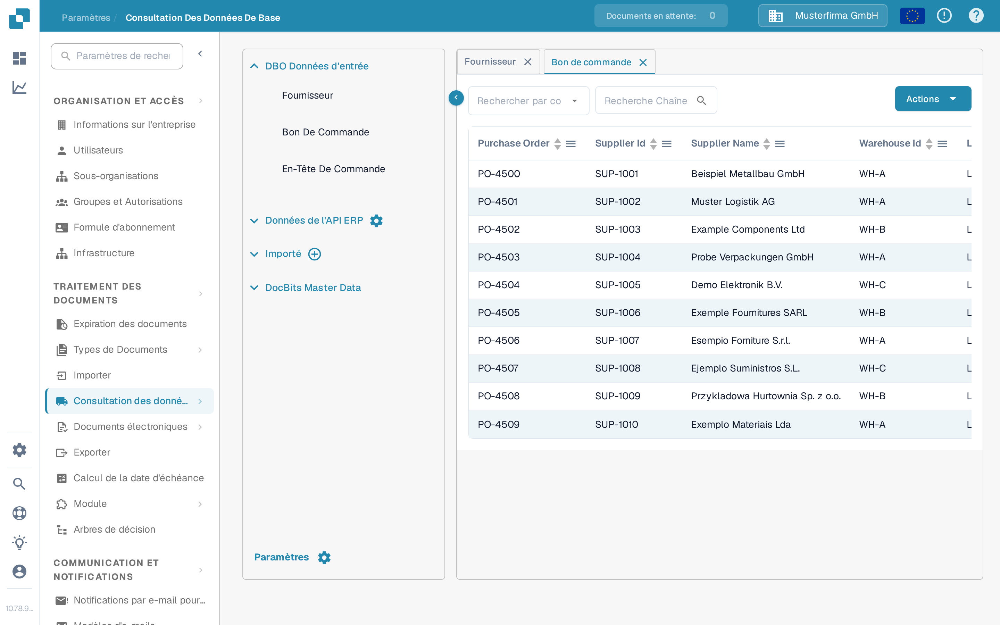

# Import depuis Infor M3 vers DocBits via API

Utilisez ce guide lorsqu'un administrateur Infor M3 doit transmettre des BOD sélectionnés à DocBits via Infor ION et API Gateway. La version précédente de cette page contenait 42 captures d'écran d'un ancien locataire Infor et des adresses d'API Sandbox figées. Ces captures et ces adresses ne constituent pas un modèle de configuration sûr pour un autre locataire.

Le chemin à vérifier est le suivant : **M3 publie un BOD → ION le route → API Gateway appelle l'API DocBits → DocBits affiche l'enregistrement importé**. Chaque étape a son propre statut. Voir un enregistrement dans DocBits est la vérification finale ; un flux de données ION actif ne prouve pas à lui seul qu'un import a eu lieu.

## Avant de configurer le flux

1. Confirmez la société M3, le locataire ION, l'organisation et l'environnement DocBits que vous souhaitez connecter. Demandez à un administrateur DocBits l'URL de base actuelle de l'API et l'opération d'API requise, à partir de la description OpenAPI de cet environnement. Les hôtes régionaux peuvent différer ; ne copiez pas un hôte ni un chemin de proxy API Gateway depuis une ancienne capture d'écran.
2. Convenez des types de documents dont l'organisation a besoin. Les données de base des fournisseurs et des commandes d'achat peuvent être vérifiées dans DocBits. N'ajoutez les documents de livraison et de comptabilité que lorsque leur cas d'usage et leur opération de réception sont confirmés.
3. Préparez un compte de service Infor disposant de l'autorisation pour l'opération d'API choisie, ainsi qu'un identifiant d'API DocBits avec les droits minimaux nécessaires. Ne saisissez les identifiants que dans l'écran de configuration autorisé. Ne collez jamais un fichier `.ionapi` complet ni une clé d'API dans une page de documentation, un ticket Jira ou une capture d'écran.
4. Conservez un identifiant de test non sensible pour chaque BOD choisi, afin de pouvoir suivre le même enregistrement dans M3, ION OneView et DocBits.

## Choisir le document et l'opération de réception

L'ancien exemple de locataire utilisait les BOD suivants. Utilisez les métadonnées d'API actuelles et votre conception d'intégration pour confirmer chaque correspondance avant de créer un point de connexion :

| BOD dans l'ancien exemple                                                                   | Données DocBits prévues                                        | Où vérifier le format de réception                                                                                        |
| ------------------------------------------------------------------------------------------- | -------------------------------------------------------------- | ------------------------------------------------------------------------------------------------------------------------- |
| `Sync.SupplierPartyMaster`, `Sync.RemitToPartyMaster`                                       | Données de base des fournisseurs                               | [Import BOD Fournisseur](../importing-via-the-api/supplier-bod.md)                                                        |
| `Sync.PurchaseOrder`                                                                        | Commandes d'achat                                              | [Import BOD Commande d'achat](../importing-via-the-api/purchase-order-bod.md)                                             |
| `Sync.ReceiveDelivery`                                                                      | Données de livraison                                           | [Import BOD Réception de marchandises](../importing-via-the-api/receive-delivery-bod.md)                                  |
| `Sync.AdvanceShipNotice`, `Sync.ChartOfAccounts`, `Sync.CodeDefinition-AccountingDimension` | Données de base supplémentaires pour les fonctions configurées | [Import XML des données de base](../importing-via-the-api/master-data-xml.md) et les métadonnées d'API de votre locataire |

`Acknowledge.SupplierInvoice` appartient à un flux d'accusé de réception de factures et doit être configuré séparément d'un import de données de base M3 vers DocBits. L'ancienne page mélangeait ces directions et incluait un corps de requête propre à un locataire ; ne copiez pas ce corps dans un nouveau flux sans avoir examiné le contrat de l'endpoint et les contrôles d'accès.

## Configurer Infor OS et ION

1. Dans Infor OS, préparez la cible API Gateway pour l'opération d'API DocBits **confirmée**. Vérifiez l'URL cible, la méthode de requête, le format de requête et l'authentification avec l'administrateur DocBits. Utilisez le [guide actuel d'API Gateway Infor](https://docs.infor.com/inforos/2025.x/en-us/useradminlib_cloud/apigatewayag_cloud/ionapi_2025.x_apigatewayag_cloud_en-us.pdf) pour les contrôles de la passerelle.
2. Dans **ION → Connect → Connection Points**, créez ou sélectionnez le point de connexion pour l'API DocBits. Ajoutez uniquement les BOD choisis dans **Documents**, sélectionnez l'opération de passerelle correspondante et configurez la charge utile de requête attendue par l'opération. Les [instructions Infor sur les éléments d'API](https://docs.infor.com/inforos/latest/en-us/useradminlib_cloud/iondeskceug/hqg1491985489422.html) expliquent le compte de service et les paramètres de requête.
3. Dans **ION → Connect → Data Flows**, connectez la source M3 et la destination API. Vérifiez la liste des documents, les filtres et les mappages, puis enregistrez et activez le flux. Infor distingue l'[enregistrement de l'activation d'un flux de données](https://docs.infor.com/inforos/latest/en-us/useradminlib_cloud/iondeskceug/lsm1436532178755.html).
4. Publiez un BOD de test approuvé depuis M3. Dans **ION OneView**, recherchez cet identifiant et confirmez quel point de connexion, quel mappage et quel appel d'API l'ont traité. Consultez [Infor OneView](https://docs.infor.com/inforos/latest/en-us/useradminlib_cloud/iondeskceug/lsm1436532196155.html). Si aucune route ou une erreur s'affiche, corrigez le flux ION avant de vérifier DocBits.

## Vérifier le résultat dans DocBits

Ouvrez **Paramètres → Traitement des documents → Consultation des données de base**. Dépliez **DBO Données d'entrée**, choisissez le type concerné et recherchez l'identifiant de test. Les onglets **Fournisseur** et **Bon De Commande** présentés ci-dessous sont des vues françaises actuelles dans l'organisation synthétique **DocBits Documentation Test A**. Leurs lignes de démonstration existantes ne constituent **pas une preuve d'un import M3**.

<figure><figcaption>
Choisissez Fournisseur, sélectionnez une colonne de recherche et saisissez l'identifiant du fournisseur de test.
</figcaption></figure>

<figure><figcaption>
Choisissez Bon De Commande et recherchez la commande de test ; les lignes affichées sont des données de démonstration synthétiques.
</figcaption></figure>

Dans l'un ou l'autre onglet, la liste déroulante **Rechercher par colonne** choisit le champ, le champ **Recherche Chaîne** accepte l'identifiant et la loupe lance la recherche. Les en-têtes du tableau trient les lignes visibles ; les flèches en bas permettent de passer d'une page à l'autre. **Actions** ouvre les opérations du tableau et n'est pas nécessaire pour cette vérification en lecture seule. Le **×** sur un onglet le ferme. Le bouton plus de l'onglet **Importé** sert aux imports CSV, pas à la réception d'un BOD ION.

Si le BOD apparaît dans OneView mais que l'enregistrement est absent dans DocBits, vérifiez l'opération et la réponse d'API, l'organisation et l'environnement, le type de document, le format de la charge utile et l'identifiant utilisé dans la recherche. Demandez le journal d'import correspondant à l'administrateur DocBits. Ne déduisez pas un succès d'un appel HTTP ou de la capture d'écran d'une ligne de démonstration sans rapport.

Cette page a été mise à jour à partir des contrôles actuels de la Sandbox DocBits et de la documentation Infor. Aucun locataire Infor ni transfert BOD M3 vers DocBits en direct n'était disponible pour un test de bout en bout ; un administrateur de locataire doit valider le mappage et le résultat finaux.
