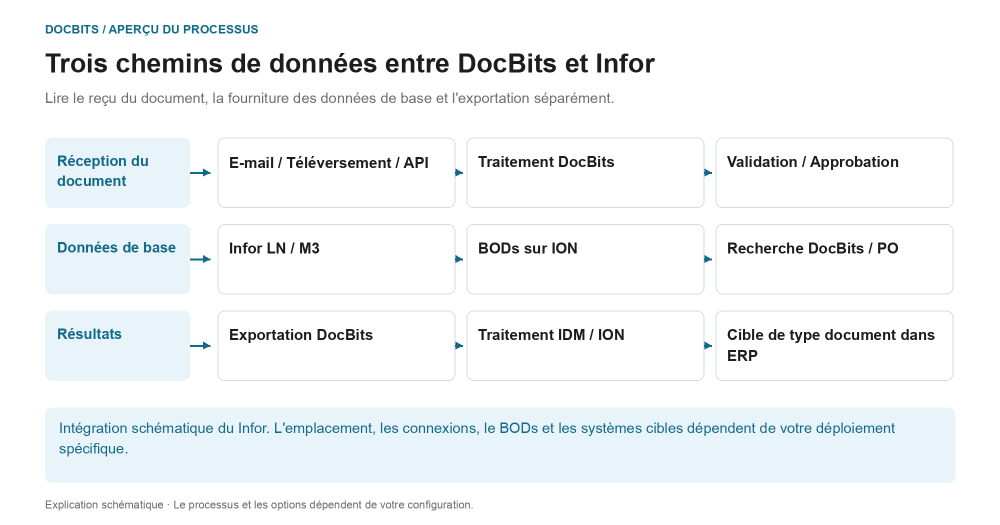

# Architecture

## L'architecture en trois chemins de données distincts

<figure><figcaption>
Lire le reçu du document, la fourniture des données de base et l&#x27;exportation séparément. Le diagramme est schématique ; les paramètres actifs de votre organisation déterminent le comportement réel.
</figcaption></figure>

L'architecture contient plusieurs flux de données ayant des finalités différentes. Les documents sont importés pour traitement ; les données de base proviennent de l'intégration ERP ; les résultats reconnus et examinés sont renvoyés via le chemin d’exportation configuré. Ces chemins sont des connexions distinctes et doivent être tracés séparément lors du diagnostic.

| Chemin des données | Direction et objectif | Point de contrôle |
| --- | --- | --- |
| **Reçu du document** | Email, téléchargement ou interface → DocBits. Les documents sont envoyés au processus de traitement prévu. | Le bon document est-il parvenu à la bonne organisation ? |
| **Fourniture de données de base** | Flux de données LN/M3 → BODs et ION → DocBits. Les fournisseurs et les commandes sont mis à disposition pour identification et rapprochement. | L'ensemble de données requis a-t-il été transféré et accepté par DocBits ? |
| **Exportation des résultats** | DocBits → connexion Infor configurée → IDM ou ION et ERP. Les documents et les données commerciales peuvent emprunter différents chemins en aval. | Le transfert et le traitement correspondant à destination sont-ils prouvés ? |

Dans l'exportation Infor décrite ici, le PDF et ses attributs sont envoyés à IDM, et le `Sync.CaptureDocument` est envoyé à ION Desk. ION le transforme en cible requise BODs selon le type de document. L'acceptation par LN ou M3 doit être vérifiée dans le système cible respectif ; une étape DocBits à elle seule ne prouve pas toutes les étapes de traitement en aval.

**Utilisez l'aperçu pour rechercher les erreurs :** Si un document est manquant, commencez par l'importation. Si des fournisseurs ou des lignes de bon de commande sont manquants, suivez le chemin des données de base. Si le transfert de retour échoue, vérifiez la configuration de l'exportation, la réponse du destinataire et le traitement ION/ERP. Les diagrammes d'architecture ci-dessous ajoutent des détails sur le déploiement et les composants à cette présentation du processus.

En outre : [Importer des documents](../../end-user-and-partner-section/end-user-section/how-to-import-documents/README.md), [Importer les données de base des clients](../../infor-integration-and-configuration/importing-customer-master-data/README.md) et [Exporter depuis DocBits](../../infor-integration-and-configuration/exporting-in-docbits/README.md).

## **Client DocBits Cloud**

<figure><figcaption></figcaption></figure>

## DocBits sur site

<figure><figcaption></figcaption></figure>

Doc**Bits** s'intègre parfaitement avec Infor LN/M3 via l'API ION, ION Desk et les BODs standards d'Infor. Notre intégration API nous permet d'exporter des données vers Infor et d'effectuer une validation des données maîtres dans Doc**Bits**.

## **Architecture de DocBits Operator**

Toutes les connexions entre les composants sont sécurisées par des protocoles de chiffrement conformes aux standards de l'industrie. SSH, HTTPS et d'autres canaux sécurisés garantissent l'intégrité et la confidentialité des données dans l'ensemble du système.

**Sur site :**&#x20;

<figure><figcaption></figcaption></figure>


[prefect-local-setup-requirements.md](prefect-local-setup-requirements.md)


**Cloud** :

<figure><figcaption></figcaption></figure>

## Exportation de données vers Infor

Nous utilisons l'API ION pour envoyer le PDF avec les attributs à IDM et le BOD Sync.CaptureDocument à ION Desk. Dans ION Desk, nous transformons le [Sync.CaptureDocument](../../infor-integration-and-configuration/exporting-in-docbits/) vers les BODs cibles souhaités en fonction du type de document traité. Ces BODs Infor transformés sont ensuite automatiquement importés dans LN ou M3.


Exporter vers [Infor](../../infor-integration-and-configuration/exporting-to-infor/)


## Validation des données maîtres dans DocBits

Pour identifier le fournisseur ou comparer/faire correspondre les lignes de commande d'achat, nous activons un déclencheur dans LN/M3 qui envoie les BODs Sync.RemitToPartyMaster, Sync.SupplierPartyMaster et Sync.PurchaseOrder à Doc**Bits**. Nous configurons ce processus dans ION Desk en définissant le flux de données vers un point de connexion spécifique à Doc**Bits**.

<figure><figcaption></figcaption></figure>


[Validation des données maîtres](../../infor-integration-and-configuration/importing-customer-master-data/)


## Importation d'e-mails OAuth Office365

<figure><figcaption></figcaption></figure>
