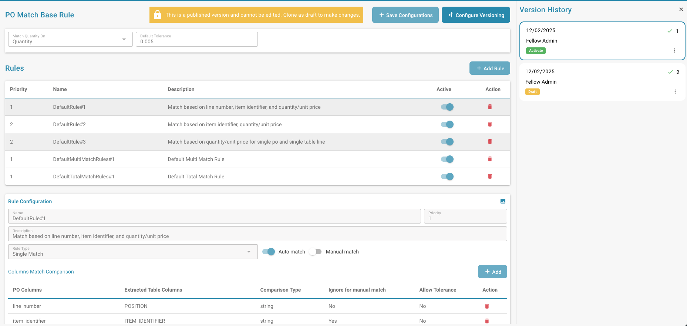
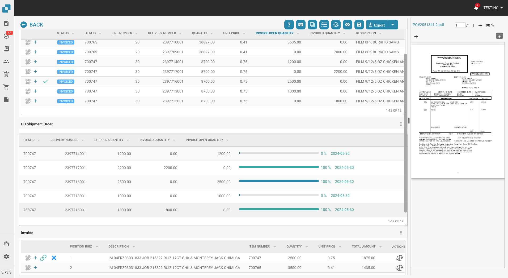

# Notes de version

**Disponibilité de NOVA R1.1 :** Disponible dans l’environnement de test depuis le **16 octobre 2026**. La mise en production est prévue le **4 novembre 2026**.



**DocBits est le produit. NOVA désigne le cycle de versions.** [Voir le film sur la nouvelle version de DocBits](https://docbits-videos.fra1.cdn.digitaloceanspaces.com/settings-assistant/nova-release/v2/fr.mp4) · [Sous-titres](https://docbits-videos.fra1.cdn.digitaloceanspaces.com/settings-assistant/nova-release/v2/fr.vtt).

Choisissez un canal de version pour voir les changements pour votre équipe. **Le cycle NOVA apporte la nouvelle version mineure de DocBits avec des capacités client supplémentaires. Les correctifs VESTA améliorent la version de production actuelle.** Consultez le [cycle de vie des versions](../docbits-release-lifecycle-strategy.md) pour la disponibilité et le changement de canal.

**Les anciennes fonctionnalités bêta de VESTA sont incluses dans l’environnement de test de NOVA.** Toutes les fonctionnalités précédemment disponibles en bêta dans VESTA font partie des fonctionnalités standard de NOVA et peuvent être testées avant la mise en production prévue. Elles deviendront également des fonctionnalités standard de VESTA avec le [prochain correctif, prévu le **11 novembre 2026**](vesta-hotfix-11-november-2026.md).

| Canal de version | Notes de version | Focus |
| --- | --- | --- |
| **NOVA – Version mineure** | [Nouveautés pour les clients](nova-major-release.md) · **4 novembre 2026 (prévue)** | Toutes les anciennes fonctionnalités bêta de VESTA, ainsi que de nouvelles capacités et extensions par rapport à VESTA R1.0.15. |
| **VESTA — Prochain correctif (prévu)** | [11 novembre 2026](vesta-hotfix-11-november-2026.md) | Introduit toutes les anciennes fonctionnalités bêta de VESTA dans l'ensemble de fonctionnalités standard de VESTA. |
| **VESTA — Version de correctif** | [14 octobre 2026 — R1.0.15](incremental-updates-14-october-2026.md) | Améliorations et correctifs pour la version de production VESTA actuelle. |

## NOVA – Version mineure 4 novembre 2026

### Ce que votre équipe gagne avec NOVA

* **Utilisez les anciennes fonctionnalités bêta de VESTA comme fonctionnalités standard NOVA.** Toutes les fonctionnalités précédemment offertes en bêta dans VESTA sont incluses dans NOVA, y compris les contrôles de gestion des règles et des mises en page. Les paramètres de l'organisation, les interrupteurs de type de document et les autorisations s'appliquent toujours.
* **Résolvez les blocages de documents avec l'Assistant de validation.** Demandez ce qui bloque un document, accédez au champ concerné et examinez les corrections suggérées tout en restant sur le document.
* **Transformez les corrections répétées en améliorations d'automatisation examinées.** Les examinateurs peuvent soumettre des demandes d'amélioration ; les administrateurs peuvent évaluer les propositions de règles apprises, examiner les documents affectés et mesurer le résultat après l'activation.
* **Comprenez et agissez sur les erreurs de factures électroniques.** Utilisez des rapports regroupés par niveau de validation, examinez les politiques de type de document et leur historique, et rejetez une facture éligible avec une raison enregistrée.
* **Configurez et contrôlez les imports FTP/SFTP.** Utilisez l'assistant de connexion, suivez les étapes d'import par fichier, configurez les tentatives de nouvelle exécution et les notifications d'échec, et supprimez éventuellement les fichiers sources après un import réussi.
* **Rapprochez les lignes de livraison avec moins d'actions répétées.** Sélectionnez d'abord les lignes de document ou de bon de commande et liez-les dans les deux sens. Les exports configurés peuvent conserver les détails des sous-lignes et regrouper les enregistrements par valeurs de ligne.
* **Gardez le travail exporté séparé du travail terminé.** Utilisez le statut Exported pour le traitement de suivi et verrouillez éventuellement les documents Finished contre une réouverture ordinaire.
* **Accédez directement aux contrôles des règles et des mises en page.** Ouvrez les panneaux de gestion sans lien bêta, recherchez et prévisualisez les mises en page, et ouvrez l'éditeur de mise en page depuis un document.
* **Contrôlez l'extraction et l'administration courante.** Redémarrez un document avec un nombre de pages choisi, décidez si les champs masqués sont extraits, utilisez des actions supplémentaires de l'Assistant de configuration et limitez les règles de notification à une sous-organisation.

### Guides pour la configuration des règles

* [**Règles de transformation**](../../administration-and-setup/settings/global-settings/document-types/transformation-rules.md) : nettoyez et réécrivez les valeurs extraites, créez une séquence d'étapes et prévisualisez le résultat. **Regarder :** [Voir la vidéo](https://docbits-videos.fra1.cdn.digitaloceanspaces.com/settings-assistant/transformation-rules/v1/fr.mp4).
* [**Règles de validation personnalisées**](../../administration-and-setup/settings/global-settings/document-types/custom-validation-rules.md) : définissez des contrôles pour les champs et les lignes de tableau, choisissez les conditions et la sévérité, et testez vos règles. **Vidéo :** [Voir la vidéo](https://docbits-videos.fra1.cdn.digitaloceanspaces.com/settings-assistant/custom-validation-rules/v1/fr.mp4).
* [**Règles de rapprochement des commandes**](../../administration-and-setup/settings/global-settings/document-types/more-settings/purchase-order/purchase-order-matching-rules.md) : configurez les types de rapprochement, les tolérances et l'ordre d'exécution, et gérez les versions des règles. **Vidéo associée — Choisir la bonne automatisation :** [Voir la vidéo](https://docbits-videos.fra1.cdn.digitaloceanspaces.com/settings-assistant/choose-automation/v1/fr.mp4).

[Parcourir toutes les vidéos des fonctionnalités](nova-major-release.md#watch-the-feature-videos), y compris les mises en page, Touchless Intelligence, la validation des factures électroniques et la série de six vidéos sur AI Table.

[Lire la comparaison complète des fonctionnalités NOVA](nova-major-release.md), y compris les exigences d'activation, les améliorations supplémentaires et toutes les **16 versions de service**.

**La base de référence VESTA inclut les fonctionnalités existantes et les fonctionnalités bêta :** l'Assistant de configuration original, les avertissements de base sur l'intégrité des imports, les niveaux d'IA, le Contrôle des champs d'en-tête, le tableau de bord Touchless Intelligence, les moteurs de règles, les transformations après la recherche de données de base et les journaux d'exécution de base des règles. Les notes NOVA distinguent le passage de la disponibilité bêta à la disponibilité standard des ajouts supplémentaires à ces capacités.

## VESTA — Versions de correctifs <a href="#vesta-hotfix-releases" id="vesta-hotfix-releases"></a>

**Prochain correctif prévu : [11 novembre 2026](vesta-hotfix-11-november-2026.md).** Toutes les fonctionnalités précédemment disponibles en version bêta dans VESTA, et désormais incluses dans NOVA, deviendront des fonctionnalités VESTA standard dans ce correctif.

**Dernier correctif publié : [14 octobre 2026 — R1.0.15](incremental-updates-14-october-2026.md).** Ce correctif VESTA a introduit l'Assistant de configuration, les niveaux d'IA mis à jour, le Contrôle des champs d'en-tête, les améliorations de la connexion et les améliorations du rapprochement des frais des bons de commande.

Notes des correctifs VESTA antérieurs :

* [15 septembre 2026 — R1.0.13](incremental-updates-15-september-2026.md)
* [8 septembre 2026](incremental-updates-8-september-2026.md)
* [12–25 août 2026](incremental-updates-12-25-august-2026.md)
* [29 juillet – 12 août 2026](incremental-updates-29-july-12-august-2026.md)
* [14–29 juillet 2026](incremental-updates-14-29-july-2026.md)
* [4–14 juillet 2026](incremental-updates-4-14-july-2026.md)
* [3–4 juillet 2026](incremental-updates-3-4-july-2026.md)
* [30 juin – 3 juillet 2026](incremental-updates-30-june-3-july-2026.md)
* [26–30 juin 2026](incremental-updates-26-30-june-2026.md)
* [21–25 juin 2026](incremental-updates-21-25-june-2026.md)

Les annonces de version originales restent ci-dessous pour référence.

## **Release R1.0 13/14 juin 2026**

> **Disponibilité Sandbox :** 28 avril 2026

### Nouvelles fonctionnalités :

* **Activity Logging / Access Audit :**\
  Journalisation détaillée de l'activité et piste d'audit des accès dans toute l'application pour la conformité et la surveillance. Différents types de journalisation pour tous les microservices, basés sur des plages horaires.
* **Recherche rapide globale :**\
  Appuyez sur Cmd+K / Ctrl+K depuis n'importe où dans l'application pour rechercher parmi plus de 200 routes et plus de 40 fonctionnalités internes aux pages. Affiche les 8 meilleurs résultats avec correspondance approximative (fuzzy), navigation au clavier et liens vers la App Index Page complète.
* **Sitemap (App Index Page) :**\
  Page d'index consultable cataloguant chaque page navigable et chaque fonctionnalité interne (dialogues, barres latérales, panneaux) dans DocBits. Organisée en 18 catégories avec filtres par type, pastilles de catégorie, recherche synchronisée à l'URL et entrées protégées par permission affichées comme verrouillées pour les utilisateurs non administrateurs.
* **Analytics Dashboard :**\
  Analyses complètes du traitement des documents avec Executive Overview, API Metrics, Quality Metrics, Processing Performance, Document Flow Analytics, Activity Log, Event Log et Audit Trail.
* **Fonctionnalité d'exportation du dashboard :**\
  Nouvelle fonctionnalité d'exportation du dashboard permettant l'exportation d'une liste au format CSV ou XLSX.
* **Full-Text Search / DocSearch :**\
  Recherche vectorielle pilotée par IA sur tous les documents indexés, avec filtrage par fournisseur en temps réel, fonctionnalité "Find Similar" et paramètres d'indexation configurables.
* **Supplier Delivery Statistics :**\
  Nouvelles vues apportant des informations sur les métriques de traitement des documents liées aux fournisseurs.
* **Debug Collector :**\
  Appuyez sur Ctrl+Shift+P pour capturer un snapshot de débogage complet incluant appels API, état WebSocket, erreurs, logs de console, métriques de performance et informations d'environnement. Les snapshots peuvent être copiés dans le presse-papiers ou envoyés directement comme ticket de support avec un rapport au format HTML et un fichier JSON joint.
* **AI Agents (DocNet) :**\
  Agents autonomes en arrière-plan qui traitent automatiquement les e-mails entrants — classant, extrayant et routant les documents sans intervention manuelle. Les agents travaillent de manière indépendante sur les tâches qui leur sont assignées et escaladent vers les utilisateurs via des demandes d'approbation lorsque le jugement humain est nécessaire. Inclut un tableau de bord dédié pour surveiller l'activité et les performances des agents.
* **Nouveaux E-Documents :**\
  Plus de 80 nouveaux types de e-invoice mondiaux et plus de 40 nouveaux formats incluant XRechnung 3.0.2, ZUGFeRD 2.2/2.3.2, variantes Factur-X et Asia-Pacific PINT Credit Notes. 100 % de couverture de classification et d'extraction.
* **AI Script Chat :**\
  Assistant de chat alimenté par IA pour le développement basique de scripts, avec réponses en streaming en temps réel.
* **Script Versioning :**\
  Historique complet des versions des scripts avec suivi des modifications, comparaison et capacités de restauration. Offre une gestion des versions pour les scripts similaire à celle utilisée pour les versions d'E-Docs.
* **Historique d'exportation dans les Dashboard Actions :**\
  Accès à l'historique d'exportation d'un document directement depuis le menu d'actions du dashboard.
* **Generic API Exporter (APS450, GLS840) :**\
  Cible d'exportation API générique configurable via une configuration Mapping-File, pour une intégration flexible avec des systèmes externes. Le support pour APS450 et GLS840 a été implémenté.
* **Configurations d'exportation multiples :**\
  Prise en charge de plusieurs configurations d'exportation actives par type de document, avec ordre d'exécution et bouton de ré-exportation pour réessayer à partir de l'étape échouée.
* **Nouvelle version de Watchdog :**\
  Refonte complète de la page WatchDog Settings. Ajout de nouvelles fonctionnalités d'agrément, incluant le statut actuel de WatchDog, un guide et des commandes pour l'installation, la configuration des templates XSLT et un paramètre de mise à jour automatique. Implémentation également de la fonctionnalité permettant à WatchDog de gérer plusieurs configurations simultanément.
* **Intégration Vertex :**\
  Intégration Consumer Use Tax via Vertex pour le calcul automatisé des taxes et la conformité lors du traitement des documents.
* **Refonte de l'UI & réorganisation des paramètres :**\
  Rafraîchissement complet de l'UI dans toute l'application. Pages de login et d'authentification redessinées. Zone de paramètres redessinée avec barre latérale rétractable, sous-catégories organisées, navigation basée sur des ancres, panneau d'aide contextuel et badges de suivi de statut. Modifications de l'UI des scripts de document. Nouvelle UI pour Document flow. UI améliorée de List of Values.
* **Idea Board :**\
  Tableau de demandes de fonctionnalités permettant aux utilisateurs de soumettre, discuter et voter pour de nouvelles fonctionnalités, améliorations, corrections de bugs nécessaires, etc., avec éditeur de texte enrichi et prise en charge des images.
* **API Key Management :**\
  Page de paramètres dédiée à la création, la visualisation et la gestion de plusieurs clés API.
* **Fonctionnalité de recherche Master Data Lookup :**\
  Capacité de recherche Master Data améliorée grâce à des options de recherche adaptées aux champs sélectionnés.
* **User Activity Chart :**\
  Graphique visuel affichant les modèles d'activité des utilisateurs et les métriques d'engagement. Dashboard de l'activité de connexion avec graphiques de comparaison de tendances, agrégation quotidienne/hebdomadaire et géolocalisation basée sur GeoLite2.
* **User Login History :**\
  Users Detail View avec historique de connexion.
* **Barre latérale personnalisable :**\
  Réorganisation par drag-and-drop, bascule afficher/masquer et épinglage en haut pour les éléments de menu de la barre latérale. Les préférences sont conservées par utilisateur avec une option "Reset to default". Respecte les feature flags.
* **Video Carousel :**\
  Carousel vidéo avec lecture automatique sur la page prepare-dashboard affichant de courtes vidéos animées de conseils produit (Global Search, Keyboard Shortcuts, Document Upload, Table Customization). Mise en page à deux colonnes avec les vidéos à gauche et la préparation du dashboard à droite. La redirection automatique est mise en pause pendant que les utilisateurs parcourent les vidéos.
* **Advanced Workflow Designer :**\
  Constructeur d'automatisation visuel basé sur des nœuds, avec canvas drag-and-drop pour des pipelines de traitement multi-étapes. Prend en charge les wait steps, les chemins parallèles, les templates réutilisables, les Or condition cards, un bouton manuel de test/run, l'exécution partielle "Test from Here" et des logs d'exécution par nœud avec surlignage visuel du flux montrant exactement quels nœuds ont été exécutés.
* **Workflow KPI Dashboard :**\
  Dashboard de métriques clés pour surveiller l'exécution des workflows.
* **Workflow Partner Card SDK :**\
  SDK pour les développeurs tiers permettant de créer des cartes de workflow personnalisées, avec revue pilotée par IA, validation en sandbox et documentation de démarrage.
* **Workflow Test Manager :**\
  Gestionnaire de tests automatisés pour workflows, permettant aux administrateurs de créer et d'exécuter des tests individuellement ou en masse.

### Améliorations :

* **Base de données (tous les modules) — Migration des colonnes ID :**\
  Toutes les colonnes "ID" de la base de données DocBits ont été migrées en interne de chaînes de caractères vers un type ID dédié (UUID7). La base de données Postgres sous-jacente a été migrée vers V18 pour prendre en charge cette amélioration.
* **Traitement des documents — Améliorations supplémentaires :**\
  Modification de la logique d'exportation concernant le nombre maximum de pages à considérer — l'intégralité du document sera désormais exportée. Pendant la validation du document, l'utilisateur aura la possibilité de remplacer la limite maximale de pages par défaut pour ce document spécifique. Le calcul du Pending Document Counter a été amélioré.
* **Versions, statut et date de déploiement des services :**\
  Le statut de disponibilité des services est fourni dans le popup "Service Versions".
* **Extension linguistique :**\
  Prise en charge étendue à 22 langues avec sélecteur de langue mis à jour.
* **Design de l'Access Control au niveau du champ :**\
  Contrôle d'accès redessiné/amélioré avec un état d'activation plus clair, accès au niveau du champ, gestion cohérente des règles et permissions basées sur les groupes simplifiées. Corrige les conflits de règles entre Access Control et View Permissions, affiche le propriétaire de l'importation dans l'UI et applique le contrôle d'accès de manière cohérente à la validation des champs, aux tables extraites par IA et à toutes les vues.
* **Activity Stream pour tous les écrans :**\
  L'Activity Stream est désormais disponible sur tous les écrans de traitement de documents (Ready for Validation, PO Matching, Accounting, Quote Details, Reject) — pas seulement sur Pending Approval. Déplacé vers une position cohérente dans le panneau droit sur tous les écrans.
* **Page Document Flow :**\
  Page dédiée à la visualisation et au suivi du flux de traitement des documents, montrant les transitions de statut et la progression dans la pipeline.
* **Dual Monitor Mode (paramètre utilisateur global) :**\
  Dual Monitor Mode déplacé vers un paramètre utilisateur global, persistant entre les sessions.
* **Améliorations du Layout Builder :**\
  Prise en charge des champs cachés et en lecture seule avec indicateurs visuels, séparateur de panneau redimensionnable et paramètres de longueur de champ. Appliquez le Default Layout à plusieurs Origins sans avoir à visiter chacun individuellement.

## **Release HotFix 3 16 avril 2026**

### Améliorations de DocBits :

* **Extraction de code QR pour les factures polonaises :**\
  DocBits prend désormais en charge l'extraction de codes QR spécifiquement pour les factures polonaises, améliorant la capture automatisée des données pour les documents provenant de Pologne.

### Corrections de bugs :

* Correction d'un problème où l'exportation automatique échouait lorsque le PO Matching avait déjà eu lieu mais que le bon de commande n'était pas associé au document.
* Correction d'un problème où les prix unitaires étaient arrondis incorrectement pour les factures avec unités d'emballage (Verpackungseinheiten / VPE).
* Correction d'un problème où les messages d'erreur d'exportation d'ION/MEC (par ex. les échecs Acknowledge.PurchaseOrder) n'étaient pas affichés dans DocBits, le statut "Exported" étant affiché malgré l'échec de l'exportation.
* Correction d'un problème où le prix unitaire sur l'écran d'approbation était incorrect lorsque l'extraction de table par IA était utilisée.
* Correction d'un problème où le script Total Matching générait une erreur sur l'écran de validation.
* Correction d'un problème où le traitement de document échouait avec une erreur ("UserAuthentication object has no setter for 'org\_id'").
* Correction d'un problème où l'entraînement des tables ne fonctionnait pas pour certains fournisseurs, les colonnes atterrissant dans des colonnes cachées au lieu des champs mappés.
* Correction d'un problème où le PO Matching échouait sur les grandes factures (plus de 10 pages) à cause du dépassement de la limite de taille de la requête multipart.
* Correction d'un problème où les valeurs de colonnes remplies par script n'étaient pas conservées après un redémarrage du document.
* Correction d'un problème où le toggle "Ignore Table Validation" s'affichait comme actif (vert) dans l'UI alors qu'il était en réalité désactivé en arrière-plan.
* Correction d'un problème où la qualité du document était significativement dégradée après l'importation.
* Correction d'un problème où les versions de microservices et les dates de déploiement affichées dans l'application étaient incohérentes entre les environnements après un déploiement complet.
* Correction d'un problème où l'extraction de code-barres échouait à cause d'une erreur lors de la construction de l'objet d'authentification utilisateur à partir des données de tâche.
* Correction d'un problème où les coordonnées de contact du fournisseur étaient vidées lors de la sauvegarde dans le Supplier Portal.
* Correction d'un problème où les documents rencontraient une erreur NoneType lors de l'exportation.
* Correction d'un problème où le corps de l'e-mail n'était pas inclus lorsque le premier fichier joint était une image PNG ou JPEG.
* Correction d'un problème où le corps de l'e-mail était manquant pour plusieurs documents.
* Correction d'un problème où le DocBits Operator "ai-exporting" ne produisait pas de résultats d'exportation dans les systèmes cibles (LN/D3).

## **Release HotFix 2 31 mars 2026**

### Améliorations de DocBits :

* **Traitement hybride des PDF — Extraction XML contrôlée par l'utilisateur :**\
  Lorsqu'un PDF contient des données XML intégrées, les utilisateurs peuvent désormais choisir si DocBits doit utiliser le XML intégré pour l'extraction ou traiter le document comme un PDF standard. Cela donne aux organisations un contrôle total sur la manière dont les documents hybrides sont traités, garantissant que la méthode d'extraction la plus adaptée à leur flux de travail est appliquée.
* **AP Assignment Code sur l'écran d'Approval :**\
  La page AP Manager Approval inclut désormais un champ AP Assignment Code, intégré avec Infor M3 CRS620. Cela permet aux approbateurs de vérifier et confirmer les codes d'affectation directement pendant le processus d'approbation sans passer par des systèmes externes.
* **Correspondance du total PO avec le total du document :**\
  DocBits prend désormais en charge la correspondance du total du bon de commande avec le total du document, fournissant une couche de validation supplémentaire lors du PO Matching pour détecter les écarts plus tôt dans le processus.
* **Mise à jour du numéro d'article fournisseur et VPE :**\
  DocBits prend désormais en charge la mise à jour des champs numéro d'article fournisseur et VPE (Verpackungseinheit / unité d'emballage) pendant le traitement des documents, avec synchronisation des valeurs vers M3 lors de l'exportation.
* **Classification améliorée du layout de document :**\
  L'identifiant de layout du document (tfidf\_id) est désormais généré uniquement à partir du texte d'en-tête, en excluant le texte de pied de page. Cela améliore la précision de la classification en empêchant le contenu du pied de page d'influencer la détection du type de document.
* **Bouton Export & Next :**\
  Un nouveau bouton "Export & Next" a été ajouté, permettant aux utilisateurs d'exporter le document en cours et de passer immédiatement au suivant dans la file d'attente, rationalisant le flux de travail de révision et d'exportation.
* **Processus d'approbation pour les factures de coûts :**\
  Le processus d'approbation pour les factures de coûts a été amélioré avec une logique de routage et de validation optimisée.

### Corrections de bugs :

* Correction d'un problème où l'exportation Infor SFTP échouait avec une erreur due à une commande de bibliothèque incorrecte.
* Correction d'un problème où les cases à cocher booléennes ne pouvaient pas être affichées sur l'écran d'approbation.
* Correction d'un problème où des messages UNMU étaient envoyés même en l'absence de divergences dans l'unité d'achat.
* Correction d'un problème où la taxe de vente était incorrectement classifiée comme frais sur l'écran de PO Matching, entraînant un montant non réglé négatif.
* Correction d'un problème où l'exportation échouait lorsque l'unité d'achat n'était pas définie dans la confirmation de commande mais était présente dans le bon de commande.
* Correction d'un problème où le corps de l'e-mail était manquant pour plusieurs documents.
* Correction d'un problème où le numéro d'article du fournisseur n'était pas visible sur l'écran d'approbation et les mises à jour n'étaient pas envoyées à M3.
* Correction d'un problème où l'exportation des fournisseurs vers Infor retournait une erreur.
* Correction d'un problème où le PO Matching produisait des erreurs lors du traitement.
* Correction d'un problème où la fonction `findAll` ne fonctionnait pas correctement dans les scripts de documents.
* Correction d'un problème où la colonne "Updated By" de Watchdog affichait incorrectement l'utilisateur Fellow Admin au lieu de l'utilisateur réel.
* Correction d'un problème où le BOD-Mapping ne pouvait pas être configuré dans l'interface Watchdog.
* Correction d'un problème où les frais étaient incorrectement affichés comme montants non réglés au lieu d'être affichés comme frais.
* Correction d'un problème où l'appariement automatique ne fonctionnait pas pour les factures multi-lignes malgré une configuration d'appariement en place.
* Correction d'un problème où un tiret ("-") dans le numéro d'article était pris en compte lors du PO Matching pour le bon de commande mais ignoré sur la facture, provoquant une fausse divergence.
* Correction d'un problème où les fichiers PDF et XML étaient tous deux téléchargés dans le dossier d'exportation même lorsque le bouton "Export PDF" était désactivé.
* Correction d'un problème où un statut manquant sur la carte de workflow empêchait les documents de progresser dans le flux de travail.
* Correction d'un problème où la qualité du document était significativement dégradée après l'importation.
* Correction d'un problème où l'écran PO Match générait une erreur ("Cannot read properties of null").
* Correction d'un problème où la liste de valeurs par défaut ne pouvait pas être modifiée.
* Correction d'un problème où le workflow ne pouvait pas lire correctement le statut du champ, causant un routage incorrect.
* Correction d'un problème où les importations d'e-mails entrants échouaient avec une erreur.
* Correction d'un problème où des lignes manquantes n'arrivaient pas correctement dans M3 lors de l'exportation.
* Correction d'un problème où les factures codées et approuvées n'étaient occasionnellement pas mises à jour au statut "approuvé" dans M3 via l'API APS110.
* Correction d'un problème avec la configuration Multi Banking qui ne fonctionnait pas correctement.
* Correction de plusieurs problèmes avec l'affichage et le comportement de sauvegarde des dashboards partagés.
* Correction d'un problème où le champ numéro d'article fournisseur était limité à 30 caractères, empêchant le stockage de valeurs plus longues.
* Correction d'un problème où les valeurs de prix unitaire et prix unitaire par unité causaient une erreur lors de l'exportation.
* Correction d'un problème où les lignes PO avec un statut exclu (par ex. "Closed") pouvaient encore être glissées et appariées sur l'écran de PO Matching malgré leur exclusion par les règles d'appariement.

### Modifications de configuration :

* Mise à jour des modèles d'e-mail pour supprimer le bouton "Go to Task".
* Ajustement des scripts et des paramètres de champs obligatoires sur les éléments de coûts.

## **Release HotFix 1 16 mars 2026**

### Améliorations de DocBits :

* **Historique des documents dans l'exportation SFTP :**\
  DocBits prend désormais en charge l'inclusion de l'historique complet du document dans le payload XML exporté lors de l'exportation vers SFTP. Cette fonctionnalité est configurable via les Export Settings et fournit aux systèmes en aval un journal d'audit complet de chaque changement de statut et action effectuée sur un document dans DocBits — y compris qui a effectué le changement, quand il s'est produit, et quels étaient les statuts précédent et actuel. Ceci est particulièrement précieux pour la conformité, la traçabilité et l'analyse opérationnelle.
* **Mise à jour des frais sur la confirmation de commande pour Infor On Premise :**\
  Les clients Infor On Premise peuvent désormais traiter les confirmations de commande incluant des frais directement dans DocBits. Les frais sont entièrement mis à jour via l'exportation, rendant le processus de confirmation de commande de bout en bout transparent et éliminant le besoin d'ajustements manuels en aval.
*   **Appliquer le Layout par défaut à tous les Origins :**\
    Un nouveau bouton **Apply Default Layout to Origins** a été introduit dans l'écran de configuration du layout. Les administrateurs peuvent désormais déployer le layout par défaut sur tous les origins au sein d'une organisation en une seule action, éliminant le processus manuel fastidieux de copier-coller du JSON de layout pour chaque origin individuellement. Ceci est particulièrement utile lors de l'intégration de nouveaux clients où plusieurs origins doivent être configurés de manière cohérente.

    <figure><figcaption></figcaption></figure>
*   **Sélection du type de document pour l'importation FTP :**\
    Les configurations d'importation FTP prennent désormais en charge l'attribution du type de document par dossier. Lors de la configuration d'une importation FTP, les utilisateurs peuvent spécifier quel type de document — tel que Facture ou Confirmation de commande — doit être appliqué à tous les documents importés depuis ce dossier. Les documents sont automatiquement classifiés lors de l'importation, supprimant le besoin d'attribution manuelle du type de document après l'ingestion. Cela prend en charge les organisations qui gèrent plusieurs types de documents à travers différentes sous-organisations et dossiers.

    <figure><figcaption></figcaption></figure>
* **Exportation vers GLS840 pour Infor On Premise :**\
  DocBits prend désormais en charge l'exportation de documents vers le programme GLS840 pour les clients Infor On Premise, élargissant la gamme des cibles d'exportation prises en charge pour les environnements on-premise.
*   **Améliorations de l'interface pour Watchdog et la configuration d'exportation :**\
    Les écrans de configuration Watchdog et de configuration d'exportation ont été rafraîchis avec une interface utilisateur améliorée, offrant une mise en page plus claire et une expérience plus intuitive pour les administrateurs gérant ces paramètres.

    <figure><figcaption></figcaption></figure>

    <figure><figcaption></figcaption></figure>

### Corrections de bugs :

* Correction d'un problème où les utilisateurs ayant des droits de consultation valides ne pouvaient pas voir les documents — la logique de permissions a été refactorisée avec une vérification du niveau d'accès remplaçant l'approche précédente de filtrage basé sur les groupes.
* Amélioration de la gestion des exceptions dans plusieurs domaines de l'application pour une meilleure stabilité.
* Résolution d'un problème où les colonnes de type booléen n'étaient pas correctement gérées lors de l'extraction des champs.
* Correction d'un problème d'authentification asynchrone dans le endpoint de téléchargement de fichiers.
* Résolution de problèmes d'affichage de l'interface pour la table PO sur l'écran de validation.
* Mise à jour du modèle de script pour inclure des commentaires de suivi des modifications pour une meilleure auditabilité.
* Correction d'un problème avec les champs déroulants qui ne se comportaient pas correctement sur l'écran de validation.
* Correction d'un problème où le champ de sous-organisation n'était pas pré-rempli lors de la mise à jour des affectations de documents depuis le dashboard.

## **Release Winter Summit 10 décembre 2025**

### Améliorations de DocBits :

*   **Personnalisation améliorée des règles de rapprochement des commandes :**\
    DocBits offre désormais un contrôle plus granulaire et personnalisable sur les règles de rapprochement des bons de commande. Les administrateurs peuvent configurer avec précision quelles colonnes doivent être évaluées pendant le processus de rapprochement pour chaque type de document, en s'assurant que seuls les champs les plus pertinents sont pris en compte. De plus, des tolérances peuvent être définies au niveau des colonnes, offrant une plus grande flexibilité lors du traitement des écarts mineurs. Chaque règle peut également être configurée pour s'appliquer au rapprochement manuel, au rapprochement automatique ou aux deux, donnant aux équipes la possibilité d'adapter le flux de travail de rapprochement à leurs exigences opérationnelles exactes. Ces améliorations améliorent considérablement l'adaptabilité et la précision du processus de rapprochement des bons de commande.

    <figure><figcaption></figcaption></figure>
*   **Prise en charge de plusieurs comptes financiers fournisseurs :**\
    DocBits prend désormais en charge la gestion de plusieurs comptes financiers pour les fournisseurs via le RemitToPartyMaster BOD fourni par Infor. Cette amélioration permet aux organisations de maintenir plusieurs enregistrements de comptes de remise pour un seul fournisseur, améliorant la flexibilité et la précision du traitement des paiements. Un nouveau paramètre de configuration a été introduit pour activer ou désactiver cette capacité, permettant aux administrateurs d'activer la fonctionnalité en fonction de leurs besoins opérationnels.

    <figure><figcaption></figcaption></figure>
*   **Ajout de l'accès utilisateur aux résultats d'extraction OCR :**\
    Le bouton **OCR View** sur l'écran de validation des champs est désormais accessible à tous les utilisateurs ayant un accès de validation, plutôt que d'être limité aux administrateurs. Avec cette mise à jour, tout utilisateur autorisé peut consulter directement les résultats d'extraction OCR, facilitant la validation de l'exactitude des données et le suivi des performances globales de l'OCR. Cette amélioration favorise une plus grande transparence et améliore l'efficacité du flux de travail de validation.

    <figure><figcaption></figcaption></figure>
* **Rendu dynamique des colonnes dans les écrans d'approbation :**\
  Vues d'approbation améliorées pour afficher dynamiquement uniquement les colonnes configurées pour la comparaison dans les préférences de base de données de chaque organisation. Auparavant, certaines colonnes spécifiques à l'organisation apparaissaient vides lorsqu'elles n'étaient pas configurées pour la comparaison, causant de la confusion. Désormais, les vues d'approbation n'affichent que les champs qui sont activement comparés. Cela fournit des écrans d'approbation plus clairs et spécifiques à l'organisation sans colonnes vides ou non pertinentes.
* **Champ Order Type ajouté à la recherche de données de référence :**\
  La liste d'en-tête de bon de commande inclut désormais une colonne "Order Type" dans la recherche de données de référence, offrant des capacités de catégorisation supplémentaires.
* **Améliorations du tableau de bord de filtres personnalisés :**\
  La fonctionnalité de partage de tableau de bord a été améliorée pour offrir une plus grande flexibilité aux utilisateurs partagés. Les personnes avec lesquelles des tableaux de bord sont partagés peuvent désormais ajuster et modifier les filtres du tableau de bord, leur permettant d'adapter les informations affichées à leurs besoins spécifiques. Cette amélioration prend en charge une expérience de visualisation plus personnalisée et interactive, garantissant que les utilisateurs peuvent facilement affiner les informations sur les données les plus pertinentes pour leurs tâches.
* **Préfixes personnalisables pour les colonnes d'écran d'approbation :**\
  Une nouvelle option configurable a été introduite pour afficher des préfixes avant les colonnes de documents sur les écrans d'approbation. Cette fonctionnalité peut être gérée directement dans le générateur de mise en page, donnant aux administrateurs un contrôle total sur l'affichage des préfixes et les types de documents auxquels ils s'appliquent. En activant cette option, les utilisateurs bénéficient d'un contexte plus clair et d'une meilleure lisibilité lors de l'examen des documents pendant le processus d'approbation.

### Améliorations générales

* Amélioration de la journalisation des erreurs pour les tableaux mal entraînés dans l'extraction de tableaux.
* Ajout d'une limite de partage pour les tableaux de bord jusqu'à 10 utilisateurs ou 5 groupes, accompagnée d'un message d'erreur clair lorsque la limite est atteinte.
* Amélioration de la gestion des erreurs pour les tableaux de bord personnalisés lorsqu'un utilisateur tente de créer un tableau de bord avec un nom déjà existant.

### Corrections de bugs :

* Correction d'un problème où les e-mails semblaient envoyés avec succès depuis la section Détails du fournisseur mais n'étaient pas livrés aux destinataires.
* Correction d'un problème où les champs déroulants ajoutés aux écrans d'approbation/rejet ne s'affichaient pas.
* Correction d'un problème où tous les documents exportés étaient marqués comme dernièrement mis à jour par le mauvais utilisateur.
* Correction d'un problème où les documents affichaient le statut "Workflow en cours" mais aucun workflow ne s'exécutait et le journal restait vide.
* Correction d'un problème où des utilisateurs non concernés étaient assignés aux documents au moment de l'exportation sans avoir effectué de travail dessus.
* Correction d'un problème où les utilisateurs avec les permissions correctes ne pouvaient pas rejeter les documents assignés et recevaient des erreurs.
* Correction d'un problème où les icônes de flux de documents ne s'affichaient pas pour certaines organisations.
* Correction d'un problème où une fenêtre contextuelle apparaissait lors du téléchargement de documents par glisser-déposer sur le tableau de bord.
* Correction d'un problème où les drapeaux E-TEXT s'affichaient comme activés dans l'interface utilisateur alors que la réponse de l'API montrait toutes les valeurs comme fausses.
* Correction d'un problème où une erreur se produisait lors du téléchargement de documents contenant des pages vierges.
* Résolution d'un problème où les hyperliens de tâches dans les notifications par e-mail ne redirigeaient pas les utilisateurs vers le bon écran d'approbation.
* Résolution d'un problème où la sélection de la sous-organisation transversale empêchait le Master Data Lookup d'afficher les fournisseurs. Les utilisateurs peuvent désormais afficher correctement les données de fournisseurs inter-organisationnelles.

## Release Autumn Summit 22 octobre 2025

### Améliorations de DocBits :

*   **Améliorations de la conception des modèles d'e-mails :**

    L'éditeur de modèles d'e-mails a été repensé pour offrir une structure plus claire et une expérience plus fluide. La sélection des champs de document est désormais plus intuitive, et les pièces jointes peuvent être incluses directement dans les modèles. Ces améliorations permettent de créer des e-mails professionnels et personnalisés plus rapidement et plus facilement.

    <figure><figcaption></figcaption></figure>
*   **Améliorations du tableau de bord :**

    Le tableau de bord a été étendu pour améliorer la navigation et la personnalisation. Avec de nouveaux onglets, les utilisateurs peuvent passer plus rapidement entre différents types de documents, réduisant ainsi le temps passé à rechercher la vue appropriée.

    <figure><figcaption></figcaption></figure>
*   **Tableaux de bord à filtres personnalisés :**\
    De plus, les tableaux de bord peuvent désormais être personnalisés et filtrés selon les préférences individuelles. Ces tableaux de bord personnalisés peuvent également être partagés avec des collègues, facilitant la création de vues de rapports cohérentes pour toute l'équipe.

    <figure><figcaption></figcaption></figure>
*   **Journaux de notifications par e-mail :**

    Une nouvelle fonctionnalité de journalisation est disponible pour toutes les notifications par e-mail. Les utilisateurs peuvent désormais consulter l'historique des notifications envoyées, ce qui facilite la vérification des livraisons et le dépannage en cas de non-réception des e-mails.
*   **Prise en charge de la facturation électronique : e-SLOG 1.6 & 2.0 :**

    La prise en charge de formats de facturation électronique supplémentaires a été introduite. Le système peut désormais traiter et générer les versions e-SLOG 1.6 et 2.0, élargissant la compatibilité avec les partenaires et les exigences réglementaires.
*   **Améliorations de la détection des doublons :**

    La détection des doublons a été améliorée avec deux options de configuration puissantes. L'**Intervalle de détection des doublons** vous permet de définir une plage de temps pour vérifier les doublons de manière plus précise, tandis que le paramètre **Interdire l'exportation des doublons** empêche automatiquement l'exportation des documents détectés comme des doublons. Ensemble, ces améliorations offrent plus de contrôle et garantissent une plus grande précision des données.

    <figure><figcaption></figcaption></figure>
*   **Améliorations de l'arbre de décision :**

    Les arbres de décision sont désormais plus polyvalents, avec la capacité de renvoyer les valeurs des champs de document. Cela permet une logique d'automatisation plus avancée, permettant aux workflows de prendre des décisions basées sur les données réelles des documents.
*   **Nouvelles cartes de workflow :**

    Deux nouvelles cartes de workflow étendent les capacités d'automatisation. La première vous permet de vérifier si un document appartient à une sous-organisation spécifique, facilitant la gestion des configurations multi-entités. La seconde introduit une vérification de tolérance de la date de livraison, qui compare les dates de livraison à la date actuelle en jours ouvrables pour aider à gérer et à appliquer plus efficacement les exigences de livraison.
*   **Améliorations de l'export CSV :**

    La fonctionnalité d'export CSV a été considérablement améliorée. Au lieu d'exporter uniquement les documents affichés sur la page actuelle, le système exporte désormais tous les documents d'un ensemble de données. Chaque export crée une entrée de journal, et le CSV résultant est automatiquement envoyé par e-mail, offrant un processus d'export plus complet et fiable.
*   **Délai de suppression des bons de commande :**

    Une nouvelle option de configuration permet aux administrateurs de définir un délai de suppression des bons de commande. Cette amélioration ajoute de la flexibilité et du contrôle sur les politiques de conservation des données, garantissant que les bons de commande ne sont supprimés que lorsque c'est approprié.

### Corrections de bugs

* Correction d'un problème où d'anciennes données étaient incluses lors de l'exportation de documents.
* Correction du filtre pour les erreurs d'exportation, qui montrait précédemment d'autres statuts également.
* Résolution d'un désaccord de validation de tableau où « Unit Price » déclenchait des erreurs mais « Unit Price Per » ne le faisait pas, malgré des valeurs correctes.
* Correction d'un problème où l'ajout d'une nouvelle colonne au tableau de bord échouait.
* Correction d'un problème où les tâches n'étaient pas visibles dans la colonne des tâches du tableau de bord.
* Correction du comportement de tri aléatoire pour que les listes suivent désormais un ordre cohérent.
* Résolution d'un problème où la modification de la taille de la colonne ne pouvait pas être arrêtée.
* Correction d'un bogue empêchant l'appariement manuel des lignes dans l'écran de PO Matching.
* Correction d'un problème où l'option de pièce jointe par e-mail était réinitialisée après l'enregistrement.
* Correction d'un problème où la comptabilité automatique affichait initialement des identifiants de base de données lors de la première ouverture.
* Correction du comportement des champs fuzzy pour que les valeurs ne soient plus écrasées incorrectement.
* Correction d'un problème où les champs de la comptabilité automatique disparaissaient après la suppression du contenu.
* Correction d'un bogue où l'utilisateur ne pouvait pas renommer « First Name » et « Last Name » dans la fenêtre contextuelle des paramètres.
* Résolution d'un problème où les documents pouvaient rester bloqués dans « workflow en cours ».
* Correction d'un problème de couleur d'icône de menu où les couleurs d'organisation sélectionnées n'étaient pas appliquées correctement.
* Correction d'un problème où les codes QR n'étaient parfois pas reconnus.
* Correction d'un problème où les comptes ne pouvaient pas être supprimés avec la touche de retour arrière pour en saisir un différent.
* Résolution d'un mélange de langues après la connexion suivant la mise en production.

## Release **Summer Bloom** juillet 2025

### Améliorations de DocBits :

* **Option de filtre pour le journal d'importation des e-mails :**\
  Les utilisateurs ont désormais la possibilité de filtrer les journaux d'importation et de trier le tableau pour une vue d'ensemble plus claire et plus efficace. Cette amélioration simplifie le processus d'identification et de gestion des entrées d'e-mails, améliorant le dépannage et la gestion globale des journaux.
*   **Prise en charge multilingue pour la liste de valeurs :**\
    Nous avons élargi les capacités multilingues de la fonctionnalité Liste de valeurs. Les administrateurs peuvent désormais définir des étiquettes dans plusieurs langues, garantissant que l'étiquette correcte est automatiquement affichée en fonction des paramètres de langue du système de l'utilisateur. Cette amélioration favorise une plus grande accessibilité et localisation, facilitant l'interaction des utilisateurs du monde entier avec la plateforme dans leur langue maternelle.

    <figure><figcaption></figcaption></figure>
* **Améliorations des détails utilisateur dans les paramètres :**\
  L'interface des paramètres affiche désormais des informations utilisateur complètes. Les administrateurs peuvent facilement voir les affiliations de groupe, les détails de sous-organisation et d'autres données clés, permettant une meilleure gestion des rôles des utilisateurs et une compréhension plus claire des structures d'équipe. De plus, les administrateurs peuvent désormais créer un System Admin pour l'organisation.
* **Informations de comptabilité automatique sur l'écran d'approbation :**\
  L'écran d'approbation présente désormais des détails de comptabilité automatique aux côtés des informations de facturation. Cette amélioration offre un aperçu plus approfondi des données de transaction, facilitant des processus de révision plus fluides et une prise de décision plus éclairée concernant les factures.
* **Compteur de tâches pour les documents dans la vue du tableau de bord :**\
  Les documents sur le tableau de bord peuvent désormais indiquer les tâches ouvertes qui leur sont associées et afficher le nombre total de tâches en attente. Cette fonctionnalité offre aux utilisateurs un aperçu rapide des actions en cours, améliorant la gestion des tâches et l'efficacité des flux de travail.
* **Sélection du modèle d'IA par fournisseur :**\
  Les utilisateurs peuvent désormais sélectionner le modèle d'IA utilisé pour l'extraction de données fournisseur par fournisseur. Cette amélioration permet une optimisation fine, garantissant une meilleure précision d'extraction pour différents fournisseurs et améliorant les résultats globaux du traitement des données. [En savoir plus](https://docs.docbits.com/end-user-and-partner-section/end-user-section/validation-screen#supplier-based-ai-model)
* **Journaux de workflow améliorés pour les cartes d'arbre de décision :**\
  Les journaux affichent désormais la sortie de l'arbre de décision, facilitant le suivi et la compréhension de la manière dont les décisions ont été prises dans les workflows.
*   **Introduction d'un nouveau système de tests automatiques pour améliorer la fonctionnalité et la stabilité du système :**

    Nous sommes ravis d'annoncer la mise en œuvre d'un nouveau système de tests automatisés conçu pour améliorer la fonctionnalité et la fiabilité globales de notre plateforme. Ce nouveau système effectuera des vérifications constantes et approfondies de notre système pour identifier tout problème avant qu'il n'affecte votre expérience. En automatisant ces tests, nous pouvons garantir des réponses plus rapides aux problèmes potentiels et maintenir les normes de qualité les plus élevées pour notre système.
* **Mise en œuvre d'une architecture de microservices :**\
  Nous avons restructuré la plateforme en scindant les composants principaux en microservices dédiés. Ce changement d'architecture améliore l'évolutivité, les performances du système et permet des cycles de développement et de déploiement plus rapides et plus modulaires.
*   **Visite guidée (Walkthrough) :**\
    Une visite guidée est désormais disponible pour aider les utilisateurs à naviguer dans les différentes parties de l'application et à les comprendre plus facilement. Elle est particulièrement utile pour l'intégration de nouveaux utilisateurs ou la découverte de fonctionnalités peu familières.

    <figure><figcaption></figcaption></figure>
* **Améliorations de l'arbre de décision :**\
  Des améliorations ont été apportées à l'interface de l'arbre de décision, notamment une fonction d'ajout de ligne plus intuitive — désormais située en haut de l'arbre — pour simplifier la maintenance et la modification.
* **DocOperator**\
  De nouveaux outils alimentés par l'IA comme DocOperator aident à automatiser les tâches répétitives, améliorant l'efficacité et réduisant les efforts manuels dans les flux de travail documentaires.
*   **Option d'aperçu des documents électroniques :**\
    Une fonctionnalité d'aperçu a été ajoutée pour les documents électroniques (eDocs), permettant aux utilisateurs de tester et de visualiser les modifications directement dans les paramètres avant de les déployer.\\

    <figure><figcaption></figcaption></figure>
* **Prise en charge d'une nouvelle langue – le chinois :**\
  DocBits prend désormais en charge le chinois, élargissant les options d'accessibilité et de localisation pour les utilisateurs des marchés mondiaux.
* **Tableau de bord des tâches amélioré :**\
  Le tableau de bord des tâches a été amélioré pour afficher un plus grand nombre de tâches à la fois, offrant aux utilisateurs une vue d'ensemble plus claire et améliorant le suivi des tâches.
*   **Améliorations du PO Matching :**

    Ajout d'indicateurs visuels pour les différents états d'appariement

    Nouveau paramètre pour ignorer les lignes de PO déjà appariées par type de document

    Vérification automatique améliorée des mises à jour de PO pour garantir la cohérence
* **Améliorations du Layout Builder :**\
  Vous pouvez désormais rechercher à la fois les noms et les titres de champs, ce qui rend la configuration et la localisation des composants de layout plus rapides et plus faciles.
* **Bouton Export and Next dans l'écran d'approbation :**\
  Un nouveau bouton a été ajouté à l'écran d'approbation qui permet aux utilisateurs d'exporter un document et de passer automatiquement au suivant dans la file « Ready for Validation ».
* **Nouvelles cartes de workflow :**\
  De nouvelles cartes de workflow ont été introduites, notamment pour exécuter des workflows sur de nouveaux bons de commande et sur des événements liés aux devis. Elles offrent davantage d'options d'automatisation.
*   **Améliorations de Watchdog :**\
    La configuration de Watchdog a été déplacée dans l'interface principale de l'application, ce qui facilite sa gestion. Des fonctionnalités supplémentaires ont également été introduites pour un meilleur suivi et un meilleur contrôle.\\

    <figure><figcaption></figcaption></figure>
* **Améliorations du rejet de ligne :**\
  Le rejet d'une ligne exige désormais que les utilisateurs fournissent un motif, garantissant une meilleure traçabilité et une meilleure responsabilisation dans les flux de révision.
* **Liste des modèles d'IA par fournisseur dans les paramètres :**\
  Une nouvelle vue des paramètres affiche les modèles d'IA attribués à des fournisseurs spécifiques, avec une option pour les réinitialiser. Cela améliore la transparence et la gestion des configurations d'IA par fournisseur.
*   **Améliorations du journal des documents :**\
    Les journaux des documents incluent désormais des informations plus détaillées pour faciliter l'audit et le dépannage.

    <figure><figcaption></figcaption></figure>
* **Prise en charge de PNG et JPG :**\
  Vous pouvez désormais téléverser des fichiers PNG et JPG, qui seront automatiquement convertis au format PDF pour le traitement.
* **Configuration du format de document d'exportation IDM :**\
  Le format d'exportation des PDF dans IDM peut désormais être configuré, offrant aux utilisateurs plus de contrôle sur la manière dont les documents sont générés.
* **Nouveau type d'eDoc – EDIFACT INVOIC02 :**\
  Nous prenons désormais en charge le type de document électronique EDIFACT INVOIC02, élargissant la compatibilité avec les formats de facture standardisés.
*   **Options de notification par e-mail et de modèles**

    DocBits offre désormais un contrôle accru sur les notifications par e-mail, notamment :

    * **Renvoi programmé :** renvoi automatique des e-mails de notification après une période définie si aucune action n'est entreprise, afin de ne manquer aucune tâche.
    * **Renvoi en cas de réaffectation :** les notifications peuvent également être déclenchées lorsque des tâches sont réaffectées, tenant les utilisateurs informés des changements de responsabilité.
    * **Modèles d'e-mail personnalisés :** les administrateurs peuvent désormais créer et gérer des modèles d'e-mail pour personnaliser les objets, le contenu des messages et la mise en forme. Cela permet des notifications personnalisées et contextuelles qui correspondent au style de communication de votre organisation.

    Ces ajouts améliorent l'efficacité de la communication et réduisent les retards dans les flux de traitement des documents.
*   **Statut du PO sur le tableau de bord**

    Le tableau de bord inclut désormais une option permettant d'afficher le **statut des bons de commande (PO) liés** directement dans les aperçus de documents. Cette amélioration offre aux utilisateurs une vision immédiate de l'avancement du PO — par exemple reçu ou facturé — permettant une prise de décision plus rapide et un meilleur alignement entre les documents et les processus d'achat.

### Corrections de bugs

* Résolution d'un problème où les tâches n'apparaissaient pas sur l'écran de validation/approbation.
* Correction du positionnement du bouton Suivant/Précédent afin qu'il reste statique.
* Correction des problèmes de défilement dans les vues de script et d'arbre de décision, garantissant que les boutons d'action restent fixes pendant le défilement.
* Suppression du champ pays d'origine des e-factures.
* Correction d'un problème avec le compteur de tâches affichant un nombre inexact de tâches.
* Ajout de traductions manquantes.
* Correction des champs personnalisés pour afficher des noms descriptifs au lieu d'ID.
* Résolution d'un problème où les documents étaient téléchargés avec un nom de fichier incorrect.
* Correction des incohérences de tri dans le tableau des lignes de factures au sein du PO Matching.
* Correction d'un problème affectant la fonctionnalité de création de tâches.
* Correction d'un problème dans le PO Matching où le tri du tableau des factures se réinitialisait lors de l'appariement d'une ligne.
* Résolution de problèmes de comptabilité automatique en s'assurant que les références de réservation se divisent correctement lorsque le montant est divisé.
* Mise à jour des informations d'hôte ClickHouse.
* Résolution d'un problème où les documents en double n'étaient pas reconnus comme des doublons.
* Correction de problèmes d'exportation causés par des références de réservation trop longues.
* Correction des prédictions fournies pour la comptabilité automatique.
* Résolution d'un problème où les cases à cocher en lecture seule n'étaient pas en lecture seule.
* Correction d'un problème où des utilisateurs pouvaient être ajoutés deux fois à une sous-organisation.
* Correction d'un problème où le changement de la sous-organisation d'un document entraînait la réinitialisation de l'utilisateur ou du groupe assigné.
* Résolution de plusieurs problèmes de l'écran auto.accounting.
* Correction d'un problème où les utilisateurs ne pouvaient pas ajouter de configuration FTP.
* Correction d'un problème de connexion SSO.
* Correction de plusieurs problèmes liés aux e-mails entrants (Inbound Emails).
* Correction d'un problème où les documents recevaient un mauvais nom lors de leur téléchargement.
* Correction d'un problème où l'arbre de décision renvoyait un résultat incorrect.

## Release Hot Fix Winter Frost 10 avril 2025

### Améliorations de DocBits :

* **Fonction de script `set_column_date_value` améliorée :**\
  La fonction `set_column_date_value` inclut désormais la prise en charge de l'option `skip_weekend`, permettant aux valeurs de date de sauter automatiquement les week-ends lorsqu'elles sont appliquées.
* **Prise en charge améliorée du téléversement de fichiers :**\
  Les fichiers PNG et JPEG peuvent désormais être téléversés directement et sont automatiquement convertis au format PDF pour une gestion simplifiée des documents.
* **Améliorations de la fonctionnalité Watchdog :**
  * Prend désormais en charge l'exportation vers **Enaio** pour une meilleure intégration système.
  * Capacités d'analyse améliorées pour extraire des informations des structures XML `Sync.ContentDocument`, permettant un traitement des données plus efficace.

### Corrections de bugs

* Correction d'un problème sur une fonction de script.
* Résolution d'un problème où les bons de commande avaient un statut incorrect après leur mise à jour.

## Release Hot Fix Winter Frost 17 mars 2025

### Corrections de bugs

* Amélioration des raccourcis.

## Release Hot Fix Winter Frost 11 mars 2025

### Améliorations de DocBits :

* **Extraction de données améliorée :** ajout d'une option pour extraire le **bon de commande** ou le **numéro d'article** d'une ligne située au-dessus ou en dessous.
* **Accès élargi aux sous-organisations croisées :** les utilisateurs non administrateurs peuvent désormais aussi accéder à la fonctionnalité **Cross Sub-Organizations**. [En savoir plus](https://docs.docbits.com/administration-and-setup/settings/global-settings/groups-users-and-permissions/sub-organizations#cross-sub-organisations-access)

### **Corrections de bugs :**

* Correction d'un problème où les utilisateurs ne pouvaient pas être ajoutés à un groupe.
* Correction d'un problème d'échecs d'importation d'e-mails.
* Résolution d'un problème d'entraînement des champs sur les documents de plus d'une page.
* Correction d'un problème où les scripts ne fonctionnaient pas correctement.
* Résolution d'un problème où les données du document n'étaient pas affichées correctement.
* Correction d'un problème avec le paramètre de mise à jour automatique des bons de commande.
* Correction d'un problème où les jetons d'abonnement étaient affichés de manière incorrecte.
* Résolution d'un problème où l'écran de tâche affichait une version de document obsolète.
* Correction d'un problème qui empêchait les documents de changer de statut.

## Release Hot Fix Winter Frost 3 février 2025

### **Améliorations de DocBits :**

* **Prise en charge d'ISO-8859-1 pour ZUGFeRD :** compatibilité améliorée pour les factures utilisant l'encodage de caractères ISO-8859-1.
* **Système de journalisation optimisé :** suivi et diagnostics améliorés pour une identification et une résolution plus rapides des problèmes.

## Release Winter Frost 22 janvier 2025

#### Nouvelles fonctionnalités

### Prise en charge de ZUGFeRD 2.1 et des versions ultérieures

DocBits inclut désormais une prise en charge complète des versions 2.1 et supérieures de ZUGFeRD, permettant la gestion et le traitement fluides des factures électroniques conformes à ZUGFeRD. L'intégration garantit :

* **Compatibilité** : DocBits est capable de gérer les factures ZUGFeRD dans leurs formats structuré (XML) et non structuré (PDF), tout en maintenant la conformité avec les normes européennes telles que l'EN 16931 pour la facturation électronique.
* **Efficacité** : les utilisateurs peuvent importer, valider et extraire sans effort les données des factures électroniques ZUGFeRD, minimisant la saisie manuelle et réduisant le temps de traitement.
* **Flexibilité** : que vous travailliez avec les profils basic, comfort ou extended de la norme ZUGFeRD, DocBits fournit des outils pour gérer chaque niveau de complexité des factures.
* **Pérennité** : grâce à la prise en charge des versions plus récentes, DocBits garantit que les entreprises restent conformes aux réglementations évolutives en matière de facturation électronique dans les États membres de l'UE et au-delà.

En intégrant ZUGFeRD 2.1 et les normes plus récentes, DocBits simplifie les transactions transfrontalières et répond aux besoins des entreprises modernes, ce qui en fait un outil essentiel pour les organisations qui privilégient la transformation numérique et la conformité réglementaire. [Découvrez les versions de ZUGFeRD et leurs mappings DocBits](https://docs.docbits.com/administration-and-setup/settings/global-settings/document-types/edi/zugferd)

### Intégration d'API externes pour un traitement amélioré des documents

DocBits introduit une capacité avancée permettant d'exploiter des API externes pendant le traitement des documents, améliorant l'exhaustivité et l'exactitude des données extraites. Cette fonctionnalité réduit considérablement la saisie manuelle en renseignant les champs manquants avec des informations précises et à jour, récupérées en temps réel auprès de sources fiables. Elle garantit que les documents sont traités plus rapidement et avec une plus grande cohérence.

### Accès aux sous-organisations croisées

Pour les organisations dont les sous-organisations multiples sont activées, DocBits introduit désormais la fonctionnalité Cross Sub-Organizations. Cette amélioration permet aux utilisateurs administrateurs de rationaliser leur gestion documentaire dans toutes les sous-organisations sous une seule bannière. Les administrateurs peuvent désormais accéder à tous les documents de chaque sous-organisation et les consulter sans avoir à changer de sous-organisation. Cette visibilité centralisée permet aux administrateurs de voir tous les documents de toutes les sous-organisations, ce qui facilite la recherche de fichiers spécifiques tout en conservant une vue d'ensemble. [En savoir plus](https://docs.docbits.com/administration-and-setup/settings/global-settings/groups-users-and-permissions/sub-organizations#cross-sub-organisations-access)

<figure><figcaption></figcaption></figure>

### Visibilité des documents basée sur les permissions de groupe

DocBits introduit des contrôles de visibilité des documents améliorés, permettant une gestion des accès plus précise pour les utilisateurs non administrateurs grâce aux permissions basées sur les groupes. Cette fonctionnalité permet aux administrateurs de définir quels documents sont visibles pour des utilisateurs ou des groupes spécifiques, garantissant des flux de travail rationalisés et une meilleure sécurité des données. Les administrateurs peuvent affecter des documents à des groupes spécifiques, ce qui n'accorde la visibilité qu'aux utilisateurs de ces groupes. Ainsi, les utilisateurs ne voient que les documents pertinents pour leur rôle ou leur équipe, ce qui réduit l'encombrement et améliore la concentration. [En savoir plus](https://docs.docbits.com/administration-and-setup/settings/global-settings/groups-users-and-permissions/groups-and-permissions)

<figure><figcaption></figcaption></figure>

### Workflow séquentiel et historique des approbations

DocBits introduit une puissante fonctionnalité de workflow séquentiel et d'historique des approbations, conçue pour améliorer l'efficacité et la responsabilité du traitement des documents. En permettant aux documents de suivre un arbre de décision prédéfini, cette fonctionnalité garantit une révision et une approbation ordonnées tout en conservant un enregistrement complet des actions effectuées. Gestion du workflow séquentiel :

* Les documents peuvent être affectés à plusieurs utilisateurs dans une séquence prédéfinie, garantissant que chaque étape de révision ou de validation se déroule dans le bon ordre.
* Chaque utilisateur du workflow est notifié lorsque c'est à son tour d'agir sur le document, ce qui réduit la confusion et les retards.
* Les workflows peuvent être personnalisés pour correspondre à des processus métier spécifiques

**Historique des approbations :**

* Un journal complet de toutes les actions effectuées sur le document est disponible dans les vues de validation et d'approbation. Il comprend :
  * Les actions des utilisateurs (par ex. « approved », « rejected »)
  * Les horodatages de chaque action
  * Les commentaires ou notes ajoutés par les utilisateurs pendant la révision
* L'historique garantit la transparence et fournit une piste d'audit pour la conformité et le dépannage. [En savoir plus](https://docs.docbits.com/administration-and-setup/settings/global-settings/document-types/more-settings/approval-history)

<figure><figcaption></figcaption></figure>

### Amélioration de l'archivage des documents SFTP/FTP

L'amélioration de l'archivage des documents SFTP/FTP dans DocBits s'appuie sur la fonctionnalité d'importation existante et introduit une méthode simple pour archiver les fichiers une fois traités. Un nouveau paramètre dans la configuration d'importation FTP permet aux utilisateurs d'activer ou de désactiver l'archivage des fichiers. Une fois les fichiers ingérés et traités avec succès dans DocBits, ils sont automatiquement archivés dans un dossier désigné sur le serveur SFTP/FTP si l'option est activée. Cela garantit que les fichiers traités sont conservés à des fins d'archivage sans encombrer les répertoires d'importation actifs. [En savoir plus](https://docs.docbits.com/end-user-and-partner-section/end-user-section/how-to-import-documents/ftp)

<figure><figcaption></figcaption></figure>

### Sections de taxe multiples pour le type de taxe et exportation vers LN

Cette fonctionnalité améliore la gestion des taxes en permettant une classification détaillée et l'exportation des informations fiscales vers Infor ERP / SAP (Full Tax, Reduced Tax, Tax Free). Elle permet un meilleur alignement avec des structures fiscales complexes et garantit une intégration fluide avec les systèmes comptables.

**Plusieurs sections de taxe par type** :

* DocBits prend désormais en charge l'ajout de plusieurs sections de taxe sous chaque type de taxe, par exemple :
  * Full Tax : taux standard de TVA ou de taxe de vente.
  * Reduced Tax : taux réduits pour certains biens ou services (par ex. produits de première nécessité).
  * Tax-Free : exonérations pour les transactions éligibles.
* Ces sections permettent une catégorisation précise des montants de taxe, garantissant la conformité aux réglementations fiscales et aux normes comptables.

**Intégration dynamique de la comptabilité automatique** :

* Sur la base des données extraites pendant le traitement du document, les sections de taxe pertinentes sont automatiquement affichées sur l'écran de comptabilité automatique (Auto Accounting).
* Les utilisateurs peuvent ainsi valider et ajuster rapidement les écritures de taxe sans calcul manuel ni ressaisie, ce qui rationalise le flux de travail.

**Exportation vers Infor ERP / SAP** :

* Les données fiscales, y compris toutes les sections et classifications pertinentes, sont exportées de manière fluide vers Infor ERP / SAP, garantissant la cohérence entre le traitement des documents dans - DocBits et le système de planification des ressources d'entreprise (ERP).
* Les données exportées sont liées aux lignes de coûts respectives dans Infor ERP / SAP, ce qui maintient une traçabilité claire et un reporting financier précis.

<figure><figcaption></figcaption></figure>

<figure><figcaption></figcaption></figure>

### Améliorations du tableau de bord

DocBits a introduit des mises à jour importantes du tableau de bord, axées sur la facilité d'utilisation, l'efficacité et une meilleure visibilité des données. Ces améliorations comprennent un nouveau filtre « Assigned To Group » et une interface optimisée pour les Document Logs, qui facilitent l'interaction des utilisateurs avec leurs documents et leur gestion.

### Améliorations du PO Matching

DocBits introduit plusieurs améliorations d'utilisabilité de l'écran de PO Matching, conçues pour rationaliser l'appariement des lignes de bon de commande (PO) avec les factures. Ces améliorations offrent des contrôles plus intuitifs pour la sélection de plusieurs lignes et fournissent des indicateurs visuels clairs pour la gestion des données de PO obsolètes.

**Ctrl + clic pour la sélection de lignes individuelles** :

* Les utilisateurs peuvent désormais maintenir la touche Ctrl enfoncée et cliquer sur des lignes précises pour sélectionner plusieurs lignes non contiguës sur l'écran de PO Matching.

**Maj + clic pour la sélection d'une plage** :

* Les utilisateurs peuvent sélectionner une plage de lignes en maintenant la touche Maj enfoncée, en cliquant sur la première ligne, puis sur la dernière. Toutes les lignes comprises entre la première et la dernière sélection seront automatiquement sélectionnées.

**Détection automatique des données obsolètes** :

* Si les données de PO associées à une facture sont anciennes (selon les paramètres système), une icône s'affiche pour en informer l'utilisateur. Cet indicateur visuel permet aux utilisateurs de savoir que des données périmées, qui ne reflètent peut-être pas les dernières mises à jour du bon de commande, sont affichées.

### Corrections de bugs

* Résolution d'un problème afin que toutes les valeurs possibles soient affichées correctement pendant les processus de comptabilité automatique
* Amélioration de l'interface utilisateur des Workflow Logs pour rendre la navigation et l'utilisation plus intuitives
* Mise à jour des champs de document pour afficher des informations supplémentaires, comme les indicateurs obligatoire et masqué, directement dans l'interface utilisateur
* Ajout de la visibilité des descriptions de groupe dans les paramètres de groupe
* Affichage des restrictions de longueur des noms de groupe lors de la création afin d'éviter les erreurs
* Traitement des problèmes dans la fonctionnalité de test de l'arbre de décision et résolution des incohérences de traduction
* Amélioration de la fonctionnalité de recherche dans les Workflow Logs pour des résultats de recherche plus précis et plus efficaces
* Correction d'un problème pour empêcher les utilisateurs de supprimer par inadvertance des brouillons de documents électroniques
* Correction de bogues dans le processus d'importation d'e-mails pour garantir une intégration et un traitement des données fluides
* Correction de problèmes d'enregistrement des tags générés par l'IA, garantissant une conservation cohérente des données
* Correction d'un problème de tri survenant lors de l'application du tri sur différentes pages du tableau de bord
* Amélioration du compteur de documents pour afficher avec précision le nombre de documents traités par DocBits
* Amélioration des traductions dans toute l'application pour améliorer l'utilisabilité dans les différentes langues

## Release Hot Fix Feast 17 décembre 2024

### **Améliorations de DocBits :**

#### Améliorations de l'importation par e-mail

* Les utilisateurs peuvent désormais importer sans difficulté des fichiers XML et EDI via la fonctionnalité d'importation par e-mail.

## Release Hot Fix Feast 27 novembre 2024

### Améliorations de DocBits :

#### Optimisation améliorée du PO

* **Mécanisme d'enregistrement optimisé** : le processus d'enregistrement a été rationalisé pour n'intervenir qu'une fois l'appariement terminé par l'utilisateur, ce qui réduit les enregistrements redondants et améliore l'efficacité.
* **Exportation asynchrone améliorée** : la fonctionnalité d'exportation s'exécute désormais de manière asynchrone, ce qui garantit des opérations plus fluides et une meilleure expérience utilisateur globale.

#### Améliorations des workflows

La fonctionnalité de workflow a été mise à niveau pour offrir une meilleure expérience utilisateur :

* **Journaux améliorés** : les journaux de workflow présentent désormais une interface plus claire et plus intuitive, ce qui facilite la consultation et la compréhension des détails du processus.
* **Réactivité améliorée** : les processus d'exécution des workflows sont optimisés pour des performances plus rapides et plus fiables, permettant d'accomplir les tâches plus vite et de réduire les délais.

#### Mise en cache améliorée de l'application

Nous avons mis en œuvre des stratégies de mise en cache avancées dans toute l'application afin d'optimiser la récupération des données et de réduire les temps de chargement. Ces améliorations renforcent l'utilisabilité globale en garantissant une navigation plus fluide et une expérience plus réactive, en particulier pour les fonctionnalités fréquemment utilisées.

#### Mises à niveau du tableau de bord et de l'interface

* **Améliorations du tableau de bord** : le tableau de bord a été remanié avec une mise en page améliorée et des fonctionnalités supplémentaires pour simplifier la navigation et améliorer la visibilité des indicateurs clés.
* **Améliorations de l'interface** : l'interface utilisateur de toute l'application a été affinée pour offrir une expérience plus moderne, plus intuitive et plus conviviale, permettant aux utilisateurs d'accomplir leurs tâches avec un minimum d'effort.

### Corrections de bugs :

1. Amélioration de la logique fuzzy pour garantir un renseignement des données plus précis et plus fiable après l'extraction.
2. Correction de bugs connus affectant les groupes et les permissions, garantissant une gestion des accès et un fonctionnement des rôles sans accroc.
3. Traitement des incohérences de traduction dans toute l'application, améliorant la clarté et la localisation.
4. Résolution de problèmes liés aux layouts, garantissant une interface utilisateur cohérente et optimisée dans toutes les configurations.
5. Correction d'erreurs dans la fonctionnalité de master data lookup, garantissant une récupération des données précise et fiable.
6. Résolution de problèmes de la fonctionnalité d'importation par e-mail pour toutes les options disponibles, garantissant des opérations fluides et sans erreur.

## Release Feast 4 novembre 2024

### Nouvelles fonctionnalités :

#### Améliorations de l'importation par e-mail

Les paramètres e-mail IMAP ont été configurés pour envoyer automatiquement des notifications sur les résultats d'importation. Les notifications d'importation réussie confirmeront les fichiers traités, tandis que les alertes d'échec incluront les noms de fichiers et les détails précis de l'erreur pour un dépannage rapide.

<figure><figcaption><p>Configurations d'importation par e-mail</p></figcaption></figure>

#### Refonte du Master Data Lookup

Les paramètres du master data lookup ont été remaniés avec une catégorisation affinée, permettant une récupération plus rapide et plus précise des différents types de données de référence. Cette amélioration simplifie l'accès aux données en organisant les données de référence en catégories distinctes, ce qui augmente nettement l'efficacité et la précision de la recherche. Les utilisateurs peuvent désormais trouver plus rapidement les données pertinentes, ce qui améliore la productivité et la prise de décision dans toute l'application

<figure><figcaption><p>Données de référence</p></figcaption></figure>

#### Améliorations des performances

Mise en œuvre d'un mécanisme de mise en cache robuste pour améliorer considérablement les performances de l'application, en particulier en cas de forte charge de requêtes. Cette amélioration réduit le temps de traitement du serveur en stockant temporairement les données fréquemment consultées, ce qui permet des temps de réponse plus rapides et une expérience utilisateur plus fluide. Le nouveau système de mise en cache gère efficacement l'augmentation du trafic, garantissant des performances fiables et évolutives, même pendant les périodes de pic d'utilisation

#### Amélioration de la fonctionnalité de verrouillage de document

La fonctionnalité de verrouillage de document a été améliorée pour empêcher les modifications simultanées, garantissant l'intégrité des données et minimisant les conflits. Désormais, les documents sont automatiquement verrouillés pendant l'édition active, ce qui fournit aux utilisateurs des indicateurs clairs lorsqu'un document est en cours d'utilisation et empêche les autres d'y apporter des modifications tant que la session d'édition n'est pas terminée. Cette amélioration rationalise les flux de travail collaboratifs et réduit le risque d'écrasement des données.

#### Améliorations de la navigation et de l'expérience utilisateur

* **Navigation par fil d'Ariane** : ajout de fils d'Ariane sur les pages de l'application pour améliorer la navigation, permettant aux utilisateurs de suivre facilement leur parcours et de revenir aux sections précédentes pour une navigation plus intuitive.
* **Interface utilisateur simplifiée** : suppression de la notification pop-up « nouvelle version » pour un flux de travail plus fluide et ininterrompu, réduisant les distractions et améliorant l'utilisabilité globale.

### Corrections de bugs :

* Résolution de problèmes propres à certains utilisateurs, tels que les échecs de pièces jointes provenant d'e-mails chiffrés ou signés.
* Correction de problèmes d'affichage et de flux des cartes.
* Correction de problèmes de routage avec les boutons Suivant/Précédent.
* Traitement de bugs liés aux tableaux de l'arbre de décision.
* Mise à jour de l'interface du champ de mot de passe pour améliorer l'utilisabilité.
* Correction de problèmes d'affichage du compteur de tâches.
* Correction d'un problème d'interface utilisateur avec le tableau IA.
* Résolution d'erreurs d'extraction de documents pendant l'entraînement des tableaux.
* Ajout d'un avertissement lorsqu'un PO est apparié pendant le reformatage, et garantie que les lignes appariées sont supprimées.
* Correction du formatage des dates, garantissant que les données se chargent correctement avec les filtres par jour et par semaine, et que les types de documents s'affichent correctement.
* Correction de l'affichage des documents sur plusieurs écrans.
* Correction d'un problème où la dissociation d'une ligne de PO supprimait toutes les lignes.
* Résolution de traductions incorrectes dans toute l'application.
* Correction du problème où les descriptions longues dans la gestion des règles provoquaient un défilement de la liste.
* Restauration de la fonctionnalité « Assign-To » manquante pour les utilisateurs non administrateurs.

## Release Harvest 9 septembre 2024

#### Nouvelles fonctionnalités

### Gestion des factures en double

Cette fonctionnalité permet aux utilisateurs d'identifier si des documents sont dupliqués dans leur système. Elle fonctionne en analysant des champs de document que l'utilisateur peut configurer. En sélectionnant des champs spécifiques, les utilisateurs peuvent personnaliser les critères de détection selon leurs besoins, ce qui garantit que seuls les doublons pertinents sont signalés. Cela contribue à préserver l'intégrité des données et réduit l'encombrement de documents redondants, rationalisant les processus de gestion documentaire.



### Arbre de décision

L'arbre de décision est un outil utilisé pour automatiser la prise de décision dans un workflow en cartographiant les choix et leurs résultats. En intégrant des arbres de décision, vous pouvez garantir des décisions cohérentes fondées sur des critères spécifiques, rationaliser les processus et réduire les erreurs. Cette approche améliore l'efficacité en automatisant les points de décision complexes au sein du workflow.



### Choix des modèles d'IA

DocBits permet désormais aux utilisateurs de basculer entre différents modèles d'IA pour mieux répondre à leurs besoins. Vous pouvez choisir le modèle d'IA qui convient le mieux à votre cas d'usage spécifique, qu'il s'agisse d'analyse de documents, d'extraction de données ou de classification de texte. Cette flexibilité vous permet d'optimiser les performances et d'obtenir des résultats plus précis, en adaptant les capacités de l'IA aux besoins spécifiques de votre organisation.



### Choix de la version OCR

DocBits offre désormais la possibilité de changer la version de l'OCR (reconnaissance optique de caractères) utilisée au sein de la plateforme. Les utilisateurs peuvent sélectionner différentes versions d'OCR selon leurs besoins spécifiques, ce qui garantit une meilleure précision et une meilleure compatibilité avec divers types de documents. Cette fonctionnalité permet une extraction de texte plus précise à partir d'images et de documents numérisés, améliorant la qualité globale des données et l'efficacité des flux de travail.



## Release Sunset 12 août 2024

### Nouvelles fonctionnalités :

## Rule Manager

[rule-manager](../../administration-and-setup/settings/document-processing/rule-manager/ "mention") offre la flexibilité de créer et de modifier des règles de résolution de conflits adaptées au système de facturation de DocBits. Ces règles sont conçues pour gérer automatiquement les écarts entre les détails de la facture et les données du bon de commande (PO), garantissant un rapprochement financier précis. Le système applique ces règles pour traiter les lignes de facture, les frais et les taxes, et génère des ajustements ou des notes appropriés si nécessaire.

<figure><figcaption><p>Rule Manager</p></figcaption></figure>

### Synchronisation des données via Stream

La synchronisation des BOD depuis Infor utilise AWS Stream pour le traitement des données en temps réel, ce qui améliore l'efficacité et réduit considérablement le temps de synchronisation des données.

### XRechnung

DocBits traite désormais XRechnung (factures électroniques) de manière fluide en créant d'abord un PDF convivial, ce qui rationalise et simplifie le flux de traitement des factures.

<figure><figcaption></figcaption></figure>

### Corrections de bugs :

1. Visibilité du bouton PO Match\
   Problème : le bouton PO Match est disponible lorsqu'il n'y a pas de tableau ou que le tableau est supprimé.\
   Statut : lors de la validation des champs, PO Match sera masqué s'il n'y a pas de tableau ou si le tableau est supprimé
2. Tri des tableaux par glisser-déposer\
   Problème : glisser-déposer des tableaux pour le tri sur toutes les listes/tableaux de bord\
   Résolution : l'utilisateur peut désormais trier le tableau par glisser-déposer
3. Barre d'outils de l'écran de validation\
   Problème : écran de validation : la barre d'outils du côté droit n'est pas défilable\
   Résolution : corrigé
4. Défilement horizontal\
   Problème : défilement horizontal sur l'écran d'approbation\
   Résolution : corrigé
5. Effacement de la décision sur l'écran d'approbation\
   Problème : possibilité d'effacer la décision d'approbation/rejet sur l'écran d'approbation\
   Résolution : corrigé
6. Affichage des tâches sur l'écran d'approbation\
   Problème : tâche affichée sur l'écran d'approbation\
   Résolution : une barre d'outils est disponible, qui affiche le nombre de tâches ouvertes/en cours
7. Taille du tableau PO Match\
   Problème : le tableau PO Match devient plus petit après l'appariement d'une ligne\
   Résolution : corrigé
8. Attribution des tâches selon le groupe d'achat de l'article\
   Problème : traduction pour l'attribution du groupe d'achat\
   Résolution : corrigé
9. Nom et identifiant du fournisseur dans la création de tâche\
   Problème : ajout du nom et de l'identifiant du fournisseur dans la création de tâche\
   Résolution : le nom et l'identifiant du fournisseur seront repris du document
10. Copie du sous-type de document\
    Problème : le clic sur Copy Document Subtype dans le paramètre de sous-type de document ne fonctionnait pas\
    Résolution : corrigé
11. Nouveau champ Label\
    Problème : nouveau champ Label dans la liste de valeurs pour ajouter un libellé avec la valeur et le synonyme\
    Résolution : corrigé
12. Carte Country Origin dans le workflow\
    Problème : nouvelle carte dans le workflow qui vérifie le pays d'origine d'un fournisseur et crée une tâche ou poursuit le traitement du document en conséquence\
    Résolution : corrigé
13. Correction du mode sombre sur la barre de recherche des paramètres\
    Problème : ce problème avait été identifié précédemment\
    Résolution : corrigé
14. Indicateur de visibilité des colonnes du tableau extrait\
    Problème : indicateur signalant si des colonnes sont masquées dans le tableau extrait lors de la validation des champs\
    Résolution : corrigé
15. Attribution depuis le tableau de bord pour les administrateurs\
    Problème : réserver Assign to sur le tableau de bord aux administrateurs\
    Résolution : corrigé
16. Visibilité de la scission de document\
    Problème : afficher la scission de document uniquement lorsqu'il y a plusieurs pages\
    Résolution : corrigé
17. Colonnes du tableau de bord des factures\
    Problème : colonnes supplémentaires sur le tableau de bord des factures\
    Résolution : corrigé
18. Désactivation des scripts de validation de champs\
    Problème : validation de champs : la désactivation du script ne fonctionnait pas correctement\
    Résolution : corrigé
19. Personnalisation des boutons de la mise en page d'approbation\
    Problème : impossible de modifier le type et le style des boutons dans le générateur de mise en page d'approbation\
    Résolution : corrigé
20. Tableau de synchronisation des données\
    Problème : tableau de synchronisation des données dans les paramètres\
    Résolution : corrigé
21. Total affiché dans les analyses du tableau de bord\
    Problème : analyses du tableau de bord : affichage d'un nombre total erroné\
    Résolution : corrigé

## Release Firework 8 juillet 2024

### Nouvelles fonctionnalités

**Exportation des frais de ligne vers M3**

• Exportez les frais de ligne vers M3 avec les éléments de coût appropriés selon vos besoins métier.

**Gestion des écarts entre PO et facture**

• Gestion intelligente des écarts de quantité, de prix, de frais et de taxe.

### Principales résolutions de bugs

#### 1. Fonctionnalité de recherche de PO

• Problème : la recherche de PO ne fonctionnait pas.

• Statut : ce problème a été identifié et ne sera pas traité dans cette version.

#### 2. Connexion du PO Matching

• Problème : la connexion du PO Matching ne se supprimait pas comme prévu.

• Résolution : corrigé pour garantir des opérations de PO Matching fluides.

#### 3. Alertes sur les documents exportés

• Problème : les documents exportés comportaient des alertes pour les éléments de coût alors que le système n'était pas configuré pour cela.

• Résolution : corrigé pour éviter les alertes inutiles, garantissant des exportations de documents précises.

#### 4. Vue EDI de l'avis d'expédition

• Problème : la vue EDI de l'avis d'expédition affichait des identifiants dans le titre.

• Résolution : les titres s'affichent désormais correctement, améliorant la lisibilité des données.

#### 5. Erreurs de calcul dans le problème de scission par total

• Problème : des erreurs de calcul se produisaient lorsque les lignes étaient scindées davantage.

• Résolution : corrigé pour garantir des calculs exacts dans tous les scénarios.

#### 6. Affichage du tableau sur l'écran PO

• Problème : aucun tableau ne s'affichait sur l'écran PO.

• Résolution : problème d'affichage résolu pour que les tableaux apparaissent correctement.

#### 7. Exportation automatique sur la confirmation de commande

• Problème : l'exportation automatique ne fonctionnait pas.

• Résolution : fonctionnalité rétablie pour que les exportations automatiques fonctionnent sans accroc.

#### 8. Problème de divergence sur le PO

• Problème : une divergence s'affichait sur le PO alors que tout était identique sur le bon de livraison.

• Résolution : corrigé pour garantir une détection exacte des divergences.

#### 9. Problèmes de téléchargement des rapports

• Problème : les rapports ne se téléchargeaient pas.

• Résolution : corrigé pour permettre des téléchargements de rapports sans accroc.

#### 10. Montants total et net incorrects

• Problème : les montants total et net affichaient des valeurs incorrectes.

• Résolution : valeurs corrigées pour garantir l'exactitude financière.

#### 11. Format de la date de facture sur le tableau de bord

• Problème : la colonne Invoice Date contenait des valeurs au mauvais format.

• Résolution : les dates s'affichent désormais au bon format, améliorant l'utilisabilité.

#### 12. Retards de workflow à « Ready for Validation »

• Problème : des retards de workflow se produisaient à « Ready for Validation » jusqu'au retour de Doc2flow.

• Résolution : le timing du workflow a été amélioré pour accélérer les processus de validation.

## Prochaine version Firework 8 juillet 2024

### Problème :

Le système existant ne dispose pas de règles automatisées pour apparier et traiter avec précision les frais de facture par rapport aux bons de commande (PO). Ce processus manuel peut entraîner des écarts, comme l'illustrent les captures d'écran, où les frais de facture et les PO doivent être rapprochés pour une facturation correcte.

<div><figure><figcaption></figcaption></figure> <figure><figcaption><p>Rule Manager DocBits</p></figcaption></figure></div>

### Solution :

Avec le nouveau Rule Manager de DocBits, lancé en juillet, vous pouvez automatiser ce processus :

#### 1. Créer des règles :

Définissez des critères (par ex. Quantity > PO Quantity) pour les lignes de facture.

#### 2. Définir des actions :

Mappez les champs et les actions pour exporter les données vers Infor de manière fluide.

#### 3. Tester les règles :

Validez les règles avec des données d'exemple pour garantir l'exactitude.

## Notes de version Junebug - 10 juin 2024

Cette mise à jour apporte de nouvelles fonctionnalités et des corrections de bugs à Junebug :

**Nouvelles fonctionnalités :**

* **Extraction automatisée des frais :** Junebug extrait et mappe désormais automatiquement les frais dans vos documents Docbit. Cela élimine la saisie manuelle des données et rationalise votre flux de travail.
* **Exportation du Portal vers Infor IDM :** le nouveau Portal vous permet d'exporter sans effort les documents fournisseurs directement vers Infor IDM. Cela simplifie le traitement des expéditions et réduit les interventions manuelles.
* **Identification de l'origine (IA) :** Junebug introduit une puissante fonctionnalité d'IA qui apprend automatiquement l'origine des documents. Cela vous fait gagner du temps et des efforts dans la classification des documents.
*

```
<div><figure><figcaption></figcaption></figure> <figure><figcaption></figcaption></figure> <figure><figcaption></figcaption></figure></div>
```

**Corrections de bugs :**

* **Correction du code QR :** un problème qui causait auparavant des difficultés avec le traitement des codes QR a été résolu.
* **Gestion des documents non EDI :** Junebug gère désormais plus efficacement les documents non EDI.

<figure><figcaption></figcaption></figure>

Correctif - 5 juin [**Priority System**](../../end-user-and-partner-section/end-user-section/our-document-priority-system.md)

## Prochaine version - Junebug Release 10 juin 2024

Sandbox Freeze - 3 juin 2024

<figure><figcaption></figcaption></figure>

Dans la prochaine version, une amélioration importante des capacités de classification et d'extraction sera introduite, visant spécifiquement les lignes de tableau dans les documents. Cette nouvelle fonctionnalité permet aux utilisateurs de définir si une ligne d'un tableau représente des frais. Cette fonctionnalité est particulièrement utile dans les documents financiers détaillés, tels que les factures, où la distinction entre différents types de transactions — comme les frais, les taxes ou les commissions — est essentielle pour un traitement et une tenue des registres exacts.

**Points clés pour les notes de version :**

* **Classification améliorée des lignes de tableau** : les utilisateurs peuvent désormais indiquer si une ligne particulière d'un tableau de document représente des frais, ce qui améliore la précision et la granularité de l'extraction des données.

## Maypole Release 5.55.8.10 - (17 mai)

### Notes de version - Web App

#### Nouvelles fonctionnalités :

▪ Traduction des cartes de workflow : améliorations du workflow, notamment la traduction des cartes pour une meilleure prise en charge de la localisation.

▪ Journalisation de l'importation d'e-mails : ajout d'une journalisation détaillée pour les importations d'e-mails afin d'améliorer le dépannage et la surveillance.

▪ Correction de l'écran fuzzy défaillant : résolution d'un problème d'affichage défaillant de l'écran fuzzy sur plusieurs interfaces.

▪ Mises à jour de la comptabilité : amélioration du processus comptable par la suppression des anciennes méthodes comptables et une intégration plus efficace des frais.

#### Améliorations :

▪ Améliorations du workflow Ruiz : correction de bugs liés à la navigation dans le workflow, notamment concernant les étapes masquées.

▪ Ajustements de l'interface utilisateur : amélioration d'éléments de l'interface tels que les conditions d'escompte sous les conditions de paiement pour plus de clarté et une meilleure expérience utilisateur.

▪ Améliorations des performances : diverses améliorations du backend pour renforcer les performances et la stabilité du système.

#### Corrections de bugs :

▪ Problème du tampon d'approbation : correction de problèmes critiques liés au processus du tampon d'approbation afin de garantir la conformité et un fonctionnement correct.

▪ Ajout de clés : réintégration dans le système des clés nécessaires pour garantir l'intégrité des données et le bon fonctionnement du système.

▪ Ajustement d'un champ de données de référence : traitement d'un problème dans le champ de données de référence pour l'aligner sur les besoins des utilisateurs.

#### Technique :

▪ Mises à jour de versions : mises à jour de routine de divers composants du système pour les aligner sur les normes et technologies actuelles.

▪ Activités de fusion : nombreuses fusions pour intégrer dans la branche principale les fonctionnalités, corrections et améliorations issues de plusieurs branches de développement.

### Nouveautés - API

▪ Améliorations de la gestion du cache : mise à jour de get\_receive\_delivery\_cache pour améliorer les performances et la fiabilité.

▪ Nouvelles fonctionnalités pour les commandes clients : introduction d'une fonction d'aperçu pour les commandes clients, améliorant la visualisation et la gestion des données de commande.

▪ Améliorations de la gestion des documents : ajout de tâches de test automatisées pour les environnements de démo et de sandbox afin de garantir la robustesse.

▪ Fonctionnalité de cache améliorée : ajout de field\_id pour renforcer davantage les mécanismes de mise en cache.

#### Corrections et améliorations

▪ Ajustements de l'importation d'e-mails Office : ajustements nécessaires apportés à la fonctionnalité d'importation d'e-mails Office pour en améliorer le fonctionnement.

▪ Améliorations du développement : fusions multiples des branches dev vers main assurant la synchronisation et la stabilité entre les environnements.

#### Divers

▪ Mises à jour de configuration : diverses mises à jour des fichiers de configuration améliorant la configuration et les paramètres du système.

### Notes de version - Workflow

#### Améliorations :

▪ Mise en œuvre d'un nouveau test de workflow pouvant désormais être activé pendant l'importation, ce qui permet des scénarios de test plus flexibles.

▪ Amélioration de la fonctionnalité de journalisation des cartes d'action, rendant le débogage et la surveillance plus efficaces.

▪ Compatibilité améliorée des cartes de comparaison de champs avec les types date et enum, garantissant des comparaisons et validations plus fluides.

▪ Mise à jour de la carte de taxe et modification des processus de retour pour les cartes d'action afin de rationaliser les opérations.

#### Corrections :

▪ Traitement de problèmes liés aux mises à jour du statut des documents, garantissant qu'elles sont reflétées avec exactitude dans le système.

▪ Correction du calcul de la carte de comparaison portant sur le prix unitaire et la quantité afin de gérer correctement les écarts.

▪ Résolution de plusieurs bugs mineurs et améliorations de la stabilité.

#### Modifications opérationnelles :

▪ Fusion de plusieurs étapes de développement dans les branches sandbox et stage, reflétant une intégration importante de nouvelles fonctionnalités et corrections.
