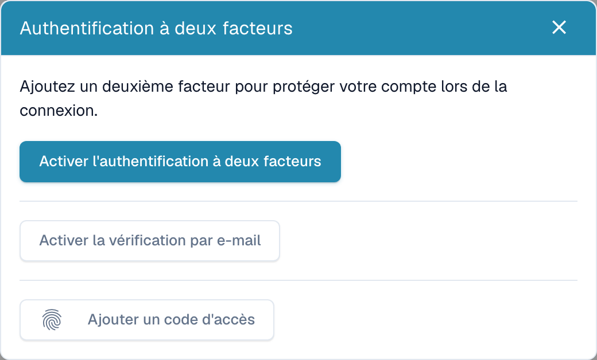
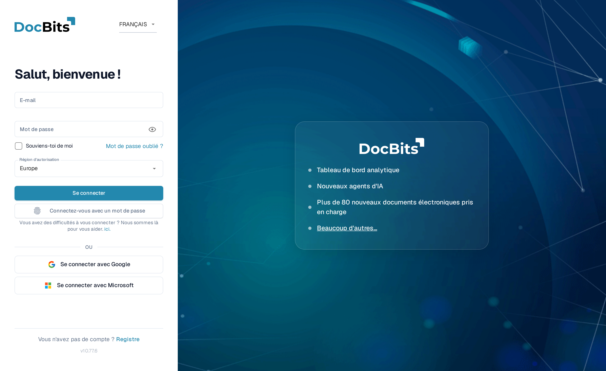

# Authentification à deux facteurs (2FA)

## Vue d'ensemble

L'authentification à deux facteurs (2FA) ajoute une deuxième étape à votre connexion. Après votre mot de passe, DocBits demande un second facteur que vous seul possédez — un code provenant d'une application d'authentification, un code envoyé par e-mail, ou une clé d'accès (Touch ID, Windows Hello, YubiKey, 1Password). Même si quelqu'un découvre votre mot de passe, il ne peut pas se connecter sans ce second facteur.

La 2FA est **facultative pour chaque utilisateur** et peut être **rendue obligatoire par l'administrateur de votre organisation**. Les connexions par authentification unique (SSO) (Google, Microsoft, SAML) sont exemptées — votre fournisseur d'identité applique déjà sa propre MFA.

Vous pouvez enregistrer plusieurs méthodes. Les méthodes prises en charge par DocBits sont les suivantes :

* **Application d'authentification (TOTP)** — Google Authenticator, Microsoft Authenticator, 1Password, Authy, etc.
* **Code par e-mail** — un code à 6 chiffres envoyé à l'adresse e-mail de votre compte.
* **Clé d'accès (WebAuthn/FIDO2)** — Touch ID, Windows Hello, une clé matérielle (YubiKey), ou un gestionnaire de mots de passe.

Lorsque vous activez votre premier facteur, DocBits vous fournit également **dix codes de secours** à utiliser si vous perdez un jour l'accès à votre méthode.

## Où la trouver

Ouvrez vos **paramètres de profil / de compte** (menu de compte en haut à droite → **Modifier le profil**) et sélectionnez **Authentification à deux facteurs**. La boîte de dialogue 2FA affiche votre état actuel et les méthodes que vous pouvez ajouter.

<figure><figcaption>
Méthodes d’authentification à deux facteurs disponibles.
</figcaption></figure>

## Configurer une application d'authentification (TOTP)

1. Dans la boîte de dialogue 2FA, cliquez sur **Activer la 2FA**.
2. Scannez le code QR avec votre application d'authentification (Google Authenticator, 1Password, Authy, …). Si vous ne pouvez pas scanner, utilisez la **clé manuelle** affichée sous le code QR.
3. Saisissez le code à 6 chiffres affiché par votre application et confirmez.
4. DocBits active la 2FA et affiche vos **codes de secours** (voir ci-dessous).

## Configurer la vérification par e-mail

1. Dans la boîte de dialogue 2FA, cliquez sur **Activer la vérification par e-mail**.
2. DocBits envoie un code à 6 chiffres à l'adresse de votre compte.
3. Saisissez le code pour confirmer. La vérification par e-mail est désormais activée.

## Ajouter une clé d'accès

1. Dans la boîte de dialogue 2FA, cliquez sur **Ajouter une clé d'accès**.
2. Votre navigateur ou votre appareil vous invite à confirmer avec Touch ID, Windows Hello, une clé matérielle, ou votre gestionnaire de mots de passe.
3. La clé d'accès est enregistrée. Vous pouvez ajouter plusieurs clés d'accès et les renommer ou les supprimer ultérieurement.

## Codes de secours

Lorsque vous activez votre **premier** facteur, DocBits affiche **dix codes de secours** — **une seule fois**. Chaque code ne fonctionne qu'une seule fois et vous permet de vous connecter si vous perdez votre application d'authentification ou votre téléphone.

* Conservez-les en lieu sûr (un gestionnaire de mots de passe est idéal).
* Vous pouvez générer un nouveau jeu à tout moment avec **Régénérer les codes de secours** (cela invalide l'ancien jeu).


Les codes de secours ne sont affichés qu'au moment où ils sont générés. DocBits ne peut pas les afficher à nouveau — conservez-les immédiatement.


## Se connecter avec la 2FA

1. Saisissez votre e-mail et votre mot de passe comme d'habitude.

    <figure><figcaption>
L'écran de connexion. Vous pouvez également vous connecter sans mot de passe en utilisant <strong>Se connecter avec une clé d'accès</strong>.
</figcaption></figure>
2. DocBits demande votre second facteur. Choisissez votre méthode :
   * **Application d'authentification** — saisissez le code à 6 chiffres actuel de votre application.
   * **E-mail** — cliquez sur **M'envoyer un code par e-mail** pour recevoir un code par e-mail, puis saisissez-le.
   * **Clé d'accès** — cliquez sur **Utiliser une clé d'accès** et confirmez avec Touch ID / Windows Hello / votre clé.
   * **Code de secours** — si vous ne pouvez pas utiliser votre méthode habituelle.

3. En cas de succès, vous êtes connecté.

### À quoi ressemble le code par e-mail

Si vous choisissez **E-mail**, DocBits envoie un message contenant un code à 6 chiffres qui expire au bout de 10 minutes :

## Faire confiance à cet appareil

Sur l'écran du second facteur, vous pouvez cocher **Se souvenir de cet appareil**. DocBits ignore alors l'étape 2FA sur cet appareil pendant **30 jours**. La confiance est automatiquement retirée lorsque vous changez votre mot de passe, et vous pouvez la révoquer vous-même à tout moment (voir ci-dessous).

## Gérer vos clés d'accès et vos appareils de confiance

Ouvrez la boîte de dialogue 2FA et cliquez sur **Gérer** pour examiner ce qui est enregistré.

* **Clés d'accès** — renommez une clé d'accès (cliquez sur son nom) ou supprimez-la. Supprimer votre dernier facteur restant désactive la 2FA.
* **Appareils de confiance** — révoquez un seul appareil, ou choisissez **Révoquer tous les appareils** pour forcer une nouvelle demande de 2FA partout.

## Désactiver la 2FA

Dans la boîte de dialogue 2FA, cliquez sur **Désactiver la 2FA** et confirmez avec un code d'authentification actuel ou un code de secours. Désactiver la 2FA efface également vos codes de secours et révoque vos appareils de confiance.


Si votre organisation **exige** la MFA, vous ne pouvez pas vous connecter avec un mot de passe tant qu'au moins un facteur n'est pas configuré. Demandez à votre administrateur si vous ne savez pas si la MFA est obligatoire pour votre organisation.


## Connexion sans mot de passe (facultatif)

Une fois que vous disposez d'une clé d'accès, vous pouvez vous connecter **sans saisir votre mot de passe** en utilisant **Se connecter avec une clé d'accès** sur l'écran de connexion. Votre mot de passe continue de fonctionner comme solution de repli. La connexion sans mot de passe nécessite que la clé d'accès vous vérifie (Touch ID / Windows Hello / code PIN), ce qui la rend à la fois plus rapide et résistante à l'hameçonnage.

Conservez les codes de secours dans un endroit sûr, séparé du dispositif d’authentification. Chaque code ne peut servir qu’une fois.

Configurez la vérification par courriel dans le dialogue d’authentification à deux facteurs. Saisissez le code reçu sur votre propre compte et effectuez la confirmation prévue.

Configurez une application d’authentification dans le dialogue des deux facteurs. Enregistrez le secret uniquement dans votre application approuvée et confirmez avec le code temporaire actuel.
