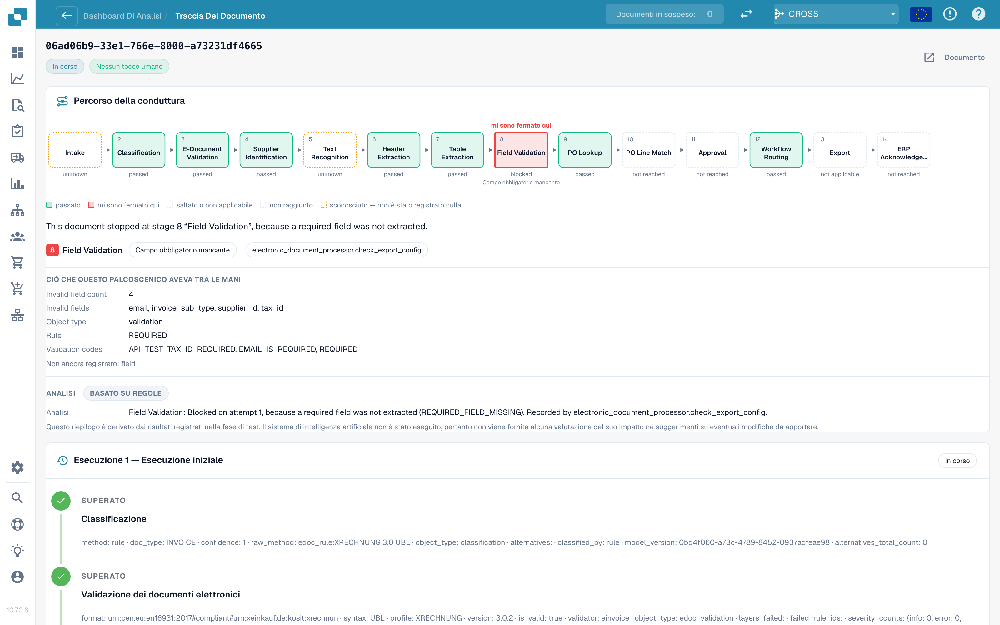

# Tracciamento del documento

Inserisci un ID documento in **ID documento** (Document ID), oppure apri un documento di esempio da un cluster, per vedere **cosa è successo a questo singolo documento**.

<figure><figcaption>
Il Tracciamento del documento: il percorso nella pipeline con la fase in cui il documento si è fermato, ciò che quella fase aveva a disposizione e la cronologia delle esecuzioni sotto.
</figcaption></figure>

In alto trovi il **percorso nella pipeline** con 14 fasi: Intake (Acquisizione), Classification (Classificazione), E-Document Validation (Convalida e-documento), Supplier Identification (Identificazione fornitore), Text Recognition (Riconoscimento del testo), Header Extraction (Estrazione dell'intestazione), Table Extraction (Estrazione delle tabelle), Field Validation (Convalida dei campi), PO Lookup (Ricerca ordine), PO Line Match (Abbinamento righe ordine), Approval (Approvazione), Workflow Routing (Instradamento del flusso di lavoro), Export (Esportazione), ERP Acknowledgement (Conferma ERP). Ogni riquadro ha uno stato:

| Stato                         | Significato                                  |
| ----------------------------- | -------------------------------------------- |
| **passed** (verde)            | La fase è andata a buon fine                 |
| **stopped here** (rosso)      | La fase ha bloccato il documento             |
| **skipped or not applicable** | La fase non si applica a questo documento    |
| **not reached**               | Il documento non è mai arrivato fin qui      |
| **unknown** (tratteggiato)    | Per questa fase non è stato registrato nulla |

Sotto il percorso, una frase indica la causa. Nello screenshot: _This document stopped at stage 8 "Field Validation", because a required field was not extracted._ Il blocco **What this stage had in its hands** (ciò che questa fase aveva a disposizione) elenca i fatti: **Invalid field count 5** e i campi (`delivery_date`, `email`, `invoice_sub_type`, `payment_terms`, `supplier_id`), la regola (**REQUIRED**) e i codici di convalida. Il blocco **Analysis** (Analisi) indica se è **Rule-based** (basata su regole) o scritta dall'IA.

La **cronologia delle esecuzioni** sotto elenca ogni esecuzione (**Run 1 · Initial run**, poi ogni riavvio) con ogni fase e i fatti registrati. Se il documento è stato corretto e riavviato, una nota ricorda che **resta contato come toccato**.

**Esempio.** I documenti di un fornitore si fermano tutti alla fase 8. Nel tracciamento vedi ogni volta gli stessi cinque campi non validi. Non è un problema di estrazione dei singoli documenti, ma un valore predefinito mancante nella configurazione dei campi: correggilo una volta e l'intero cluster diventa recuperabile.

## Pagine correlate

* [Touchless Intelligence](./)
* [Diagnosi del fornitore e cluster di problemi](touchless-supplier-diagnosis.md)
* [Diagnosi dell'abbinamento ordini](touchless-po-matching-diagnosis.md)
