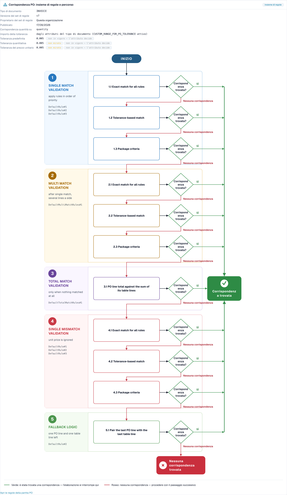

# Diagnosi dell'abbinamento ordini

## Panoramica

Molte fatture si fermano all'ordine d'acquisto. La fattura dice una cosa, l'ordine d'acquisto (PO) ne dice un'altra, e DocBits non può decidere da solo se appartengono insieme. Ogni documento di questo tipo richiede una persona, quindi **non è touchless**.

Touchless Intelligence ti mostra **perché** un abbinamento ordini è fallito e **come** DocBits ha provato ad abbinare. Questa pagina spiega le due fasi della pipeline coinvolte, i motivi che vedrai e il **flusso decisionale dell'abbinamento ordini** (PO matching decision flow), un diagramma che mostra i passi di abbinamento uno dopo l'altro.

### Dove vedi l'abbinamento ordini in Touchless Intelligence

| Dove                                                                                                                                   | Cosa vedi                                                                                                                                                                                                  |
| -------------------------------------------------------------------------------------------------------------------------------------- | ---------------------------------------------------------------------------------------------------------------------------------------------------------------------------------------------------------- |
| **Dove si perde il touchless per primo** (scheda panoramica)                                                                           | Una barra come _PO line match: PO item mismatch_. Ti dice quanti documenti si sono fermati lì                                                                                                              |
| **Opportunità fornitori**                                                                                                              | Un fornitore con la causa radice **Abbinamento ordini** (PO matching)                                                                                                                                      |
| **Diagnosi del fornitore**, sezione **How this organisation matches** (come abbina questa organizzazione) e il **cluster di problemi** | Il flusso decisionale con il set di regole della tua organizzazione                                                                                                                                        |
| **Tracciamento del documento**                                                                                                         | La fase **PO Line Match** con lo stato **blocked** e il motivo                                                                                                                                             |
| **Impostazioni → Tipi di documento → Altre impostazioni → Ordine d'acquisto**                                                          | Le regole di abbinamento vere e proprie. Vedi [Regole di abbinamento degli ordini d'acquisto](../../settings/global-settings/document-types/more-settings/purchase-order/purchase-order-matching-rules.md) |

## Le due fasi dell'ordine

| Fase                   | Domanda                                                     | Si ferma con                                                                                                          |
| ---------------------- | ----------------------------------------------------------- | --------------------------------------------------------------------------------------------------------------------- |
| **9 · PO Lookup**      | Esiste un ordine d'acquisto per questa fattura?             | _Purchase order not found_                                                                                            |
| **10 · PO Line Match** | Ogni riga della fattura corrisponde a una riga dell'ordine? | _PO item mismatch_, _PO line identifier mismatch_, _Unit price outside PO tolerance_, _Quantity outside PO tolerance_ |

Un documento che si ferma alla fase 9 o 10 compare nella coda dei fornitori con il primo blocco **Abbinamento ordini**.

## Motivi per cui un abbinamento ordini fallisce

| Motivo che vedi                     | Cosa significa                                                                                                                                                                                 | Causa tipica                                                                                                                       | Cosa cambiare                                                                                                                                                                                         |
| ----------------------------------- | ---------------------------------------------------------------------------------------------------------------------------------------------------------------------------------------------- | ---------------------------------------------------------------------------------------------------------------------------------- | ----------------------------------------------------------------------------------------------------------------------------------------------------------------------------------------------------- |
| **Purchase order not found**        | DocBits non ha trovato alcun ordine d'acquisto per il numero d'ordine sulla fattura                                                                                                            | Il numero d'ordine è letto in modo errato o manca; l'ordine non è ancora stato importato; l'ordine appartiene a un altro fornitore | Controlla l'estrazione del numero d'ordine per questo fornitore, l'importazione dei dati anagrafici degli ordini e il collegamento al fornitore                                                       |
| **PO item mismatch**                | Le righe della fattura non corrispondono alle righe dell'ordine                                                                                                                                | Il fornitore usa propri codici articolo; la descrizione è diversa; le righe sono state unite o divise                              | Controlla la mappatura dei codici articolo e le **priorità delle regole** nelle regole di abbinamento; aggiungi una regola per il modo in cui il fornitore identifica le righe                        |
| **PO line identifier mismatch**     | Il numero di riga o l'identificativo sulla fattura non corrisponde all'ordine                                                                                                                  | Il fornitore rinumera le righe                                                                                                     | Abbina per articolo e quantità invece che per numero di riga                                                                                                                                          |
| **Unit price outside PO tolerance** | Il prezzo differisce più della tolleranza consentita                                                                                                                                           | Una vera variazione di prezzo, una differenza di arrotondamento o un'unità di prezzo diversa                                       | Controlla la **tolleranza del prezzo unitario** (Unit price tolerance) nel set di regole; correggi l'ordine o chiedi al fornitore                                                                     |
| **Quantity outside PO tolerance**   | La quantità differisce più della tolleranza consentita                                                                                                                                         | Consegna parziale, consegna in eccesso                                                                                             | Controlla **Match quantity on** (confronta la quantità su) e la **tolleranza della quantità** (Quantity tolerance)                                                                                    |
| **PO matching service error**       | Il servizio di abbinamento non ha potuto rispondere                                                                                                                                            | Un problema tecnico temporaneo                                                                                                     | Riavvia i documenti; contatta il supporto se si ripete                                                                                                                                                |
| **Automatic PO export disabled**    | L'impostazione **Esporta automaticamente se l'abbinamento ordini è al 100%** (Auto export if PO matched 100%) è disattivata, quindi i documenti abbinati non vengono esportati automaticamente | L'impostazione è disattivata                                                                                                       | Attiva l'impostazione se vuoi l'esportazione automatica. Vedi [Esportazione automatica se l'abbinamento ordini è al 100%](../../settings/document-processing/module/auto-export-if-po-matched-100.md) |


Non tutti i motivi di abbinamento ordini possono essere risolti in DocBits. Se il fornitore invia un numero d'ordine sbagliato, la scheda indica **Supplier action only**: il fornitore deve correggere il documento e inviarlo di nuovo.


## Il flusso decisionale dell'abbinamento ordini

Il flusso decisionale mostra come DocBits cerca di abbinare una riga di fattura a una riga d'ordine. Ha **cinque fasi** e vince la prima corrispondenza:

1. **Single match validation**: applica le regole in ordine di priorità. È il caso normale, una riga di fattura e una riga d'ordine
2. **Multi match validation**: dopo una corrispondenza singola, quando su un lato sono coinvolte più righe
3. **Total match validation**: solo quando non è stato abbinato nulla. Il totale della riga d'ordine viene confrontato con la somma delle sue righe di tabella
4. **Single mismatch validation**: il prezzo unitario viene ignorato, quindi una riga può essere abbinata per articolo e quantità anche se il prezzo differisce
5. **Fallback logic**: restano una riga d'ordine e una riga di tabella, quindi vengono accoppiate

All'interno delle fasi DocBits prova, in quest'ordine:

* **Exact match for all rules**: ogni valore confrontato è identico
* **Tolerance-based match**: i valori numerici possono scostarsi entro la tolleranza
* **Package criteria**: l'ultimo passaggio, basato sui criteri relativi alla confezione del set di regole

Ogni passo chiede **Match found?** (Corrispondenza trovata?) La risposta **Yes** (verde) porta a **Match found** e il documento prosegue. La risposta **No match** (rosso) passa al passo successivo e, dopo l'ultimo passo, il risultato è **No match found**: il documento si ferma e richiede una persona.

<figure><figcaption>
Il flusso decisionale dell'abbinamento ordini, aperto da <strong>How this organisation matches</strong> nella pagina Diagnosi del fornitore. L'intestazione mostra il set di regole (versione 7, di proprietà di questa organizzazione) e le tolleranze. Sotto, le cinque fasi con i loro passaggi vanno dall'alto verso il basso. Il verde porta a <strong>Match found</strong>, il rosso passa al passo successivo e termina in <strong>No match found</strong>. Organizzazione di esempio con dati demo.
</figcaption></figure>

### Cosa ti dice l'intestazione del diagramma

| Campo                                               | Significato                                                                                          |
| --------------------------------------------------- | ---------------------------------------------------------------------------------------------------- |
| **Tipo di documento** (Document type)               | Il tipo di documento a cui appartiene il set di regole, ad esempio INVOICE                           |
| **Versione del set di regole** (Rule set version)   | La versione delle regole di abbinamento, ad esempio v3                                               |
| **Proprietario del set di regole** (Rule set owner) | **This organisation** (le tue regole) o **Shipped default rule set** (le regole standard di DocBits) |
| **Pubblicato** (Published)                          | Quando la versione è stata pubblicata                                                                |
| **Match quantity on**                               | Quale quantità viene confrontata (quantità ordinata, quantità aperta)                                |
| **Tolerance amount**                                | Se le tolleranze provengono dagli attributi del tipo di documento o dal set di regole                |
| **Unit price tolerance** / **Quantity tolerance**   | Di quanto possono scostarsi un prezzo o una quantità                                                 |
| **Default tolerance**                               | La tolleranza per tutti gli altri valori numerici                                                    |

Nell'esempio sopra, le tolleranze mostrano **not configured** e **not in force: attribute decides**. Significa: il set di regole stesso non ha una tolleranza propria, e la riga **Tolerance amount** dice che le tolleranze provengono dagli **attributi del tipo di documento**. Una tolleranza decide solo quando è in vigore. Leggi questa riga per prima quando una differenza di prezzo o quantità blocca dei documenti: ti dice **dove** cambiare la tolleranza.

Lo stato del set di regole è mostrato come nota: **Active version** (queste regole decidono), **Approved, not active**, **Draft, not yet in force** o **Version state unknown**. Solo la versione attiva decide.

Se regole di trasformazione hanno modificato un documento prima dell'abbinamento, il diagramma lo indica, ad esempio _2 applied: (names)_ o _"(rule)" rebuilt (table): the PO match was lost here_. È una causa nascosta frequente: una regola che riformatta una tabella può rompere un abbinamento che prima funzionava.

## Esempi

I numeri negli esempi sono illustrativi.

### Esempio 1: prezzo entro la tolleranza

Una riga di fattura ha un prezzo unitario di **10,40**. La riga d'ordine dice **10,00**. La tolleranza del prezzo unitario è **5 %**.

* **Exact match** fallisce (10,40 non è 10,00).
* **Tolerance-based match** riesce: la differenza è **4 %**, entro il 5 %.
* La riga è abbinata. **Match found.**

Con una tolleranza del **3 %** anche il tolerance-based match fallisce. Dopo tutte le fasi il documento si ferma con **Unit price outside PO tolerance**. Il diagramma mostra esattamente questo percorso, e la soluzione è o la tolleranza (se il 4 % è accettabile per la tua attività) o una correzione presso il fornitore.

### Esempio 2: i codici articolo del fornitore sono diversi dai tuoi

Un fornitore fattura l'articolo **"A-4711-X"**, il tuo ordine dice **"4711"**. Nessuna regola confronta i due, quindi non viene trovata alcuna corrispondenza, e Touchless Intelligence raggruppa tutte le fatture di questo fornitore in un cluster: **PO line match, PO item mismatch**, 27 documenti.

* Nel cluster leggi _27 affected, 27 recoverable_, incremento atteso ad esempio **+8,7 pp**.
* La correzione è dalla tua parte: aggiungi o riordina una regola che abbini sul codice articolo del fornitore o sulla descrizione, oppure mantieni i codici articolo del fornitore nei dati anagrafici.
* Dopo aver cambiato la regola, applica la modifica con una [proposta di modifica](touchless-change-proposals.md) e leggi la **Cronologia delle modifiche** due settimane dopo: tasso puro prima e dopo.

### Esempio 3: l'ordine d'acquisto non c'è ancora

Le fatture arrivano prima che l'ordine sia stato importato. Si fermano a **PO Lookup** con **Purchase order not found**. Il cluster mostra un breve picco. La soluzione è l'ordine dei tuoi processi, o la pianificazione dell'importazione degli ordini, non le regole di abbinamento. Controlla **Dove si perde il touchless per primo**: una barra _PO lookup: Purchase order not found_ che cresce dopo ogni interruzione dell'importazione indica questa causa.

### Esempio 4: una regola ha ricostruito la tabella

Dopo l'attivazione di una regola di trasformazione per la tabella di un fornitore, il tasso di abbinamento di questo fornitore è calato bruscamente. Il diagramma di un documento interessato dice _"(rule)" rebuilt (table): the PO match was lost here_. La soluzione è modificare o annullare la regola di trasformazione, non le regole di abbinamento.

## Una routine per i problemi di abbinamento ordini

1. Apri **Dove si perde il touchless per primo**. Una fase di abbinamento ordini è tra le prime tre?
2. Apri **Opportunità fornitori** e ordina per **Incremento atteso**. Prendi il fornitore con la causa radice **Abbinamento ordini** e lo stato **RECOVERABLE**.
3. Apri la **Diagnosi del fornitore** e leggi il cluster: motivo, documenti interessati, **Cosa cambiare**, **Prove mancanti**.
4. Apri **How this organisation matches** e controlla il set di regole: versione, proprietario e tolleranze.
5. Apri un **documento di esempio** e il suo [Tracciamento del documento](touchless-document-trace.md): quale fase, quale motivo?
6. Cambia **una** cosa (ordine delle regole, tolleranza, mappatura degli articoli) con un'anteprima, così la **Cronologia delle modifiche** può misurarla.

## Pagine correlate

* [Touchless Intelligence](./)
* [Diagnosi del fornitore e cluster di problemi](touchless-supplier-diagnosis.md)
* [Tracciamento del documento](touchless-document-trace.md)
* [Proposte di modifica e report](touchless-change-proposals.md)
* [Regole di abbinamento degli ordini d'acquisto](../../settings/global-settings/document-types/more-settings/purchase-order/purchase-order-matching-rules.md)
* PO Matching Cards: guida completa
